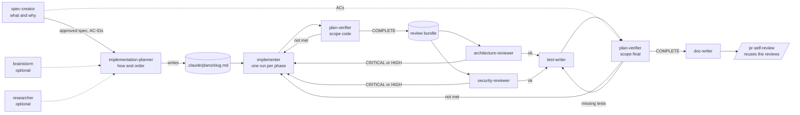

# Agents

Project subagents for dev-digest. Each file in this folder is one agent; the file itself is the
source of truth for its rules. This README is a guide to the set.

## Overview

| Agent | Role | Model | Tools | Writes files |
|---|---|---|---|---|
| [`spec-creator`](spec-creator.md) | What and why: asks six categories of questions, writes an EARS spec, marks unknowns `[NEEDS CLARIFICATION]` | `opus` | `Read, Grep, Glob, Write, Edit, Agent(researcher, Explore)`, read-only `mcp__devdigest__*` | Yes (one spec file in a `specs/` folder, hook-enforced) |
| [`researcher`](researcher.md) | Finds facts in the repo or on the web | `sonnet` | `Read, Grep, Glob, WebSearch, WebFetch` | No |
| [`brainstorm`](brainstorm.md) | Explores 2-4 options with trade-offs before planning | `sonnet` | `Read, Grep, Glob` | No |
| [`implementation-planner`](implementation-planner.md) | How and in what order: checks spec readiness, asks implementation questions and execution mode, returns a plan whose every step cites AC-IDs (no spec work, no requirement clarification) | `opus` | `Read, Grep, Glob, Write, Edit` | Yes (its plan file in `.claude/plans/` only, hook-enforced) |
| [`implementer`](implementer.md) | Executes a plan on server and client, keeps existing tests green | `sonnet` | `Read, Grep, Glob, Edit, Write, Bash` | Yes (production code; no new tests, hook-enforced) |
| [`test-writer`](test-writer.md) | Writes and runs the plan's tests for client and server | `sonnet` | `Read, Grep, Glob, Edit, Write, Bash` | Yes (test files only, hook-enforced) |
| [`architecture-reviewer`](architecture-reviewer.md) | Checks architectural boundaries, reports findings with evidence | `sonnet` | `Read, Grep, Glob` | No |
| [`security-reviewer`](security-reviewer.md) | Looks for vulnerabilities in the change (OWASP), separate from architecture | `sonnet` | `Read, Grep, Glob` | No |
| [`plan-verifier`](plan-verifier.md) | Final gate: verifies the code against every plan item and every spec AC with evidence | `sonnet` | `Read, Grep, Glob, Bash` | No (Bash allowlist hook) |
| [`doc-writer`](doc-writer.md) | Documents implemented features with diagrams in `docs/`; marks the shipped spec `implemented` | `sonnet` | `Read, Grep, Glob, Edit, Write` | Yes (`docs/` and `specs/` only, hook-enforced) |

Subagents cannot spawn further subagents, so the orchestrator (main session or you) drives every hand-off. The one exception is `spec-creator`: it lists `Agent(researcher, Explore)` and launches parallel `researcher` and `Explore` agents when it runs as the main session (`claude --agent spec-creator`); as a subagent it returns "Research requests" for the orchestrator to run instead.

## Typical flow

`spec-creator` and `implementation-planner` are run by hand. From an approved plan on, [`/run-plan <slug>`](../skills/run-plan/SKILL.md) runs steps 4-11 below: one implementer run per phase, `plan-verifier` (scope `code`), the review bundle, both reviewers in parallel with a fix loop of at most 3 rounds ([`review-loop.md`](../skills/run-plan/references/review-loop.md)), a re-check of the items the fixes touched, `doc-writer`, `/engineering-insights` and `/pr-self-review`. In the fix loop, CRITICAL and HIGH findings are always fixed, the user decides on each MEDIUM finding every round, and LOW findings are only logged; rounds after the first re-review only the touched files and the open findings. `test-writer` is off by default to save tokens (`--with-tests` turns it and `plan-verifier` scope `final` back on). Run state is kept in `.claude/plans/<slug>/`, so a run can be resumed.

0. For a new feature or behaviour change, `spec-creator` first returns a Questions Report sorted into six categories (C1 scope, C2 users and UX, C3 data and contracts, C4 integrations, C5 edge cases, C6 non-functional and security), then writes one spec (`<pkg>/specs/` or root `specs/`). Unknowns stay in the spec as `[NEEDS CLARIFICATION]` markers. The orchestrator adds the README index line from the Spec Report, and the user moves the spec to `approved` once no marker is left. The spec path is the implementation-planner's input.
0. Optionally ask `brainstorm` for options when the approach is not obvious. Its recommendation feeds `implementation-planner`.
1. Optionally ask `researcher` for facts the plan depends on.
2. `implementation-planner` first returns an Intake Report (spec readiness, spec gaps routed back to `spec-creator`, implementation questions, recommendations, multi-agent or single-agent?). The orchestrator asks the user and calls it again. In `single-agent` mode steps 4-8 collapse into one pass by the main session (`implementer` does not write new tests, so it cannot be the single agent).
3. The implementation-planner writes the plan itself to `.claude/plans/<task-slug>.md` (its hook allows only that path) and returns a short summary: ACs planned, phases, open questions. Each step carries a **Context** line (anchors, signatures, a pattern file), and §8 splits the steps into phases of one package or layer each. The folder is git-ignored.
4. `implementer` runs once per phase, each run with a fresh context and the plan path plus the phase number. It verifies with `.claude/scripts/check-changed.sh` and returns an Implementation Report.
5. `plan-verifier` with scope `code` checks every step and the code side of every AC before anyone reviews. Missing functionality goes back to `implementer` while it is cheap; reviewing incomplete code is wasted.
6. The orchestrator builds the review bundle: `PR_SELF_REVIEW_BASE=<base_sha> node .claude/skills/pr-self-review/scripts/bundle.mjs write` (`base_sha` from the run state) (summary, per-package patches, routed skills, mechanical gates including the onion gate).
7. `architecture-reviewer` and `security-reviewer` read the bundle, in parallel. Their fixes are made before tests are written, so moved files do not break new tests. The orchestrator saves their "Findings JSON" blocks as a JSON array in `.devdigest/cache/review-bundle/reviews.json`.
8. `test-writer` writes the plan's test items against the reviewed code and returns a Test Report.
9. `plan-verifier` with scope `final` re-checks the test items, the ACs' test evidence and the items whose files changed after step 5, and returns a Plan Verification Report. Not-met items go back to `implementer` or `test-writer`; nothing goes to `doc-writer` before the verdict is COMPLETE.
10. `doc-writer` documents the verified feature under `docs/` or `<pkg>/docs/`, and sets the matching spec's `Status` to `implemented`. `/pr-self-review` is still run separately; it reuses the reviewers' findings for files that did not change since the bundle (`bundle.mjs reuse`) and reviews only the other skills and the changed files.
11. After the work is verified and reviewed, delete the plan file. Durable findings go to `<pkg>/INSIGHTS.md` through `/engineering-insights`.

## Token-efficient hand-offs

Observed on the Intent Layer run: about 750k subagent tokens, most of it re-reading the same files and long reports.
These rules cut that without dropping any validation step. Savings are estimates, not measurements.

- **Pass paths, not text.** Hand the plan over as `.claude/plans/<slug>.md`. Agents read only the sections they need.
- **Give reviewers the bundle.** Before `architecture-reviewer`, `security-reviewer` and `plan-verifier`, run `node .claude/skills/pr-self-review/scripts/bundle.mjs write` and pass `.devdigest/cache/review-bundle/summary.md`. Without it a reviewer rebuilds the diff file by file: one architecture review took 105 turns and about 6.7M cumulative input tokens that way.
- **One implementer run per phase.** Cost grows with turns × context, and each turn re-sends the whole context. One implementer that did server, client and mcp in one run reached 81 turns, a 160k context and about 7.8M cumulative input tokens; test and typecheck output was only about 25 KB of that. Fresh runs per phase keep the context small. The implementation-planner's **Context** lines stop the implementer re-reading `AGENTS.md`, `INSIGHTS.md` and the skills.
- **One check script.** `.claude/scripts/check-changed.sh <pkg>... [--full] [--it]` runs typecheck, `vitest related` on the changed files (dot reporter, `DEBUG_PRINT_LIMIT=1500`) and the onion gate, and prints one line per gate plus the tail of a failure. The implementer, `test-writer` and `plan-verifier` all use it.
- **Short reports in chat, full tables in a file.** Ask reviewers to return only findings, partial / not-met / unverifiable items and the commands run, each with `path:line`. A line such as "met: N items" replaces the passing rows. The full matrix goes to a file in the scratchpad.
- **Do not re-run what already passed.** `plan-verifier` with scope `final` gets the scope `code` report and re-checks only the test items, the ACs' test evidence and the items whose files changed since then. It runs `check-changed.sh --full` once instead of the §5 commands one by one.
- **Read shared context once.** `researcher` and `implementation-planner` both read INSIGHTS, `prompt.ts`, `run-executor.ts` and the contracts. Use `researcher` for external or web questions only; the implementation-planner reads the repo itself.
- **Pick the model by the step.** Keep `opus` only where a wrong call is expensive and hard to catch later: `spec-creator` (requirements) and `implementation-planner` (sequencing and layering). `architecture-reviewer` moved to `sonnet` to cut cost: it works from the bundle, the onion gate and the two architecture skills' checklists, and the plan already fixed the layering. Use `sonnet` for everything else: `brainstorm` (options are reviewed by the user and the planner), `security-reviewer` (works from the OWASP checklist in the `security` skill), the implementer, the writers and `plan-verifier`, whose job is mechanical: match plan items and ACs to evidence. If a `sonnet` agent misses things on a run, raise it back to `opus` for that run with `model: "opus"` on the Agent call rather than changing the default. For mechanical edits (dead-code removal, moving a constant, INSIGHTS appends) pass `model: "haiku"` on the Agent call, or make the edit in the main session.
- **Skip the agent for small fixes.** A review round that finds one-line issues is cheaper to fix in the main session than through a new `implementer` run. Re-run a reviewer only on the files the fix touched.
- **First runs: limit, do not switch off.** Check the usage dashboard before a long run; limits depend on the plan and the model, so there is no fixed number here. On the first runs of the pipeline, run e2e only for the flows the spec's ACs name (not the full `./scripts/e2e.sh`), and run one agent at a time: no parallel reviewers, and `spec-creator` runs its `researcher` / `Explore` questions one after another instead of in parallel. Keep the hermetic tests, typechecks, the onion gate and `plan-verifier`: without them you cannot see whether the pipeline itself works.
- **Keep validation.** Per-item plan evidence, the independent onion gate and the separate architecture review each caught a real defect (label/id mismatch, raw error text in the Live Log, a new `container` access), so they stay.

## spec-creator

- **Responsibility:** turn a feature and the user's design sources (text, Figma export or screenshots, existing code, a repo) into a spec for Spec Driven Development. Analyses the design for gaps, uncovered edge cases, cross-module communication, untrusted inputs and UX improvements, and returns them as questions and `PROPOSED` items. Spec holds the what and why: workflow and communication diagrams and contract shapes are allowed, implementation details are not. Reads `INSIGHTS.md` only for the modules the feature touches (root `INSIGHTS.md` only when two or more are touched). Reads `engineering-insights` (recall phase only, to mine recorded traps for edge cases), `security`, `zod`, `react-best-practices` (accessibility) and `mermaid-diagram` only for requirements, never for implementation choices.
- **Research:** splits wide fact-finding into 2-4 independent questions for parallel `researcher` agents, and uses `Explore` for quick sweeps of files and conventions; launches them itself as the main session, or returns them as "Research requests" when it runs as a subagent.
- **Dialogue:** a Questions Report first (no file written). Every question and proposal is tagged with one of six categories: C1 scope and goals, C2 users and UX flow, C3 data and contracts, C4 integrations and cross-module communication, C5 edge cases and failure handling, C6 non-functional, security and constraints. A category with nothing to ask is stated as "None — why settled". Writes the draft only after the blocking answers. Revises its own draft on request: same file and Spec ID, stable item IDs, a `Changelog` line.
- **Fixed invariants:** a spec may rely on `groundFindings()` (grounding gate) and `wrapUntrusted()` (untrusted text in prompts) in `reviewer-core`, but never redefines them; a feature that needs a change to one is a blocking question.
- **Observable ACs:** every AC carries `_(observable: ...)_`, which the test-writer asserts and `plan-verifier` checks.
- **No guessing:** an unknown value or behaviour is written in place as `[NEEDS CLARIFICATION: <question>]` with an "Open questions" entry. A spec with a marker left stays `draft`, and the implementation-planner does not plan the ACs it touches.
- **System state:** reads live state through the devdigest MCP server with read-only tools only (`list_agents`, `get_conventions`, `get_blast_radius`, `get_findings`); `run_agent_on_pr` is left out because it starts a paid review run.
- **Permissions:** `Read, Grep, Glob, Write, Edit, Agent(researcher, Explore)` plus the four MCP tools. Owns spec content; `doc-writer` only sets `Status: implemented`. [`spec-creator-path-guard.sh`](../hooks/spec-creator-path-guard.sh) allows Write/Edit only on `*.md` files directly inside root `specs/`, `server/specs/`, `client/specs/`, `reviewer-core/specs/` or `mcp/specs/`. It denies `e2e/specs/`, spec-folder READMEs and everything else. The README index line and a superseded spec's `Status` line come back in the Spec Report for the orchestrator to apply.
- **Output:** a spec file `YYYY-MM-DD-<feature-slug>.md` with `Spec ID: SPEC-NN` (one global sequence), `Status: draft`, EARS acceptance criteria, all in English (WHEN / WHILE / IF … THEN / WHERE + `(shall)`), measurable NFRs, a Traceability table (AC → story → goal → covered edge cases / NFRs → verify lane from `TESTING.md`), Decisions and a Changelog, at most about 15 ACs; plus a Spec Report (files, summary, decisions, open questions, final self-check, not verified, hand-off to implementation-planner). The template, EARS rules, NFR categories, revisions and self-check live in the [`spec-writing`](../skills/spec-writing/SKILL.md) skill; the agent file holds only its workflow. UI gaps and accessibility come from [`ux-review`](../skills/ux-review/SKILL.md).

## researcher

- **Responsibility:** read-only research. Repository questions (cited as `path:line`) or external questions (docs, web). Asks clarifying questions first when the task is vague.
- **Permissions:** no Write, Edit or Bash. Does not use skills or slash commands.
- **Input:** a concrete question, scope (package or sources) and desired depth.
- **Output:** a structured report: Question, Conclusions (with confidence), Evidence, References or Sources, Not found / unverified, Open questions. Two templates, one for repository and one for external research.

## brainstorm

- **Responsibility:** explore the options before planning. Returns 2-4 distinct approaches grounded in the repo (`path:line`), with trade-offs, one recommendation and open questions. Does not write steps or file lists; that is `implementation-planner`.
- **Permissions:** read-only (`Read, Grep, Glob`).
- **Input:** a goal and scope. Stops and asks when the goal is vague. **Output:** Options Report (goal and constraints, options, recommendation, open questions, not verified, hand-off to implementation-planner).

## implementation-planner

- **Responsibility:** answer *how* and *in what order*, never *what* or *why*. Checks that the spec is ready (status `approved`, EARS ACs with IDs and verify lanes, no `[NEEDS CLARIFICATION]` blocking an AC, no conflict with code or rules). Requirement gaps are routed back to `spec-creator`, never clarified with the user here. Asks only implementation questions and gives concrete recommendations about the approach. Then plans steps that respect the project modules, available skills, `INSIGHTS.md` entries and architecture constraints. Reading the routed skills is mandatory before it writes the plan (always `onion-architecture` for server work and `frontend-ui-architecture` for client work), and each plan step cites the skill rules that shaped it. Does not plan review work.
- **No spec work:** never writes, edits, extends or re-statuses a spec and never drafts acceptance criteria. A spec from `spec-creator` is read-only input; gaps in it are routed back to `spec-creator`. A new feature or behaviour change without a spec is sent to `spec-creator`; a plain task description is accepted only for fixes, refactors and tooling.
- **AC traceability:** every step in §4 has a required `Covers:` line with the AC-IDs it implements (or names the step it is a prerequisite of). §1 maps every ready AC to steps and a test, and §5 tags each test with the ACs it covers.
- **Execution mode:** always asks (unless the input already states the user's choice) whether to run `multi-agent` (full pipeline above) or `single-agent` (one pass by the main session that writes code and tests), with its recommendation. The plan's section 8 describes the hand-offs for the chosen mode.
- **Permissions:** `Read, Grep, Glob, Write, Edit`; [`planner-path-guard.sh`](../hooks/planner-path-guard.sh) allows Write/Edit only on `.claude/plans/<slug>.md`. No Bash, web or `Agent`. It cannot ask the user directly: the orchestrator relays its questions (for example with `AskUserQuestion`) and calls it again with the answers.
- **Input:** a spec path or a task description, plus answers to earlier questions and the chosen mode. It reads, in order, the spec, root and package `AGENTS.md`, `<pkg>/INSIGHTS.md`, `<pkg>/docs/`, the "Agent routing" section of [`../skills/README.md`](../skills/README.md) with the routed `SKILL.md` files, then the code.
- **Output:** either an Intake Report (spec readiness, spec gaps for `spec-creator`, implementation questions, recommendations, execution-mode question) when anything blocking is open, or an Implementation Plan written to `.claude/plans/<slug>.md`: Spec readiness (§0), Goal and scope, Applicable constraints, Skill assignments, Steps (each with Covers, Files, Context, Done when, Phase), Test plan, Risks and open questions, Not verified, Execution mode and phases (§8). It returns only a short summary in chat. Sections 1-7 keep their numbers, so `§5` still means the test plan.

## implementer

- **Responsibility:** execute one phase of the plan on backend or frontend, keep the existing tests green, and verify only its own changes with `check-changed.sh`. Priorities, in order: write the code, keep the tests working, spend few turns. New tests, architecture and security review, `next build`, full-repo e2e and `/pr-self-review` are out of its scope.
- **Permissions:**
  - Edits files and runs Bash, no web and no `Agent`.
  - Does not commit, push or open PRs.
  - Two frontmatter hooks: the Bash guard (see below) and [`implementer-path-guard.sh`](../hooks/implementer-path-guard.sh), which denies new test files, `server/clones/**`, `*/src/vendor/**` (except the paired `shared` contracts), migrations, lockfiles, specs and `.claude/plans/**`. Editing an existing test that the change broke is allowed.
- **Skills:** the plan's §3 quotes the rules per step and each step's Context line gives the anchors, so the implementer does not re-read `AGENTS.md`, `INSIGHTS.md` or the skills. It reads a `SKILL.md` section only when §3 is not enough or it touches an area the plan did not route, and lists that in the report. Not for this agent: `pr-self-review`, `mermaid-diagram`.
- **Input:** an approved plan from `.claude/plans/` (read only) and the phase to run. Without a plan it stops and asks.
- **Output:** a short Implementation Report: Steps with status and `path:line`, skills read beyond the plan, Deviations, Verification (the `check-changed.sh` lines), Not run / unverified, Hand-off (changed files, contracts and migrations touched, existing tests updated, suggested INSIGHTS entries).

## test-writer

- **Responsibility:** write and run the plan's test items (section 5), choosing the lane per behaviour (client RTL, server hermetic, `*.it.test.ts`). Applies `react-testing-library` and the `onion-architecture` testing reference; records repo overrides (no MSW, so `vi.mock` of hooks). Never edits production code; a needed source change is reported as a blocker.
- **Permissions:** edits files and runs Bash. The implementer Bash guard and [`test-writer-path-guard.sh`](../hooks/test-writer-path-guard.sh) apply; the path guard allows only `server/test/**`, `client/src/test/**`, `*.test.ts(x)` under `client/src`, `reviewer-core` tests and `e2e/specs/*.flow.json`.
- **Input:** a plan path or an explicit list of behaviours. **Output:** Test Report (coverage map with "what would make it fail", skills applied, deviations, verification, not covered, hand-off).

## architecture-reviewer

- **Responsibility:** verify onion layering, client placement, vendored `shared` drift, `reviewer-core` purity and migrations on changed lines only. Every finding carries `path:line`, the rule and quoted evidence.
- **Permissions:** read-only (`Read, Grep, Glob`). It cannot run `git` or depcruise, so it reads the review bundle (`summary.md` with the onion gate result, then `diff/<pkg>.patch`). Without a bundle the orchestrator pastes the changed-file list, the diff and the `check.sh` output; without the gate output it reports "gate not run".
- **Output:** Architecture Review Report (verdict, findings table with confidence, gate results, checked-and-clean per area, not verified, hand-off, Findings JSON for `/pr-self-review`). Security review and plan conformance are out of scope.

## security-reviewer

- **Responsibility:** vulnerability review of changed lines: untrusted PR/issue text, path traversal, SSRF, secret leaks into logs or the Live Log, injection, validation and workspace scoping, client XSS, dependencies. Every finding has an attack scenario and `path:line`. Architecture is out of scope.
- **Permissions:** read-only (`Read, Grep, Glob`). Reads the review bundle; without it the orchestrator supplies the changed-file list and diff.
- **Output:** Security Review Report (verdict, findings table with OWASP class, checked and clean, not verified, hand-off, Findings JSON for `/pr-self-review`).

## plan-verifier

- **Responsibility:** read-only plan conformance in two scopes: `code` right after the implementer (steps and the code side of every AC; test items are "not in scope"), and `final` as the last gate after reviews and tests (test items, the ACs' test evidence, and items whose files changed since the `code` run). Explode the plan into numbered items, add one item per spec AC, and give each a status (met, partial, not met, unverifiable) with `path:line` or command evidence. An AC with no covering step or test is "not met (untraced)"; an AC blocked by `[NEEDS CLARIFICATION]` is never "met". It never substitutes verification with general advice, and "the implementer said so" is not evidence.
- **Permissions:** Read, Grep, Glob and Bash behind [`readonly-bash-guard.sh`](../hooks/readonly-bash-guard.sh): single commands only (no chaining, pipes or redirects outside quotes, so a quoted jq filter or `git grep -e 'a|b'` is fine), limited to `check-changed.sh`, `*/node_modules/.bin/vitest run|related` and `tsc --noEmit`, `npm [--prefix <dir>] test | run typecheck`, read-only `git` (also `-C <dir>` and `git grep`), the onion `check.sh`, `cd`, `ls`, `cat`, `wc`, `jq`, `head`, `tail`. Earlier versions denied `git -C`, `cd` and quoted pipes, which cost 5-15 turns per run on denied commands.
- **Output:** Plan Verification Report (scope, verdict with counts, only the not-met item rows, AC table, unplanned changes, commands run, not verified, hand-off).

## doc-writer

- **Responsibility:** document what is implemented (verified in code), convert plans and reports into docs with Mermaid diagrams, and place them: `docs/` for cross-cutting, `<pkg>/docs/` for package deep-dives. In `specs/` it only sets a shipped spec's `Status` to `implemented`; spec content belongs to `spec-creator`. Prefers extending an existing doc and indexing new files in the folder's README.
- **Permissions:** Read, Grep, Glob, Edit, Write; [`doc-writer-path-guard.sh`](../hooks/doc-writer-path-guard.sh) allows only `docs/` and `specs/` folders. It never edits `AGENTS.md`, `CLAUDE.md`, `INSIGHTS.md`, `README.md` or code.
- **Output:** Documentation Report (files, placement rationale, diagrams, source facts, gaps, hand-off).

### Bash guard

[`../hooks/implementer-bash-guard.sh`](../hooks/implementer-bash-guard.sh) runs before every Bash call of the implementer and the test-writer only. It does not affect the main session.

| Decision | Commands |
|---|---|
| deny | `git commit`, `git push`, `docker compose down -v`, `rm -rf`, `pnpm` / `corepack` |
| deny | file writes through the shell: a redirect into a source file (`cat > x.ts`, heredocs), `sed -i`, `perl -i`, `tee`, python/node scripts that write files. Edits go through Edit/Write, where the path guards apply |
| deny | `next build` (the orchestrator runs it once at the final gate) |
| ask | `npm install` and similar in `server/` or `client/`, or at the repo root or an unknown directory |
| allow | `npm ci` / `npm install` in `reviewer-core/` or `e2e/` |
| no decision | everything else (normal permission flow) |

It matches command text, so a script that runs a denied command internally is not caught.

## Orchestration rules

Advisory (the orchestrating session follows them; no hook can enforce them):

- **One question call per handback.** When an agent hands back several questions, ask them in one `AskUserQuestion` call (up to 4 questions), not one call each.
- **Downscale design images before a spec run.** Pass `spec-creator` copies made with `sips -Z 1400` in the scratchpad, not 400 KB+ originals.
- **Dependent stages run one after another.** `implementation-planner` → `implementer` (per phase) → `plan-verifier` (code) → reviewers → `test-writer` → `plan-verifier` (final) → `doc-writer` each need the previous output. Starting them together only makes them wait on each other.
- **One writer at a time per working tree.** `implementer`, `test-writer` and `doc-writer` never run concurrently on the same checkout. Concurrent writers need `isolation: "worktree"`.
- **Parallel only for independent read-only work.** `architecture-reviewer` and `security-reviewer` look at the same finished change without touching it, so they may run together. `test-writer` and the final `plan-verifier` wait for both and their fixes. Several `researcher`s on disjoint questions likewise.
- **No agent team for a single file or a linear plan.** Do it in the main session or with one agent.
- **Enforced, not advisory:** write access is limited by `tools:` plus the path and Bash guard hooks above, never by a sentence in a prompt.

## Sources behind the rules

Fetched 2026-10-04. The 1,536-character, 500-line and 15,000-token limits came through a summarizing fetch tool and were not spot-checked.

| Source | Rule | Where it applies |
|---|---|---|
| [Sub-agents docs](https://code.claude.com/docs/en/sub-agents) | An agent is one markdown file; `name` and `description` required; `description` drives delegation | Frontmatter of all agents |
| Sub-agents docs | `tools` is an allowlist; omit `Agent` to prevent spawning | Tool lists of both agents |
| Sub-agents docs | `skills:` preloads full skill content at startup; not used here, to save context (about 30k tokens for all 12) | Skills are read on demand instead |
| Sub-agents docs | Hooks can be defined in agent frontmatter (`PreToolUse`, matcher `Bash`) | `implementer` guard hook |
| [Hooks reference](https://code.claude.com/docs/en/hooks) | `permissionDecision` is `allow`, `deny`, `ask` or `defer`, returned as JSON on exit 0 | `implementer-bash-guard.sh` |
| [Best practices](https://code.claude.com/docs/en/best-practices) | Separate research and planning from implementation | `implementation-planner` / `implementer` split |
| Best practices | A spec names files and interfaces, states out-of-scope, and ends with a verification step | Plan sections 1, 4, 5 |
| Best practices | Give the agent a runnable check and require evidence, not assertions | Implementer verification step and report section 4 |
| Best practices | The agent doing the work should not grade it; review in a fresh context | Implementer scope limit, hand-off section |
| Best practices | Hooks are deterministic, prompt rules are advisory | Bash guard |
| [Multi-agent research system](https://www.anthropic.com/engineering/built-multi-agent-research-system) (2025-06-13) | Each subagent needs an objective, output format, tool guidance and clear boundaries | Hard rules and output templates |
| [Context engineering](https://www.anthropic.com/engineering/effective-context-engineering-for-ai-agents) (2025-09-29) | Return condensed summaries; keep tool sets small; load context just in time | Fixed templates, minimal tools, lazy reading of INSIGHTS and docs |
| [Building effective agents](https://www.anthropic.com/engineering/building-effective-agents) (2024-12-19) | Orchestrator-workers fits multi-file changes; add structure only when simpler options fall short | Two-agent design |
| [Skills docs](https://code.claude.com/docs/en/skills) | Keep `SKILL.md` small and use progressive disclosure | Agents reference skills instead of copying them |
| Repo: `AGENTS.md`, `<pkg>/AGENTS.md`, `<pkg>/INSIGHTS.md` | Do-not-touch list, vendored `shared` copies, migrations via drizzle-kit, test naming, `pnpm` workaround | Planner constraints, implementer hard rules and verification table |
| Repo: [`researcher.md`](researcher.md) | Structure: hard rules, intake gate, fixed template, `path:line` citations | Style of `implementation-planner` and `implementer` |

Added with the four review and test agents (fetched 2026-10-04):

| Source | Rule | Where it applies |
|---|---|---|
| Sub-agents docs | A read-only reviewer uses `tools: Read, Grep, Glob`; `tools` is a hard restriction, a prompt line is advisory | `architecture-reviewer`, path and Bash hooks |
| Sub-agents docs | A Bash-capable agent is restricted with a scoped `PreToolUse` hook | `plan-verifier`, `test-writer`, `doc-writer` guards |
| [Testing Library queries](https://testing-library.com/docs/queries/about/#priority) | Role-first query priority; test ids last | `test-writer` |
| [Testing implementation details](https://kentcdodds.com/blog/testing-implementation-details) | Test behaviour, not implementation | `test-writer` |
| [dependency-cruiser](https://github.com/sverweij/dependency-cruiser) | Layer rules as forbidden `from` / `to` import edges | `architecture-reviewer` evidence format |
| [Diátaxis](https://diataxis.fr/), [GitHub Mermaid](https://docs.github.com/en/get-started/writing-on-github/working-with-advanced-formatting/creating-diagrams) | Separate doc types by reader need; Mermaid renders in Markdown | `doc-writer` |

**Not from an official source (my design):** the seven plan sections and the report sections of every agent, the choice of models (`opus` for the spec and the plan; `sonnet` for `brainstorm`, both reviewers, the writers and `plan-verifier`), the per-item met / partial / not met / unverifiable verdicts (inferred from "building effective agents"), and not setting `permissionMode`.

## Maintenance

- Skill routing lives only in the "Agent routing" section of [`../skills/README.md`](../skills/README.md). Update it there, not in the agents.
- A new skill reaches the implementer through the routing table in `../skills/README.md` and the implementation-planner's assignments; nothing in `implementer.md` needs to change. Skills are read per step, so their cost scales with the task.
- Plans in `.claude/plans/` are temporary and git-ignored.
