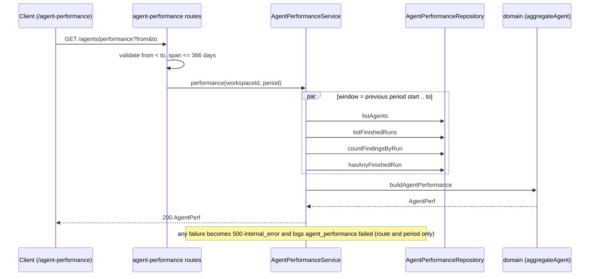

# Agent Performance dashboard

Implements [SPEC-04](../specs/2026-10-18-agent-performance.md). A global, read-only page at `/agent-performance` shows, per review agent and across all agents, how many runs finished, how many findings were accepted, what the runs cost and how fast they were. It aggregates stored `agent_runs` and `findings` rows on demand. It never calls a model and never writes.

This page is explanation and reference. For env setup see [`server/README.md`](../server/README.md) and the root [`README.md`](../README.md).

## Flow

`GET /agents/:id/stats` follows the same path but calls `agentStats`, fetches only the current period for one agent, and answers 404 `not_found` before aggregating when the agent is not in the workspace.

## API reference

Both routes are GET-only, workspace-scoped, and take the same query.

| Route | Response | Notes |
|---|---|---|
| `GET /agents/performance?from&to` | `AgentPerf` | One row per workspace agent, plus at most one merged "deleted agent" row. |
| `GET /agents/:id/stats?from&to` | `AgentStats` | One agent, current period only. Reuses the same reducer. |

- `from` and `to` are ISO datetimes with offset. A request is rejected with 422 when `to` is not after `from` or the span exceeds 366 days (`server/src/modules/agent-performance/routes.ts:10-23`, `constants.ts:8`). Both values reach SQL only as bound parameters (`repository.ts:77-86`).
- The static `performance` segment outranks `:id` in Fastify's router (`routes.ts:31`). The route precedence and the 422 are covered by `server/test/agent-performance.it.test.ts`.
- Responses carry aggregates only: no finding text, prompt or diff. Contracts live in the vendored shared copies (`observability.ts` for `AgentStats`, `productionize.ts` for `AgentPerf`); keep both copies in step.
- Module layout: `routes.ts` → `service.ts` → `ports.ts` / `domain.ts` ← `repository.ts`, wired in `server/src/platform/container.ts` (`agentPerformanceService`) and registered in `server/src/modules/index.ts`.

## Aggregation rules

All numbers come from one pure reducer, `aggregateAgent` (`server/src/modules/agent-performance/domain.ts:110`). Both endpoints and the all-agents totals go through it, so a per-agent card and the dashboard row cannot disagree.

| Rule | Behaviour |
|---|---|
| Which runs count | Only finished runs: `done`, `failed`, `cancelled` (`constants.ts:2`). `running` is excluded. |
| Window | Half-open `[from, to)` on `agent_runs.ran_at`. |
| Previous period | Same length, ending at `from` (`previousPeriod`, `domain.ts:56`). Used for the trend arrow and the cost delta. |
| Finding to run link | Only through `reviews.run_id` (a plain uuid, no FK). A review with a null `run_id` is in no metric. Every run's findings count, not just the newest review per agent. |
| Decisions | `accepted` = `accepted_at` set. `dismissed` = `dismissed_at` set and `accepted_at` null. `decided` = accepted + dismissed. `pending` = total - decided (`repository.ts:51-52`). |
| Rates | `accept_rate` and `dismiss_rate` are fractions of `decided`, `null` when nothing is decided. |
| Cost | `resolveRunCost` (`server/src/platform/run-cost.ts:27`): persisted `cost_usd`, else tokens x price estimate, else unknown. A run with zero tokens is unknown, not free. Unknown runs are counted in `unpriced_runs` and skipped in totals. The total is `null` only when no run is priced. `cost_basis` is always `estimate`. |
| Average latency | Mean `duration_ms` over `done` runs with a duration. |
| Cost by model | Per priced run, summed by model slug, descending. A null model becomes an `unknown_model` segment. |
| Cost by agent | Per agent total, descending. The merged deleted-agent row is a `deleted_agent` segment. Empty when nothing is priced. |
| Trend | Findings per run for the last 10 runs (`TREND_RUNS`), oldest first. |
| Runs series | Runs per bucket aligned to `from`: hourly when the span is 48 hours or less, daily otherwise (`bucketSizeMs`, `HOURLY_BUCKET_MAX_MS`). |
| Deleted agents | Runs whose `agent_id` is null or unknown are merged into one row with null name. |
| Row order | Rows with runs first (runs desc, last run desc, deleted last, name), then idle agents by name. |
| Most active | Known agent with the most runs; ties by last run, then name. |
| First-ever state | `summary.has_any_runs` comes from `hasAnyFinishedRun` over all time, so the client can tell "no runs yet" from "no runs in this period". |

## Client surface

Route `/agent-performance` (`client/src/app/agent-performance/page.tsx`), view in `_components/AgentPerformanceView`. It is a GLOBAL section item in the sidebar (`client/src/vendor/ui/nav.ts`, key `agent-performance`).

- **Data.** `useAgentPerformance` (`client/src/lib/hooks/agent-performance.ts`) is a TanStack query keyed on `["agent-performance", from, to]`, with `retry: false` and no `placeholderData`, so a new period never shows the previous period's numbers.
- **Period.** The period lives in the URL as `from`, `to`, `range` (`1d`, `30d`, `custom`). A missing or invalid period (`parsePeriodQuery`) falls back to a 30-day window computed once on open. A custom range is entered as local dates, both days inclusive, at most 365 days, and not ending in the future (`customRangeToPeriod` in `helpers.ts`). The client limit mirrors the server's 366-day cap (`constants.ts`).
- **States.** `data-state` on `[data-agent-performance]` is `loading`, `error` (with retry), `empty` or `ready`. Empty has two texts: no runs ever versus none in this period (`summary.has_any_runs`).
- **Table.** Sort is by accept rate only. Order is rows with enough decisions, then small samples (fewer than 10 decided findings, `SMALL_SAMPLE_THRESHOLD`), then idle agents. The trend arrow shows only when both periods have at least 10 decided findings and the rounded rates differ (`trendDirection`).
- **Cost.** Every cost is labelled as an estimate. The donuts are an app-local `CostDonut` because the vendored `Donut` legend rounds tiny costs to `$0.00`. Direction of the cost delta is a text sign, never colour alone.
- **Test hooks.** `data-agent-performance`, `data-state`, `data-period-picker`, `data-kpi`, `data-cost-delta`, `data-cost-breakdown`, `data-cost-segment`, `data-perf-table`, `data-sort-accept`, `data-agent-id`, `data-agent-details`, `data-small-sample`, `data-trend`. The period error is `role="alert"` with id `agent-performance-period-error`.

## Known limits and gaps

- The per-agent `GET /agents/:id/stats` route has no client consumer yet: the agent editor still has no Stats tab (the spec says so; only the global page ships).
- `reviews.run_id` has no foreign key, so a review without a run, such as the seeded PR #482 review, never shows on the dashboard.
- Vendored `productionize.ts` differs between server and client at one pre-existing line (provider enum has `openrouter` on the server only); `observability.ts` is identical (verify-code-r1).
- Not covered by tests: visual layout (jsdom), the relative "Last run" text, e2e. `server/test/reviews.it.test.ts` has 2 known pre-existing failures unrelated to this feature.
- NFR1 (p95 at most 1 s at 10k runs / 50k findings) is checked by `server/test/agent-performance-perf.it.test.ts`.
