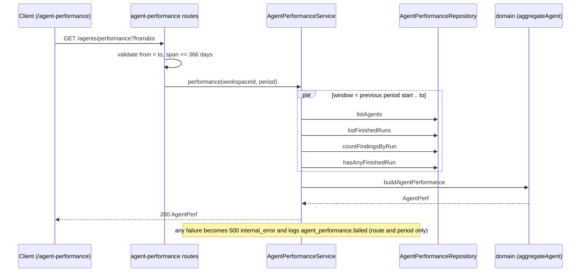
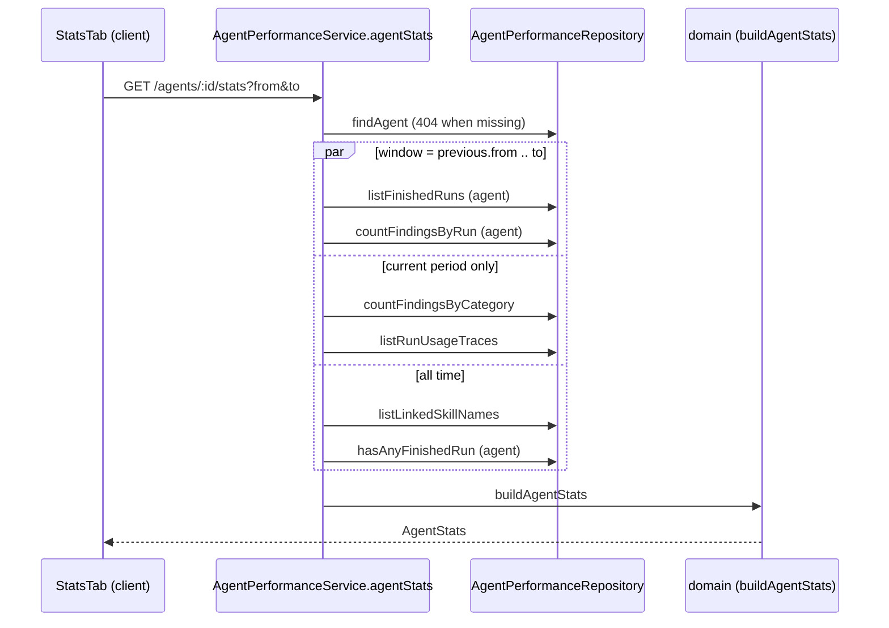

# Agent Performance dashboard

Implements [SPEC-04](../specs/2026-10-18-agent-performance.md). A global, read-only page at `/agent-performance` shows, per review agent and across all agents, how many runs finished, how many findings were accepted, what the runs cost and how fast they were. It aggregates stored `agent_runs` and `findings` rows on demand. It never calls a model and never writes. The per-agent endpoint also feeds the agent editor Stats tab ([SPEC-05](../specs/2026-10-18-agent-stats-tab.md), see [Agent Stats tab](#agent-stats-tab-spec-05)).

This page is explanation and reference. For env setup see [`server/README.md`](../server/README.md) and the root [`README.md`](../README.md).

## Flow

`GET /agents/:id/stats` follows the same path but calls `agentStats` for one agent, reads the previous period too (since SPEC-05, see [Agent Stats tab](#agent-stats-tab-spec-05)), and answers 404 `not_found` before aggregating when the agent is not in the workspace.

## API reference

Both routes are GET-only, workspace-scoped, and take the same query.

| Route | Response | Notes |
|---|---|---|
| `GET /agents/performance?from&to` | `AgentPerf` | One row per workspace agent, plus at most one merged "deleted agent" row. |
| `GET /agents/:id/stats?from&to` | `AgentStats` | One agent, current and previous period. Reuses the same reducer. Consumed by the agent editor Stats tab. |

- `from` and `to` are ISO datetimes with offset. A request is rejected with 422 when `to` is not after `from` or the span exceeds 366 days (`server/src/modules/agent-performance/routes.ts:10-23`, `constants.ts:8`). Both values reach SQL only as bound parameters (`repository.ts:77-86`).
- The static `performance` segment outranks `:id` in Fastify's router (`routes.ts:31`). The route precedence and the 422 are covered by `server/test/agent-performance.it.test.ts`.
- Responses carry aggregates only: no finding text, prompt or diff. Contracts live in the vendored shared copies (`observability.ts` for `AgentStats`, `productionize.ts` for `AgentPerf`); keep both copies in step.
- Module layout: `routes.ts` → `service.ts` → `ports.ts` / `domain.ts` ← `repository.ts`, wired in `server/src/platform/container.ts` (`agentPerformanceService`) and registered in `server/src/modules/index.ts`.

## Aggregation rules

All numbers come from one pure reducer, `aggregateAgent` (`server/src/modules/agent-performance/domain.ts:110`). Both endpoints and the all-agents totals go through it, so a per-agent card and the dashboard row cannot disagree.

| Rule | Behaviour |
|---|---|
| Which runs count | Only finished runs: `done`, `failed`, `cancelled` (`constants.ts:2`). `running` is excluded. |
| Window | Half-open `[from, to)` on `agent_runs.ran_at`. |
| Previous period | Same length, ending at `from` (`previousPeriod`, `domain.ts:56`). Used for the trend arrow and the cost delta. |
| Finding to run link | Only through `reviews.run_id` (a plain uuid, no FK). A review with a null `run_id` is in no metric. Every run's findings count, not just the newest review per agent. |
| Decisions | `accepted` = `accepted_at` set. `dismissed` = `dismissed_at` set and `accepted_at` null. `decided` = accepted + dismissed. `pending` = total - decided (`repository.ts:51-52`). |
| Rates | `accept_rate` and `dismiss_rate` are fractions of `decided`, `null` when nothing is decided. |
| Cost | `resolveRunCost` (`server/src/platform/run-cost.ts:27`): persisted `cost_usd`, else tokens x price estimate, else unknown. A run with zero tokens is unknown, not free. Unknown runs are counted in `unpriced_runs` and skipped in totals. The total is `null` only when no run is priced. `cost_basis` is always `estimate`. |
| Average latency | Mean `duration_ms` over `done` runs with a duration. |
| Cost by model | Per priced run, summed by model slug, descending. A null model becomes an `unknown_model` segment. |
| Cost by agent | Per agent total, descending. The merged deleted-agent row is a `deleted_agent` segment. Empty when nothing is priced. |
| Trend | Findings per run for the last 10 runs (`TREND_RUNS`), oldest first. |
| Runs series | Runs per bucket aligned to `from`: hourly when the span is 48 hours or less, daily otherwise (`bucketSizeMs`, `HOURLY_BUCKET_MAX_MS`). |
| Deleted agents | Runs whose `agent_id` is null or unknown are merged into one row with null name. |
| Row order | Rows with runs first (runs desc, last run desc, deleted last, name), then idle agents by name. |
| Most active | Known agent with the most runs; ties by last run, then name. |
| First-ever state | `summary.has_any_runs` comes from `hasAnyFinishedRun` over all time, so the client can tell "no runs yet" from "no runs in this period". |

## Client surface

Route `/agent-performance` (`client/src/app/agent-performance/page.tsx`), view in `_components/AgentPerformanceView`. It is a GLOBAL section item in the sidebar (`client/src/vendor/ui/nav.ts`, key `agent-performance`).

- **Data.** `useAgentPerformance` (`client/src/lib/hooks/agent-performance.ts`) is a TanStack query keyed on `["agent-performance", from, to]`, with `retry: false` and no `placeholderData`, so a new period never shows the previous period's numbers.
- **Period.** The period lives in the URL as `from`, `to`, `range` (`1d`, `30d`, `custom`). A missing or invalid period (`parsePeriodQuery`) falls back to a 30-day window computed once on open. A custom range is entered as local dates, both days inclusive, at most 365 days, and not ending in the future (`customRangeToPeriod`). The client limit mirrors the server's 366-day cap. Since SPEC-05 the picker and these period helpers live in the shared `client/src/components/period-picker/` (used by the dashboard and the Stats tab), and `formatPercent`, `formatDuration` and `SMALL_SAMPLE_THRESHOLD` in `client/src/lib/agent-metrics.ts`.
- **States.** `data-state` on `[data-agent-performance]` is `loading`, `error` (with retry), `empty` or `ready`. Empty has two texts: no runs ever versus none in this period (`summary.has_any_runs`).
- **Table.** Sort is by accept rate only. Order is rows with enough decisions, then small samples (fewer than 10 decided findings, `SMALL_SAMPLE_THRESHOLD`), then idle agents. The trend arrow shows only when both periods have at least 10 decided findings and the rounded rates differ (`trendDirection`).
- **Cost.** Every cost is labelled as an estimate. The donuts are an app-local `CostDonut` because the vendored `Donut` legend rounds tiny costs to `$0.00`. Direction of the cost delta is a text sign, never colour alone.
- **Test hooks.** `data-agent-performance`, `data-state`, `data-period-picker`, `data-kpi`, `data-cost-delta`, `data-cost-breakdown`, `data-cost-segment`, `data-perf-table`, `data-sort-accept`, `data-agent-id`, `data-agent-details`, `data-small-sample`, `data-trend`. The period error is `role="alert"`; its element id comes from `React.useId()` (`client/src/components/period-picker/PeriodPicker.tsx:15`), no longer a fixed string.

## Agent Stats tab (SPEC-05)

Implements [SPEC-05](../specs/2026-10-18-agent-stats-tab.md). A fourth "Stats" tab in the agent editor (`/agents/:id?tab=stats`) shows one agent's KPIs with previous-period deltas, skill and memory usage, a severity time series and a category breakdown. It is read-only: the only request is `GET /agents/:id/stats`. The shared aggregation is the same `aggregateAgent` reducer as the dashboard, so the per-agent numbers equal the dashboard row for the same period.

### Flow

Reads: `server/src/modules/agent-performance/service.ts:46-57`. Failures after the 404 check become 500 `internal_error` with the same metadata-only log line as the dashboard (`service.ts:69-72`).

### New `AgentStats` fields (additive)

Both vendored copies of `observability.ts` carry them; the existing fields are unchanged.

| Field | Meaning |
|---|---|
| `has_any_runs` | The agent has at least one finished run ever (`hasAnyFinishedRun` with an agent id, `repository.ts:102`). Picks between the two empty states. |
| `previous_runs`, `previous_decided` | Counts for `[from - len, from)`, from a second `aggregateAgent` pass (`domain.ts:528`). |
| `previous_avg_cost_usd`, `previous_avg_latency_ms`, `previous_accept_rate` | Nullable: `null` when the previous period has no priced run, no timed `done` run, or no decision. |
| `runs_series` | Runs per bucket of the current period, same rule as the dashboard (hourly up to 48 h, else daily). |
| `severity_bucket`, `findings_by_severity_series` | `day` buckets for periods up to 14 days, `week` buckets beyond (`severityBucketMs`, `domain.ts:378`); buckets align to `from`, the last one is cut at `to`; a finding lands in its run's `ran_at` bucket. Only CRITICAL, WARNING and SUGGESTION are counted. |
| `findings_by_category` | Always six keys: `bug`, `security`, `perf`, `style`, `test`, `other`. Any stored category outside the five counts as `other` (`categoryBreakdown`, `domain.ts:406`; the DB column is free text). |
| `skills_usage` | One item per skill name that is in `prompt_assembly.skills_used` of a run in the period, or currently linked to the agent (union, one row per name). `share = runs / runs_with_data`, `null` when no run has data. Sorted by share desc (null last), then name. |
| `memory_usage` | One item per distinct pulled `text`, grouped by exact text, a run counted once per text. At most 10 items (`MEMORY_ITEMS_MAX`), `label` cut to 200 characters with `truncated`, `entries_total` = distinct texts. |

### Trace-derived usage rules

- Only `done` runs take part, and only the two sub-paths `prompt_assembly.skills_used` and `memory_pulled` are selected from `run_traces.trace` (`repository.ts:84-85`); the whole trace, which holds the full prompt, is never read or returned. Failed and cancelled runs count in runs and cost but not in usage denominators.
- A run is "with data" for a block only when the value is well-formed: `skills_used` an array of strings (`readSkillsUsed`, `domain.ts:416`), `memory_pulled` an array whose every element is an object with a string `text` (`readMemoryPulled`, `domain.ts:422`). Anything else (no trace row, missing key, old schema, odd shape such as `{ "foo": 1 }`) goes to `runs_without_data` and the answer is still 200. Guards are hand-written in the domain; there is no runtime zod in the core.
- `data_from` is the `ran_at` of the earliest run with data; the client uses it for the "No data before ..." footer.
- `skills_used` records prompt inclusion, not whether the model applied a skill, and holds enabled skills only, so a linked but disabled skill shows 0%. Skills are matched by name, so a rename gives two rows.
- Every trace written today stores `memory_pulled: []`, so the memory panel shows its empty state until a later change fills it (out of scope in SPEC-05).

### Client surface

Component folder `client/src/app/agents/[id]/_components/AgentEditor/_components/StatsTab/`, registered as the fourth tab in `AgentEditor/constants.ts:15` (`VALID_TABS` in the page derives from `TABS`, so `?tab=stats` needs no page edit).

- **Data.** `useAgentStats` (`client/src/lib/hooks/agent-stats.ts`) is a TanStack query keyed `["agent-stats", agentId, from, to]`, `retry: false`, no `placeholderData`. Opening the tab or picking a period makes one GET.
- **Period.** Read from the URL (`from`, `to`, `range`) next to `tab=stats`; invalid or missing falls back to a 30-day window computed once. `selectPeriod` does `router.replace` keeping other query values (`StatsTab.tsx:29-36`). Switching agent in the sidebar pushes only `?tab=`, so the new agent opens on 30 days.
- **States.** `data-state` on `[data-agent-stats]`: `loading` (`aria-busy` skeletons, no numbers), `error` (`ErrorState` with Retry), `empty` (`runs === 0`; two texts chosen by `has_any_runs`, picker stays), `ready`.
- **Deltas** (`StatsTab/helpers.ts:44-68`). Every delta is `null` when `previous_runs === 0`; cost and duration also when either side is null; accept rate also when `decided` or `previous_decided` is below 10. A `null` delta renders "Not enough history to compare". Direction is a text sign (`+` / `−`), not colour. The accept-rate delta is in percentage points.
- **Panels.** `StatsKpiCards` (cost labelled "Estimated", no "billed" text), `UsagePanel` (generic list used for skills `data-skill-row` and memory `data-memory-row`, coverage footer "Based on N of M runs", date only when `runs_without_data > 0`, "+K more" for memory), `SeverityBars` (plain HTML/CSS stacked bars, because the vendored charts have no stacked bar), `CategoryDonut` (app-local recharts ring, `aria-hidden`, with a text legend; "Small sample" below 10 findings, `CategoryDonut.tsx:68`). Skill names and memory labels are rendered as text only.
- **Strings.** New namespace `client/messages/en/agentStats.json`. The shared picker keeps reading the `agentPerformance.period.*` keys, so any screen using it must load that namespace.
- **Hand-mirrored constant.** `runsUnit` in `StatsTab/helpers.ts:30` uses a 48 h threshold copied from the server `HOURLY_BUCKET_MAX_MS` (`constants.ts:11`); change both together.

### Test status

SPEC-05 added no new test files. Existing suites were updated where the change broke them (`server/test/contracts.test.ts`, `agent-performance-domain.test.ts`, `agent-performance-service.test.ts`) and, per the implementation reports, the hermetic server suite (538) and client suite (363) passed, along with typecheck and `next build`. The new SQL (`countFindingsByCategory`, `listRunUsageTraces`, `listLinkedSkillNames`) and the NFR1 latency budget on 10,000 runs with traces have not been run against Postgres. The Stats tab components have no dedicated tests.

## Known limits and gaps

- The per-agent `GET /agents/:id/stats` route is consumed by the agent editor Stats tab (SPEC-05, below), not by the dashboard page.
- `reviews.run_id` has no foreign key, so a review without a run, such as the seeded PR #482 review, never shows on the dashboard.
- Vendored `productionize.ts` differs between server and client at one pre-existing line (provider enum has `openrouter` on the server only); `observability.ts` is identical (verify-code-r1).
- Not covered by tests: visual layout (jsdom), the relative "Last run" text, e2e. `server/test/reviews.it.test.ts` has 2 known pre-existing failures unrelated to this feature.
- NFR1 (p95 at most 1 s at 10k runs / 50k findings) is checked by `server/test/agent-performance-perf.it.test.ts`.
