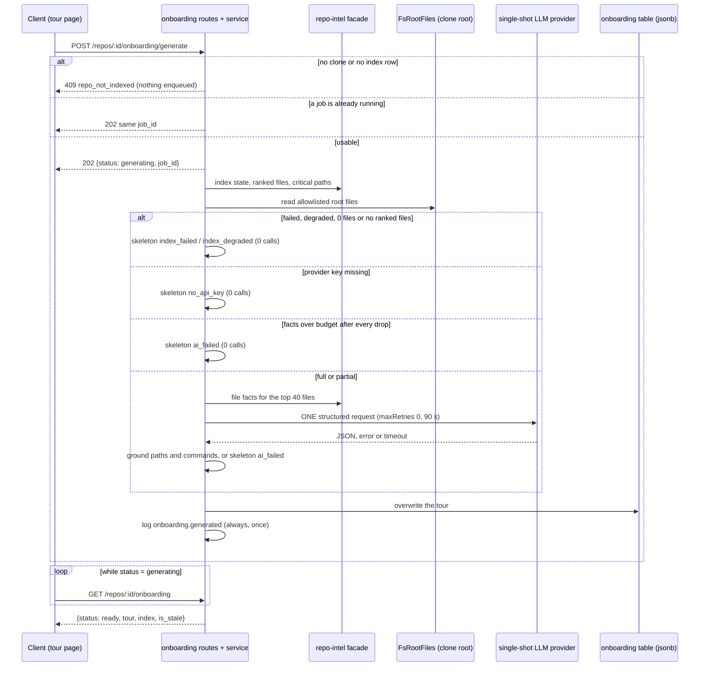

# Onboarding Tour

Implements [SPEC-02](../specs/2026-10-14-onboarding-tour.md). A per-repo page at `/repos/[repoId]/onboarding` shows five sections (architecture overview, critical paths, how to run locally, guided reading path, first tasks). A background job builds them from deterministic repo-intel facts plus an allowlist of root files, with at most one structured LLM call. Every path and command is grounded in those facts, and a failure falls back to a deterministic skeleton with an honest reason.

This page is explanation and reference. For env setup see [`server/README.md`](../server/README.md) and the root [`README.md`](../README.md).

## Flow: generate

Steps in prose:

1. **Gate.** `requestGeneration` returns 404 for an unknown repo and `RepoNotIndexedError` (409 `repo_not_indexed`) when the repo has no clone or no index row. It enqueues nothing in that case (`server/src/modules/onboarding/service.ts:118-127`, `domain.ts:60`).
2. **Join.** The in-flight map is filled synchronously, before any await, so two POSTs 100 ms apart share one job id. The entry is removed when the job settles, or when `enqueue` itself rejects (`service.ts:129-143`). The map lives on the memoized service instance, so it is lost on restart (EC14).
3. **Facts.** `build` reads the ranked files, critical-path chains and the root-file snapshot, then decides on a skeleton reason before any LLM work (`service.ts:255-279`).
4. **One request.** `completeStructured` is called once with `maxRetries: 0`, `maxTokens: 4000`, `timeoutMs: 90000`, `temperature: 0`, wrapped in `withTimeout`. Any throw or timeout gives an `ai_failed` skeleton with `llm_calls: 1` (`service.ts:315-337`). The provider comes from a "single-shot" factory in the container that also turns off SDK transport retries, so "one call" is one HTTP request (`server/src/platform/container.ts`, `llmSingleShot`).
5. **Store and log.** The tour overwrites the single row. The `onboarding.generated` line is written from a `finally`, so it appears for every outcome, including an infrastructure error. That error is stored as a best-effort `ai_failed` skeleton, and a failed save logs one `onboarding.save_failed` warning (`service.ts:169-215`). The job always resolves, and it is registered with `retries: 0` (`routes.ts:24-30`).

## Skeleton reasons

A tour is `outcome: "ai"` or `outcome: "skeleton"`. A skeleton has `architecture.summary: null` and `first_tasks: []`, and its other sections come from facts only.

| `skeleton_reason` | Cause | `llm_calls` |
|---|---|---|
| `index_failed` | Index status is `failed` | 0 |
| `index_degraded` | Status `degraded`, or 0 files indexed, or files indexed but no ranked files (graph build failed) | 0 |
| `no_api_key` | Provider key missing (`ConfigError` from the provider factory) | 0 |
| `ai_failed` | Request error, 90 s timeout, or schema-invalid output | 1 |
| `ai_failed` | Prompt still over budget after every droppable fact is gone | 0 |
| `ai_failed` | Infrastructure error (DB, fact collection) | 0 or 1 |

`skeletonReasonForIndex` is the first three rows (`domain.ts:68-76`). The empty-ranked-set rule is spec gap 2, accepted in the spec.

## Reading path ranking

`scoreOf(pagerank, hotness) = pagerank * (1 + hotness)`. `rankOrdered` drops files flagged `junk`, sorts by score descending and breaks ties by path ascending (`domain.ts:80-89`). `selectReadingPath` keeps the first 10 (all of them when fewer exist), and `selectFactFiles` keeps the first 40 for the prompt facts (`domain.ts:91-97`).

The model never changes the order or the set: grounding rebuilds `reading_path` from the deterministic list and takes only a one-line `reason` from a model entry with the same path (`domain.ts:384-399`).

Hotness is 0 today because clones are shallow, so the order equals PageRank. `churn_available` is `rows.some(r => r.hotness > 0)`, and the page shows a "churn unavailable" note while it is false (`domain.ts:99-101`).

## Grounding

`groundModelSections` runs on the validated model output before storing (`domain.ts:378-480`). It enforces the section counts, because the model schema has no `minItems`/`maxItems` (strict JSON-schema upstreams could reject them). Each dropped invented path or command adds 1 to `dropped_paths`.

| Section | Rule |
|---|---|
| `reading_path` | Deterministic set and order; model only supplies `reason`. A model entry with a path outside the indexed set counts as dropped. |
| `critical_paths` | Keep model entries whose path is in the indexed set, at most 8; use the deterministic list when none survive. |
| `run_locally` | Keep a model command only if it equals a candidate command character for character, taking `source` from the candidate. Then append the candidates the model did not list. An invented command counts as dropped. |
| `architecture` | Drop nodes whose non-null path is not indexed (counted), at most 12 nodes; drop edges that point at removed ids (not counted). |
| `first_tasks` | Remove ungrounded paths (counted); remove a task left with no path. Fewer than 3 survivors is valid. |

The "indexed set" is the set of paths in `file_rank` (`service.ts:343-348`).

### Candidate run commands

`deriveCandidateCommands` builds the only commands a tour can contain, in this order, de-duplicated and capped at 60 (`domain.ts:235`):

1. `<pm> install` and `<pm> run <script>` from `package.json`. The package manager is inferred from the lockfile (pnpm, then yarn, then bun, otherwise npm). A script name must match `SAFE_NAME` (`domain.ts:105-113,245-252`).
2. `cp .env.example .env` when `.env.example` exists. Only its presence is read (NFR4).
3. `docker compose up -d <service>` for each service in a compose file.
4. `make <target>` for each `Makefile` target.
5. Shell lines from fenced shell blocks under the first README heading that looks like install, run, setup or usage, capped at 20 lines.

### README_UNSAFE filter

README shell lines are repo-authored text one click from the clipboard. A review finding (S-1, fixed in round 2, widened for S-3 in round 3) added a filter in `readmeShellLines` (`domain.ts:213-233`). A line is skipped when it is longer than 200 characters (`README_COMMAND_MAX_CHARS`, `constants.ts:27`) or matches `README_UNSAFE` (`domain.ts:120`):

- any control character (`\u0000-\u001f`, `\u007f`) or Unicode format character (`\p{Cf}`, which covers bidi overrides and zero-width characters);
- a backtick, `;`, `|`, `&`, `<` or `>`;
- a variable or command expansion: `$` followed by `(`, `{`, a letter or `_`.

Plain commands such as `npm run dev` are kept. The page also shows a "review each command before you run it" note above the commands, and commands are copy-only: the app never runs them (NG6).

## Prompt and token budget

`assemblePrompt` (`server/src/modules/onboarding/prompt.ts:136`) builds a system message and one user message. Fixed instructions stay outside the data. Every repo-derived text goes through `wrapUntrusted()` with its own label: `repo:file-ranking`, `repo:endpoints`, `repo:critical-paths`, `repo:candidate-commands`, `repo:stack`, `repo:structure` and `repo:readme-excerpt`.

The budget fit is linear: render the fixed part once, price each fact file once, keep the longest score-ordered prefix that fits, render once. `truncated` is true only when budget dropped file facts, not when a repo merely has more than 40 files. If the fixed part alone is over budget the README excerpt is dropped and the part is re-measured once. If it is still over, `overBudget` is true and the service makes no request (`ai_failed`, `llm_calls: 0`).

## Limits

Constants are in `server/src/modules/onboarding/constants.ts`.

| Limit | Value |
|---|---|
| Prompt input | 12,000 estimated tokens (`ceil(chars / 4)`) |
| Output | 4,000 tokens |
| LLM request timeout | 90 s |
| Job timeout, retries | 120 s, 0 |
| Facts files | 40 |
| Reading path, critical paths, nodes, first tasks | 10, 8, 12, 5 |
| Candidate commands, README commands | 60, 20 (each at most 200 chars) |
| README excerpt, stack deps | 4,000 chars, 40 |
| Endpoints per file in the prompt | 10 |
| Root file read | 64 KB each (`65_536` bytes); larger is skipped as `too_large`, non-UTF-8 as `not_utf8` |
| Generate rate limit | 10 per minute |

The root-file reader is a non-recursive `readdir` of the clone root over fixed allowlisted names. It skips symlinks and only `stat`s lockfiles and `.env.example` (`server/src/adapters/root-files/fs-root-files.ts`, port in `server/src/ports/root-files.ts`).

## API

Routes are in `server/src/modules/onboarding/routes.ts`.

| Route | Purpose | Success body |
|---|---|---|
| `GET /repos/:id/onboarding` | Current state; never generates | `OnboardingState` (`status`, `job_id`, `index`, `is_stale`, `tour`) |
| `POST /repos/:id/onboarding/generate` | Start a generation, or join the running one | 202 `OnboardingGenerateResponse` (`status: "generating"`, `job_id`) |

Errors: 404 `not_found` (unknown repo), 409 `repo_not_indexed` (POST only), 429 from the per-route limit (POST only), 422 `validation_error` for a non-UUID id.

`status` is `generating` while the in-memory map has a running job, otherwise `ready` when a tour is stored, otherwise `none`. `index.usable` means a clone and an index row exist. `is_stale` is `tour.indexed_sha !== index.last_indexed_sha`. When the persisted sha is empty, `indexed_sha` is stored as `''`, `last_indexed_sha` is `null`, and the tour is not stale (`service.ts:96,113`). A stored row that no longer parses as `OnboardingTour` reads as `none`, not 5xx (`server/src/modules/onboarding/repository.ts`, `getTour`).

The contract is in the Onboarding block of `server/src/vendor/shared/contracts/knowledge.ts`, with a byte-identical block in the client copy. The whole tour is stored in the existing `onboarding.json` jsonb column, so there is no migration. Fields added after SPEC-02 must be `.nullish()`.

## Log line

One `info` record per generation, event `onboarding.generated`, with `repo_id`, `indexed_sha`, `model`, `llm_calls`, `tokens_in`, `tokens_out`, `cost_usd`, `duration_ms`, `outcome`, `skeleton_reason`, `dropped_paths`, `truncated` (`service.ts:197-214`). It is metadata only: no prompt text, README text, commands or model output. `cost_usd` is `null` when the price is unknown, never 0.

## Client surfaces

- Sidebar: a WORKSPACE item "Onboarding Tour" in the vendored `client/src/vendor/ui/nav.ts` (a spec-sanctioned edit). `activeKeyFor` marks only `/repos/<id>/onboarding` active, so the Add-repository route `/onboarding` is untouched (`client/src/components/app-shell/helpers.ts`).
- Data hooks in `client/src/lib/hooks/onboarding.ts`: the state query polls every `ONBOARDING_POLL_MS = 2_500` while `generating`. It also polls after a Resync on a not-yet-usable repo for at most `RESYNC_POLL_MAX_MS = 120_000` (`:12-36`).
- Page: `client/src/app/repos/[repoId]/onboarding/`, view `_components/OnboardingView/`. It shows an empty state with exactly one action (Generate when usable, otherwise Resync), a `role="status"` in-progress note, status notes per condition, five collapsible cards, a GitHub "Open" link pinned to `indexed_sha` (hidden when the sha is empty), and a copy button per command. Summaries render as Markdown with no raw HTML and no `dangerouslySetInnerHTML`. Strings live in `client/messages/en/onboarding.json`.
- e2e flow: `e2e/specs/08-onboarding-tour.flow.json` covers the never-generated state on the seeded repo (no clone, so the Resync empty state).

## Known limits

- The AI path (real model output) is covered only through mock providers; no automated lane calls an LLM.
- `server/test/onboarding.it.test.ts` needs Docker. The verification reports ran the hermetic suites only (server 347/347 and client 215/215 in round 1; server 215/215 related tests in round 2).
- Model prose fields (`title`, `why`, `label`, `note`, `reason`, `summary`) are not length-capped or sanitised server-side (review finding S-2, logged, not fixed). The client renders them as text or Markdown without raw HTML.
- Each of the eight `OnboardingView/_components/*` folders imports the parent's `styles.ts` instead of its own (review finding A-1, logged, deliberate; matches the nested-component convention in `client/INSIGHTS.md`).
- The Generate mutation toasts on error as well as showing the inline alert; the provider has no opt-out (plan risk, accepted).
- The in-flight state is per process; a second API instance would not join a running job.
- With a stored tour and status `generating`, the buttons are disabled. With no stored tour and status `generating`, only the status renders (`verify-code-r1`).
- The 200-character cap on README commands is not in the plan text; it was added with the S-1 fix.
