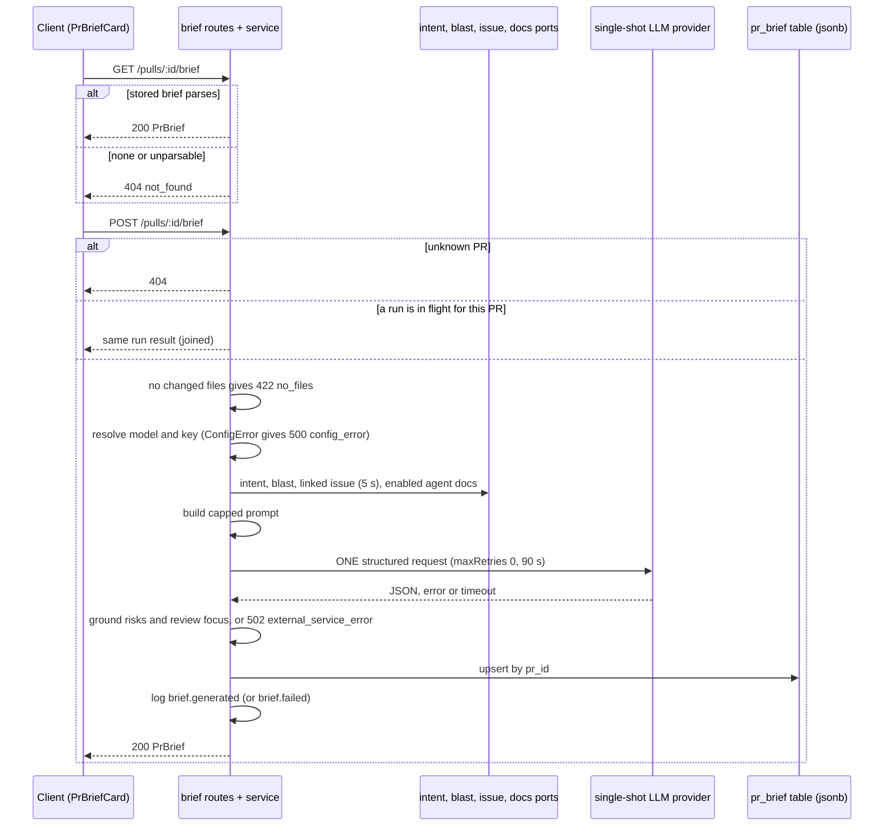

# PR Why + Risk Brief

Implements [SPEC-03](../specs/2026-10-15-pr-why-risk-brief.md). The PR Overview tab gets a card that joins "why this change exists", "what is risky" and "where to read first". `POST /pulls/:id/brief` gathers deterministic facts (diff stats, Intent, Blast radius, attached project docs, linked issue), makes exactly one structured LLM call, grounds every file reference against the PR, and stores the result. `GET /pulls/:id/brief` only reads the stored brief and never generates.

This page is explanation and reference. For env setup see [`server/README.md`](../server/README.md) and the root [`README.md`](../README.md).

## Flow

Steps in prose:

1. **Read side.** `get` returns 404 for an unknown PR or when no brief is stored. A stored row that no longer parses as `PrBrief` reads as 404, not 5xx (`server/src/modules/brief/service.ts:77-83`, `repository.ts:73-78`).
2. **Join.** The in-flight map is checked and filled with no `await` in between, so two POSTs share one run. It is cleared when the run settles. The map lives on the memoized service instance, so it is per process (`service.ts:85-99`).
3. **Facts.** Intent (read only, never derived), Blast radius (a read failure becomes `unavailable`, not an error), the linked issue (rule `closes|fixes|resolves #N` or a bare `#N`, 5 s timeout, any failure means "absent"), and the docs attached to enabled agents for this repo, ordered and read through the Project Context rules (`service.ts:214-293`, `domain.ts:29-33`).
4. **One request.** `completeStructured` is called once with `maxRetries: 0`, `maxTokens: 5000`, `timeoutMs: 90000`, `temperature: 0`, wrapped in `withTimeout` (`service.ts:131-150`). The provider comes from the single-shot factory, so one call is one HTTP request.
5. **Ground, store, log.** The model output is grounded (below), merged with the facts and upserted into `pr_brief` (`service.ts:152-185`). `brief.generated` carries counts, enums and cost only, never PR text or model output (`service.ts:187-204`). Every failure writes one `brief.failed` warning with a reason.

## Inputs and caps

All constants are in `server/src/modules/brief/constants.ts`. Every cut is recorded in `truncated`.

| Limit | Value |
|---|---|
| Prompt input | 40,000 estimated tokens (`ceil(chars / 4)`); over budget after every cut throws, giving a generic failure |
| Output | 5,000 tokens |
| LLM timeout / linked-issue timeout | 90 s / 5 s |
| Files in the prompt | 300, largest `additions + deletions` first, ties by path |
| Hunk headers per file | 20 |
| Title / description / issue body | 500 / 8,000 / 4,000 chars |
| Intent block / Blast summary | 4,000 / 2,000 chars |
| Caller file paths | 100 (distinct files from the Blast callers) |
| Risks / review focus items | 8 / 8 |
| Generate rate limit | 10 per minute per route |

Fit order in `assembleBriefPrompt` (`prompt.ts:64-177`): fixed capped blocks (PR, issue, intent, blast), then caller paths while they fit, then project-doc specs while they fit, then the file base lines as the longest prefix that fits, then hunk headers while they fit. Every PR-derived string goes through `wrapUntrusted` with its own label (`pr`, `issue`, `intent`, `blast`, `blast:callers`, `spec:<label>`, `files`) and the system prompt gets `INJECTION_GUARD`. The system text is `server/src/prompts/brief.system.md`. Each file line carries its Smart Diff role from `classifyFile`.

The model schema `BriefModelOutput` (`summary`, `risks`, `review_focus`) has no array bounds on purpose: strict JSON-schema upstreams may reject `minItems`/`maxItems`. The caps are enforced in grounding (`prompt.ts:18-28`).

## Grounding

`groundBrief` runs on the untrusted model output before storing (`domain.ts:117-184`).

| Part | Rule |
|---|---|
| `review_focus` | Drop duplicate `(file, line)`; ground each against the persisted diff with the shared `groundFindings` (line must be in a changed hunk); cap at 8. |
| `risks[].file_refs` | Drop duplicate refs; a ref (`path`, `path:N` or `path:N-M`) is kept only if its path is a PR file or a Blast caller file. Callers count only when Blast was available. |
| `risks` | A risk left with no refs is dropped; then cap at 8. |

Counts go to `dropped` (`review_focus` = duplicates + ungrounded + over cap; `risks`; `file_refs`). The diff is rebuilt from persisted `pr_files.patch` (`repository.ts:44-55`).

## Contract

Zod contract `PrBrief` in `server/src/vendor/shared/contracts/brief.ts:171-227`, with a byte-identical copy in the client vendor folder (see the root `AGENTS.md` drift rule). Fields added after SPEC-03 must be `.nullish()`.

| Field | Meaning |
|---|---|
| `summary` | Model text, may be absent |
| `intent` | `{intent, in_scope, out_of_scope}` copied from the stored Intent, or `null` |
| `blast` | The `BlastRadius` as read, or `null` |
| `risks.risks[]` | `{kind, title, explanation, severity: high\|medium\|low, file_refs[]}`, at most 8 |
| `history` | Always `null` today (set in `service.ts:172`) |
| `review_focus[]` | `{file, line >= 1, reason}`, at most 8 |
| `head_sha` | The PR head commit the brief was built for |
| `generated_at` | ISO-8601 |
| `missing_inputs[]` | `{input: intent\|blast\|specs\|description\|issue, reason: absent\|stale\|degraded\|empty\|unavailable}` |
| `specs_used` | Labels of project docs that fit the prompt |
| `truncated` | `files`, `description`, `issue_body`, `callers`, `blast_summary` |
| `dropped` | `review_focus`, `risks`, `file_refs` |
| `model`, `tokens_in`, `tokens_out`, `cost_usd` | Usage; `cost_usd` is `null` when the price is unknown |

`missing_inputs` rules (`domain.ts:47-57`): intent `absent` when none, `stale` when its `head_sha` differs from the PR head; blast `unavailable` when reading threw, `degraded` when flagged; specs `absent` when none fit; description `empty` when blank; issue `absent` when none was resolved.

The brief is stored whole in the `pr_brief.json` column keyed by `pr_id` (`repository.ts:80-85`).

## API

Routes are in `server/src/modules/brief/routes.ts`.

| Route | Purpose | Success body |
|---|---|---|
| `GET /pulls/:id/brief` | Stored brief; never generates | 200 `PrBrief` |
| `POST /pulls/:id/brief` | Generate (or regenerate), store, return; joins a running run | 200 `PrBrief` (not 202: the call is synchronous) |

The module installs its own `application/json` parser so a POST with that content type and an empty body is accepted; invalid JSON is 400 (`routes.ts:18-29`).

| Status | Code | When |
|---|---|---|
| 404 | `not_found` | Unknown PR, or no stored brief (GET) |
| 422 | `validation_error` | Non-UUID id; or `details.reason = no_files` for a PR with no changed files (POST) |
| 429 | rate limit | More than 10 POSTs per minute (POST) |
| 500 | `config_error` | No provider key or model not resolvable (POST) |
| 502 | `external_service_error` | LLM failed (POST) |

### Error reasons

`details.reason` on the 502 comes from `classifyLlmFailure` and never carries model output (`domain.ts:186-200`):

| `reason` | Cause |
|---|---|
| `timeout` | `TimeoutError` or `APIConnectionTimeoutError` (90 s) |
| `schema_mismatch` | Output failed schema validation (a truncated answer lands here; there is no re-ask) |
| `provider_error` | Any other provider error |

`brief.failed` log reasons: `no_files`, `config_error`, the three above, and `internal` for anything else (for example a DB error or over-budget prompt).

## Cache and stale rule

The stored brief is the cache. GET never regenerates. A brief is stale when `brief.head_sha` differs from the PR's current head sha and both are non-empty (`client .../PrBriefCard/helpers.ts`, `isStale`). The client then shows a warning; regeneration is always a manual Refresh and overwrites the single row. Stale Intent is reported separately in `missing_inputs` (`reason: stale`).

## Client surfaces

- Card: `client/src/app/repos/[repoId]/pulls/[number]/_components/OverviewTab/_components/PrBriefCard/PrBriefCard.tsx`, rendered by `OverviewTab`. Strings in `client/messages/en/brief.json`.
- Hooks: `client/src/lib/hooks/brief.ts`. `useBrief` maps 404 to `null` with no retry; `useGenerateBrief` writes the POST result into the query cache.

Card states:

| State | What shows |
|---|---|
| Loading | Skeleton |
| No brief | Empty text and a Generate button; disabled when the PR has no files (different text) |
| Generating | `aria-live="polite"` status line; Refresh and Generate disabled |
| Brief | Summary, risk rows, Review focus list, cost and token line, "missing inputs" line |
| Stale | Warning line while not generating |
| Error | Inline message plus Retry. 429 reads as rate limited, `config_error` as no key (with a Settings link), anything else generic (`helpers.ts`, `briefErrorKind`) |
| Verdict banner | Shown above the summary when the newest review with a verdict exists (blockers = undismissed CRITICAL findings) |

### Review focus deep link and scroll-once

Each focus item links to `/repos/<repoId>/pulls/<n>?tab=diff&file=<path>&line=<n>`, or renders plain text when the line is not a positive integer (`helpers.ts`, `reviewFocusHref`). The PR page passes `file` and `line` to `DiffTab` (`page.tsx:187-194`); switching tabs clears both params (`page.tsx:71-73`).

`DiffTab` hands focus down only after Smart Diff has settled and only when the file is in the PR, so a card never scrolls in the flat list and then remounts inside role groups. `FileCard` force-opens the focused file, highlights the row whose new-side number equals `line` (a non-deleted line), and falls back to the file header when the line is absent. A `claimScroll(key)` ref in `DiffTab` ensures one scroll per `(file, line)` pair across re-renders and remounts (`DiffTab.tsx:45-62`, `diff-viewer/FileCard/FileCard.tsx:64-74`).

## Tests by lane

| Lane | Files |
|---|---|
| Server hermetic | `server/test/brief-domain.test.ts`, `brief-prompt.test.ts`, `brief-service.test.ts`, `brief-wiring.test.ts`, and the `PrBrief` block in `contracts.test.ts` |
| Server integration (Docker) | `server/test/brief.it.test.ts` (13 tests: head sha, 429, GET latency, corrupt row, workspace isolation) |
| Client (vitest + jsdom) | `PrBriefCard/helpers.test.ts`, `PrBriefCard/PrBriefCard.test.tsx`, `OverviewTab/OverviewTab.test.tsx`, `[number]/page.test.tsx`, `DiffTab/DiffTab.test.tsx` |
| e2e | `e2e/specs/09-pr-brief.flow.json` (19 steps) |

Final verification: server 504 and client 298 hermetic tests passed; `brief.it` 13/13 (`verify-final-r1`, `tests`). See [`TESTING.md`](../TESTING.md) for the suite map.

## Known limits

- The e2e flow `09-pr-brief.flow.json` has not been run: `agent-browser` is not installed here and `scripts/e2e.sh` needs pnpm. The JSON and the e2e type-check were validated only. The visual scroll and highlight were not checked in a browser (jsdom only).
- The demo brief is seeded for PR #482 only on a fresh DB (`server/src/db/seed-brief.ts`, called from `seed.ts`; insert is `onConflictDoNothing`). An existing dev DB needs a re-seed or a manual Generate.
- The seeded brief has `intent: null`, `blast: null`, `model: "seed"`. The flow clicks `src/config.ts:11` (seeded lines 11 and 13; the plan said 12).
- Low-severity review findings from the cross-model review ([`cross-model-review.md`](../.claude/plans/pr-why-risk-brief/cross-model-review.md)) were logged and addressed in the plan; no unresolved CRITICAL or HIGH remains. Seed side effects on e2e flows 04 and 05 were listed there as unchecked.
- In-flight state is per process; a second API instance would not join a running run.
- `history` is always `null`; the contract field exists for a later feature.
- A truncated model answer becomes `schema_mismatch`; there is no re-ask.
- Non-blocking: `service.ts` imports the type `DocRead` from `ports/project-docs` (onion gate passes).
- `e2e/README.md` still needs a `09-pr-brief` row (not editable from the docs agent).
