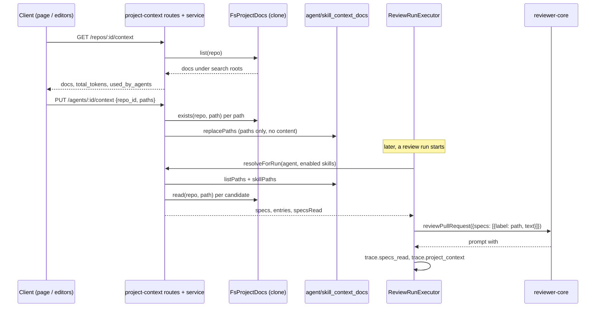

# Project Context

Implements [SPEC-01](../specs/2026-10-14-project-context.md). A repo's Markdown docs (specs, docs, insights) can be listed and previewed, attached per repo to agents and skills, and injected into the review prompt as untrusted, path-labelled blocks under `## Project context`. The run trace records a status and token cost per doc.

This page is explanation and reference. For env setup see [`server/README.md`](../server/README.md) and the root [`README.md`](../README.md).

## Flow: discovery to trace

Steps in prose:

1. **Discovery.** `FsProjectDocs.list` walks the clone, skips symlinks and excluded dirs, keeps `.md` files matching the search roots, sorts by path and cuts at 500 (`server/src/adapters/project-docs/fs-project-docs.ts`, `list`/`walk`).
2. **Attachment.** `ProjectContextService.setAttachments` validates and replaces the full path list for one (agent or skill, repo) pair. Only paths are stored; there is no content column and the agent/skill `version` is not touched (`server/src/modules/project-context/service.ts`, `setAttachments`).
3. **Run time.** `ReviewRunExecutor.resolveProjectContext` calls `resolveForRun` with the agent id and its **enabled** linked skills, in link order. The call never fails the run: on any error it logs one metadata-only line and continues with no context (`server/src/modules/reviews/run-executor.ts:499-529`). It runs regardless of the repo-intel gate.
4. **Ordering.** `orderCandidates` puts agent paths first (attach order), then each skill in order; a path seen twice keeps its first occurrence (`server/src/modules/project-context/domain.ts`, `orderCandidates`).
5. **Assembly.** Included docs are passed as `specs: [{ label: path, text }]`; with no included docs the `specs` key is omitted so the prompt is unchanged (`run-executor.ts:278-279`).
6. **Trace.** `specs_read` lists included paths in prompt order; `project_context` holds one entry per candidate, or `null` when there are none (`run-executor.ts:413-414`). A failure before the prompt keeps `specs_read: []` and no `project_context` (`run-executor.ts:601`).

## Configuration

`PROJECT_CONTEXT_ROOTS` (server env) is a `;`-separated list of search-root globs. `;` is used because the default contains commas. Entries are trimmed, empties dropped, and an empty or unset value falls back to the default `**/{specs,docs,insights}/**/*.md` (`server/src/platform/config.ts:40,81,111-129`).

Glob support is in-house and minimal: `**`, `*` and `{a,b}` only. `**/` matches zero or more whole segments, `*` never crosses `/`, and every other regex metacharacter is escaped (`server/src/ports/project-docs.ts`, `globToRegExp`). Only `.md` files are listed.

A doc's `type` is the folder nearest the file that a root names literally (so `docs/specs/x.md` is `specs`), falling back to the first directory (`docTypeFor`).

## Routes

All five module routes live in `server/src/modules/project-context/routes.ts` and sit under the global rate limit.

| Route | Purpose | Success body |
|---|---|---|
| `GET /repos/:id/context` | List docs under the search roots | `ProjectContextList` (`docs`, `total_tokens`, `search_roots`, `truncated`) |
| `GET /repos/:id/context/file?path=` | Preview one doc | `ProjectContextFile` (doc fields plus `content`) |
| `GET /agents/:id/context?repo_id=` | Attached paths of an agent in a repo | `ContextAttachments` (`repo_id`, `paths`, `missing`) |
| `GET /skills/:id/context?repo_id=` | Same for a skill | `ContextAttachments` |
| `PUT /agents/:id/context`, `PUT /skills/:id/context` | Replace the attached list | `ContextAttachmentsSaved` (`repo_id`, `paths`) |

Errors (`domain.ts`): `repo_not_found` 404, `context_path_invalid` 400, `context_doc_not_found` 404, `context_doc_too_large` 413, `clone_unavailable` 409, and `validation_error` 400 for more than 50 paths or duplicates. A body of the wrong shape (for example a missing `repo_id`) is rejected by the zod handler as 422, not 400.

`used_by_agents` counts distinct agents that attach the doc directly or through any linked skill, enabled or not (plan R4), so it can exceed the number of agents that actually receive the doc at run time. `missing[]` lists attached paths whose file no longer resolves; a non-existent path is still accepted on PUT so the user keeps a "missing" row.

## Caps

Constants in `server/src/ports/project-docs.ts:10-19`.

| Cap | Value | Effect |
|---|---|---|
| Per doc | 64 KB (65,536 bytes) | Larger docs: preview 413, run status `over_limit` |
| Per run | 24,000 tokens | A doc that would exceed the running total is `over_limit`; later, smaller docs can still fit |
| Listed | 500 docs | `truncated: true` |
| Attachments | 50 per agent or skill per repo | `validation_error` 400 |
| Scan | 5,000 directory entries visited | Walk stops (equals repo-intel `MAX_INDEXED_FILES`) |

Tokens are estimated as `ceil(chars / 4)` (`estimateTokens`).

## Doc statuses (run trace)

`ProjectContextEntry.status` is one of four values; non-included entries carry `tokens: null` and `text: null` (`domain.ts`, `buildProjectContext`).

| Status | Cause |
|---|---|
| `included` | Read succeeded and fits the run budget; `text` is the exact injected text |
| `missing` | File gone, or clone unavailable |
| `rejected` | Path failed a safety check, or the file is not valid UTF-8 |
| `over_limit` | Over 64 KB, or over the 24,000-token run budget |

Each entry also has `origin` (`agent` or `skill`) and `skill_name`. `RunTrace.project_context` is optional so stored traces without it still parse.

## Path safety

Syntax rules (`checkContextPathSyntax`, no fs access) reject: empty paths, a leading `/`, drive-letter prefixes, any `\`, any `..` segment, control characters (`\x00-\x1f`, `\x7f`) and any `%` (this blocks `specs/%2e%2e/x.md`; it also rejects real file names containing `%`, see plan R5).

`FsProjectDocs.read` and `exists` then run in this order, and no content is read until all pass (`fs-project-docs.ts`, `resolveDoc`/`read`):

1. Syntax check; the service also checks the search roots before any fs call.
2. `realpath` of the clone root and the target (ENOENT or ENOTDIR gives `missing`).
3. The resolved target must stay inside the resolved clone root.
4. The resolved repo-relative path must still end in `.md`, match the roots and avoid excluded dirs. A symlink to `src/secret.md` is therefore `invalid`.
5. Size over 64 KB gives `too_large`.
6. Strict UTF-8 decode; failure gives `not_utf8`.

The directory walk never follows symlinks. The adapter does not import from `modules/`; excluded dirs and the scan cap are passed in by the container. `exists` runs steps 1 to 4 only.

## reviewer-core: `SpecEntry` and label escaping

`PromptParts.specs` and `ReviewInput.specs` accept `SpecEntry[]`, where `SpecEntry = string | { label: string; text: string }` (`reviewer-core/src/prompt.ts:33`, `run.ts:61`, exported from `index.ts`). A string keeps the positional `spec-<i>` label, so existing callers produce byte-identical prompts. An object uses its `label` (the doc path) (`prompt.ts:210-217`).

`wrapUntrusted` now HTML-escapes the label: `&` to `&amp;`, `"` to `&quot;`, `<` to `&lt;`, `>` to `&gt;`, CR/LF to `&#13;`/`&#10;` (`prompt.ts:35-49`). Content escaping is unchanged. Doc text is only ever in the user message as an untrusted block, never in the system message. The same escaping applies to skill-name labels and convention-scan path labels when they contain those characters.

Logs stay metadata-only: the Live Log and the `prompt.assembled` event carry counts and statuses, never doc text (`run-executor.ts:309-326`, `516-522`). The full text is only in `run_traces.trace`.

## Client surfaces

Per the plan (not re-verified line by line here): a sidebar entry "Project Context" (`client/src/vendor/ui/nav.ts`, a spec-sanctioned edit of a vendored file), the page `/repos/[repoId]/context` (list plus Markdown preview, read-only), a shared `ContextDocPicker` in `client/src/components/context-doc-picker/` used by a Context tab in the agent and skill editors, and a Project context section in the run trace drawer. Reordering is not built.

## Known limits

- AC15 (the model cites an attached doc in a grounded finding) is manual: it needs a real model and no automated lane calls an LLM.
- Tests for this feature were not written in this run. `plan-verifier` could not confirm NFR8 (no script or inline handler or `javascript:` link rendered in the preview) or NFR6 (list p95 under 1 s on a 5,000-file clone) without them. The preview uses the vendored `Markdown` with no `rehype-raw` and no `dangerouslySetInnerHTML`.
- `list` reads every listed doc (up to 500) to compute tokens; cache by path, mtime and size if NFR6 fails.
- `used_by_agents` counts disabled agents and skills; the run uses enabled skills only.
- Client visual layout and the `DocPreviewPanel` source were not verified.
