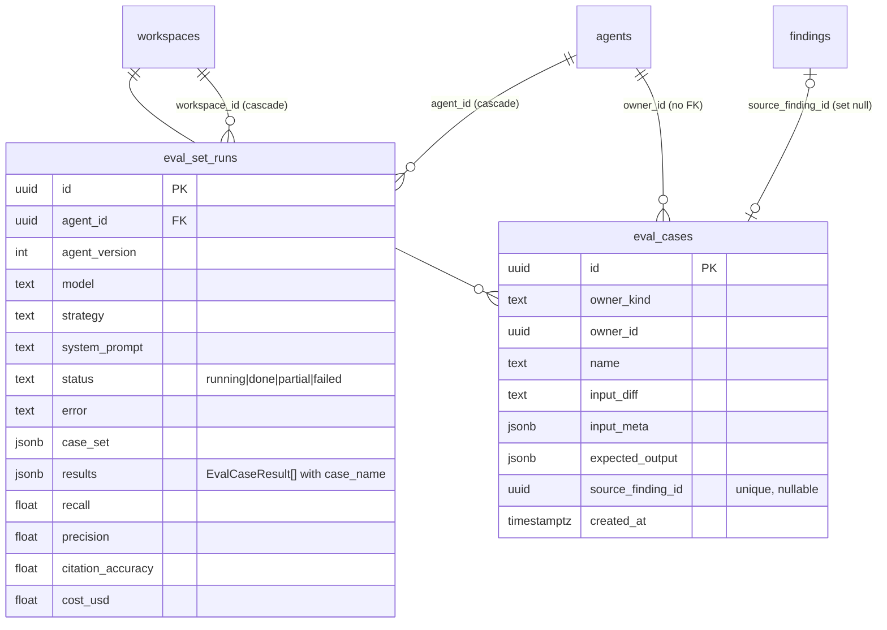
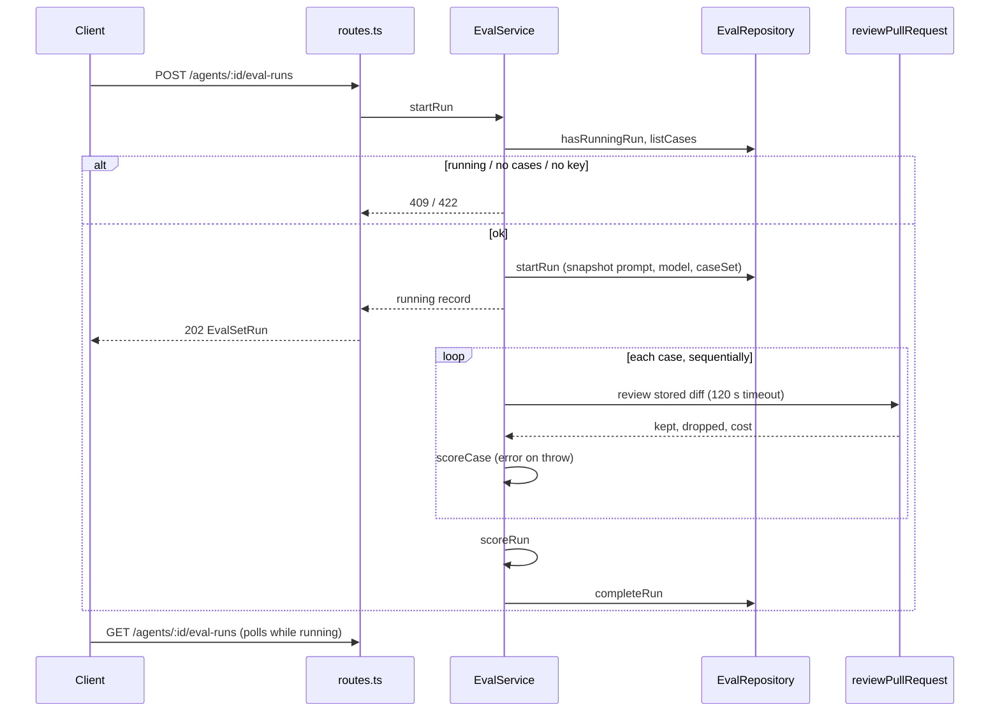
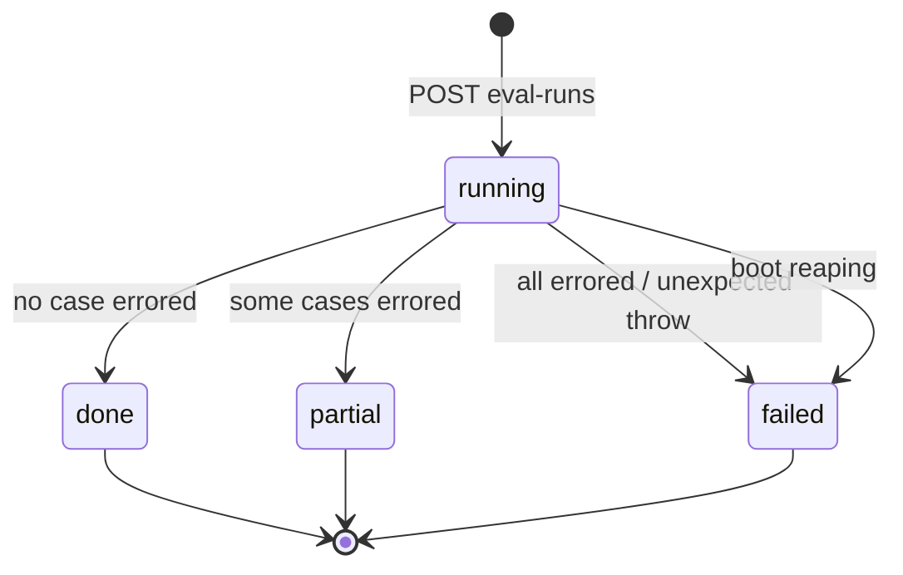

# Eval pipeline (SPEC-06)

Turns decided findings into per-agent eval cases, runs an agent over its whole case set in the
background, and scores the run in code. Spec: `specs/2026-10-22-eval-pipeline.md`. Plan:
`.claude/plans/eval-pipeline.md`. `reviewer-core` is unchanged; the module only calls its
`reviewPullRequest`.

Module: `server/src/modules/eval/` (`domain.ts`, `ports.ts`, `repository.ts`, `service.ts`,
`routes.ts`, `constants.ts`). The legacy `eval_runs` table and `EvalRun` contracts are untouched.

## Reference

### Routes

All routes are defined in `server/src/modules/eval/routes.ts`; the module registers its own
tolerant parser so a `POST` with `content-type: application/json` and an empty body is accepted.

| Route | Result | Notes |
|---|---|---|
| `POST /findings/:id/eval-case` | `201` new, `200` existing `EvalCase` | body `{ agent_id? }` (only needed when the review has no owning agent) |
| `GET /agents/:id/eval-cases` | `EvalCase[]` | adds `decision_changed` and `last_status` |
| `DELETE /eval-cases/:id` | `204` | past run results are kept |
| `POST /agents/:id/eval-runs` | `202` `EvalSetRun` (status `running`) | per-route limit 10/min (`EVAL_RUN_RATE_LIMIT`) |
| `GET /agents/:id/eval-runs` | `EvalSetRun[]` | newest first, last 20 (`EVAL_RUN_HISTORY_LIMIT`) |
| `GET /eval-runs/:id` | `EvalSetRunDetail` | adds `system_prompt` and per-case `results` |

Domain errors (`domain.ts`, all `AppError`):

| Code | HTTP | Raised when |
|---|---|---|
| `finding_undecided` | 422 | finding is neither accepted nor dismissed |
| `diff_unavailable` | 422 | no stored `pr_files` patch for the finding's file |
| `agent_required` | 422 | review has no existing owning agent and no `agent_id` was sent |
| `eval_run_active` | 409 | a run is already `running` for the agent |
| `no_eval_cases` | 422 | the agent has 0 cases |
| `provider_not_configured` | 422 | the agent's provider has no key |

Unknown finding, agent, case or run is `NotFoundError` (404).

### Case creation rules

`EvalService.createCaseFromFinding` (`service.ts:72`) checks in this order: finding exists, an
existing case for that source finding (returns `created: false`, so a later decision change
still answers 200), decision present, owner resolution (review's agent if it exists, else
`agent_id`), patch present. The case stores the finding's file patch as `input_diff`,
`input_files = [file]`, `input_meta = { pr_number, title, body }` and one expectation item.

- accepted finding -> `must_find`; dismissed -> `must_not_flag` (`expectationTypeFor`).
- `decision_changed` is true when the finding's current decision no longer maps to the case's
  type; false when the source finding is gone (`decisionChanged`).
- Name: title slug + ` file:line` (`caseNameFor`).

### Scoring rules

All scoring is pure code in `domain.ts`; no model call happens after the reviews.

- Match: same `file` and inclusive line-range overlap (`findingMatchesItem`); severity, category
  and title are ignored.
- Case pass: `must_find` passes when every item is matched; `must_not_flag` passes when no item
  is matched (`scoreCase`). An item matched by several findings counts once.
- Noise: in a `must_find` case, a kept finding matching none of its items; in a `must_not_flag`
  case, every kept finding.
- Run metrics (`scoreRun`), over non-errored cases only; `null` on a zero denominator:

| Metric | Formula |
|---|---|
| `recall` | matched `must_find` items / `must_find` items (of non-errored cases) |
| `precision` | (kept - noise) / kept |
| `citation_accuracy` | kept / (kept + dropped by grounding) |

- `cases_total` counts errored cases; `cases_passed` counts `pass`.
- Run status: `done` (no errors), `partial` (some), `failed` (all cases errored).
- `cost_usd` is the sum of case costs, or `null` if any case cost is unknown.

Each case calls `reviewPullRequest` with the run's snapshotted prompt/model/strategy and only
`diff`, `llm`, `prDescription` (untrusted title/body, wrapped by the engine) and `task`. No intent,
skills, specs, callers, repo map or memory are passed. The provider is `llmSingleShot` (one HTTP
request per call) wrapped in `withTimeout(..., 120_000)` (`EVAL_CASE_TIMEOUT_MS`).

### Data model

Migration `0016_grey_vin_gonzales.sql` (generated by drizzle-kit). Schema: `server/src/db/schema/eval.ts`.



- `eval_cases_source_finding_uq` (unique on `source_finding_id`; NULLs do not collide) is the
  double-click race guard: the insert path falls back to the existing row.
- `eval_set_runs_agent_running_uq` is a partial unique index on `agent_id WHERE status = 'running'`;
  a unique violation (`23505`) in `repository.startRun` becomes `EvalRunActiveError` (409), so two
  concurrent starts cannot both win.
- Per-case results live in `eval_set_runs.results` (carrying `case_name`), not in a table keyed
  by `case_id`, so deleting a case never rewrites history.
- `eval_cases.owner_id` has no FK (shared with skills), so deleting an agent removes its cases
  in the same transaction (`server/src/modules/agents/repository.ts:77`, `deleteById`); runs
  cascade through their FK.
- `last_status` of a case = its first result when walking finished (non-`running`) runs newest
  first (`latestCaseStatuses`), else `never_run`. The client's metric cards use only `done` and
  `partial` runs.

## Explanation: run lifecycle



`startRun` checks in order: agent exists, no running run, at least one case, provider key present
(`service.ts:143`). It snapshots the agent's version, provider, model, strategy and system prompt
plus the full case inputs (`caseSet`), so later edits to the agent or a case do not change a run
in progress. Execution is fire-and-forget; `inFlight` (runId -> promise) lets tests
`await service.waitFor(runId)`.

A case that throws or times out is stored as `status: 'error'` with a capped single-line message
(`safeErrorMessage`) and excluded from metrics. An unexpected failure outside a case marks the
whole run `failed` so the 409 guard never sticks. Logs carry ids, counts, status and duration only
(`eval.run.started`, `eval.case.finished`, `eval.run.finished`, `eval.run.failed`), never diff,
prompt or finding text.



### Boot reaping

A run is in memory only while the process lives. At boot `server/src/app.ts:104` calls
`container.evalService.failStaleRuns()`, which runs `UPDATE eval_set_runs SET status='failed',
finished_at=now(), error=<reason> WHERE status='running'` (`repository.failRunningRuns`). The reason
is `EVAL_RESTART_REASON` ("Server restarted while the run was in progress"). Without it a crashed
run would block the agent with 409 forever.

### Wiring

`container.evalService` (`server/src/platform/container.ts:325`) is memoized because the service
owns in-flight state. The service never receives `Container`; the LLM provider, agent lookup and
provider-key check are bound closures there.

### Seed

`server/src/db/seed-eval.ts` seeds 8 cases for the seeded Security Reviewer (5 `must_find`,
3 `must_not_flag`, each with its own fake-secret patch), idempotent by owner and name, and called
outside the `if (!pr)` block of `seed.ts` so it also reaches an already-seeded DB.

## How-to: run `verify:l06`

`server/package.json` defines `verify:l06`: it runs `eval-domain`, `eval-service`, `eval-contracts`,
`eval.it` and `eval-seed.it` with `EVAL_REQUIRE_DOCKER=1`, which makes the two `*.it.test.ts` files
fail instead of self-skipping when Docker is absent. Docker must be running.

`pnpm` is broken in this environment, so run vitest directly from `server/`:

```bash
cd server
EVAL_REQUIRE_DOCKER=1 ./node_modules/.bin/vitest run \
  test/eval-domain.test.ts test/eval-service.test.ts test/eval-contracts.test.ts \
  test/eval.it.test.ts test/eval-seed.it.test.ts
```

Run it without `server/.env` present (a server INSIGHTS note: run-driven IT tests flake with it).
A hermetic-only check is the first three files without the env flag.

## Client surface

Client-side behaviour is summarised here because it is one feature end to end.

- Finding card: `EvalCaseAction` (under `FindingCard/_components/`) shows "Turn into eval case".
  Disabled with a described reason while the finding is undecided; if `reviewAgentId` is not a
  known agent it opens an agent picker and posts `{ agent_id }`; `diff_unavailable` shows inline.
- Agent editor: `AgentEditor/_components/EvalsTab/` lists cases, runs all, and shows history and
  a two-run compare. It polls via `useEvalRuns` (`client/src/lib/hooks/eval.ts`): 4 s while the
  newest run is `running`, otherwise no polling.
- Shared pieces: `client/src/components/eval-metric-cards/`, `eval-run-history/`, and pure
  helpers in `client/src/lib/eval-metrics.ts` (percent formatting, point deltas, latest and
  previous finished run). Strings are in `client/messages/en/eval.json`.

## Gaps

- No gaps to the plan were found in the read sources, but the client files were not read
  line by line for this page; the Client surface section is a summary from names and plan.
