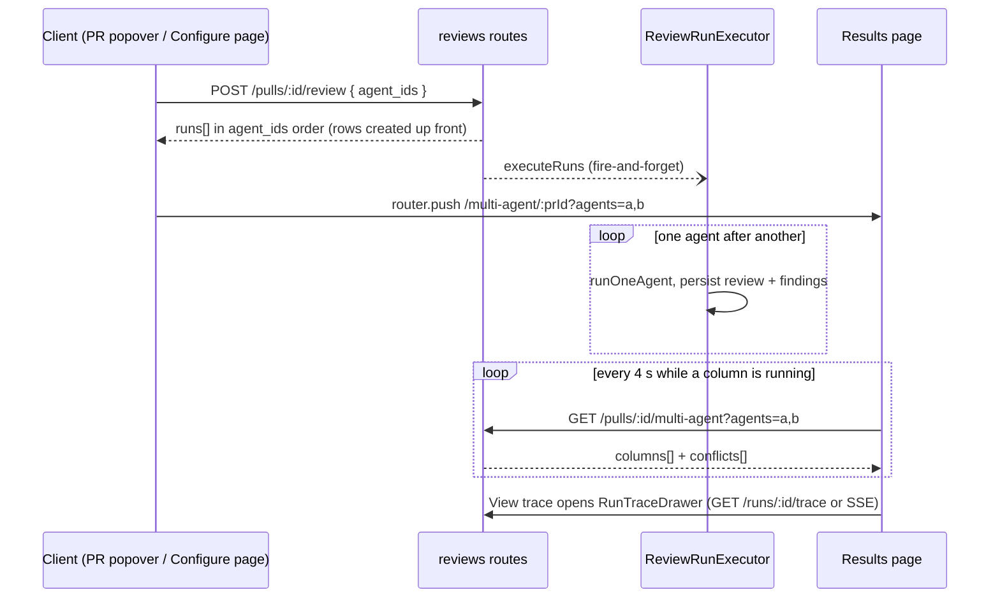

# Multi-Agent Review (SPEC-08)

Run a chosen set of enabled agents on one PR, compare their latest runs side by side, and see where they agree. Spec: [`../../specs/multi-agent-review.md`](../../specs/multi-agent-review.md). No new table, migration or execution mode: the feature wires the existing run executor, run trace drawer and the `MultiAgentRun` contracts together.

## Flow

1. Trigger. `RunRequest` gained `agent_ids` (`server/src/vendor/shared/contracts/platform.ts:335-339`). `resolveTargets` rejects `agent_ids` combined with `agentId` or `all` (400 `invalid_run_request`), validates the list, then resolves each id; a non-UUID, unknown or disabled id is 404 (`server/src/modules/reviews/service.ts:48-64`). Validation runs before any `agent_runs` row is created. The route is `POST /pulls/:id/review`, rate-limited to 10/min (`server/src/modules/reviews/routes.ts:29-48`).
2. List rules (`server/src/modules/reviews/domain.ts:9-29`): 1 to `MAX_AGENT_IDS` = 6 ids, no duplicates, else 400 `invalid_run_request`.
3. Execution. `runReview` creates one `agent_runs` row per target in order and returns `runs` immediately (`service.ts:133-153`); `executeRuns` loops the jobs with `for ... await` (`run-executor.ts:154-161`), so agents run sequentially.
4. Navigation. The PR popover pushes `/multi-agent/:prId?agents=<ids in click order>` (`client/src/app/repos/[repoId]/pulls/[number]/_components/RunReviewDropdown/RunReviewDropdown.tsx:66`); the Configure page does the same (`client/src/app/multi-agent/_components/MultiAgentConfigureView/MultiAgentConfigureView.tsx:57`).
5. Polling. `useMultiAgentRun` queries `GET /pulls/:id/multi-agent?agents=...` and refetches every 4000 ms while any column has `status === "running"`, otherwise stops (`client/src/lib/hooks/multi-agent.ts:13-26`). The results page does not subscribe to SSE itself.
6. View trace. The results page keeps the selected agent id and renders the shared `RunTraceDrawer` for that column's `run_id`, passing `running` from the column status (`MultiAgentResultsView.tsx:84-92`). The drawer opens on the Live log tab when `running`, else on Trace (`client/src/components/run-trace-drawer/RunTraceDrawer.tsx:46`); only the live tab uses the run SSE stream.

## Results read: `GET /pulls/:id/multi-agent`

`multiAgentRun` (`service.ts:198-258`): 400 for an invalid list (same `assertAgentIdList`), 404 for an unknown PR or agent. Unlike the trigger, a disabled agent is allowed (it may have old runs). Output:

- One column per requested agent, in request order. Run = the newest run of that agent on the PR (`runs.find` over `listRunsForPull`, newest first). No run gives `status: 'none'` with nulls and empty findings. Findings come from the review whose `run_id` matches the run.
- `total_duration_ms` sums known durations; `total_cost_usd` sums known costs, `null` when none is known.
- `id` is always `null`: nothing is persisted.
- `conflicts` = `buildConflicts(columns)`.

The client renders Columns or Tabs, the conflicts table, and reuses `FindingCard`, relocated to `client/src/components/finding-card/`, and `RunTraceDrawer`, relocated to `client/src/components/run-trace-drawer/`. The sidebar entry is in `client/src/vendor/ui/nav.ts:42`.

## Grouping rule

Implemented in `groupFindings` (`domain.ts:45-88`), applied by `attributeFindings` (`domain.ts:117-157`).

| Rule | Detail |
|---|---|
| Same group | same `file`, different bucket, and inclusive ranges overlap: `a.start <= b.end && b.start <= a.end` (`domain.ts:67-68`) |
| Bucket | `agent:<agent_id>`, or `review:<review_id>` for a review without an agent (`domain.ts:123`); findings of one bucket never join each other directly |
| Transitive | union-find, so A-B and B-C put A, B, C in one group |
| `group_key` | smallest member finding id (string compare); independent of input order (`domain.ts:84`). Singletons get a key too |
| Scope | the newest review per agent per PR (`countedReviewIds`, `server/src/modules/pulls/domain.ts:32-42`, input newest first). Findings of older reviews get `group_key: null` and `agreed_by: []` |

`buildConflicts` (`domain.ts:177-222`) emits one entry per `group_key` seen in any column, sorted by file then line. A column with a `done` run and no finding in the group adds a take with verdict `ignored` ("did not flag"); a column that did not finish adds no take. `is_conflict` is true when some `done` column ignored the group or the top severities differ (`domain.ts:216`).

## Attribution contract (for Export to CI)

Every finding returned by `GET /pulls/:id/reviews` and in `GET /pulls/:id/multi-agent` columns carries (`server/src/vendor/shared/contracts/review-api.ts:21-37`):

| Field | Meaning |
|---|---|
| `agent_id` | producing agent, `null` for a review with no agent |
| `agent_name` | its name, `null` when unknown |
| `group_key` | group key above, `null` outside the newest-review scope |
| `agreed_by` | `{ agent_id, agent_name, finding_id }[]`: members of the same group from other agents. Never contains the finding's own agent; empty for a finding of an agentless review (`domain.ts:140-147`) |

`reviewsForPull` attaches these via `attributeFindings` (`service.ts:176-192`), and the multi-agent columns reuse that output. The `AgreedBy` / `FindingRecord` shapes are in the server vendored contracts; the client copy must change in step (see root `AGENTS.md`). Worktree B should call `groupFindings` / `attributeFindings` rather than re-implement the rule.

## Known limits

- Sequential execution only; no parallel mode.
- Polling every 4 s instead of SSE on the results page, so a finished column can appear up to about 4 s late.
- No persisted multi-agent session: the URL `agents` param is the only memory, `multi_agent_runs` stays unused, and `MultiAgentRun.id` is `null`.
- Per-request regrouping (review finding S-1, LOW): groups are recomputed in memory on every `GET /reviews` and `GET /multi-agent` (pairwise per file, O(n^2)); `group_key` is not stored, and the key can change when a newer review replaces an older one.
- `agents` query is validated in the service, so malformed lists answer 400 rather than 422 (`routes.ts:138`).
