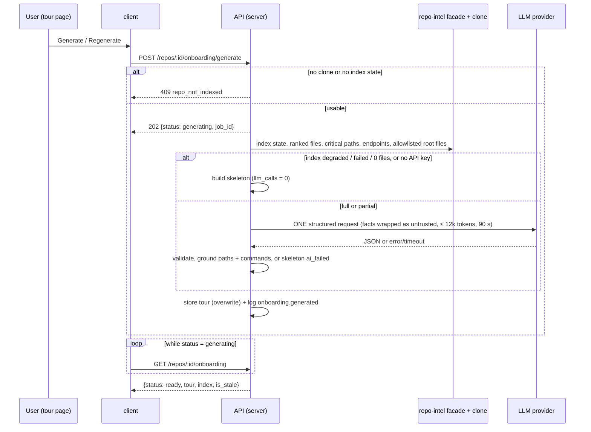

# Spec: Onboarding Tour
Spec ID: SPEC-02
Status: approved
Supersedes: None
Modules: server, client, e2e

## Problem and user
**Who.** A dev-digest user who has imported an unfamiliar repository and needs to get
productive in it: where the code starts, which files matter, how to run it, what to read first,
what to try first. There is one local user and no roles.

**Problem today.** dev-digest indexes every imported repo, but it shows that index to no
one except the reviewer prompt. The user still has to reverse-engineer the codebase by hand.

What already exists, and what is missing:
- **repo-intel facts (deterministic):**
  - It builds an import graph with a PageRank file rank (`server/src/modules/repo-intel/pipeline/rank.ts:25-70`).
  - Its facade exposes `getTopFilesByRank` and `getCriticalPaths`
    (`server/src/modules/repo-intel/service.ts:642-705`). Critical paths are greedy import
    chains from the top 5 ranked files, `BFS_DEPTH = 2` (`server/src/modules/repo-intel/constants.ts:49`).
  - It stores per-file HTTP endpoints and crons.
  - Its index state is one of `full | partial | degraded | failed`, with `files_indexed`,
    `last_indexed_sha` and `updated_at` (`server/src/modules/repo-intel/types.ts:25-50`).
  - Read: `GET /repos/:id/index-state` (`server/src/modules/repo-intel/routes.ts:33`).
    Re-index: `POST /repos/:id/resync` (`server/src/modules/repo-intel/routes.ts:44`).
- **Hotness is always 0.**
  - Clones are shallow (`CLONE_DEPTH = 1`, `server/src/modules/repos/constants.ts:9`).
  - The ranker therefore stores `hotness: 0` and `rank = pagerank`
    (`server/src/modules/repo-intel/pipeline/rank.ts:4-7`, `:51`).
  - `HOTNESS_WINDOW_DAYS` is declared but unused (`server/src/modules/repo-intel/constants.ts:50`).
- **Facts repo-intel does not have.**
  - It extracts no run scripts, README text, stack or compose services. Only JS/TS files are
    parsed (`server/src/modules/repo-intel/constants.ts:14`).
  - Limits: `MAX_INDEXED_FILES = 5000`, 400 KB per file, a 110 s soft budget
    (`server/src/modules/repo-intel/constants.ts:42-46`).
- **Import never calls GitHub.** The `repos` row has owner, name, `default_branch` and
  `clone_path` only, with no description, language or stars
  (`server/src/db/schema/repos.ts:5-25`). A missing clone gives a `degraded` index with
  reason `no_clone` (`server/src/modules/repo-intel/pipeline/full.ts:84-94`). A repo with no
  index row reads as `degraded` / `no_data` (`server/src/modules/repo-intel/service.ts:189-205`).
- **Unfinished onboarding scaffolding** exists and is not wired to anything:
  - A table `onboarding` (`repo_id` PK with cascade delete, `json`, `generated_at`), with no
    commit sha (`server/src/db/schema/context.ts:120-126`).
  - A generic `Onboarding` contract `{ sections: [{ kind, title, body, diagram, links }] }`, in
    both vendored copies (`server/src/vendor/shared/contracts/knowledge.ts:28-47`, and the same
    file under `client/src/vendor/shared`).
  - A system prompt with a different section set that uses bare `<untrusted>` tags
    (`server/src/prompts/onboarding.system.md:1-44`).
  - A feature-model id `onboarding`, default `openrouter` / `deepseek/deepseek-v4-flash`
    (`server/src/vendor/shared/contracts/platform.ts:44-51`).
  - An `onboarding` i18n namespace whose copy describes a different 5-section tour
    (`client/messages/en/onboarding.json:10`).
  - A nav label `nav.onboarding-tour` (`client/messages/en/shell.json:19`).
  - No server module and no client page.
- **Route collision.** `/onboarding` is the Add-repository screen
  (`client/src/app/onboarding/page.tsx:1-9`). The sidebar active-key rule marks any path
  containing `/onboarding` as `onboarding-tour` (`client/src/components/app-shell/helpers.ts:29`).
- **Sidebar.** It lives in the vendored `client/src/vendor/ui/nav.ts:21-36`. WORKSPACE holds
  only `pulls`, and a test pins that (`client/src/components/app-shell/nav.test.tsx:11`).
- **LLM path.**
  - The OpenRouter provider sends strict json_schema output and reads real `usage.cost`
    (`reviewer-core/src/llm/openrouter.ts:59-114`). On a parse failure it re-prompts up to
    `maxRetries ?? 2` times (`reviewer-core/src/llm/openrouter.ts:61`). Its SDK timeout is 90 s
    (`reviewer-core/src/llm/openrouter.ts:54`).
  - The JobRunner defaults to a 120 s timeout and 2 retries (`server/src/platform/jobs.ts:49-50`).
  - Cost may be unknown (`null`).
  - A missing provider key throws `config_error` (`server/src/platform/container.ts:322`,
    `server/src/platform/errors.ts:37-40`).
  - Review runs store tokens and cost but never log them. Intent derivation logs
    `tokens=in/out, cost=` (`server/src/modules/intent/service.ts:179`).
- **Opening files.** Files open on GitHub through `githubBlobUrl(repo, sha, file)`
  (`client/src/lib/github-urls.ts:24-37`). There is no in-app viewer.

**Why it matters.** A first-day tour taken from the existing index replaces hours of reading.
It must be honest: when the index or the model fails, the user sees deterministic facts and
the reason, not invented prose. For the course demo, each generation's LLM call count, tokens
and cost must be checkable in the server log.

**Design sources.**
- Two screenshots, `d1.png` and `d2.png`. They show:
  - the WORKSPACE sidebar item "Onboarding Tour";
  - the breadcrumb `<owner/name> > Onboarding Tour`;
  - the title "Onboarding for <name>";
  - the subtitle "Generated from index of N files · last refreshed 2h ago";
  - the buttons Regenerate and Share link;
  - an "On this page" TOC;
  - five collapsible section cards.
- The user's assignment text names the five sections and the generation approach.
- Where the screenshots and the requirements differ, see "Decisions" (Share link: P1).

## Goals / Non-goals
### Goals
- G1. The user opens an Onboarding Tour page for the active repo. It shows five sections, in
  a fixed order: Architecture overview, Critical paths, How to run locally, Guided reading
  path, First tasks.
- G2. A tour is built from deterministic repo facts (repo-intel plus an allowlist of root
  files) and at most **one** structured LLM call per generation.
- G3. Every file path and command in a tour is grounded in the facts. Anything else is
  dropped and counted.
- G4. When the index is unusable, degraded or failed, or the model call fails, the user gets
  a deterministic skeleton with an honest status, never invented prose.
- G5. Each generation logs its LLM call count, tokens and cost in one server log line.

### Non-goals
- NG1. Sharing, public links or exporting a tour. The design's "Share link" button is not
  built (P1).
- NG2. Computing git churn: no deeper clones, no history fetch, no GitHub API calls. Hotness
  is read from the existing column, which is 0 today (Q2).
- NG3. Automatic generation on page open, on import or after indexing. Generation runs only
  on an explicit user action (Q1).
- NG4. Tour history, or one tour per commit. One tour per repo, overwritten by each
  generation (Q1).
- NG5. An in-app file viewer. "Open" goes to GitHub (P7).
- NG6. Running any command from the tour. Commands are copy-only (P5).
- NG7. Non-English tour prose. The tour is written in English only.
- NG8. Parsing non-JS/TS source. Such repos are in scope, but they get a degraded tour
  (see AC9).
- NG9. The "Project Context" sidebar item shown in `d1.png`. It belongs to SPEC-01.
- NG10. Changing the repo-intel indexer, its limits or its PageRank computation.

## User stories
- US1. As a newcomer to a repo, I want an Onboarding Tour page in the sidebar with five
  readable sections, so that I can orient myself without reading the whole codebase.
- US2. As a user, I want to generate and regenerate the tour on demand, at a known and
  bounded cost, so that I control when the model is called.
- US3. As a newcomer, I want every file and command in the tour to be real and actionable
  (open the file, copy the command), so that I can trust and use the tour directly.
- US4. As a user, I want an honest status when the index or the model is not usable, so that
  I know what the tour is based on and what to do next.
- US5. As the course demo presenter, I want each generation's LLM call count, tokens and cost
  in the server log, so that I can show what the feature costs.

## Acceptance criteria (EARS)
- AC1 (US1). WHILE a repo is active, the sidebar (shall) show the item "Onboarding Tour"
  under WORKSPACE, linking to `/repos/<repoId>/onboarding`. The item is active only on that
  route, and never on the Add-repository route `/onboarding`.
  _(observable: nav item with label key `shell:nav.onboarding-tour` and that href; active key
  is `onboarding-tour` for `/repos/r1/onboarding` and not for `/onboarding`)_
- AC2 (US1). WHEN the tour page loads for a repo whose tour state is `none`, the page (shall)
  show an empty state. Its single primary action is "Generate" when `index.usable` is true,
  and "Resync" (calling `POST /repos/:id/resync`) with a "not indexed yet" message when
  `index.usable` is false.
  _(observable: EmptyState with i18n keys `onboarding:empty.*` and exactly one of the
  Generate or Resync buttons)_
- AC3 (US2). WHEN `POST /repos/:id/onboarding/generate` is received for a repo with a usable
  index, the API (shall) return 202 with `{ status: "generating", job_id }`. While a generation
  for that repo is already running, it returns that running generation's `job_id` and does not
  start a second one.
  _(observable: two POSTs 100 ms apart both return 202 with the same `job_id`; the mock LLM
  provider records 1 call)_
- AC4 (US2). WHILE the tour state is `generating`, the tour page (shall) show an in-progress
  status with Generate and Regenerate disabled. A previously stored tour stays rendered
  underneath.
  _(observable: element with `role="status"` and key `onboarding:status.generating`; buttons
  `disabled`; previous section content still in the DOM)_
- AC5 (US2). WHEN a generation runs on a `full` or `partial` index with a configured
  provider key, the server (shall) send exactly one LLM request: no repair re-prompt, no job
  retry. On a schema-valid response it stores the tour with `outcome: "ai"`.
  _(observable: mock provider call count = 1; stored tour `outcome = "ai"`, `llm_calls = 1`)_
- AC6 (US3). The server (shall) order the reading path by score = `pagerank × (1 + hotness)`,
  descending, with ties broken by path ascending. It holds the 6–10 highest-scoring files
  that pass the junk-path filter, or all of them when fewer than 6 exist. The model may
  rewrite only the one-line `reason` of each entry, never the order or the set.
  _(observable: `sections.reading_path[*].path` equals the deterministic top-N list in the same
  order for a fixture graph, whatever the model returns)_
- AC7 (US3). IF a model-returned entry refers to a path that is not in the repo's indexed
  file set, or a `run_locally` command that does not equal a fact-derived candidate command
  character for character, THEN the server (shall) drop that entry and add it to
  `dropped_paths`.
  _(observable: a fixture response with 1 invented path and 1 invented command gives a stored
  tour without them and `dropped_paths = 2`)_
- AC8 (US2). IF the assembled facts exceed 12,000 estimated input tokens, THEN the server
  (shall) remove the lowest-scoring file facts until the input is within budget, and set
  `truncated: true` on the tour.
  _(observable: a fixture with facts for 5,000 files gives a prompt ≤ 12,000 estimated tokens
  and stored `truncated = true`)_
- AC9 (US4). IF a generation cannot produce an AI tour, THEN the server (shall) store a
  deterministic skeleton tour with `outcome: "skeleton"` and the matching `skeleton_reason`:
  - `index_degraded`: the index is `degraded` with a clone present, or 0 files are indexed,
    or files are indexed but the ranked-file set is empty (the graph build failed); no LLM
    request is made;
  - `index_failed`: the index is `failed`; no LLM request is made;
  - `no_api_key`: the provider key is missing; no LLM request is made;
  - `ai_failed`, in any of three cases:
    - the single LLM request errors, times out after 90 s, or returns output that fails
      schema validation (`llm_calls` 1);
    - the facts still exceed the 12,000-token budget of AC8 after every droppable fact has
      been removed, so no LLM request is made (`llm_calls` 0);
    - an infrastructure error happens during generation, for example in the DB or in fact
      collection. A best-effort skeleton is stored, and the AC11 log line is still written
      (`llm_calls` 0 or 1, depending on whether the request was sent).

  _(observable: stored tour `outcome = "skeleton"`, the reason above; `llm_calls` 0 for
  `index_degraded`, `index_failed` and `no_api_key`, and 0 or 1 for `ai_failed` as listed;
  `architecture.summary` is null and `first_tasks` is empty)_
- AC10 (US4). IF `POST /repos/:id/onboarding/generate` is received for a repo with no clone
  or no index state, THEN the API (shall) return 409 with `error.code`
  `"repo_not_indexed"`, and (shall) not enqueue a generation.
  _(observable: HTTP 409 body `{ error: { code: "repo_not_indexed" } }`; no `onboarding.generated`
  log line)_
- AC11 (US5). WHEN a generation finishes, with any outcome, the server (shall) write exactly
  one `info` log line with event `onboarding.generated`. Its fields are `repo_id`,
  `indexed_sha`, `model`, `llm_calls`, `tokens_in`, `tokens_out`, `cost_usd`, `duration_ms`,
  `outcome`, `skeleton_reason`, `dropped_paths` and `truncated`. `cost_usd` is `null` when the
  price is unknown, never 0.
  _(observable: a captured pino record with `msg`/event `onboarding.generated` and those keys;
  `llm_calls` ∈ {0, 1})_
- AC12 (US1). WHEN the tour state holds a stored tour, the tour page (shall) render:
  - the title "Onboarding for <name>";
  - the subtitle with `files_indexed` and the relative time of `generated_at`;
  - an "On this page" list of five anchors;
  - five collapsible section cards, in the order Architecture overview, Critical paths, How
    to run locally, Guided reading path, First tasks. All cards start expanded.

  _(observable: headings in that order by i18n keys `onboarding:sections.*`; each card
  header has `aria-expanded="true"`; subtitle contains the file count)_
- AC13 (US4). WHEN a stored tour is rendered, the tour page (shall) show one status note for
  each true condition:
  - `is_stale`;
  - `index_status = "partial"`;
  - `truncated`;
  - `churn_available = false`;
  - `outcome = "skeleton"`, with the reason text, plus a link to `/settings/api-keys` when the
    reason is `no_api_key`.

  _(observable: notes with keys `onboarding:notes.{stale,partialIndex,truncated,churnUnavailable,skeleton.<reason>}`;
  today every tour shows `churnUnavailable`)_
- AC14 (US3). WHEN the user activates "Open" on a critical-path, reading-path or first-task
  file, the page (shall) open the GitHub blob URL of that path at the tour's `indexed_sha` in
  a new tab.
  _(observable: link `href` = `githubBlobUrl(full_name, indexed_sha, path)`, `target="_blank"`,
  `rel` includes `noopener`)_
- AC15 (US3). WHEN the user activates the copy button of a "How to run locally" command, the
  page (shall) write the exact command text to the clipboard and switch that button to a
  "copied" state.
  _(observable: `navigator.clipboard.writeText` called with the command string; the button's
  accessible name switches to key `onboarding:run.copied`)_
- AC16 (US2). IF `POST /repos/:id/onboarding/generate` fails, THEN the tour page (shall)
  show an inline error naming the cause, and keep any stored tour rendered:
  - 429: a rate-limit message saying to retry within a minute;
  - 409 `repo_not_indexed`: the not-indexed message with Resync;
  - any other status: a generic error with Retry.

  _(observable: inline alert with `onboarding:errors.{rateLimited,notIndexed,generic}`;
  previous section content still in the DOM)_

## Workflow

## Contracts
Wire fields are snake_case. The contract replaces the generic `Onboarding` /
`OnboardingSection` / `OnboardingLink` in **both** `server/src/vendor/shared/contracts/knowledge.ts`
and `client/src/vendor/shared/contracts/knowledge.ts` with the same shape (see EC12).

**`GET /repos/:id/onboarding` → 200 `OnboardingState`**
| Field | Type | Nullability |
|---|---|---|
| `status` | `"none" \| "generating" \| "ready"` | required |
| `job_id` | string | nullable (null unless `generating`) |
| `index` | object below | required |
| `index.status` | `"full" \| "partial" \| "degraded" \| "failed"` | required |
| `index.usable` | boolean: a clone and an index state row exist | required |
| `index.files_indexed` | integer | required |
| `index.last_indexed_sha` | string | nullable |
| `is_stale` | boolean: `tour.indexed_sha ≠ index.last_indexed_sha` | required (false when no tour) |
| `tour` | `OnboardingTour` | nullable (null when no stored tour) |

Errors: 404 `not_found` for an unknown repo.

**`POST /repos/:id/onboarding/generate`** (no body) → 202 `{ status: "generating", job_id: string }`.
Errors:
- 404 `not_found` for an unknown repo;
- 409 `repo_not_indexed`;
- 429 from the route rate limit of 10 requests/min.

**`OnboardingTour`**. This is also the stored JSON. Every field added after this spec must be
`nullish`, because stored documents are parsed later (root `INSIGHTS.md`, "A contract field
added to RunStats must be optional, not just nullable").
| Field | Type | Nullability |
|---|---|---|
| `generated_at` | ISO-8601 string | required |
| `indexed_sha` | string | required |
| `files_indexed` | integer | required |
| `index_status` | `"full" \| "partial" \| "degraded" \| "failed"` | required |
| `outcome` | `"ai" \| "skeleton"` | required |
| `skeleton_reason` | `"index_degraded" \| "index_failed" \| "no_api_key" \| "ai_failed"` | nullable (null when `outcome = "ai"`) |
| `churn_available` | boolean | required |
| `truncated` | boolean | required |
| `dropped_paths` | integer | required |
| `model` | string | nullable (null when no LLM request was made) |
| `llm_calls` | integer, 0 or 1 | required |
| `tokens_in`, `tokens_out` | integer | nullable |
| `cost_usd` | number | nullable (null = unknown, never 0 for unknown) |
| `sections.architecture.summary` | markdown string, no raw HTML | nullable (null on skeleton) |
| `sections.architecture.nodes[]` | `{ id: string, label: string, path: string \| null }`, ≤ 12 | `path` nullable |
| `sections.architecture.edges[]` | `{ from: string, to: string }` (node ids) | required |
| `sections.critical_paths[]` | `{ path: string, why: string \| null }`, ≤ 8 | `why` nullable |
| `sections.run_locally[]` | `{ command: string, note: string \| null, source: string }`; `source` = the root file it came from | `note` nullable |
| `sections.reading_path[]` | `{ path: string, reason: string \| null, score: number }`, 6–10 (fewer if fewer files) | `reason` nullable |
| `sections.first_tasks[]` | `{ title: string, why: string, paths: string[] (≥ 1) }`, target 3–5 on `ai`, empty on skeleton | required |

Item counts (critical paths ≤ 8, reading path 6–10, first tasks 3–5, nodes ≤ 12) are targets,
not bounds in the model's output schema. The server enforces the upper bounds. Grounding
(AC7) may leave fewer items than the lower bound. For example, a tour with
`outcome = "ai"` may hold fewer than 3 first tasks, or none, and that is valid.

Fact-derived candidate commands (the only commands AC7 accepts) come from these root files
of the clone:
- `package.json` scripts, with the package manager inferred from the lockfile;
- `docker-compose*.yml` service names;
- the presence of `.env.example` (key names only, never values);
- `Makefile` targets;
- shell lines in the README's install/run/getting-started section.

## Edge cases
- EC1. The tour was never generated. Covered by AC2.
- EC2. The clone is missing, or the repo was never indexed. Covered by AC10 (API) and AC2
  (page shows Resync).
- EC3. The index is `degraded` or `failed`, or has 0 indexed files (for example a non-JS/TS
  repo). Covered by AC9.
- EC4. The index is `partial` (more than 5,000 files, or the soft budget was hit). AI
  generation still runs, and the page shows a note. Covered by AC5 and AC13.
- EC5. A very large repo whose facts exceed the token budget. Covered by AC8.
- EC6. The model returns invalid JSON, times out (90 s) or errors. One request only, then
  the skeleton. Covered by AC5 and AC9.
- EC7. No provider API key. Covered by AC9 (`no_api_key`) and AC13 (settings link).
- EC8. Double click, or two tabs clicking Generate at once. Covered by AC3.
- EC9. More than 10 generate requests per minute. Covered by AC16 (429 message).
- EC10. The index moves (resync) after the tour was generated. Covered by AC13 (`is_stale`
  note).
- EC11. A model-invented file path or command. Covered by AC7.
- EC12. The server and client contract copies drift. Covered by NFR8.
- EC13. A stored `onboarding.json` row does not parse as `OnboardingTour` (for example an
  older shape). The API treats it as no tour (`status: "none"`, `tour: null`) and does not
  return 5xx. Covered by NFR8.
- EC14. The server restarts during a generation. The running state is not persisted. After
  the restart `status` reflects the stored tour (`none` or `ready`), and the user can generate
  again. Covered by AC3.
- EC15. A regeneration produces a skeleton while an AI tour was stored. The skeleton replaces
  it (one tour per repo, overwritten: Q1), and the page shows the reason. Covered by AC9 and
  AC13.
- EC16. Long file paths and long model text. Covered by NFR5.
- EC17. Repo deleted. The stored tour is removed with it (FK `onDelete: 'cascade'`,
  `server/src/db/schema/context.ts:123`), and the page shows the existing repo-not-found state.
- EC18. Cost unknown (no price for the model). Covered by AC11 (`cost_usd: null`).
- EC19. The index reports files but has no ranked files (the graph build failed). Covered by
  AC9 (`index_degraded`, no LLM request).
- EC20. The facts are still over budget after every droppable fact is removed. Covered by AC9
  (`ai_failed`, `llm_calls` 0).
- EC21. An infrastructure error (DB, fact collection) happens mid-generation. Covered by AC9
  (`ai_failed`, best-effort skeleton) and AC11 (the log line is still written).
- EC22. Grounding leaves fewer first tasks than the 3–5 target. The tour stays valid. Covered
  by AC7 and Contracts.

## Non-functional requirements
- NFR1. Limits: a whole generation (fact collection, LLM request, grounding, store) finishes
  within the JobRunner's 120 s limit (`server/src/platform/jobs.ts:49`). The LLM request
  timeout is 90 s, and output is capped at 4,000 tokens. The facts include at most 40
  top-ranked files. Verify: server-unit (budgets passed to the mock provider).
- NFR2. Rate limits: `POST /repos/:id/onboarding/generate` allows 10 requests/min, the same
  as review and intent (`server/src/modules/reviews/routes.ts:29`,
  `server/src/modules/intent/routes.ts:26`). The page's status polling for one open tab stays
  under the global 120 requests/min (`server/src/app.ts:111`). Verify: server-integration
  (429 on the 11th request), client (poll interval).
- NFR3. Security (prompt injection): every repo-derived text (file paths, README excerpt,
  manifests, endpoint strings) reaches the prompt only through `wrapUntrusted()`
  (`reviewer-core/src/prompt.ts:45`), each with its own `source` label. The reviewer-core
  invariant is used unchanged. Verify: server-unit (assembled prompt contains no repo text
  outside `<untrusted source=...>` blocks).
- NFR4. Security (secret in prompt, log or response): `.env.example` values are never read
  into facts, prompts, logs or the tour. Only key names are read, and only to choose the
  copy-env command. No `SecretsProvider` value appears in the log line of AC11 or in any
  response. Verify: server-unit.
- NFR5. Security (stored XSS) and long content:
  - `architecture.summary` is rendered as Markdown with raw HTML disabled.
  - Diagram labels are shown as plain text and never interpreted as diagram syntax.
  - Paths longer than the card width are truncated, with the full path available on hover
    and focus.

  Verify: client (a `<script>` and `` in a summary render as text; a long path
  exposes its full text).
- NFR6. Accessibility (WCAG 2.2 AA):
  - Section headers are buttons with `aria-expanded`.
  - TOC links are keyboard-focusable and move focus to the section heading.
  - The in-progress status uses `role="status"`.
  - Each copy and Open button has an accessible name that includes its command or path.
  - The diagram has a text alternative listing nodes and edges.

  Verify: client.
- NFR7. i18n: every new user-facing string lives in `client/messages/en/onboarding.json`, or
  in `shell.json` for the nav label. None is inlined in JSX. The existing
  `onboarding.generate.body` copy that names other sections is replaced. Verify: client.
- NFR8. Compatibility:
  - The server and client copies of the contract are identical.
  - A stored tour that fails to parse yields `status: "none"`, not a 5xx.
  - The Add-repository route `/onboarding` keeps its behaviour, and e2e flow
    `06-onboarding.flow.json` stays green.

  Verify: server-unit (`contracts.test.ts` parses a fixture with both copies' shapes),
  server-integration (corrupt row → 200 `none`), e2e web.
- NFR9. Observability: the AC11 line is the only per-generation summary. It holds metadata
  only, never prompt text or model output (`server/INSIGHTS.md`, "Prompt logs are
  metadata-only"). Verify: server-unit.
- NFR10. Determinism: for the same index state and root files, a skeleton tour is identical
  across runs, apart from `generated_at`. Verify: server-unit.

## Inputs and provenance
| Input | Source | Trusted? | Used in |
|---|---|---|---|
| File ranks, import edges, critical paths, endpoints | DB (repo-intel index, derived from the clone) | no (derived from repo content) | reading path, critical paths, prompt facts |
| Root files: `package.json`, lockfile, `docker-compose*.yml`, `.env.example` key names, `Makefile`, README excerpt | repo clone | no | candidate commands, prompt facts |
| Index state (`status`, `files_indexed`, `last_indexed_sha`) | DB | yes | gating, subtitle, staleness |
| Model output (summary, why, reason, tasks, nodes) | model output | no | stored tour, UI |
| Provider and model choice | Settings (`onboarding` feature model) | yes | LLM request, log |
| Provider API key | `SecretsProvider` | secret | LLM request only |
| User action (Generate / Regenerate) | user | yes | job start |

## Untrusted inputs
- Repo file content and paths. These reach the prompt. Threat: prompt injection. The server
  (shall) pass them only inside `wrapUntrusted()` blocks. Covered by NFR3.
- `.env.example`. It could reach the prompt or the log. Threat: secret in prompt or log. The
  server (shall) read key names only. Covered by NFR4.
- Model-returned paths. These reach the UI links and the GitHub URL. Threats: hallucinated
  reference, path traversal in the URL. The server (shall) keep only paths in the indexed
  file set. Covered by AC7 and AC14.
- Model-returned commands. These reach the UI clipboard. Threat: a malicious command copied
  into a shell. The server (shall) keep only commands equal to a fact-derived candidate.
  Covered by AC7 and AC15.
- Model-returned Markdown and diagram labels. These reach the UI. Threat: stored XSS. The
  page (shall) render them without raw HTML and treat labels as plain text. Covered by NFR5.
- Model output in the log. It could reach the log. Threat: log injection, data leak. The log
  line (shall) carry metadata only. Covered by NFR9.

## Traceability
| AC | Story | Goal | Covers (EC / NFR / untrusted input) | Verify by |
|---|---|---|---|---|
| AC1 | US1 | G1 | — | client |
| AC2 | US1 | G1, G4 | EC1, EC2 | client, e2e web |
| AC3 | US2 | G2 | EC8, EC14, NFR2 | server-integration |
| AC4 | US2 | G1 | NFR6 | client |
| AC5 | US2 | G2 | EC4, EC6, NFR1 | server-unit |
| AC6 | US3 | G1, G3 | NFR10 | server-unit |
| AC7 | US3 | G3 | EC11, EC22, model paths, model commands | server-unit |
| AC8 | US2 | G2 | EC5, NFR1 | server-unit |
| AC9 | US4 | G4 | EC3, EC6, EC7, EC15, EC19, EC20, EC21, NFR10 | server-unit |
| AC10 | US4 | G4 | EC2 | server-integration |
| AC11 | US5 | G5 | EC18, EC21, NFR4, NFR9 | server-unit |
| AC12 | US1 | G1 | EC16, NFR5, NFR6, NFR7 | client |
| AC13 | US4 | G4 | EC4, EC7, EC10, EC15 | client |
| AC14 | US3 | G3 | model paths | client |
| AC15 | US3 | G3 | model commands, NFR6 | client |
| AC16 | US2 | G2 | EC9, NFR2 | client |

## Decisions
- Fixed by the user (constraints): repo-intel collects the facts deterministically; the
  reading path is ranked by `pagerank × (1 + hotness)`; one Zod-validated structured LLM call
  writes the sections; a degraded index or a failed LLM call gives a deterministic skeleton
  with an honest status; each generation logs its call count, tokens and cost. Landed in:
  G2, G4, G5, AC5, AC6, AC9, AC11.
- Q1 — accepted (recommended): one tour per repo, overwritten by each generation; it stores
  the indexed sha and file count; staleness is shown; generation only on an explicit click.
  Landed in: NG3, NG4, AC2, AC13, EC10, EC15.
- Q2 — accepted (a): hotness is read from the existing `file_rank.hotness` column, so the
  order equals PageRank today; the tour states "churn unavailable (shallow clone)". Landed
  in: NG2, AC6, AC13.
- Q3 — accepted (a): a deterministic allowlist of root files gives the candidate commands;
  the model only orders and annotates them. Landed in: Contracts, AC7, NFR4.
- Q4 — accepted (recommended numbers): 40 files in the facts, reading path 6–10, critical
  paths ≤ 8, first tasks 3–5, 12,000 input tokens, 4,000 output tokens, 90 s LLM timeout,
  120 s total, `partial` index allowed with a note. Landed in: AC6, AC8, NFR1, Contracts, EC4.
- Q5 — accepted (a): repairs off, exactly one HTTP request per generation; invalid output or
  a timeout gives the skeleton with "AI summary failed" (`ai_failed`). Landed in: AC5, AC9.
- Q6 — accepted (recommended): no clone or no index → 409 and a Resync prompt; `degraded`,
  `failed` or no key → skeleton without an LLM request; `partial` → AI with a note. Landed
  in: AC2, AC9, AC10, AC13.
- Q7 — accepted (a): background job, 202 and polling, a second request joins the running
  job. Landed in: AC3, AC4, EC8, EC14.
- P1 — accepted: Share link removed. Landed in: NG1.
- P2 — accepted: the five typed sections replace the generic contract in both copies. Landed
  in: Contracts, AC12, NFR8.
- P3 — accepted: the diagram is structured nodes/edges (≤ 12 nodes) with a text
  alternative, not raw model diagram syntax. Landed in: Contracts, NFR5, NFR6.
- P4 — accepted: model paths are grounded against the indexed file set; repo text reaches the
  prompt only via `wrapUntrusted()`. Landed in: AC7, NFR3.
- P5 — accepted: commands must match a fact-derived candidate; they are copy-only, never run;
  Markdown has no raw HTML. Landed in: AC7, AC15, NG6, NFR5.
- P6 — accepted: route `/repos/[repoId]/onboarding`, a WORKSPACE nav item, and an
  active-key fix for `/onboarding`. Landed in: AC1, NFR8.
- P7 — accepted: "Open" goes to the GitHub blob at `indexed_sha`. Landed in: AC14, NG5.
- P8 — accepted: the ux-review state matrix (empty, generating, regenerating, AI failed, no
  key, 429, stale, long text, keyboard, `aria-expanded`). Landed in: AC2, AC4, AC13, AC16,
  NFR5, NFR6.
- P9 — accepted: one `onboarding.generated` log line, with `cost_usd` null when unknown.
  Landed in: AC11, NFR9.
- P10 — accepted: 10 requests/min on generate; concurrent requests join the running job.
  Landed in: AC3, NFR2.
- P11 — accepted: the subtitle uses the tour's `files_indexed` and `generated_at`. Landed in:
  AC12.
- P12 — accepted: 3–5 first tasks, each with ≥ 1 grounded path; none on a skeleton. Landed
  in: Contracts, AC7, AC9.
- P13 — accepted: one deterministic e2e flow for the never-generated state; the AI path is
  tested with the mock provider. Landed in: AC2 (e2e web), AC5.
- Vendored-nav exception — accepted by the user: this feature may edit
  `client/src/vendor/ui/nav.ts` and its pinning test `client/src/components/app-shell/nav.test.tsx`,
  despite the root `AGENTS.md` "Do not touch `*/src/vendor/**`" rule. The exception is limited
  to the one WORKSPACE nav item. Landed in: AC1.
- Non-blocking answers: English-only prose (NG7); non-JS repos are in scope but degraded
  (NG8, AC9: 0 indexed files → `index_degraded`); one spec, not a split. At 16 ACs this is
  slightly over the guideline of about 15, which is inside the user's 15–17 tolerance.
- Gap 2 (planner and cross-model review, 2026-10-14) — accepted, decided by the
  orchestrator: files indexed with an empty ranked-file set → `index_degraded`, no LLM
  request. Landed in: AC9, EC19.
- Gap 3 (same review) — accepted, decided by the orchestrator: section counts are targets
  enforced by grounding and server caps, not bounds in the model schema; fewer than 3 first
  tasks is valid. Landed in: Contracts, EC22.
- Gap 6 (same review) — accepted, decided by the orchestrator: facts still over the 12,000
  token budget after every drop → skip the LLM, skeleton `ai_failed` with `llm_calls` 0.
  Landed in: AC9, EC20.
- Gap 7 (same review) — accepted, decided by the orchestrator: an infrastructure error
  during generation → a best-effort `ai_failed` skeleton, and the log line is still written.
  Landed in: AC9, EC21.

## Open questions
- OQ1. The per-file read cap for the allowlisted root files (for example reusing
  `MAX_FILE_SIZE = 400 KB`, `server/src/modules/repo-intel/constants.ts:43`). The prompt budget
  in AC8 already bounds what reaches the model. — category: C5 — owner:
  implementation-planner — blocks: none — marker: none
- OQ2. Where `indexed_sha` and the generation metadata are stored: inside the existing `json`
  column, or in new columns of `onboarding` (`server/src/db/schema/context.ts:120-126`). The
  wire contract is the same either way. — category: C3 — owner: implementation-planner —
  blocks: none — marker: none

## Changelog
- 2026-10-14 — draft created from the user's answers to Q1–Q7 and P1–P13.
- 2026-10-14 — revision after the planner and cross-model review. AC9 now covers:
  - an empty ranked-file set → `index_degraded` (Gap 2);
  - facts over budget after every drop → `ai_failed` with `llm_calls` 0 (Gap 6);
  - infrastructure errors → best-effort `ai_failed` skeleton with the log line still written
    (Gap 7).

  The AC9 observable allows `llm_calls` 0 or 1 for `ai_failed`. Contracts state that item
  counts are targets, not schema bounds (Gap 3). Added EC19–EC22. Status stays `approved`;
  no IDs were renumbered.
