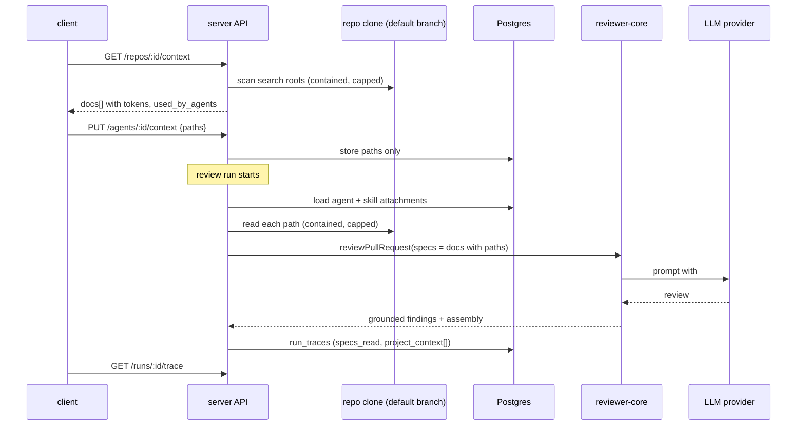

# Spec: Project Context
Spec ID: SPEC-01
Status: implemented
Supersedes: None
Modules: server, client, reviewer-core, e2e

## Problem and user
**Who.** A dev-digest user who configures reviewer agents and skills for a repository (one
local user; there are no roles in the app).

**Problem today.** A reviewer agent sees only its system prompt, its linked skills, the PR text,
the derived intent, repo-intel digests and the diff. It never sees the project's own written
rules (specs, architecture docs, incident notes). An invariant such as "module `api/` does not
import `db/` directly" can only reach the reviewer if someone copies it into a skill body by hand.

What already exists and what is missing:
- `reviewer-core` already has an optional `specs` slot. `assemblePrompt` wraps each entry in
  its own `<untrusted source="spec-<i>">` block under a `## Project context` heading
  (`reviewer-core/src/prompt.ts:197-200`, `reviewer-core/src/prompt.ts:222`;
  `reviewer-core/src/review/run.ts:61`). Labels are positional (`spec-0`, `spec-1`), so the
  model never sees which document a block came from.
- The server never fills that slot. `ReviewRunExecutor` passes skills, callers, repo map, PR
  body and intent but no `specs` (`server/src/modules/reviews/run-executor.ts:250-277`). Every
  trace is written with `specs_read: []` (`server/src/modules/reviews/run-executor.ts:393`,
  `server/src/modules/reviews/run-executor.ts:543`).
- The trace contract already has `specs_read: string[]` and `prompt_assembly.specs` in both
  vendored copies (`server/src/vendor/shared/contracts/trace.ts:47`,
  `server/src/vendor/shared/contracts/trace.ts:94`, and the same in
  `client/src/vendor/shared/contracts/trace.ts`). The trace drawer shows `specs_read` as chips
  and `prompt_assembly.specs` as one plain-text block, with no per-document view and no token
  count (`client/src/app/repos/[repoId]/pulls/[number]/_components/RunTraceDrawer/_components/TraceBody/TraceBody.tsx:39-50`, `:94-96`).
- A Project Context page was started on the client side and never finished. These pieces exist:
  the nav label (`client/messages/en/shell.json:20`), an active-key mapping for `/context`
  (`client/src/components/app-shell/helpers.ts:30`), a `context` i18n namespace
  (`client/messages/en/context.json`), hooks that call `GET /repos/:id/context` and
  `POST /repos/:id/context/reindex` (`client/src/lib/hooks/core.ts:122-137`), and a `SpecFile`
  contract (`client/src/vendor/shared/contracts/platform.ts:275`,
  `server/src/vendor/shared/contracts/platform.ts:275`). These pieces are missing: the nav entry
  (`client/src/vendor/ui/nav.ts:21-36`), the route under `client/src/app/repos/[repoId]/`, and
  any server route. No route under `server/src/modules` lists or reads repo files
  (`server/src/modules/repos/routes.ts:26-43`).
- The agent editor has only a Config tab and a Skills tab
  (`client/src/app/agents/[id]/_components/AgentEditor/constants.ts:11-14`). The skill editor
  has Config, Preview, Versions and Evals
  (`client/src/app/skills/[id]/_components/SkillEditor/constants.ts:10-15`).

**Scoping facts this spec depends on.**
- Agents and skills belong to a workspace and have no repo column
  (`server/src/db/schema/agents.ts:8-36`, `server/src/db/schema/skills.ts:5-21`).
- Repository documents live in that repo's clone at `<cloneDir>/<owner>/<name>`
  (`server/src/adapters/git/simple-git.ts:61-71`). The clone is a shallow checkout of the
  default branch: `sync` runs `reset --hard origin/<branch>`
  (`server/src/adapters/git/simple-git.ts:155-164`). The PR head is never checked out.

**Why it matters.** Attaching project documents lets one written invariant shape every review,
and the user can see what that costs in tokens before the run starts.

**Design sources.** Five screenshots: `l2.png` and `l3.png` show the Project Context page,
`l4.png` the agent editor Context tab, `l5.png` the skill editor Context tab, and `l6.png` the
run trace with Prompt Assembly. Where they conflict with the requirements, see "Decisions" P7-P10.

## Goals / Non-goals
### Goals
- G1. The user can find every Markdown document under the configured search roots of a repo,
  read it, and see its size in tokens.
- G2. The user can attach documents to an agent (agent editor, Context tab) or to a skill
  (skill editor, "Project context to use"). Only the document paths are stored.
- G3. When a review run starts, the attached documents are read from the repo checkout and added
  to the prompt as untrusted data under `## Project context`. This needs no extra LLM call.
- G4. The run trace shows which documents were read, how many tokens each one added, and the
  full text that was sent. Documents that could not be added are listed with the reason.
- G5. Path handling, size limits and prompt-injection delimiters are measurable and tested.

### Non-goals
- NG1. Automatic selection of relevant documents from PR content. This is a separate future
  feature.
- NG2. Editing, creating, uploading or deleting documents from dev-digest. Documents are
  view-only (P1).
- NG3. Creating a new agent or skill version when attachments change (P5).
- NG4. Chunking, embedding or semantic indexing of documents. The "chunks" count is replaced
  by a token total (P2). "Reindex" pulls the clone from origin and rescans; it builds no index
  (P20).
- NG5. A "coverage" score per document. The design's ring is replaced by a simple count of
  agents (P4).
- NG6. Project context for the GitHub/CI runner path. That path calls `reviewPullRequest`
  directly and has no attachments.
- NG7. The other tabs shown in the design that do not exist today: agent Evals, Stats and CI;
  skill Stats. The trace "Skills loaded" row is also out of scope.
- NG8. Reading documents from the PR head. The document text always comes from the repo's
  synced default-branch checkout.
- ~~NG9. Reordering attachments.~~ Withdrawn 2026-10-16 (P21): attached documents can be
  reordered by drag or by keyboard.
- NG10. A UI for search roots. In v1 they are set through a server environment variable only
  (OQ3).

## User stories
- US1. As a user, I want to browse every project document of the active repo with its token
  size and a read-only preview, so that I know what I can attach and what it will cost.
- US2. As a user, I want to attach documents to an agent, so that every review by that agent
  checks the PR against them.
- US3. As a user, I want to attach documents to a skill, so that every agent using that skill
  gets them.
- US4. As a user, I want attached documents added to the review prompt safely, so that the
  reviewer uses them and they can never take over the prompt.
- US5. As a user, I want to see in a run's trace exactly which documents were sent and what they
  cost, so that I can tell whether the project context affected the review.

## Acceptance criteria (EARS)
- AC1 (US1). WHEN the client requests the document list for a repo, the API (shall) return
  every `.md` file in that repo's clone whose repo-relative path matches a configured search
  root. The default search root is `**/{specs,docs,insights}/**/*.md`. Search roots are
  configurable through a server environment variable only; v1 has no UI for them (OQ3). Files
  under any directory in the repo-intel `EXCLUDED_DIRS` list
  (`server/src/modules/repo-intel/constants.ts:17`: node_modules, dist, build, coverage, .next,
  out, vendor, .git) are not returned (OQ2).
  _(observable: `GET /repos/:id/context` responds 200 with `docs[]` sorted by `path`. Each entry
  has `path`, `type`, `size_bytes`, `tokens` and `used_by_agents`. A fixture clone with
  `specs/a.md`, `docs/b.md`, `insights/c.md`, `src/d.md` and `specs/e.txt` returns exactly the
  first three.)_
- AC2 (US1). WHEN the user selects "Project Context" in the sidebar WORKSPACE group, the client
  (shall) open `/repos/<repoId>/context`. The page shows a list of the repo's documents (path,
  type badge, token estimate) and the footer `{files} files · {tokens} tokens total`. The word
  "chunks" does not appear. _(observable: the nav item is present; one row per document; the
  footer text comes from a `context` namespace key; `tokens` is the sum of `tokens` over
  `docs[]`.)_
- AC3 (US1). WHEN the user selects a document in the list, the Project Context page (shall)
  show its full content as rendered Markdown in a read-only preview, with no Edit, New, Upload
  or Save control. _(observable: the preview region holds the rendered headings of the fixture
  document; no `textbox` or edit button is in the panel; the request is
  `GET /repos/:id/context/file?path=<path>` → 200 `content`.)_
- AC4 (US1). WHEN a document is listed or previewed, the API (shall) report `used_by_agents` as
  the number of distinct agents that get this document for this repo, either attached directly
  or through a linked skill that attaches it (OQ5). The page shows that number as
  "Used by {count} agents". _(observable: a fixture in which agent A attaches `specs/a.md`, and
  skill S, linked to agents A, B and C, also attaches `specs/a.md` → `used_by_agents` is 3; the
  label reads "Used by 3 agents".)_
- AC5 (US1, US4). IF a requested or submitted document path is absolute, contains `..` or NUL,
  does not match a search root, or resolves (after following symlinks) outside the repo's clone,
  THEN the API (shall) answer 400 with `error.code` `context_path_invalid` and (shall) not read
  the file. _(observable: status 400 with that code for each traversal fixture in NFR1; a spy on
  file reads records no read outside the clone.)_
- AC6 (US2). WHEN the client saves an agent's attachments for the active repo, the API (shall)
  store each attachment as (agent, repo, repo-relative path), in attach order (OQ1, OQ4). It
  stores no document text and does not change `agents.version`. _(observable:
  `PUT /agents/:id/context` with `repo_id` → 200 echoing `paths`; a later
  `GET /agents/:id/context?repo_id=` returns the same list in the same order, and the same call
  for another repo returns `[]`; the stored row holds no content column; `GET /agents/:id` shows
  the same `version` as before.)_
- AC7 (US2). WHEN the user checks or unchecks a document on the agent editor's Context tab, the
  tab (shall) update the header `{attached} of {total} attached` and the footer
  `≈ {tokens} tokens` to the sum of the attached documents' `tokens`, and (shall) save the new
  attached list. _(observable: with fixtures of 120 and 197 tokens attached the footer reads
  "≈ 317 tokens"; one `PUT /agents/:id/context` carrying both paths. Each row shows a checkbox,
  the path, the type badge and a Preview button, and a filter input narrows rows by path. Rows
  have no drag handle and no reorder control (NG9).)_
- AC8 (US3). WHEN the user checks or unchecks a document in the skill editor's "Project context
  to use" section, the skill editor (shall) save the skill's attached path list for the active
  repo, as (skill, repo, path) in attach order (same rule as AC6), without changing
  `skills.version`. _(observable: `PUT /skills/:id/context` with `repo_id` → 200;
  `GET /skills/:id/context?repo_id=` returns the list;
  `GET /skills/:id/versions` is unchanged; the header shows `{attached} attached`.)_
- AC9 (US4). WHEN a review run starts for an agent on a PR, the run executor (shall) read from
  the PR's repo clone, as current UTF-8 text, the documents attached for that PR's repo only:
  the agent's own attachments, then the attachments of each skill in that run's `skills_used`,
  with duplicates removed by path (first occurrence kept). It (shall) pass each document to
  `reviewer-core` as its own entry in the `## Project context` section, in that order: agent
  attachments in attach order, then skill attachments skill by skill in `skills_used` order
  (OQ1, OQ4). _(observable: `prompt_assembly.specs` contains one `<untrusted ...>` block per
  included document, in the stated order. Each block names the document's repo-relative path and
  holds the file's text. A document attached to the same agent for another repo does not
  appear. The fake LLM receives a user message containing `## Project context`.)_
- AC10 (US4). IF an attached document is missing, unreadable, not valid UTF-8 or rejected by the
  AC5 rules at run time, THEN the run executor (shall) leave it out, (shall) continue the run,
  and (shall) record the path with status `missing` or `rejected` in the trace.
  _(observable: run status `done`; `project_context[]` holds that path with its status and
  `tokens: null`; `specs_read` does not contain it; the Live Log has one `info` line naming the
  path and the reason.)_
- AC11 (US4). IF including the next document would exceed the per-document cap (NFR2) or the
  per-run cap (NFR3), THEN the run executor (shall) leave that document out with status
  `over_limit` and (shall) continue with the remaining documents in order. _(observable: a
  fixture over the cap gets `status: "over_limit"` in `project_context[]`; documents that fit are
  still `included`; the run completes.)_
- AC12 (US4). WHILE an agent and its skills have no attached documents, the run executor (shall)
  produce a prompt byte-identical to today's and a trace with `specs_read: []`.
  _(observable: snapshot equality of `prompt_assembly.system` and `prompt_assembly.user` against
  a fixture run without the feature; `prompt_assembly.specs` is null.)_
- AC13 (US5). WHEN a run completes, the run executor (shall) persist `specs_read` as the included
  paths in prompt order, and `project_context[]` with one entry per attached document carrying
  `path`, `origin`, `status`, `tokens` and the exact `text` that was added. _(observable:
  `GET /runs/:id/trace` returns both fields; for included documents, the sum of `tokens` equals
  ceil(chars/4) of each `text`, added up.)_
- AC14 (US5). WHEN the user opens a run's trace, the trace drawer (shall) show a Prompt Assembly
  section titled "Project context — attached specs (untrusted)" with one expandable entry per
  `project_context[]` item (path, status, `~N tok`). Expanding an included entry shows its full
  text. _(observable: one entry per item; expanding shows `text`; a `missing` item shows the
  missing label and no text; the Configuration "Specs read" row lists the `specs_read` paths.)_
- AC15 (US2, US4). WHEN a document stating "module `api/` does not import `db/` directly" is
  attached to an agent and that agent reviews a PR in which a file under `api/` imports from
  `db/`, the review (shall) return at least one finding on that import line whose title or
  rationale names the attached document's path. _(observable: a finding with `file` under
  `api/` and a `line` on the import, grounded by `groundFindings()`, whose text contains the
  document path; the trace shows that path in `specs_read`.)_

## Workflow

## Contracts
Wire fields are snake_case. Nullability terms follow root `AGENTS.md`. Every change below lands
in both `server/src/vendor/shared` and `client/src/vendor/shared` with the same shape (see
NFR12). The existing `SpecFile` (`platform.ts:275`, both copies) is replaced or extended by
`ProjectContextDoc`; `IndexStatus` and the `reindex` hook are not used by this feature.

**ProjectContextDoc** (response)
- `path`: string, always present. Repo-relative, `/`-separated.
- `type`: string, always present. The search-root folder name the path matched (`specs`,
  `docs`, `insights`, or a custom root's folder name). When more than one root folder appears
  in the path, `type` comes from the folder nearest the file: `docs/specs/x.md` → `specs` (OQ8).
- `size_bytes`: integer, always present.
- `tokens`: integer, always present. ceil(chars/4), the estimate already used by
  `server/src/platform/trace-builder.ts:65` and `client/src/lib/tokens.ts:4`.
- `used_by_agents`: integer, always present (AC4).
- `updated_at`: string (ISO), nullish.

**`GET /repos/:id/context`** → 200
`{ docs: ProjectContextDoc[], total_tokens: int, search_roots: string[], truncated: boolean }`.
`truncated` is true when the NFR4 cap was hit.
Errors: 404 `repo_not_found`; 409 `clone_unavailable` (the repo has no clone on disk).

**`GET /repos/:id/context/file?path=<path>`** → 200 `ProjectContextDoc & { content: string }`.
Errors: 400 `context_path_invalid` (AC5); 404 `context_doc_not_found`; 409 `clone_unavailable`;
413 `context_doc_too_large` (over NFR2).

**`GET /agents/:id/context?repo_id=`**, **`GET /skills/:id/context?repo_id=`** → 200
`{ repo_id: string, paths: string[], missing: string[] }`. `repo_id` is required in the query.
`paths` is the attach order for that repo. `missing` lists attached paths not found in the
clone, always present and possibly empty (EC4).
**`PUT /agents/:id/context`**, **`PUT /skills/:id/context`** request:
`{ repo_id: string, paths: string[] }`, both required. It replaces the whole list for that repo
only, with at most 50 paths per agent or skill per repo (OQ7). Response 200
`{ repo_id: string, paths: string[] }`.
Errors: 400 `context_path_invalid`; 400 `validation_error` (more than 50, or duplicate paths);
404 when the agent, skill or repo is not in the workspace.

**RunTrace** (stored jsonb, parsed back on read)
- `specs_read`: string[], unchanged. It now holds the included paths in prompt order.
- `project_context`: nullish array. It must be nullish, not nullable, because traces stored
  before this field existed must still parse (root `INSIGHTS.md` "A contract field added to
  RunStats must be optional"). Each item:
  - `path`: string, always present.
  - `origin`: enum `agent` | `skill`, always present.
  - `skill_name`: string, nullish; set when `origin` = `skill`.
  - `status`: enum `included` | `missing` | `rejected` | `over_limit`, always present.
  - `tokens`: integer, nullable; null unless `included`.
  - `text`: string, nullable. The exact text added to the prompt; null unless `included`.
- `prompt_assembly.specs`: unchanged string, nullish (the whole Project context block).

## Edge cases
- EC1. The repo has no matching documents (first use). The page shows an empty state that names
  the active search roots and a rescan action. The existing copy that points to
  `.devdigest/specs/` (`client/messages/en/context.json:13`) no longer matches the roots. →
  AC1, AC2.
- EC2. A filter matches nothing on the Context tab. The tab says no document matches and offers
  to clear the filter. → AC7.
- EC3. The repo is not cloned yet, or the clone failed. The list answers 409
  `clone_unavailable` and the page shows an error state with a retry. At run time every attached
  document is recorded `missing`. → AC1 (contract), AC10.
- EC4. An attached document was deleted or renamed after it was attached. At run time it is
  skipped and recorded. On the agent Context tab and the skill section it is shown as a checked
  row labelled "missing", which the user can uncheck to remove it (OQ6). → AC10, AC7.
- EC5. A document changes in the default branch between attaching and the run. The run reads the
  current text (paths, not text, are stored), so the token count on the tab may differ from the
  trace. The trace is authoritative. → AC9, AC13.
- EC6. A PR edits an attached document. The run still uses the default-branch text, because the
  clone does not check out the PR head (`server/src/adapters/git/simple-git.ts:155-164`), so the
  PR cannot change the context for its own review. → NG8, NFR7.
- EC7. A symlink inside a search root points outside the clone, or to a file outside the roots.
  It is not listed and not read. → AC5, NFR1.
- EC8. A very large document, or a lot of documents attached. → AC11, NFR2, NFR3.
- EC9. A repo has more matching documents than the list cap. The list is truncated and the page
  says so. → NFR4, AC1.
- EC10. Map-reduce runs. The project context is sent with every chunk call
  (`reviewer-core/src/review/run.ts:177`), so the real cost is the token estimate times the
  number of chunks. The footer and tab label say "per prompt", not "per run". → AC7, AC13.
- EC11. The same path is attached to the agent and to one or more of its skills. It is added
  once. → AC9.
- EC12. A skill with attachments is disabled, or not linked to the agent. Its documents are not
  added: inheritance follows `skills_used`. → AC9.
- EC13. Two tabs save attachments for the same agent. Each save replaces the whole list, so the
  last save wins. This matches the agent Skills tab, which sends the full list on every change
  (`client/src/app/agents/[id]/_components/AgentEditor/_components/SkillsTab/SkillsTab.tsx:29`).
  → AC6.
- EC14. An agent or skill is deleted. Its attachments go with it, and `used_by_agents` drops. →
  AC4, AC6.
- EC15. A path or file name is long (deeply nested docs). Rows truncate the path and show the
  full path in a tooltip or `title`. → NFR10.
- EC16. A document contains text that tries to inject instructions, including a literal
  `</untrusted>`. The text stays data: the closing tag is escaped by `wrapUntrusted()`
  (`reviewer-core/src/prompt.ts:32-35`). → NFR7.
- EC17. A file name contains `"`, `<`, `>` or newline characters. That name cannot break the
  delimiter that carries the path to the model. → NFR7, AC5.
- EC18. A `.md` file is binary or not valid UTF-8. It is recorded as `rejected` at run time,
  and the preview shows an error. → AC10.
- EC19. The agent's repo-intel toggle is off. Project context is still added; it does not depend
  on `agent.repoIntel` (`server/src/modules/reviews/run-executor.ts:217`). → AC9.
- EC20. A run fails or is cancelled before the prompt is built. The trace keeps
  `specs_read: []` and `project_context` absent, as it does today for failed runs
  (`server/src/modules/reviews/run-executor.ts:522-546`). → AC13.
- EC21. Rate limit. The new routes sit under the global 120 requests/min
  (`server/src/app.ts:111`). On 429 the page keeps the last list and shows the retry message. →
  NFR5.

## Non-functional requirements
- NFR1. Security (path traversal) — For each fixture path, the list, file and attach endpoints
  and the run-time reader answer 400 `context_path_invalid` (or record `rejected` at run time),
  with zero filesystem reads outside the clone root. Fixtures: `../x.md`,
  `specs/../../etc/passwd.md`, `/etc/x.md`, `C:\x.md`, `specs/%2e%2e/x.md`, a path with NUL, a
  symlink in `specs/` to a file outside the clone, a symlink in `specs/` to `src/secret.md`
  (inside the clone but outside the roots). The existing `readFile` guard resolves the path but
  does not follow symlinks (`server/src/adapters/git/simple-git.ts:207-215`); the
  `conventions` reader has no guard (`server/INSIGHTS.md` "Plan/spec `readFile` needs a
  containment guard"). — verify: server-unit.
- NFR2. Limits (per document) — A single document larger than 64 KB (65,536 bytes) is shown in
  the list with its size but is rejected as `over_limit` at run time. Its preview returns 413.
  — verify: server-unit.
- NFR3. Limits (per run) — The project context added to one prompt does not exceed 24,000
  estimated tokens (ceil(chars/4), summed over included documents). — verify: server-unit.
- NFR4. Limits (listing) — The list returns at most 500 documents, with `truncated: true` beyond
  that. Each agent or skill holds at most 50 attachments per repo. The scan stops after
  visiting 5,000 files, matching `MAX_INDEXED_FILES` (`server/src/modules/repo-intel/constants.ts:42`).
  — verify: server-unit.
- NFR5. Rate limits and cost — The new routes are under the global limit of 120 requests/min
  (`server/src/app.ts:111`). Adding project context makes 0 extra LLM calls per run: the fake LLM
  call count is the same with and without attachments. — verify: server-unit.
- NFR6. Performance — `GET /repos/:id/context` answers within 1 s at p95 on a clone of 5,000
  files on the dev stack. — verify:
  server-integration (timed fixture).
- NFR7. Security (prompt injection) — Document text reaches the prompt only inside
  `wrapUntrusted()` blocks under `## Project context`, after the system prompt that carries
  `INJECTION_GUARD` (`reviewer-core/src/prompt.ts:18`). A literal `</untrusted>` in a document
  is escaped. A path cannot close or alter the delimiter: a fixture named `a"><x>.md` either
  produces a block whose opening tag is intact or is rejected at listing time. No document text
  appears in the system message. The `groundFindings()` gate
  (`reviewer-core/src/grounding.ts:75`) is unchanged, so a document cannot create a finding
  outside the diff. — verify: reviewer-core.
- NFR8. Security (stored XSS in preview) — The preview renders raw HTML in a document as text.
  A fixture with `<script>`, `` and `[x](javascript:alert(1))` produces no
  `script` element, no `onerror` attribute and no `javascript:` href. — verify: client.
- NFR9. Observability — Each run adds one Live Log `info` line,
  `project context: {included} included, {skipped} skipped (~{tokens} tokens)`, plus one `info`
  line per skipped path with its status. The pino `prompt.assembled` event carries only paths'
  count, chars and token estimates. No document text appears in any log line
  (`server/INSIGHTS.md` "Prompt logs are metadata-only"). — verify: server-unit.
- NFR10. Accessibility (WCAG 2.2 AA) — Every checkbox has the document path as its accessible
  name. The filter input has a label. The icon-only Preview button has a text name. The
  `{attached} of {total} attached` count and the token footer are in an `aria-live="polite"`
  region. All attach, preview and reorder actions work by keyboard. Truncated paths expose the
  full path. Targets are at least 24×24 px. Type badges show text, not only colour. — verify:
  client.
- NFR11. i18n — New strings go in `client/messages/en/context.json` (page and shared Context
  list), `agents.json` (`editor.tabs.context`), `skills.json` (`editor.tabs.context`) and
  `runs.json` (Project context trace labels). None are inline in JSX. `context.chunks` is no
  longer used on this page. — verify: client.
- NFR12. Compatibility — A trace stored before this feature (no `project_context` key) parses
  and renders. The server and client `trace.ts` and `platform.ts` copies carry the same
  `ProjectContextDoc` and `project_context` shapes. Existing agent, skill and MCP tool responses
  are unchanged. — verify: server-unit (contract parse test) and client.

## Inputs and provenance
| Input | Source | Trusted? | Used in |
|---|---|---|---|
| Document paths found by the scan | repo clone (file names are repo-controlled) | no | API list, UI, stored attachments, prompt delimiter label |
| Document text | repo clone (default branch) | no | preview UI, prompt, `run_traces.trace` |
| Paths submitted by the client | user input over REST | no (validated) | DB attachments |
| Search roots | config (per AC1 answer) | yes | scanner |
| Agent system prompt, manual skills | DB (user-authored) | yes | prompt (existing) |
| Model output citing documents | model output | no | findings (through `groundFindings()`) |

## Untrusted inputs
- Document path (file name) — reaches the file path, the UI and the prompt delimiter label —
  threat: path traversal, symlink escape, delimiter breakout (prompt injection) — the system
  (shall) reject any path outside the clone or the roots, and keep the label from closing or
  altering the `<untrusted>` tag — covered by: AC5, NFR1, NFR7.
- Document text — reaches the prompt — threat: prompt injection / goal hijacking (OWASP ASI01) —
  the system (shall) carry it only inside untrusted blocks below the injection guard, with
  `</untrusted>` escaped; it cannot remove or downgrade findings — covered by: AC9, NFR7.
- Document text — reaches the UI preview — threat: stored XSS (A05) — the system (shall) render
  HTML as text and drop `javascript:` links — covered by: NFR8.
- Document text — reaches logs — threat: sensitive data in logs (A09) — the system (shall) log
  metadata only — covered by: NFR9.
- Document text — reaches `run_traces` — threat: sensitive data at rest — the system stores it as
  it already stores the full prompt (`server/INSIGHTS.md` "Prompt logs are metadata-only"); no
  new exposure beyond the trace endpoint — covered by: AC13.
- Document size and count — reach memory and the token budget — threat: resource exhaustion /
  cost blow-up (A06) — the system (shall) enforce the caps — covered by: AC11, NFR2, NFR3, NFR4.
- PR content (head branch) — could try to change an attached document — threat: prompt injection
  through a self-modified context — the system (shall) read documents only from the
  default-branch clone — covered by: NG8, EC6, NFR7.
- Submitted attachment paths — reach the DB — threat: path traversal stored for later use —
  validated on save — covered by: AC5, AC6.

## Traceability
| AC | Story | Goal | Covers (EC / NFR / untrusted input) | Verify by |
|---|---|---|---|---|
| AC1 | US1 | G1 | EC1, EC3, EC9, NFR4, NFR6 | server-integration |
| AC2 | US1 | G1 | EC1, NFR10, NFR11 | client |
| AC3 | US1 | G1 | NG2, NFR8 | client |
| AC4 | US1 | G1 | EC14 | server-integration |
| AC5 | US1, US4 | G5 | EC7, EC17, NFR1, path input | server-unit |
| AC6 | US2 | G2 | EC13, EC14, NG3 | server-integration |
| AC7 | US2 | G2 | EC2, EC10, EC15, NFR10 | client |
| AC8 | US3 | G2 | NG3 | server-integration |
| AC9 | US4 | G3 | EC5, EC11, EC12, EC16, EC19, NFR5, NFR7, text input | server-unit + reviewer-core |
| AC10 | US4 | G3, G4 | EC3, EC4, EC18 | server-unit |
| AC11 | US4 | G5 | EC8, NFR2, NFR3 | server-unit |
| AC12 | US4 | G3 | NFR12 | server-unit |
| AC13 | US5 | G4 | EC5, EC20, NFR9, NFR12 | server-unit |
| AC14 | US5 | G4 | NFR10, NFR11 | client |
| AC15 | US2, US4 | G3 | course verification scenario | manual — needs a real model's answer; the e2e lane never calls an LLM (`e2e/AGENTS.md:8`). An `e2e web` flow (`e2e/specs/NN-project-context.flow.json`) can cover attach → trace rendering with a seeded trace. |

## Decisions
- P1 — accepted — Documents are view-only in v1; Edit, New, Folder and Upload are dropped.
  Reason: writing into the clone is wiped by the next `sync` (`reset --hard origin/<branch>`,
  `server/src/adapters/git/simple-git.ts:155-164`) and never reaches GitHub, so an edit would be
  silently lost. The user allowed dropping editing if it is costly. — landed in: NG2, AC3.
- P2 — accepted (user) — The footer says "tokens total" instead of "chunks". — landed in: AC2,
  NG4.
- P3 — accepted (user) — A missing document is skipped and recorded; the run continues. —
  landed in: AC10.
- P4 — accepted (user) — Usage is a simple "Used by N agents" count; no coverage ring. — landed
  in: AC4, NG5.
- P5 — accepted (user) — Attachment changes do not create agent or skill versions. — landed in:
  AC6, AC8, NG3.
- P6 — accepted (course brief) — No automatic document selection in v1. — landed in: NG1.
- P7 — accepted (course brief vs design) — The search roots are
  `**/{specs,docs,insights}/**/*.md`, not the single `.devdigest/specs/` folder the design header
  shows (l2.png). — landed in: AC1, EC1.
- P8 — accepted (follows P1) — The design toolbar's new-file, folder and upload buttons are
  dropped; the refresh button stays as a rescan. — landed in: NG2.
- P9 — accepted (course brief) — Paths only are stored, and the text is read at run time. —
  landed in: AC6, AC9, EC5.
- P10 — superseded by P21, P23 (2026-10-16) — changed (user, 2026-10-14) — Fixed order, no drag reorder: agent attachments in attach
  order, then skill attachments in skill order. — landed in: AC6, AC7, AC9, NG9.
- P11 — accepted (user, 2026-10-14) — The scan skips the repo-intel `EXCLUDED_DIRS`. — landed
  in: AC1.
- P12 — open — A trusted system-prompt line telling the model to check the diff against the
  attached documents and cite the path (like `buildScopePolicy`, `reviewer-core/src/prompt.ts:80`).
  It may be needed for AC15 to pass reliably. — landed in: OQ10 (non-blocking).
- P13 — accepted (user, 2026-10-14) — Attachments are per repo, stored as (agent or skill, repo,
  path). A document attached for repo A never reaches a review of repo B. — landed in: AC6, AC8,
  AC9, Contracts.
- P14 — accepted (user, 2026-10-14) — "Used by N agents" counts distinct agents, direct or
  through an attached skill. — landed in: AC4.
- P15 — accepted (user, 2026-10-14) — Caps: 64 KB per document, 24,000 tokens per run, 500 listed
  documents, 50 attachments per agent or skill per repo. — landed in: NFR2, NFR3, NFR4,
  Contracts.
- P16 — accepted (user, 2026-10-14) — Search roots come from a server environment variable, with
  no UI in v1. — landed in: AC1, NG10.
- P17 — accepted (user, 2026-10-14) — A stale attached path shows as a "missing" row the user can
  uncheck. — landed in: EC4, Contracts (`missing`).
- P18 — accepted (user, 2026-10-14) — `type` comes from the root folder nearest the file. —
  landed in: Contracts.
- P19 — accepted (user, 2026-10-14) — The list endpoint answers within 1 s at p95 on a
  5,000-file clone. — landed in: NFR6.

- P20 — changed (review feedback, 2026-10-16) — The Project Context page has a toolbar with
  Download (the selected document as a `.md` file, client side) and Reindex.
  `POST /repos/:id/context/reindex` syncs the clone to `origin/<default branch>` and returns
  the rescanned list; a failed sync answers 409 `clone_unavailable`. Replaces the Rescan
  button of P8. — landed in: NG4.
- P21 — changed (review feedback, 2026-10-16) — Supersedes P10. Attached documents are listed
  first in attach order and can be reordered by drag and drop, or with ArrowUp / ArrowDown on
  the row handle. The order is stored through the existing full-replace PUT. — landed in: NG9.
- P22 — accepted (review feedback, 2026-10-16) — The agent and skill pickers warn when the
  attached documents cost more than 8,000 tokens (`CONTEXT_TOKEN_WARN`). This is a warning
  only; the 24,000-token run cap (P15) is unchanged.
- P23 — accepted (user, 2026-10-16) — The prompt groups included documents as specs, docs,
  insights, then any other type, keeping the P21 order inside each group
  (`groupCandidates`). The skill editor Context tab shows this shape in a "Serializes as" block.
  The client group order mirrors the server's `CONTEXT_GROUP_ORDER` by hand.

## Open questions
- ~~OQ1~~ closed 2026-10-14 — per repo: (agent or skill, repo, path) — see P13.
- ~~OQ2~~ closed 2026-10-14 — the repo-intel `EXCLUDED_DIRS` list — see P11.
- ~~OQ3~~ closed 2026-10-14 — a server environment variable, with no UI in v1 — see P16.
- ~~OQ4~~ closed 2026-10-14 — fixed order with no drag reorder — see P10, NG9.
- ~~OQ5~~ closed 2026-10-14 — distinct agents, direct or through a skill — see P14.
- ~~OQ6~~ closed 2026-10-14 — a "missing" row the user can uncheck — see P17.
- ~~OQ7~~ closed 2026-10-14 — 64 KB / 24,000 tokens / 500 documents / 50 attachments — see P15.
- ~~OQ8~~ closed 2026-10-14 — the folder nearest the file — see P18.
- ~~OQ9~~ closed 2026-10-14 — 1 s at p95 on a 5,000-file clone — see P19.
- OQ10. Should a trusted system-prompt policy line ask the model to check the diff against the
  attached documents and cite the path? This would change `reviewer-core` prompt text, but not
  `wrapUntrusted()` or `groundFindings()`. Recommended: add it only if a manual AC15 run shows
  that the reviewer does not cite the document without it. Place it in the system message, as
  `buildScopePolicy` does. — category: C4 — owner: user — blocks: none (it affects only how
  reliably AC15 passes) — marker: none.

## Changelog
- 2026-10-14 — draft created
- 2026-10-14 — user answers applied. OQ1-OQ9 are closed and their markers replaced. AC4, AC6,
  AC7, AC8, AC9 and AC1 are reworded, the Contracts take `repo_id` and `missing[]`, the caps go
  into NFR2-NFR4 and NFR6 has its target. NG9 (no reorder) and NG10 (no search-root UI) are
  added, and P10-P19 are recorded. OQ10 stays open and non-blocking. The AC count is unchanged
  at 15.
- 2026-10-14 — status set to approved by the user
- 2026-10-16 — revised after review: P20-P23 added. NG9 is withdrawn, NG4 is reworded, and
  P10 is superseded by P21.
