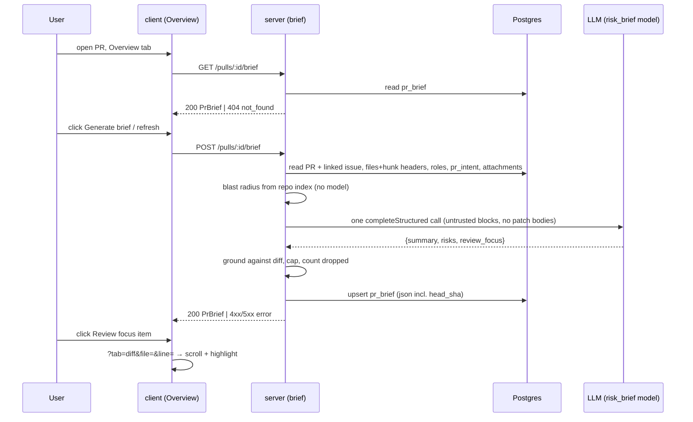

# Spec: PR Why + Risk Brief
Spec ID: SPEC-03
Status: implemented
Supersedes: None
Modules: server, client, e2e

## Problem and user
**Who.** A dev-digest user who opens someone else's pull request "cold". They do not know
why the change exists, what is risky in it, or which file to read first. There is one local
user and no roles.

**Problem today.** The PR Overview tab shows three separate pieces: the Intent card, the
Blast radius card and the PR description
(`client/src/app/repos/[repoId]/pulls/[number]/_components/OverviewTab/OverviewTab.tsx:17-29`).
Nothing joins them into a "why + risk + where to start" view:
- **Intent (L03).** It is stored in `pr_intent` (`server/src/db/schema/reviews.ts:49-67`).
  It is read through `getIntent(workspaceId, prId)` in the intent module
  (`server/src/modules/intent/repository.ts:50`), not in the reviews repository.
  `GET /pulls/:id/intent` returns 404 when an intent was never derived, and it never derives
  one (`server/src/modules/intent/routes.ts:10,18`).
- **Blast radius (L04).** `GET /pulls/:id/blast` returns `BlastRadius` with `summary`,
  `downstream[].callers[]`, `degraded` and `degraded_reason`
  (`server/src/modules/blast/routes.ts:17`, `server/src/vendor/shared/contracts/brief.ts:91-99`).
  Callers are capped at 20 in total, not per symbol (server INSIGHTS
  "MAX_CALLERS_PER_SYMBOL is a global slice").
- **Smart Diff (L03).** `GET /pulls/:id/smart-diff` groups files by role and makes no model
  call (`server/src/modules/smart-diff/routes.ts:16`, `brief.ts:137-146`).
- **Diff stats.** `PrDetail.files[]` carries `path`, `additions`, `deletions` and an optional
  `patch` (`server/src/vendor/shared/contracts/platform.ts:207-212,231-239`).
- **Project Context (SPEC-01).** Attached documents are stored per (agent, repo) and per
  (skill, repo) (`server/src/db/schema/project-context.ts:11,31`,
  `server/src/modules/project-context/routes.ts:21-22`).
- **Brief scaffolding exists but is unused:**
  - The `PrBrief` contract `{ intent, blast, risks, history }` requires every part and has no
    summary and no review focus (`brief.ts:172-177`). The client copy has the same exports
    (`client/src/vendor/shared/contracts/brief.ts:172`).
  - A `pr_brief` table `(pr_id PK, json NOT NULL)` exists with no writer
    (`server/src/db/schema/reviews.ts:69-74`).
  - A feature model `risk_brief` (default `openai` / `gpt-4.1`) exists
    (`server/src/vendor/shared/contracts/platform.ts:59-65`).
  - A `brief` i18n namespace exists (`client/messages/en/brief.json:1-19`).
- **No route to a file.** The Files changed tab (`?tab=diff`) takes no file or line target
  (`client/src/app/repos/[repoId]/pulls/[number]/page.tsx:61-69`,
  `.../DiffTab/DiffTab.tsx:14-20`). No screen can link to "this file, this line" in the diff.

**Why it matters.** One card that says what the PR does, why, what is risky and where to
start cuts the time to a useful first review comment. It must stay cheap and honest:
- exactly one model call per generation;
- only precomputed facts go in, and the model never sees diff code;
- every file and line in the brief is checked against the real diff;
- missing data is named, not filled in.

**Design sources.**
- `hw1.png` (Overview), in this order:
  - a "PR BRIEF" label;
  - a banner with a verdict, "6 findings · 2 blockers", a summary paragraph, a refresh icon,
    a PR score ring (61) and cost/tokens;
  - an Intent card (quote, In scope, Out of scope);
  - "Risk areas" rows: severity icon, title, `file:start-end` ref, expand chevron;
  - a Blast radius card with "Prior PRs touching these files";
  - a full-width "REVIEW FOCUS — READ THESE FIRST (4)" list of `file:line — reason`.
- `hw2.png` (Files changed): the reviewer-ordered diff in Smart order, with a target file
  expanded at the clicked line.
- The assignment text sets the priorities: P1 user stories are the Definition of Done. The
  verdict/score banner and risk expansion are P3. Prior PRs is P3 and not part of the brief.
  Where the screenshots and the text differ, the text wins.

## Goals / Non-goals
### Goals
- G1. The Overview tab shows one "PR Brief" card. It holds a model-written summary,
  Risk areas and Review focus, next to the existing Intent and Blast radius cards.
- G2. A generation makes **exactly one** model HTTP call. The call gets only precomputed facts:
  intent, blast summary and caller files, diff stats with roles and hunk headers, the PR title
  and description, the linked issue's title and body, and attached specs. It never gets diff
  code (hunk bodies).
- G3. At generation time:
  - every Review focus file and line lies inside the PR diff;
  - every risk file ref is a PR changed file or a blast-radius caller file.

  Anything else is dropped and counted.
- G4. A generated brief is persisted per PR with the commit SHA it was built for. It is shown
  on reload without regeneration, and it is marked stale when the PR head moves.
- G5. A Review focus item takes the user to that file (and line) on the Files changed tab.
- G6. Missing inputs, model failures, rate limits and empty PRs end in an honest, named state.
  The brief never contains invented data.

### Non-goals
- NG1. "Prior PRs touching these files" (P3 from L04). `PrBrief.history` is not filled in.
- NG2. Deriving intent, computing blast radius anew, or calling any other model as part of a
  brief generation. Missing facts are reported, not produced (P5).
- NG3. Generating automatically on page open, on PR sync or after a review. Generation runs
  only on an explicit click (Generate or refresh).
- NG4. Brief history, or one brief per commit. One brief per PR, overwritten by each
  successful generation.
- NG5. Sending diff code (patch bodies) to the model.
- NG6. Exposing the brief through the MCP server.
- NG7. Changing `groundFindings()`, `wrapUntrusted()`, `INJECTION_GUARD` or the Intent and
  Blast radius cards themselves.
- NG8. The Blast radius "Graph" view, the "Tree/Graph" toggle and other visual polish from
  `hw1.png` beyond the blocks listed in G1. A simple list is accepted.
- NG9. Non-English brief prose. The model is asked to write English.
- NG10. A job queue or progress polling for generation. The request is synchronous (Q5).

## User stories
- US1. As a reviewer opening a PR, I want a PR Brief block with a "Generate brief" button on
  the Overview tab when no brief exists yet, so that I know I can get one.
- US2. As a reviewer, I want to click Generate brief, wait, and then see a summary (what the
  PR does and why), Risk areas and Review focus next to Intent and Blast radius, so that I
  understand the PR before reading code.
- US3. As a reviewer, I want each risk to show its title and the file it concerns, so that I
  know where the risk lives.
- US4. As a reviewer, I want a Review focus list of `file:line — why it matters` where a
  click opens that file on the Files changed tab, so that I start reading in the right place.
- US5. As a reviewer, I want the same brief to appear immediately after a reload, without
  regeneration, so that I do not pay for it twice.
- US6. As a reviewer, I want a refresh button that regenerates the brief, so that I can
  update it after new commits.
- US7 (P3, does not block acceptance). As a reviewer, I want the verdict and PR score of the
  latest review above the summary, and I want to expand a risk to read its explanation, as in
  the design.

## Acceptance criteria (EARS)
- AC1 (US1). WHILE the PR has no stored brief, the Overview tab (shall) show the PR Brief
  card above the Intent and Blast radius cards. The card's single primary action is
  "Generate brief". _(observable: `GET /pulls/:id/brief` → 404 `not_found`; the card shows the
  text of `brief:generate` as an enabled button and the `brief:empty` hint; the
  `IntentCard` and `BlastRadius` cards still render; the Description block renders below the
  brief)_
- AC2 (US2). WHEN the user clicks Generate brief, the API (shall) build the brief from the
  stored facts and make exactly one model HTTP call. The call uses the provider and model
  that the Settings item `risk_brief` resolves to, with no re-ask and no transport retry
  (Q2). _(observable: with a counting fake provider, one `completeStructured` request is
  recorded per `POST /pulls/:id/brief`; its `model` equals the resolved `risk_brief` model;
  the response is 200 with a `PrBrief` body)_
- AC3 (US2). WHEN the API builds the model input, it (shall) include only these facts:
  - PR title and description;
  - the linked issue's title and body, when `PrDetail.linked_issue` is set;
  - intent (intent, in scope, out of scope, change type);
  - blast summary and the distinct caller file paths;
  - per changed file: path, role, additions, deletions and its hunk headers;
  - the attached specs of the repo's enabled agents (Q3).

  Each untrusted text goes inside its own `wrapUntrusted()` block, after the system prompt
  that carries `INJECTION_GUARD`. _(observable: the fake provider's user message contains
  one `<untrusted source="...">` block per fact group, per spec and for the linked issue,
  plus `@@ ... @@` header lines; it contains no `+`/`-`/context line of any
  `pr_files.patch` hunk body)_
- AC4 (US2). IF one or more inputs are absent, stale, degraded or empty, THEN the API (shall)
  still generate the brief and (shall) record each one in `missing_inputs` with its reason.
  The cases are:
  - intent never derived;
  - intent derived for another head SHA;
  - blast unavailable or `degraded: true`;
  - no spec included;
  - PR description empty;
  - no linked issue (`linked_issue` null or absent) → `{input:"issue",reason:"absent"}`.

  _(observable: for a PR with no `pr_intent` row and no attachments, the 200 body has
  `missing_inputs` containing `{input:"intent",reason:"absent"}` and
  `{input:"specs",reason:"absent"}`, and the model call count is 1, never 2)_
- AC5 (US3, US4). WHEN the model answer arrives, the API (shall) apply the diff-grounding
  rule of `groundFindings()` (`reviewer-core/src/grounding.ts:75`, unchanged). The rules
  differ for focus items and risks.

  **Review focus items:**
  - keep an item only if its `file` is a PR changed file and its `line` lies in a new-side
    hunk range of that file;
  - a file found only in the blast radius is not enough, because Review focus must deep-link
    into Files changed, which shows PR files only.

  **Risk file refs:**
  - keep a ref whose path is a PR changed file or, when blast is available, a caller file of
    the blast radius;
  - drop every other ref;
  - when blast is unavailable, only PR changed files count;
  - drop a risk that has no ref left.

  Store the counts in `dropped`.

  _(observable: a fake answer containing these items
  - focus item on `not/in/diff.ts:3`;
  - focus item on a real PR file at a line outside every hunk;
  - focus item on a blast-only caller file;
  - risk whose only ref is a blast caller file;
  - risk whose only ref is in neither set.

  → the stored brief keeps only the risk with the blast caller ref, and
  `dropped = {review_focus: 3, risks: 1, file_refs: 1}`. With blast `null`, the
  caller-file risk is dropped too.)_
- AC6 (US2, US5). WHEN a generation succeeds, the API (shall) store the brief as the PR's
  single `pr_brief` row, with the PR's current `head_sha` and `generated_at`. It replaces any
  earlier brief. _(observable: after two successful POSTs, one row exists for the PR and its
  `json.head_sha` equals `PrDetail.head_sha` at the second POST)_
- AC7 (US2, US3). WHEN a brief is shown, the PR Brief card (shall) render these parts, as
  plain text:
  - the summary;
  - a "Risk areas" list: per risk, its title, each file ref, and a severity icon whose
    accessible name is the severity word;
  - a "Review focus — read these first" list of `file:line — reason` in the stored order.

  _(observable: the texts of `brief:block.risks` and `brief:block.reviewFocus`; one row per
  stored risk and focus item in order; each severity icon has an accessible name from
  `brief:severity.high|medium|low`; with no risks, `brief:noRisks` is shown)_
- AC8 (US4). WHEN the user activates a Review focus item, the PR detail page (shall) switch to
  the Files changed tab. It (shall) scroll to that file, expanded, with the target line
  highlighted. When that line is not rendered, it (shall) scroll to the file header instead.
  _(observable: the URL becomes `?tab=diff&file=<url-encoded path>&line=<n>`; the file's diff
  row is expanded and in the viewport; the line row carries a `data-focus-line` attribute;
  the item is an `<a>` reachable by Tab and opened by Enter)_
- AC9 (US5). WHEN the Overview tab loads for a PR with a stored brief, the client (shall)
  show that brief from `GET /pulls/:id/brief` without a model call. _(observable: after a
  reload the same summary, risks and focus items render; the fake provider records 0 new
  calls; no POST is sent)_
- AC10 (US5, US6). WHILE the stored brief's `head_sha` differs from the PR's current
  `head_sha`, the PR Brief card (shall) show the stored brief with a stale note and the
  refresh action, and (shall) not regenerate on its own. _(observable: `brief:stale` text
  is visible; no POST is sent on load)_
- AC11 (US6). WHEN the user clicks the refresh button on a shown brief, the client (shall)
  send one generation request and (shall) replace the shown brief with the response on
  success. _(observable: one `POST /pulls/:id/brief`; the new `generated_at` renders; the
  refresh button has the accessible name `brief:refresh`)_
- AC12 (US2, US6). WHILE a generation request is pending, the PR Brief card (shall) show a
  generating status in a polite live region, and (shall) disable Generate and refresh.
  _(observable: `brief:generating` inside an element with `aria-live="polite"`; both
  buttons `disabled`; a second click sends no request)_
- AC13 (US2, US6). IF a generation fails, THEN the API (shall) store nothing and (shall) keep
  any earlier brief. It (shall) answer with the error code from "Contracts". The failure
  cases are:
  - missing provider key;
  - timeout after 90 s;
  - provider error;
  - an answer that does not match the output schema.

  _(observable: with a fake provider that throws, the response is 502
  `external_service_error` with `details.reason` in
  `timeout | provider_error | schema_mismatch`; with no key it is 500 `config_error`; the
  `pr_brief` row is byte-identical to before)_
- AC14 (US2, US6). IF a generation request fails, THEN the PR Brief card (shall) show an
  error state with a Retry action and keep showing the earlier brief, if there is one. For
  `config_error` it (shall) also link to Settings. For 429 it (shall) show the rate-limit
  message. _(observable: `brief:error.generic` + Retry button; `brief:error.noKey` with a
  link to `/settings`; `brief:error.rateLimited` on 429; the earlier summary is still in the
  DOM)_
- AC15 (US2). IF two generation requests for the same PR overlap (double click, two tabs),
  THEN the API (shall) make one model call and (shall) return the same brief to both.
  _(observable: two concurrent POSTs → the fake provider records 1 call; both 200 bodies
  have the same `generated_at`)_
- AC16 (US1, US2). IF the PR has no changed files, THEN the PR Brief card (shall) show
  Generate disabled with the `brief:emptyPr` hint, and the API (shall) answer a POST with
  422 `validation_error` (`details.reason: "no_files"`) without a model call.
  _(observable: button `disabled`; direct POST → 422; fake provider records 0 calls)_
- AC17 (US7, P3, optional). WHERE the PR has at least one review, the PR Brief card (shall)
  show the verdict and PR score of the newest review above the summary, reusing the existing
  verdict banner. The banner may also show the brief's `cost_usd` and
  `tokens_in`→`tokens_out`. Cost uses the three-way format: unknown "—", free "$0.00",
  below $0.0001 "<$0.0001" (OQ3). _(observable: verdict label from `prReview:verdict.*` and
  the score ring render; with no review, only the summary renders; a `cost_usd` of null
  renders "—")_
- AC18 (US7, P3, optional). WHEN the user expands a risk row, the PR Brief card (shall) show
  that risk's explanation. _(observable: the row's toggle has `aria-expanded` going from
  false to true; the explanation text becomes visible)_

## Workflow

## Contracts
`@devdigest/shared` changes in **both** copies, `server/src/vendor/shared/contracts/brief.ts`
and `client/src/vendor/shared/contracts/brief.ts`, with the same shape. `PrBrief` is parsed
from stored JSON (`pr_brief.json`), so every field added to it is `nullish` and older JSON
still parses (root INSIGHTS "A contract field added to RunStats must be optional").

**`GET /pulls/:id/brief`**
- It reads the cache only. It never generates and never calls the model.
- Reopening a PR whose head SHA is unchanged reads the stored brief.
- 200: `PrBrief`.
- 404: `not_found` when there is no stored brief, or when the stored JSON does not parse.
- 404: `not_found` when the PR is not in the workspace.
- Global rate limit only.

**`POST /pulls/:id/brief`**
- Request: no body. An empty body is accepted.
- Response 200: `PrBrief`. Responses are synchronous; the server waits up to 90 s for the
  model.
- Errors:
  - 404 `not_found`: unknown PR.
  - 422 `validation_error`, `details.reason: "no_files"`: the PR has no changed files.
  - 500 `config_error`: no API key for the resolved provider.
  - 502 `external_service_error`, `details.reason`: one of `timeout`, `provider_error`,
    `schema_mismatch`.
  - 429: rate limit.

**`PrBrief`** (wire, snake_case):
- `summary`: string, nullish. Always set by this feature; nullish only for stored JSON.
- `intent`: `Intent`, nullable. Was required; becomes `null` when absent.
- `blast`: `BlastRadius`, nullable. Was required; becomes `null` when unavailable.
- `risks`: `Risks`, always present. `risks[]` holds at most 8 items.
  - `Risk.file_refs[]` entries are `path` or `path:start-end`.
- `history`: `PrHistory`, nullish. Not filled by this feature (NG1).
- `review_focus`: array, nullish, at most 8 items. Each item has:
  - `file`: string;
  - `line`: int ≥ 1;
  - `reason`: string.
- `head_sha`: string, nullish. The PR head the brief was built for.
- `generated_at`: ISO-8601 string, nullish.
- `missing_inputs`: array, nullish. Each item has:
  - `input`: one of `intent | blast | specs | description | issue`;
  - `reason`: one of `absent | stale | degraded | empty | unavailable`.
- `specs_used`: array of repo-relative paths, nullish.
- `truncated`: object, nullish:
  - `files`: int, the changed files left out over the 300-file cap;
  - `description`: boolean;
  - `issue_body`: boolean, nullish.
- `dropped`: object, nullish:
  - `review_focus`: int;
  - `risks`: int;
  - `file_refs`: int.

  Each count covers items removed by grounding or by the 8-item caps.
- `model`: string, nullish.
- `tokens_in`: int, nullish.
- `tokens_out`: int, nullish.
- `cost_usd`: number, nullish. `null` when the price is unknown.

**Model output schema** (internal to the server, not on the wire): `{ summary: string,
risks: Risk[], review_focus: { file, line, reason }[] }`.

## Edge cases
- EC1. **First use.** No brief yet → AC1.
- EC2. **Stale brief after new commits.** The stored `head_sha` ≠ the current head → AC10.
  A force-push that removes a grounded file only shows the stale note. Grounding runs at
  generation time only.
- EC3. **No API key.** The resolved provider has no key → 500 `config_error` (AC13), and
  the UI shows the Settings link (AC14). The default `risk_brief` is `openai`, so a fresh
  setup without `OPENAI_API_KEY` hits this.
- EC4. **Model timeout, provider error or schema mismatch.** → AC13, AC14. There is no
  re-ask (Q2).
- EC5. **The model names a file or line outside the allowed set.** A Review focus item must
  sit on a PR file inside a hunk. A risk ref may also point to a blast caller file. → AC5.
- EC22. **No linked issue.** The brief is generated and `missing_inputs` gets
  `{input:"issue",reason:"absent"}`. An issue with an empty body passes only its title.
  → AC4.
- EC23. **Blast unavailable or degraded.** Risk refs are grounded against PR files only, when
  blast is `null`. When blast is degraded, the callers it did return still count. → AC5.
- EC6. **A file has no `patch`** (binary or too-large file). It is listed with no hunk
  headers, so no Review focus line can be grounded on it. Risk refs to it are still kept
  (AC5).
- EC7. **Missing intent, stale intent, degraded or unavailable blast, no specs, empty
  description.** → AC4. The Intent and Blast cards keep their own empty or degraded states.
- EC8. **Empty PR (0 files).** → AC16.
- EC9. **Double click, or two tabs generating at once.** → AC12, AC15.
- EC10. **Reload during a pending generation.** The page shows the earlier state: the
  stored brief or the empty card. The running generation still finishes and stores its
  brief. The next Generate click joins it if it is still running (AC15). The next load
  shows its result (AC9).
- EC11. **Rate limit hit** → 429 and the UI message (AC14, NFR3).
- EC12. **Large PR.** More than 300 changed files, a description over 8,000 chars, or more
  than 20 hunks in one file. Inputs are cut to the caps and the cuts are recorded in
  `truncated` (NFR2).
- EC13. **Specs over the caps.** A document over 64 KB, or past the 24,000-token total, is
  left out like in SPEC-01 AC11. An unreadable or missing document is left out like in
  SPEC-01 AC10. Only included paths appear in `specs_used` (AC3, NFR2).
- EC14. **The model returns more than 8 risks or 8 focus items.** The first 8 are kept in
  the model's order; the rest are counted in `dropped` (AC5).
- EC15. **Stored JSON does not parse** (written before this schema). It reads as "no brief"
  (AC1, Contracts).
- EC16. **Long text.** A long summary, reason or path wraps and never overflows the card.
  A path is never cut in the middle of the `file:line` link target (AC7, NFR5).
- EC17. **Prompt injection in PR text, spec text or intent text** (including a literal
  `</untrusted>`). → AC3, NFR4.
- EC18. **The target line is not rendered** (inside a collapsed context region, or the file
  left the diff after a force-push). → AC8 falls back to the file header. If the file is
  absent, the Files changed tab opens at the top.
- EC19. **The PR is deleted or re-imported.** The brief goes with it (cascade,
  `server/src/db/schema/reviews.ts:70-72`).
- EC20. **No review yet.** The P3 verdict banner is hidden (AC17).
- EC21. **Contract drift.** The server and client `brief.ts` copies must keep the same shape
  (NFR8).

## Non-functional requirements
- NFR1. **Cost.**
  - One generation = exactly one model HTTP call. It uses the single-shot provider path, with
    no SDK transport retry and no schema re-ask (server INSIGHTS "`container.llm()` cannot
    promise exactly one HTTP request").
  - verify: server-unit, with a counting fake provider and a control case that fails on a
    second call.
- NFR2. **Input caps.**
  - PR description: 8,000 chars.
  - Linked issue body: 4,000 chars. The cut is recorded in `truncated.issue_body`.
  - Changed files listed: 300.
  - Hunk headers: 20 per file.
  - Specs: 64 KB per document and 24,000 estimated tokens in total, as in SPEC-01
    NFR2/NFR3.
  - Whole user prompt: at most 40,000 estimated tokens (ceil(chars/4)).
  - Model output: at most 8 risks and 8 Review focus items.
  - verify: server-unit, with fixtures over each cap.
- NFR3. **Rate limits.**
  - `POST /pulls/:id/brief`: 10 requests/min, the same as intent
    (`server/src/modules/intent/routes.ts:26`) and onboarding generate
    (`server/src/modules/onboarding/constants.ts:33`).
  - `GET /pulls/:id/brief`: the global 120 requests/min only (`server/src/app.ts:111`).
  - verify: server-integration.
- NFR4. **Security (prompt injection).**
  - PR title and body, linked issue title and body, intent text, blast summary, caller and
    file paths, hunk headers and spec text reach the prompt only inside `wrapUntrusted()`
    blocks
    (`reviewer-core/src/prompt.ts:45`), after `INJECTION_GUARD`
    (`reviewer-core/src/prompt.ts:18`).
  - A literal `</untrusted>` in any of them arrives escaped.
  - Model output can never add a Review focus location outside the diff, or a risk ref
    outside the PR files and blast caller files (AC5).
  - verify: server-unit, with an injection fixture.
- NFR5. **Security (stored XSS, link injection).**
  - Summary, titles, explanations, reasons and paths render as plain text, never as HTML or
    markdown.
  - A Review focus link is built only from a grounded `file` and an integer `line`, and is
    URL-encoded.
  - verify: client.
- NFR6. **Observability.** Each generation writes one `info` log line, `brief.generated`.
  - Fields: `pr_id`, `llm_calls` (= 1), `model`, `tokens_in`, `tokens_out`, `cost_usd` (or
    null), the counts of included inputs, `missing_inputs`, `truncated`, `dropped` and
    `duration_ms`.
  - A failure writes one `warn` line, `brief.failed`, with `pr_id` and `reason`.
  - No log line holds prompt text, PR or spec text, file paths or model output (server
    INSIGHTS "Prompt logs are metadata-only").
  - verify: server-unit.
- NFR7. **Performance.**
  - `GET /pulls/:id/brief` answers within 300 ms at p95 on the dev stack. It does no model
    call and no index rebuild.
  - The POST is bounded by the 90 s model timeout plus input assembly.
  - verify: server-integration.
- NFR8. **Compatibility.**
  - Both `brief.ts` copies carry the identical `PrBrief`.
  - JSON with no new keys still parses.
  - The `IntentCard`, `BlastRadius`, Smart Diff and Files changed behaviour without a
    `file`/`line` query stays unchanged.
  - verify: server-unit (contract parse) + client.
- NFR9. **Accessibility (WCAG 2.2 AA).**
  - Severity is never shown by color alone (1.4.1).
  - The generating, error and stale states are announced through `aria-live="polite"`
    (4.1.3).
  - Buttons and focus links are keyboard-reachable, with visible focus (2.1.1, 2.4.7).
  - The icon-only refresh button has an accessible name (4.1.2).
  - verify: client.
- NFR10. **i18n.**
  - Every new string lives in `client/messages/en/brief.json`.
  - `block.risks` becomes "Risk areas".
  - New keys: `block.reviewFocus`, `generate`, `refresh`, `generating`, `empty`, `emptyPr`,
    `stale`, `missing.*`, `severity.*`, `error.generic`, `error.noKey`, `error.rateLimited`,
    `retry`.
  - The obsolete `unavailableHint` copy ("Run a review or open the PR…") is replaced.
  - Nothing is inline in JSX.
  - verify: client.
- NFR11. **e2e.** One flow, `e2e/specs/09-pr-brief.flow.json`, covers the demo journey on
  the seeded PR #482. The e2e lane runs with no key and no model (`e2e/AGENTS.md:8`), so a
  real Generate cannot succeed there. The seed used by the e2e stack writes one fixed,
  grounded `pr_brief` row for PR #482, with `head_sha` equal to the seeded head. The flow
  checks three things:
  - the brief is displayed (summary, Risk areas, Review focus);
  - the same brief is still shown after a reload;
  - a Review focus click opens the Files changed tab at that file.

  Real generation is not part of the e2e lane. It is shown manually in the demo video (OQ1).
  — verify: e2e web.

## Inputs and provenance
| Input | Source | Trusted? | Used in |
|---|---|---|---|
| PR title, description | GitHub, stored in DB | no | prompt |
| Linked issue title, body (`PrDetail.linked_issue`) | GitHub | no | prompt |
| Intent text, scope lists | model output (L03), DB `pr_intent` | no | prompt; Intent card |
| Blast summary, caller paths | repo index built from the repo clone (`GET /pulls/:id/blast`) | no | prompt |
| Changed file paths, additions/deletions, hunk headers | GitHub, DB `pr_files` | no (paths are repo text) | prompt; grounding; UI; URL query |
| File roles | Smart Diff (deterministic) | yes (fixed enum) | prompt |
| Attached spec text | repo clone, default branch (SPEC-01) | no | prompt |
| `risk_brief` provider/model | Settings, DB | yes | model call |
| API key | `SecretsProvider` | secret | model call only |
| Summary, risks, review focus | model output | no | DB `pr_brief`; UI; link target |
| Newest review verdict/score (P3) | DB `reviews` | no (model output) | UI |

## Untrusted inputs
- **PR title and description:**
  - reaches the prompt;
  - threat: prompt injection (OWASP Agentic AI, A05);
  - guard: the system (shall) pass them only inside `wrapUntrusted()` blocks after
    `INJECTION_GUARD`, with `</untrusted>` escaped;
  - covered by: AC3, NFR4.
- **Linked issue title and body:**
  - reach the prompt;
  - threat: prompt injection (anyone who can edit the issue controls this text);
  - guard: the system (shall) pass them only inside `wrapUntrusted()` blocks after
    `INJECTION_GUARD`, with the body capped at 4,000 chars;
  - covered by: AC3, NFR2, NFR4.
- **Spec text:**
  - reaches the prompt;
  - threat: prompt injection;
  - guard: the same, one block per document, capped;
  - covered by: AC3, NFR2, NFR4.
- **Intent text and blast summary:**
  - reach the prompt;
  - threat: indirect prompt injection (these are derived from PR and repo text);
  - guard: wrapped like any untrusted text;
  - covered by: AC3, NFR4.
- **File paths and hunk headers:**
  - reach the prompt, the UI and the URL query;
  - threats: prompt injection, and link/query injection in the UI;
  - guard: wrapped in the prompt; rendered as text; URL-encoded in the link;
  - covered by: AC3, AC8, NFR5.
- **Model output (summary, titles, reasons, file/line):**
  - reaches the DB, the UI and the link target;
  - threats: stored XSS, and hallucinated locations (A06 insecure design);
  - guard: the system (shall) keep only grounded locations and render all text as plain
    text;
  - covered by: AC5, AC7, NFR5.
- **All of the above in logs:**
  - threat: data leak into logs (A09);
  - guard: the system (shall) log counts and ids only;
  - covered by: NFR6.
- **API key:**
  - threat: secret in log or response;
  - guard: the system (shall) never include it in a log line, response body or prompt;
  - covered by: NFR6, AC13.

## Traceability
| AC | Story | Goal | Covers (EC / NFR / untrusted input) | Verify by |
|---|---|---|---|---|
| AC1 | US1 | G1 | EC1, EC15, NFR10 | client |
| AC2 | US2 | G2 | NFR1 | server-unit |
| AC3 | US2 | G2 | EC12, EC13, EC17, NFR2, NFR4, PR text, issue text, spec text, intent/blast text | server-unit |
| AC4 | US2 | G2, G6 | EC7, EC22 | server-unit |
| AC5 | US3, US4 | G3 | EC5, EC6, EC14, EC23, model output | server-unit |
| AC6 | US2, US5 | G4 | EC19 | server-integration |
| AC7 | US2, US3 | G1 | EC16, NFR5, NFR9, NFR10 | client |
| AC8 | US4 | G5 | EC18, NFR5, NFR9 | client, e2e web |
| AC9 | US5 | G4 | NFR7 | client, server-integration |
| AC10 | US5, US6 | G4 | EC2 | client |
| AC11 | US6 | G4 | — | client |
| AC12 | US2, US6 | G6 | EC9, NFR9 | client |
| AC13 | US2, US6 | G6 | EC3, EC4, NFR6 | server-unit |
| AC14 | US2, US6 | G6 | EC3, EC4, EC11, NFR3, NFR10 | client |
| AC15 | US2 | G2, G6 | EC9, EC10 | server-unit |
| AC16 | US1, US2 | G6 | EC8 | client, server-unit |
| AC17 | US7 | G1 | EC20 | client |
| AC18 | US7 | G1 | — | client |

NFR11 (e2e, seeded brief) covers the journey AC7 → AC9 → AC8 on PR #482.

## Decisions
- Q1 — accepted (a) — the model gets hunk headers (`@@ -a,b +c,d @@`) per file, never patch
  bodies — landed in: AC3, AC5, NG5.
- Q2 — accepted (a) — exactly one model HTTP call; a schema mismatch is an error and the old
  brief is kept — landed in: AC2, AC13, NFR1.
- Q3 — accepted (a) — specs = the union of the own attachments of the workspace's enabled
  agents for the PR's repo, deduplicated by path, with SPEC-01 caps — landed in: AC3, EC13,
  NFR2.
- Q4 — accepted (a) — P1 stories get ACs; the verdict/score banner and risk expansion are
  optional P3 ACs; Prior PRs is a non-goal — landed in: AC17, AC18, NG1.
- Q5 — accepted (a) — synchronous POST with a 90 s limit; overlapping requests join one
  generation — landed in: AC15, NG10, Contracts.
- P1 — accepted — `PrBrief` gains summary, review_focus, head_sha, generated_at and
  missing_inputs; intent and blast become nullable; history becomes nullish — landed in:
  Contracts, NFR8. Changed: new fields are `nullish`, not required, because the object is
  parsed from stored JSON (root INSIGHTS).
- P2 — accepted — `file_refs` entries are `path` or `path:start-end` — landed in: Contracts,
  AC7.
- P3 — accepted — grounding against the diff with dropped counts — landed in: AC5.
- P4 — accepted — the stale note, no automatic regeneration — landed in: AC10, EC2.
- P5 — accepted — generate with missing inputs and name them; never derive intent — landed
  in: AC4, NG2.
- P6 — accepted — an empty PR disables Generate, and the API answers 422 — landed in: AC16.
- P7 — accepted — the button is disabled while pending, and the server joins in-flight
  requests — landed in: AC12, AC15.
- P8 — accepted — 10 requests/min on POST, a 429 message in the UI — landed in: NFR3,
  AC14.
- P9 — accepted — on failure nothing is stored, the old brief is kept, the UI shows Retry
  and a Settings link — landed in: AC13, AC14.
- P10 — accepted — every untrusted text is wrapped; an injection fixture test — landed in:
  AC3, NFR4.
- P11 — accepted — plain-text rendering; links only from grounded data — landed in: AC7,
  NFR5.
- P12 — accepted with the suggested numbers — landed in: NFR2, EC12, EC13, EC14.
  Interpretation: over-cap model items are cut to the first 8, not treated as a schema
  failure.
- P13 — accepted — `?tab=diff&file=&line=`: expand, scroll, highlight, fall back to the file
  header — landed in: AC8, EC18.
- P14 — accepted — layout per `hw1.png`; Description stays below — landed in: AC1, AC7.
- P15 — accepted — one metadata-only log line per generation — landed in: NFR6.
- P16 — accepted — strings in `brief.json`; "Risk areas" wording — landed in: NFR10.
- P17 — accepted — the WCAG items — landed in: NFR9, AC7, AC12.
- P18 — accepted — stored JSON that does not parse reads as "no brief" — landed in: EC15,
  Contracts.
- Non-blocking answers from the user:
  - Description stays (AC1).
  - Stale intent is passed and flagged. I chose `missing_inputs` reason `stale` instead of a
    separate field (AC4).
  - A force-push only shows the stale note (EC2).
  - An e2e flow is wanted (NFR11).
  - MCP is a non-goal (NG6).
- Derived (not asked; from existing codes in `server/src/platform/errors.ts:21-39`) —
  error codes `not_found`, `validation_error`, `external_service_error` and `config_error`
  with the `details.reason` values in Contracts — landed in: AC13, AC16. Confirmed by the
  user 2026-10-15 (OQ2).
- OQ1 — answered (a) — a seeded `pr_brief` row for e2e; real generation is shown manually in
  the demo — landed in: NFR11.
- OQ3 — answered yes — the P3 banner may show cost and tokens — landed in: AC17.
- R1 (user, 2026-10-15) — the linked issue title and body become an untrusted input. The
  body is capped at 4,000 chars. An absent issue is recorded in `missing_inputs` (input
  `issue`), not silently left out. Hunk bodies are never passed — landed in: G2, AC3, AC4,
  NFR2, NFR4, EC22, Contracts.
- R2 (user, 2026-10-15) — risk refs may point to PR changed files or blast caller files,
  when blast is available. Review focus requires a PR file and an in-hunk line, because it
  deep-links into Files changed, which shows PR files only — landed in: G3, AC5, EC5, EC23,
  NFR4.

## Open questions
- ~~OQ1~~ closed 2026-10-15 — the e2e stack's seed writes a `pr_brief` row for PR #482; e2e
  covers display, reload and the Review focus click; real generation is shown manually in
  the demo video — see NFR11.
- ~~OQ2~~ closed 2026-10-15 — confirmed: `details.reason` is `no_files`, `timeout`,
  `provider_error` or `schema_mismatch`; a timeout maps to 502 `external_service_error`.
- ~~OQ3~~ closed 2026-10-15 — yes: the optional P3 banner may show cost and tokens, with the
  three-way money format — see AC17.

## Code anchors
- `server/src/vendor/shared/contracts/brief.ts:9-13` — `Intent { intent, in_scope, out_of_scope }`.
- `server/src/vendor/shared/contracts/brief.ts:91-99` — `BlastRadius` with `summary`, `degraded`, `degraded_reason` (nullish).
- `server/src/vendor/shared/contracts/brief.ts:103-118` — `RiskSeverity`, `Risk { kind, title, explanation, severity, file_refs[] }`, `Risks`.
- `server/src/vendor/shared/contracts/brief.ts:137-146` — `SmartDiffRole` enum and `SmartDiffFile` (`finding_lines`).
- `server/src/vendor/shared/contracts/brief.ts:172-177` — `PrBrief { intent, blast, risks, history }`, all required.
- `client/src/vendor/shared/contracts/brief.ts:172` — the client copy's `PrBrief`, same exports and line layout.
- `server/src/db/schema/reviews.ts:69-74` — `pr_brief (pr_id uuid PK → pull_requests ON DELETE cascade, json jsonb NOT NULL)`; no other code writes it.
- `server/src/db/schema/reviews.ts:49-67` — `pr_intent`, including `head_sha` and `change_type`.
- `server/src/modules/intent/repository.ts:50` — `getIntent(workspaceId, prId)`.
- `server/src/modules/intent/routes.ts:10,18` — the intent GET returns 404 when never derived and never derives.
- `server/src/modules/intent/routes.ts:26` — the intent POST is limited to 10 requests/min.
- `server/src/modules/blast/routes.ts:17` — `GET /pulls/:id/blast` → `BlastRadius`.
- `server/src/modules/blast/service.ts:15-18` — the blast `get` throws `NotFoundError` for an unknown PR.
- `server/src/modules/smart-diff/routes.ts:16` — `GET /pulls/:id/smart-diff`, deterministic.
- `server/src/vendor/shared/contracts/platform.ts:207-212` — `PrFile { path, additions, deletions, patch? }`.
- `server/src/vendor/shared/contracts/platform.ts:223-228` — `IssueMeta { number, title, body (nullish), state }`.
- `server/src/vendor/shared/contracts/platform.ts:235` — `PrDetail.linked_issue: IssueMeta.nullish()`.
- `server/src/vendor/shared/contracts/platform.ts:59-65` — `risk_brief` defaults to `openai` / `gpt-4.1`.
- `server/src/modules/settings/feature-models.ts:51` — `resolveFeatureModel(container, workspaceId, id)`, which takes `Container`.
- `server/src/platform/container.ts:202` — the private `resolveFeatureModelFor` workaround (server INSIGHTS).
- `server/src/platform/container.ts:375-406` — `llmSingleShot`; a missing key throws `ConfigError`.
- `server/src/platform/errors.ts:21-39` — `not_found` 404, `validation_error` 422, `external_service_error` 502, `config_error` 500.
- `server/src/modules/onboarding/service.ts:85,130-142` — the in-flight join per key (precedent).
- `server/src/modules/onboarding/service.ts:329` — `maxRetries: 0` on the single model call (precedent).
- `server/src/modules/onboarding/constants.ts:33` — `GENERATE_RATE_LIMIT = { max: 10, timeWindow: '1 minute' }`.
- `server/src/app.ts:111` — global rate limit, 120 requests/min.
- `reviewer-core/src/llm/openrouter.ts:54` — SDK request timeout 90,000 ms.
- `reviewer-core/src/grounding.ts:75` — `groundFindings(findings, diff)`.
- `reviewer-core/src/prompt.ts:18` — `INJECTION_GUARD`.
- `reviewer-core/src/prompt.ts:45-48` — `wrapUntrusted(label, content)` escapes `</untrusted>`.
- `server/src/modules/project-context/routes.ts:21-22` — per-repo attachments of agents and skills.
- `server/src/db/schema/project-context.ts:11,31` — `agentContextDocs`, `skillContextDocs`.
- `server/src/db/schema/agents.ts:32` — `agents.enabled`.
- `specs/2026-10-14-project-context.md:162-182` — SPEC-01 AC9–AC11: attachment order, missing/rejected/over_limit handling.
- `specs/2026-10-14-project-context.md:344-348` — SPEC-01 caps: 64 KB per document, 24,000 tokens per run.
- `client/src/app/repos/[repoId]/pulls/[number]/page.tsx:61-69` — tab state in `?tab=` (`overview|findings|diff`), set by `router.replace`.
- `client/src/app/repos/[repoId]/pulls/[number]/page.tsx:143-185` — the Overview, Findings and Diff tab render; `pr.head_sha` is passed to Overview.
- `client/src/app/repos/[repoId]/pulls/[number]/_components/OverviewTab/OverviewTab.tsx:17-29` — order: IntentCard, BlastRadius, Description.
- `client/src/app/repos/[repoId]/pulls/[number]/_components/DiffTab/DiffTab.tsx:14-20,68-99` — props have no file/line target; Smart order vs a flat fallback.
- `client/src/app/repos/[repoId]/pulls/[number]/_components/VerdictBanner/VerdictBanner.tsx:20-22` — props `verdict`, `summary`, `score`.
- `client/messages/en/brief.json:2-12` — `block.intent|blast|risks|history`, `noRisks`, `unavailable`, `unavailableHint`.
- `e2e/AGENTS.md:8` — e2e flows need no key and no LLM.
- `e2e/specs/08-onboarding-tour.flow.json:2-3` — the highest existing flow number; it is read-only on the seeded `acme/payments-api`.

## Changelog
- 2026-10-15 — draft created
- 2026-10-15 — user answers applied: the NFR11 marker resolved (seeded `pr_brief` row for
  PR #482; e2e covers display, reload and the focus click), OQ2 confirmed, OQ3 added cost and
  tokens to the optional AC17. One spec, no split. No `[NEEDS CLARIFICATION]` marker is left.
- 2026-10-15 — user revision on the approved spec:
  - R1: linked issue input (capped at 4,000 chars; absent → `missing_inputs`).
  - R2: risk refs may use blast caller files; Review focus stays limited to PR files.
  - Updated: G2, G3, AC3, AC4, AC5, NFR2, NFR4, Contracts, Inputs, Untrusted inputs,
    EC5, Workflow and Code anchors.
  - Added: EC22, EC23.
  - Made explicit that the GET reads the cache only.
  - Status unchanged.
