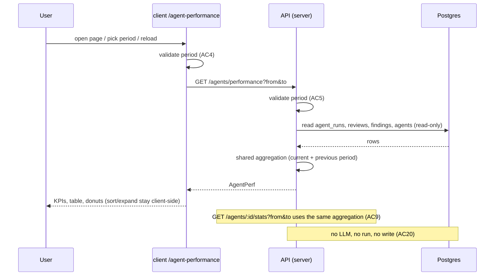

# Spec: Agent Performance dashboard
Spec ID: SPEC-04
Status: implemented
Supersedes: None
Modules: server, client

## Problem and user
**Who.** The single local dev-digest user who has written several review agents and pays for
their model calls. They want to know which agents are worth keeping. The quality signal is
the accept rate of their findings; the price signal is their cost.

**Problem today.** No screen aggregates stored run data per agent or across agents:
- The agent editor has only Config, Skills and Context tabs
  (`client/src/app/agents/[id]/_components/AgentEditor/constants.ts:11-15`). The "Stats" tab
  the assignment refers to does not exist yet (`AgentEditor.tsx:2` says later lessons add it).
- The server has no stats route. The agents module serves list, get, create, update, delete,
  versions, skills and models only (`server/src/modules/agents/routes.ts:74-174`).
- Contracts for both screens exist but nothing uses them: `AgentStats` for
  `GET /agents/:id/stats` (`server/src/vendor/shared/contracts/observability.ts:96-119`) and
  `AgentPerf` / `AgentPerfRow` / `PerfCostSegment` for `GET /agents/performance`
  (`server/src/vendor/shared/contracts/productionize.ts:139-186`). Neither takes a period.
- Client scaffolding exists: an `agentPerformance` i18n namespace
  (`client/messages/en/agentPerformance.json:1-32`), a nav label
  (`client/messages/en/shell.json:27`) and the active-key mapping for `/agent-performance`
  (`client/src/components/app-shell/helpers.ts:37`). The sidebar groups themselves have no
  GLOBAL section (`client/src/vendor/ui/nav.ts:21-38`), and there is no page route.

**Data that exists.**
- Every review run is one `agent_runs` row with `ran_at`, `model`, `duration_ms`,
  `tokens_in/out`, nullable `cost_usd`, `status` and nullable `agent_id`
  (`server/src/db/schema/runs.ts:8-33`). Status is `running` at creation and becomes `done`,
  `failed` or `cancelled` (`server/src/modules/reviews/repository/run.repo.ts:138,149`).
- Findings belong to a review, which points to its run and agent
  (`server/src/db/schema/reviews.ts:18-20,29-47`). A decision is `accepted_at` or
  `dismissed_at`; setting one clears the other (`review.repo.ts:121-145`).
- **Every cost is a DevDigest estimate.** It is computed from token counts and a price table at
  completion (`server/src/adapters/llm/openai.ts:90`, `anthropic.ts:91`) or re-priced on read
  (`server/src/platform/run-cost.ts:27-32`). No reconciled billing data is stored anywhere.

**Why it matters.** One read-only screen that answers "which agents earn their keep" lets the
user drop or retune weak or expensive agents. The numbers must be honest: the same as the
per-agent stats, sums that add up, and no invented zeros.

**Design source.** `hw1.jpg`, which shows:
- the title "Agent Performance" and the subtitle "Which agents earn their keep — accept rate is
  the quality signal", with a "30 days" period button at the top right;
- four KPI cards: Total runs with a sparkline, Total cost with a delta (for example "-$1.20"),
  Avg accept rate with a ring, and Most-active agent (name, runs, accept %);
- a table with the columns Agent, Runs, Avg cost, Avg dur., Accept (sorted, with a trend
  arrow), Last run (relative) and View;
- a "Cost breakdown" section with two donuts, By agent and By model, each with a legend of
  dollar amounts;
- a sidebar GLOBAL section with Memory, Multi-Agent Review, Agent Performance and CI Runs.
  Only Agent Performance is in scope.

## Goals / Non-goals
### Goals
- G1. A global "Agent Performance" screen, reachable from a GLOBAL sidebar section.
- G2. Period selection: last 1 day, last 30 days, or a custom date range.
- G3. One server aggregation of stored runs and findings, served by a period-aware per-agent
  stats endpoint and by the dashboard endpoint, so both give the same numbers.
- G4. KPIs, a per-agent table and cost breakdowns by agent and by model whose numbers add up
  and show their denominators.
- G5. Honest states: loading, error and empty never show invented numbers; small samples are
  marked; every cost is labelled as an estimate.
- G6. Strictly read-only: the screen never starts a review or calls a model.

### Non-goals
- NG1. The per-agent Stats tab UI in the agent editor. A later spec builds it on top of the
  per-agent endpoint from this spec (user answer to Q1).
- NG2. The Memory, Multi-Agent Review and CI Runs sidebar entries shown in the design.
- NG3. Reconciled billing data, or any import of provider invoices (P1). All costs are
  estimates.
- NG4. Filtering by repository. "Global" means every run of the workspace.
- NG5. Exporting data, auto-refresh, or pushing live updates while the page is open.
- NG6. Changing how runs, costs or decisions are stored.

## User stories
- US1. As a user, I want an Agent Performance entry in the sidebar, so that I can open the
  dashboard from anywhere.
- US2. As a user, I want to choose 1 day, 30 days or a custom range, so that I can see recent
  or historical performance.
- US3. As a user, I want per-agent runs, cost, duration and accept rate that match the agent's
  own stats, so that I can trust one number in both places.
- US4. As a user, I want total cost and cost by agent and by model, so that I can see where
  money goes.
- US5. As a user, I want to sort agents by accept rate without small samples distorting the
  ranking, so that the ranking reflects real quality.
- US6. As a user, I want clear loading, error and empty states, so that I never read a
  placeholder as a real zero.
- US7. As a user, I want to expand an agent row and open the agent, so that I can dig in
  without leaving the screen.

## Acceptance criteria (EARS)
Definitions used below:
- **Period**: the half-open interval `[from, to)` sent by the client.
- **Counted run**: an `agent_runs` row of the workspace with `ran_at` in the period and
  `status` in `done`, `failed` or `cancelled` (Q3 default, confirmed by the user 2026-10-18).
- **Decision**: a finding of a counted run's review with `accepted_at` or `dismissed_at` set.
  `decided = accepted + dismissed`.
- **Threshold**: 10 decisions (user answer to Q5).

- AC1 (US1). The app shell (shall) show a GLOBAL sidebar section that holds exactly one item,
  "Agent Performance", which links to `/agent-performance` and is marked active on that route.
  _(observable: nav item with label key `shell:nav.agent-performance`, `href="/agent-performance"`, active state on that pathname; no Memory, Multi-Agent Review or CI Runs item)_
- AC2 (US2). WHEN the user picks "1 day", "30 days" or applies a valid custom range, the
  dashboard (shall) request that period and write it to the URL query.
  _(observable: one `GET /agents/performance` with matching `from`/`to`; the URL query holds the period)_
- AC3 (US2). WHEN the dashboard page loads, it (shall) request the period held in the URL
  query, or the last 30 days when the query holds no valid period.
  _(observable: after a reload the picker shows the same period and the request carries the same `from`/`to`; no query → `to − from` = 30×24 h)_
- AC4 (US2). IF the custom range has a start after its end, an end after today, or more than
  365 days, THEN the picker (shall) show an inline error and send no request.
  _(observable: error text from `agentPerformance` keys; no new network request)_
- AC5 (US3). IF `from` or `to` is missing or not an ISO-8601 date-time, `from ≥ to`, or
  `to − from` is more than 366 days, THEN both stats endpoints (shall) answer with the
  existing validation error envelope and no aggregate body.
  _(observable: HTTP 422, `error.code` = `validation_error`, per `server/src/platform/errors.ts:25-28`)_
- AC6 (US3). The API (shall) count, per agent and in the summary, only counted runs; a run
  still `running` or outside `[from, to)` is excluded from every metric.
  _(observable: with seeded runs at `from − 1 ms`, `from`, `to − 1 ms`, `to` and one `running` run, `runs` = 2)_
- AC7 (US3). The API (shall) return per agent `accepted`, `dismissed`, `pending`, `decided`
  and `accept_rate = accepted / decided`, with `accept_rate` null when `decided` = 0.
  _(observable: seeded 3 accepted, 1 dismissed, 2 pending → `decided` 4, `accept_rate` 0.75; no decisions → `null`, not `0`)_
- AC8 (US3). The API (shall) return `summary.avg_accept_rate` as the pooled
  Σaccepted / Σdecided over all counted runs in the period, null when Σdecided = 0 (user
  answer to Q4).
  _(observable: agents with 9/10 and 1/10 decided-accepted → 0.5; an agent with 1/1 does not pull it to the mean of the rates)_
- AC9 (US3). WHEN `GET /agents/:id/stats` and `GET /agents/performance` are called with the
  same `from` and `to`, the per-agent response (shall) equal that agent's dashboard row in
  `runs`, `total_cost_usd`, `avg_cost_usd`, `avg_latency_ms`, `accepted`, `dismissed`,
  `pending`, `decided` and `accept_rate`.
  _(observable: field-by-field equality on seeded data, for 1-day, 30-day and custom periods)_
- AC10 (US4). The API (shall) return `summary.total_cost_usd` as the sum of the resolved cost
  of every priced counted run, `unpriced_runs` as the number of counted runs without a
  resolvable cost, and null for the total when no counted run has a price.
  _(observable: costs 0.02, 0.03 and one null → total 0.05, `unpriced_runs` 1; all null → `null`, not `0`)_
- AC11 (US4). The API (shall) return `cost_by_agent` and `cost_by_model` whose segment values
  each sum to `summary.total_cost_usd`. Runs with a deleted agent go to a `deleted_agent`
  segment and runs with no model go to an `unknown_model` segment.
  _(observable: |Σsegments − total| ≤ 1e-9 for both arrays; seeded run with `agent_id` null appears under `kind: "deleted_agent"`)_
- AC12 (US3). The API (shall) set `summary.most_active` to the agent with the most counted runs,
  breaking ties by the latest `last_run_at` and then by agent name, and to null when the
  period has no counted run of an existing agent.
  _(observable: agents with 5, 7 and 7 runs → the 7-run agent with the newer last run; empty period → `null`)_
- AC13 (US5). The dashboard (shall) show next to every accept rate, in the KPI card and in each
  row, its denominator as "N decisions", and in each row the agent's counted runs for the
  period.
  _(observable: text from `agentPerformance` keys containing `decided`; Runs column equals `runs`)_
- AC14 (US5). WHEN the user sorts the table by accept rate, the dashboard (shall) order agents
  with `decided` ≥ 10 by accept rate and place every agent below the threshold after them,
  marked with a "Small sample (n=N)" badge.
  _(observable: row order by `data-agent-id`; badge element on every row with `decided` < 10 and on none at or above it; `aria-sort` on the Accept header)_
- AC15 (US6). WHILE the performance request is pending, the dashboard (shall) show skeleton
  placeholders in place of every KPI value, table cell and donut, and no numeric metric.
  _(observable: no text matching a number, "$" amount or "%" in the KPI cards, table or legends while loading)_
- AC16 (US6). IF the performance request fails, THEN the dashboard (shall) show the load error
  message with a Retry button and no metric value.
  _(observable: `agentPerformance:loadError` text, Retry button, no "0", "$0.00" or "0%" rendered)_
- AC17 (US6). WHEN the response has `summary.runs` = 0, the dashboard (shall) show the
  "no runs yet" empty state if `summary.has_any_runs` is false, and the "no runs in this
  period" empty state with a hint to widen the period if it is true.
  _(observable: two distinct empty-state texts from `agentPerformance` keys; no KPI zeros rendered in either)_
- AC18 (US6). WHILE the selected period holds runs, the table (shall) list every existing agent
  without counted runs after the agents with runs, with the label "No runs in period" and "—"
  for every metric.
  _(observable: row with that label, "—" in Avg cost, Avg dur., Accept and Last run; never "0%" or "$0.00")_
- AC19 (US4). The dashboard (shall) label every cost value (Total cost, Avg cost, delta,
  both breakdown legends) as a DevDigest estimate, with an explanation that costs are computed
  from token counts and a price table and are not reconciled billing data.
  _(observable: "Estimated" label and explanation text from `agentPerformance` keys, shown when `cost_basis` = `"estimate"`)_
- AC20 (US7). WHEN the user loads the page, changes the period, sorts, expands or collapses a
  row, or reloads, the system (shall) create no agent run and make no model call.
  _(observable: only `GET` requests to `/agents/performance`; `agent_runs` row count unchanged; the LLM adapter mock records zero calls)_
- AC21 (US7). WHEN the user expands an agent row, the dashboard (shall) show that agent's
  findings by severity, its accepted, dismissed and pending counts, and its cost by model, all
  from the loaded response.
  _(observable: expanded region with these values; toggle has `aria-expanded="true"`; no new network request)_
- AC22 (US1). The API (shall) return, for the previous period `[from − (to − from), from)`,
  `summary.previous_total_cost_usd` and per agent `previous_accept_rate` and
  `previous_decided`, plus `summary.runs_series` of counted runs per bucket of the current
  period.
  _(observable: seeded runs in both windows give the expected values; bucket = 1 h when `to − from` ≤ 48 h, else 1 day, aligned to `from`; Σ`runs_series` = `summary.runs`)_
- AC23 (US1). The dashboard (shall) show the cost delta only when both
  `summary.total_cost_usd` and `previous_total_cost_usd` are non-null, and an accept-rate trend
  arrow on a row only when both `decided` and `previous_decided` are ≥ 10 (user answer to Q7).
  _(observable: no delta element when one value is null; no arrow on a row with either count < 10; arrow has a text alternative)_

## Workflow

## Contracts
Wire fields are snake_case. Both `shared` copies (`server/src/vendor/shared` and
`client/src/vendor/shared`) carry the same shape (NFR7). Nullability words follow root
`AGENTS.md`.

**Request (both endpoints), query string**
- `from` — optional (request input), ISO-8601 date-time with offset; required in practice,
  missing → AC5 error.
- `to` — same rules as `from`.
- Errors: invalid period → 422 `validation_error` (AC5). `GET /agents/:id/stats` with an
  unknown agent id → 404 `not_found` (`server/src/platform/errors.ts:19-22`).

**`GET /agents/performance` → `AgentPerf` (extends the existing contract)**
- `period` — object, always present:
  - `from`, `to`, `previous_from`, `previous_to` — string ISO-8601, not null.
- `cost_basis` — literal `"estimate"`, not null (P1).
- `summary` — object:
  - `runs` — int, not null (existing).
  - `has_any_runs` — boolean, not null: whether the workspace has any finished run ever (AC17).
  - `total_cost_usd` — number, nullable (existing).
  - `previous_total_cost_usd` — number, nullable.
  - `unpriced_runs` — int, not null.
  - `accepted`, `decided` — int, not null.
  - `avg_accept_rate` — number 0..1, nullable (existing; now pooled, AC8).
  - `most_active_agent` — string, nullable (existing; the agent's name).
  - `most_active` — object, nullable: `agent_id` string, `agent_name` string, `runs` int,
    `accept_rate` number nullable, `decided` int.
  - `runs_series` — array of `{ label: string (bucket start, ISO-8601), value: int }`, not null,
    oldest to newest.
- `agents` — array of `AgentPerfRow`, not null. Rows with runs come first; rows without
  counted runs come after them (AC18). Existing fields stay; changes and additions:
  - `agent_id` — string, **nullable** (was required): null only for the deleted-agent bucket.
  - `agent_name` — string, nullable: null for the deleted-agent bucket (the client renders an
    i18n label).
  - `pending`, `decided`, `unpriced_runs` — int, not null.
  - `previous_accept_rate` — number, nullable. `previous_decided` — int, not null.
  - `cost_by_model` — array of `PerfCostSegment`, not null (AC21).
  - `last_run_at` — string, nullable (existing): null when the agent has no counted run.
  - `runs`, `accepted`, `dismissed`, `accept_rate`, `total_cost_usd`, `avg_cost_usd`,
    `avg_latency_ms`, `findings_by_severity` — existing fields, now computed for the period.
  - `avg_cost_usd` = row total ÷ priced counted runs, nullable. `avg_latency_ms` = mean
    `duration_ms` of `done` runs, nullable (default from Q3).
- `cost_by_agent`, `cost_by_model` — arrays of `PerfCostSegment`, not null, sorted by value
  descending.

**`PerfCostSegment` (extends the existing contract)**
- `label` — string, nullable: agent name or model slug; null for the two special buckets.
- `value` — number, not null (USD).
- `kind` — enum `agent` | `deleted_agent` | `model` | `unknown_model`, not null.
- `agent_id` — string, nullish: present for `kind` = `agent`.

**`GET /agents/:id/stats` → `AgentStats` (extends the existing contract)**
- Existing fields stay, computed for the period.
- Adds `period` (same shape as above), `decided` int, `unpriced_runs` int, `last_run_at` string
  nullable, `cost_basis` literal `"estimate"`.
- The AC9 parity fields have the same meaning and the same rule as in `AgentPerfRow`.

## Edge cases
- EC1. A workspace with no runs ever — "no runs yet" empty state (AC17).
- EC2. Runs exist, but none in the period — "no runs in this period" state (AC17).
- EC3. An agent with no runs in the period — "No runs in period" row with "—" (AC18).
- EC4. An agent with runs but no decided findings — accept rate "—", "0 decisions", sorted
  below the threshold (AC7, AC13, AC14).
- EC5. A run still `running` — not counted (AC6). It counts once it finishes, after a reload.
- EC6. A failed or cancelled run with token spend — counts in runs and cost; excluded from avg
  duration (AC6, Contracts) — Q3 default, confirmed by the user.
- EC7. A run with no resolvable cost (no model, zero tokens, unpriced slug,
  `run-cost.ts:27-32`) — excluded from cost sums and counted in `unpriced_runs` (AC10).
- EC8. A run whose agent was deleted (`agent_id` set null, `runs.ts:13`) — `deleted_agent`
  bucket in the table and the by-agent donut, no View link, never the most-active agent (AC11,
  AC12).
- EC9. A run with no model — `unknown_model` segment (AC11).
- EC10. Ties for most active — AC12 tie-break.
- EC11. Boundary times exactly at `from` or `to` — half-open interval (AC6).
- EC12. Custom range invalid, in the future or over 365 days — inline error (AC4); a crafted
  URL that skips the client check — 422 (AC5); a crafted URL query with an invalid period —
  falls back to 30 days (AC3).
- EC13. Rapid period changes — the dashboard shows only the response for the latest selected
  period (AC2: the rendered values match the URL period).
- EC14. Request fails or the API is down — error state with Retry, no numbers (AC16).
- EC15. Very cheap or free models — costs use the three-way format "—" / "$0.00" /
  "<$0.0001" (client INSIGHTS "Formatting a cost at fixed 4dp reports cheap real runs as free")
  (AC10, AC19).
- EC16. A decision made after the page loaded — visible after a reload. Decisions count with
  their run's period, so a past period's accept rate can change later (default from Q2; AC7).
- EC17. Re-runs of the same agent on the same PR — each run's findings count for that run
  (default; AC7).
- EC18. A long agent name or many agents (for example 50) — the name is truncated with the full
  name available on hover and to screen readers; every agent is listed and every segment
  appears in the legend (NFR5).
- EC19. An "Agent Performance" request while the global rate limit (120/min) is exhausted —
  error state with Retry (AC16).
- EC20. The previous period has no runs — no cost delta and no trend arrows (AC23).
- EC21. A period shorter than or equal to 48 h — hourly sparkline buckets; longer — daily
  (AC22).

## Non-functional requirements
- NFR1. Performance — `GET /agents/performance` answers in ≤ 1 s at p95 with 10,000 counted
  runs and 50,000 findings in the period on the dev stack (P10) — verify: server-integration,
  a bulk-seeded `*.it.test.ts` timing test in the normal integration lane.
- NFR2. Limits and rate limits — both endpoints stay under the global limit of 120 requests/min
  (`server/src/app.ts:111`), with no per-route limit; opening the page makes exactly one API
  request — verify: client (one request per period), server-integration.
- NFR3. Reliability / read-only — both endpoints perform no database write and no LLM call.
  The only possible outbound call is the existing background price-list refresh of
  `PriceBook` during read-time re-pricing, which is not a model call (P9, server INSIGHTS
  "PriceBook.estimate returns a different price on the first call after boot") — verify:
  server-integration (row counts unchanged, LLM mock not called).
- NFR4. Security and privacy — responses hold no secret, prompt, diff or finding text; only
  aggregates, agent names and model slugs — verify: server-unit contract test on the response
  keys.
- NFR5. Accessibility (WCAG 2.2 AA) — the period picker, sort header and row expand toggle work
  with the keyboard alone and have a visible focus indicator. The sort header uses `aria-sort`
  and the toggle uses `aria-expanded`. Every donut has a text legend with amount and
  percentage. The accept ring, the sparkline and the trend arrows have text alternatives.
  Colour is never the only carrier of meaning (trend direction, small sample) — verify: client.
- NFR6. i18n — every new string lives in `client/messages/en/agentPerformance.json` (existing
  namespace) or `shell.json` for the GLOBAL section label; none inline in JSX. The subtitle is
  replaced with the design's wording — verify: client.
- NFR7. Compatibility — the server and client copies of `AgentPerf`, `AgentPerfRow`,
  `PerfCostSegment` and `AgentStats` have the same fields and nullability. No existing endpoint
  or stored data changes. No migration is required by this spec — verify: server-unit contract
  test against both copies.
- NFR8. Observability — a failed aggregation logs one error-level line with the route and
  period bounds, and no agent names — verify: server-unit.

## Inputs and provenance
| Input | Source | Trusted? | Used in |
|---|---|---|---|
| `from`, `to` query values | user (URL, picker) | no | API validation, DB filter, response `period` |
| Agent names | user (agent editor), DB | no | table, KPI card, donut legend |
| Model slugs on runs | config at run time, DB | no | by-model donut, expanded row |
| Run rows (status, cost, duration, tokens) | DB, written by the run executor | yes | aggregation |
| Finding decisions | DB, written by user actions | yes | accept rates |
| Price list | OpenRouter / static table via `PriceBook` | partly (estimate) | read-time re-pricing of rows without `cost_usd` |

## Untrusted inputs
- `from` / `to` — reaches the DB filter and the response — threat: injection (A05) and
  resource exhaustion through huge ranges (A06) — the API (shall) reject malformed values and
  ranges over 366 days and treat accepted values only as data — covered by: AC5, NFR1.
- Agent names — reach the UI (table, card, legend, title attribute) — threat: stored XSS (A05)
  — the dashboard (shall) render them as text only — covered by: AC13, AC18 (rendered as text;
  test with a name containing markup).
- Model slugs — reach the UI legend — threat: stored XSS (A05) — rendered as text only —
  covered by: AC11, AC21.
- None of these inputs reach a prompt. The feature never calls a model (AC20), so
  `wrapUntrusted()` and `groundFindings()` are not involved.

## Traceability
| AC | Story | Goal | Covers (EC / NFR / untrusted input) | Verify by |
|---|---|---|---|---|
| AC1 | US1 | G1 | NFR6 | client |
| AC2 | US2 | G2 | EC13, NFR2 | client |
| AC3 | US2 | G2 | EC12 | client |
| AC4 | US2 | G2 | EC12 | client |
| AC5 | US3 | G2, G3 | EC12, untrusted `from`/`to` | server-integration |
| AC6 | US3 | G3 | EC5, EC6, EC11 | server-integration |
| AC7 | US3 | G3 | EC4, EC16, EC17 | server-integration |
| AC8 | US3 | G3, G4 | — | server-integration |
| AC9 | US3 | G3 | NFR7 | server-integration |
| AC10 | US4 | G4 | EC7, EC15 | server-integration |
| AC11 | US4 | G4 | EC8, EC9, untrusted model slugs | server-integration |
| AC12 | US3 | G4 | EC8, EC10 | server-integration |
| AC13 | US5 | G4, G5 | EC4, untrusted agent names | client |
| AC14 | US5 | G5 | EC4, NFR5 | client |
| AC15 | US6 | G5 | — | client |
| AC16 | US6 | G5 | EC14, EC19 | client |
| AC17 | US6 | G5 | EC1, EC2 | client |
| AC18 | US6 | G5 | EC3, untrusted agent names | client |
| AC19 | US4 | G5 | EC15, P1 | client |
| AC20 | US7 | G6 | NFR3 | server-integration (no write, no LLM) + client (GET only) |
| AC21 | US7 | G4 | NFR5 | client |
| AC22 | US1 | G4 | EC20, EC21 | server-integration |
| AC23 | US1 | G4, G5 | EC20, NFR5 | client |

## Decisions
User answers (via the coordinator):
- Q1 — answered (a): one shared server aggregation behind a new period-aware
  `GET /agents/:id/stats` and `GET /agents/performance`; parity compares the two; Stats tab UI
  is a later spec — landed in: G3, NG1, AC9.
- Q4 — answered (a): pooled average accept rate — landed in: AC8.
- Q5 — answered: threshold 10 decisions — landed in: AC14, AC23.
- Q7 — answered (a): sparkline, cost delta and trend arrows in scope; trend only when both
  periods meet the threshold — landed in: AC22, AC23.

Defaults proposed by the coordinator, **confirmed by the user on 2026-10-18**:
- Q2 — default (a): a run is in the period by `ran_at`; its findings' decisions count with it,
  whenever they were made — landed in: AC6, AC7, EC16.
- Q3 — default (a): runs = finished runs (`done`, `failed`, `cancelled`); cost over priced
  finished runs; avg duration over `done` runs — landed in: AC6, AC10, Contracts, EC6.
- Q6 — default (b): expandable row with stored-only data; View goes to `/agents/{id}` — landed
  in: AC21, EC8.
- P1 — accepted (default): every cost labelled as estimate; `cost_basis`; reconciled billing
  is a Non-goal — landed in: AC19, NG3, Contracts.
- P2 — accepted (default): unpriced runs excluded from sums and counted; "—" when nothing is
  priced; three-way money format — landed in: AC10, EC7, EC15.
- P3 — accepted (default): `deleted_agent` and `unknown_model` buckets so breakdowns sum to the
  total — landed in: AC11, EC8, EC9.
- P4 — accepted (default): extend the existing vendored `AgentPerf` / `AgentStats` contracts and
  the existing `agentPerformance` namespace; subtitle replaced with the design wording —
  landed in: Contracts, NFR6, NFR7.
- P5 — accepted (default): most-active tie-break by latest last run, then name; "—" when empty
  — landed in: AC12.
- P6 — accepted (default): 1 day = last 24 h; 30 days = last 30×24 h; custom = local calendar
  dates, both days included, start ≤ end, not in the future, at most 365 days; period in the
  URL — landed in: AC2, AC3, AC4.
- P7 — accepted (default): skeletons, error with Retry, two distinct empty states, "No runs in
  period" rows — landed in: AC15-AC18.
- P8 — accepted (default): WCAG 2.2 AA items — landed in: NFR5.
- P9 — accepted (default): read-only; read-time re-pricing allowed, it is not a model call —
  landed in: AC20, NFR3.
- P10 — accepted (default): global rate limit only; p95 ≤ 1 s at 10,000 runs — landed in:
  NFR1, NFR2.
- Non-blocking defaults, confirmed by the user on 2026-10-18:
  - runs of both sources (`local`, `ci`) count — landed in: AC6;
  - findings of every kind count toward decisions — landed in: AC7;
  - each re-run's findings count for that run — landed in: EC17;
  - "global" = the whole workspace, no repo filter — landed in: NG4;
  - every existing agent (enabled or not) gets a row — landed in: AC18;
  - sparkline buckets hourly for periods ≤ 48 h, else daily, aligned to `from` — landed in:
    AC22;
  - trend arrow up / down / none by comparing accept rates rounded to whole percent — landed
    in: AC23.

## Open questions
None open. Closed on 2026-10-18:
- ~~OQ1~~ closed 2026-10-18 — Q2 default confirmed by the user: decisions count with their
  run's period (AC6, AC7).
- ~~OQ2~~ closed 2026-10-18 — Q3 default confirmed by the user: failed and cancelled runs count
  in runs and cost; avg duration over `done` only (AC6, AC10).
- ~~OQ3~~ closed 2026-10-18 — Q6 default confirmed by the user: expandable row with stored-only
  data; View goes to `/agents/{id}` (AC21).
- ~~OQ4~~ closed 2026-10-18 — P1-P10 and the non-blocking defaults confirmed by the user.
- ~~OQ5~~ closed 2026-10-18 — the user keeps SPEC-04 as one spec with 23 ACs; no split.
- ~~OQ6~~ closed 2026-10-18 — the GLOBAL section edit of the vendored
  `client/src/vendor/ui/nav.ts` and `client/src/components/app-shell/nav.test.tsx` is a
  main-session step (root INSIGHTS "The implementer cannot apply a plan-sanctioned vendor
  edit").

## Code anchors
- `client/src/app/agents/[id]/_components/AgentEditor/constants.ts:11-15` — editor tabs are config, skills, context; no Stats tab.
- `server/src/modules/agents/routes.ts:74-174` — existing agents routes; no stats or performance route.
- `server/src/vendor/shared/contracts/observability.ts:96-119` — `AgentStats` contract (unused, no period).
- `server/src/vendor/shared/contracts/productionize.ts:139-186` — `AgentPerfRow`, `PerfCostSegment`, `AgentPerf` (unused, no period); `agent_id` is a required string at :140.
- `client/src/vendor/shared/contracts/productionize.ts:155,179,184` — client copy has the same `AgentPerf` fields today.
- `server/src/db/schema/runs.ts:8-33` — `agent_runs` columns; `agent_id` set null on agent delete (:13); `cost_usd` nullable (:22); `source` local|ci (:26).
- `server/src/modules/reviews/repository/run.repo.ts:120-143` — the only `agent_runs` insert; status `running`, source `local`.
- `server/src/modules/reviews/repository/run.repo.ts:145-179` — completion sets status done|failed|cancelled, duration, tokens, cost.
- `server/src/db/schema/reviews.ts:10-27` — `reviews` with `agent_id`, `run_id`, `model`.
- `server/src/db/schema/reviews.ts:29-47` — `findings` with `severity`, `kind`, `accepted_at`, `dismissed_at`.
- `server/src/modules/reviews/repository/review.repo.ts:121-145` — accept clears dismiss and vice versa.
- `server/src/platform/run-cost.ts:27-47` — `resolveRunCost` (persisted, else tokens × price, else null) and `sumRunCosts` (skip unpriced, null when none priced).
- `server/src/adapters/llm/openai.ts:90`, `server/src/adapters/llm/anthropic.ts:91` — run cost is `estimateCost(model, tokensIn, tokensOut)`.
- `server/src/platform/errors.ts:4,19-28` — error envelope `{ error: { code, message, details } }`; 404 `not_found`; 422 `validation_error`.
- `server/src/app.ts:111` — global rate limit 120 requests/min.
- `client/src/vendor/ui/nav.ts:21-38` — sidebar groups WORKSPACE and SKILLS LAB only.
- `client/src/components/app-shell/helpers.ts:37` — `/agent-performance` already maps to active key `agent-performance`.
- `client/messages/en/shell.json:27` — nav label "Agent Performance"; `:7` "GLOBAL" used for the command palette group.
- `client/messages/en/agentPerformance.json:1-32` — existing namespace (title, old subtitle, loadError, summary, table, empty).
- `client/src/app/agents/[id]/page.tsx` — target of the View link.

## Changelog
- 2026-10-18 — draft created from `hw1.jpg`, the course assignment, user answers to Q1, Q4, Q5
  and Q7, and coordinator defaults for Q2, Q3, Q6, P1-P10 and the non-blocking items.
- 2026-10-18 — user approved the spec as is: all defaults confirmed (OQ1-OQ4 closed), one spec
  kept (OQ5 closed), nav edit set as a main-session step (OQ6 closed), NFR1 verify lane set to a
  bulk-seeded `*.it.test.ts` in the normal integration lane. Status set to `approved`. No AC
  changed.
