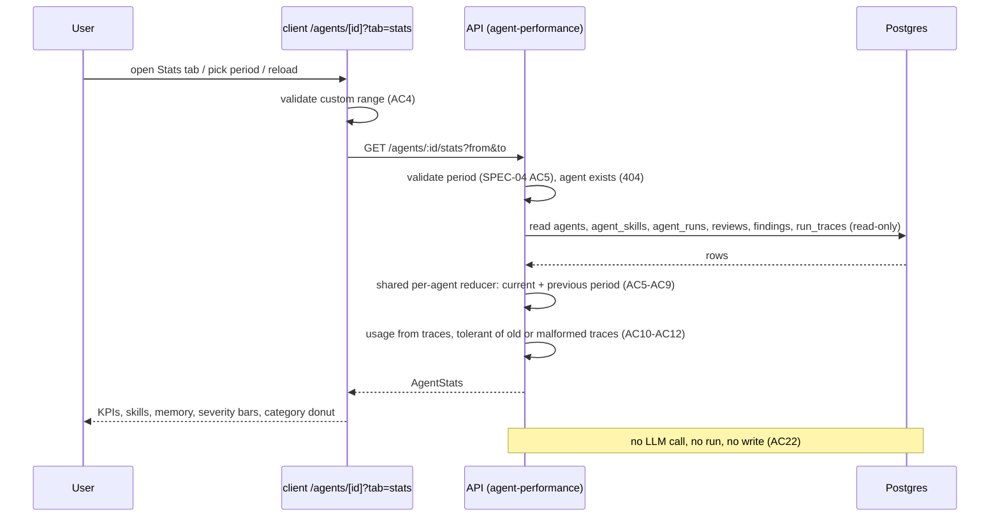

# Spec: Agent editor Stats tab
Spec ID: SPEC-05
Status: implemented
Supersedes: None
Modules: server, client

## Problem and user
**Who.** The single local dev-digest user who writes and tunes review agents. While editing
one agent, they want to see how that agent performs without leaving the editor: how often it
runs, what it costs, how often its findings are accepted, which of its skills and memory
reach the prompt, and what kinds of findings it produces.

**Relation to SPEC-04.** `specs/2026-10-18-agent-performance.md` (SPEC-04) built the global
Agent Performance dashboard and a period-aware `GET /agents/:id/stats`, and deferred this tab
as its NG1. This spec builds that tab on top of the SPEC-04 endpoint. Every SPEC-04 rule that
the tab reuses (counted run, decision, accept rate, cost resolution, period validation,
small-sample threshold, three-way cost format, estimate labelling) still holds and is not
redefined here.

**Today.**
- The editor has three tabs: Config, Skills, Context
  (`client/src/app/agents/[id]/_components/AgentEditor/constants.ts:11-15`). The tab lives in
  `?tab=` and only keys from that list are accepted
  (`client/src/app/agents/[id]/page.tsx:17-18,50-55`). The label `editor.tabs.stats` already
  exists (`client/messages/en/agents.json:54`).
- `GET /agents/:id/stats?from&to` returns `AgentStats` for the period
  (`server/src/modules/agent-performance/routes.ts:47-54`), through the same per-agent reducer
  as the dashboard (`server/src/modules/agent-performance/domain.ts:109-182,347-387`). It has
  runs, accept/dismiss/pending/decided, accept rate, total and average cost, average latency,
  severity totals and a per-run findings `trend`
  (`server/src/vendor/shared/contracts/observability.ts:105-133`).
- It does **not** have: previous-period values (the service reads only the current period,
  `server/src/modules/agent-performance/service.ts:49-52`), a runs-per-bucket series, a
  severity series over time, a category breakdown, skill usage or memory usage, or whether the
  agent has ever run.
- Skill usage is recorded per run: the trace stores `prompt_assembly.skills_used`, the names
  of the enabled linked skills that went into the prompt
  (`server/src/modules/reviews/run-executor.ts:241-243,390`,
  `server/src/modules/reviews/helpers.ts:14-16`). The field is absent on traces written before
  it existed (`server/src/vendor/shared/contracts/trace.ts:44-45`) and on failed or cancelled
  runs, whose trace is built without it (`run-executor.ts:580-603`). It records prompt
  inclusion, not whether the model "applied" a skill.
- Memory usage would come from `memory_pulled` (`trace.ts:61-65,106`), an array of
  `{ pr, text }` with no memory id. **Every trace written today stores an empty array**
  (`run-executor.ts:412,600`); no code path fills it.
- Findings carry a `category` (`server/src/db/schema/reviews.ts:38`), constrained on the wire
  to `bug | security | perf | style | test` (`server/src/vendor/shared/contracts/findings.ts:14`)
  but stored as free `text` in the database.

**Why it matters.** The global dashboard ranks agents; the tab is where the user acts on one
agent (edits its prompt, links or unlinks skills). Seeing in the same place which skills
actually reach the prompt and which findings the agent produces closes that loop. The numbers
must equal the dashboard's for the same period.

**Design source.** A user screenshot (described in text) of the editor for "Security
Reviewer" (model chip `openrouter/openai/gpt-5-nano`), tabs Config · Skills · Context · Evals ·
Stats · CI, Stats selected:
- top right: period label "30 days · Sep 11 – now", a "Sync CI" button, a period button
  "30 days";
- four KPI cards: TOTAL RUNS (4, sparkline), AVG COST / RUN ($0.00, a "billed" badge, delta
  tooltip "Not enough history to compare"), AVG DURATION (34s), ACCEPT RATE ("—", subtitle
  "based on 0 local findings");
- MOST-USED SKILLS: "Share of runs where the model applied the skill", rows name + bar +
  percent (PR Quality Rubric 100%, deprecation-policy 50%, Lethal Trifecta 50%,
  breaking-change 0%, Secret Leakage Gate 0%), footer "No data before Oct 11";
- MOST-PULLED MEMORY: "Share of runs where this entry was pulled into the prompt", empty state
  "No memory pulled in this period", footer "No data before Oct 11";
- FINDINGS BY SEVERITY: stacked bars per week W1..W5, legend Critical / Warning / Suggestion,
  footer "6 findings in period";
- FINDINGS BY CATEGORY: donut with the total (6) in the centre, legend with count and percent
  per category (security 4 · 67%, bug 2 · 33%, perf 0, style 0, test 0), a "small sample"
  marker.

## Goals / Non-goals
### Goals
- G1. A Stats tab in the agent editor, reachable by click and by `?tab=stats`.
- G2. Period selection on the tab with the same presets, custom range and limits as the
  SPEC-04 dashboard, kept in the URL.
- G3. The per-agent stats endpoint returns, for the period, everything the tab shows:
  previous-period values, a runs series, a severity series, a category breakdown, skill usage
  and memory usage, while its SPEC-04 parity with the dashboard keeps holding.
- G4. KPI cards and the four panels of the design, whose numbers add up and show their
  denominators and data coverage.
- G5. Honest states: loading, error and empty never show invented numbers; small samples and
  missing history are marked; every cost is labelled as an estimate.
- G6. Strictly read-only: the tab never starts a review or calls a model.

### Non-goals
- NG1. CI: no "Sync CI" button and no CI tab (user decision). Stored runs of any `source`
  still count, as in SPEC-04.
- NG2. The Evals tab (user decision).
- NG3. Changing what a run trace records: filling `memory_pulled`, adding memory ids, or
  backfilling `skills_used` on old traces. The tab reads what is stored.
- NG4. Telling whether the model "applied" a skill. The data records prompt inclusion only
  (D2).
- NG5. Reconciled billing data; the "billed" badge of the design (D3). All costs are
  estimates (SPEC-04 NG3).
- NG6. Filtering by repository, exporting, auto-refresh or live updates while the tab is open.
- NG7. Any change to the global dashboard's behaviour or its response.

## User stories
- US1. As a user editing an agent, I want a Stats tab, so that I can check the agent's
  performance without leaving the editor.
- US2. As a user, I want to choose 1 day, 30 days or a custom range on the tab, so that I can
  see recent or historical performance.
- US3. As a user, I want runs, average cost, average duration and accept rate with a
  comparison to the previous period that match the dashboard, so that I can trust one number
  in both places and see the direction of change.
- US4. As a user, I want to see which skills and memory entries reached this agent's prompts,
  so that I can unlink skills that never apply and judge what context the agent gets.
- US5. As a user, I want findings by severity over time and by category, so that I can see
  what the agent mostly reports.
- US6. As a user, I want clear loading, error and empty states, so that I never read a
  placeholder as a real zero.
- US7. As a user, I want the tab to be read-only, so that opening it never costs model calls.

## Acceptance criteria (EARS)
Definitions used below:
- **Period**, **counted run**, **decision**, **accept rate**: as defined in SPEC-04
  (half-open `[from, to)`, finished statuses `done` / `failed` / `cancelled`, decisions count
  with their run's period).
- **Previous period**: `[from − (to − from), from)`, as in SPEC-04 and
  `domain.ts:56-59`.
- **Skills-traced run**: a counted run with status `done` whose stored trace carries
  `prompt_assembly.skills_used` as an array (possibly empty).
- **Memory-traced run**: a counted run with status `done` whose stored trace carries
  `memory_pulled` as an array (possibly empty).
- **Small-sample threshold**: 10, the SPEC-04 value
  (`client/src/app/agent-performance/_components/AgentPerformanceView/constants.ts:2`).

- AC1 (US1). The agent editor (shall) show a Stats tab after the Context tab, and WHEN the
  URL holds `tab=stats`, the editor (shall) open with the Stats tab selected.
  _(observable: tab labelled by `agents:editor.tabs.stats`, fourth in order; reload of `/agents/{id}?tab=stats` shows the Stats panel; no Evals or CI tab)_
- AC2 (US2). WHEN the Stats tab opens, it (shall) request `GET /agents/:id/stats` for the
  period held in the URL query, or for the last 30 days when the query holds no valid period,
  and show the period label for that period.
  _(observable: one request with matching `from`/`to`; no query → `to − from` = 30×24 h; label "30 days · <from as MMM d> – now" for a preset, "<start> – <end>" for a custom range)_
- AC3 (US2). WHEN the user picks "1 day", "30 days" or applies a valid custom range, the Stats
  tab (shall) request that period and write `from`, `to` and `range` to the URL while keeping
  `tab=stats`.
  _(observable: one new request with the picked `from`/`to`; URL query holds `tab=stats&from=…&to=…&range=…`; after a reload the same period is requested)_
- AC4 (US2). IF the custom range has a start after its end, an end after today, or more than
  365 days, THEN the picker (shall) show an inline error and send no request.
  _(observable: inline error text with `role="alert"`; no new network request; same rules as SPEC-04 AC4)_
- AC5 (US3). The API (shall) return in `AgentStats` the agent's previous-period
  `previous_runs`, `previous_avg_cost_usd`, `previous_avg_latency_ms`, `previous_accept_rate`
  and `previous_decided`, computed with the same rules as the current-period fields.
  _(observable: seeded runs in both windows give the expected values; no run in the previous period → `previous_runs` 0, `previous_decided` 0 and the three averages/rates `null`, never `0`)_
- AC6 (US3). WHEN `GET /agents/:id/stats` and `GET /agents/performance` are called with the
  same `from` and `to`, the per-agent response (shall) equal that agent's dashboard row in the
  SPEC-04 AC9 fields and in `previous_accept_rate` and `previous_decided`.
  _(observable: field-by-field equality on seeded data for 1-day, 30-day and custom periods)_
- AC7 (US3). The API (shall) return `runs_series`: the agent's counted runs per bucket of the
  current period, with the SPEC-04 AC22 bucket rule (1 h when `to − from` ≤ 48 h, else 1 day,
  aligned to `from`).
  _(observable: Σ`runs_series[].value` = `runs`; bucket count = ceil((to − from) / bucket); labels are bucket starts, oldest first)_
- AC8 (US5). The API (shall) return `findings_by_severity_series`: the counts of CRITICAL,
  WARNING and SUGGESTION findings of counted runs per bucket, where a finding falls in the
  bucket of its run's `ran_at`, buckets are 1 day when `to − from` ≤ 14 days and 7 days
  otherwise, aligned to `from`, and the last bucket ends at `to`.
  _(observable: `severity_bucket` = `day` | `week`; per severity Σ over buckets = `findings_by_severity`; a 30-day period gives 5 buckets, the 5th covering 2 days)_
- AC9 (US5). The API (shall) return `findings_by_category` with a count for each of `bug`,
  `security`, `perf`, `style`, `test` and `other`, where `other` holds every finding whose
  stored category is none of the five.
  _(observable: all six keys always present; Σ values = `findings_total`; a seeded finding with category `"api"` counts in `other`)_
- AC10 (US4). The API (shall) return `skills_usage` with one item per skill name that is
  either in `skills_used` of a skills-traced run of the period or currently linked to the
  agent, each with `runs` (skills-traced runs whose `skills_used` holds that name) and
  `share = runs / runs_with_data`, null when `runs_with_data` = 0.
  _(observable: 4 skills-traced runs, skill A in 4 and B in 2, linked skill C in none → shares 1.0, 0.5, 0.0; C has `linked: true`; items ordered by `share` desc, then name)_
- AC11 (US4). The API (shall) return `memory_usage` with one item per distinct `text` in
  `memory_pulled` of the memory-traced runs of the period, each with `runs` (memory-traced runs
  that pulled that text at least once) and `share = runs / runs_with_data`, at most 10 items,
  ordered by `share` desc then label, and `entries_total` = the number of distinct texts.
  _(observable: seeded traces with 12 distinct texts → 10 items, `entries_total` 12; the same text pulled twice in one run counts once; every trace stored today has `memory_pulled: []` → `items` empty, `entries_total` 0)_
- AC12 (US4). IF a counted `done` run has no stored trace, a trace without the field, or a
  trace document that does not match the expected shape, THEN the API (shall) count that run in
  `runs_without_data` of the affected usage block and (shall) still answer 200 with every
  other metric unchanged.
  _(observable: seeded run with an old trace lacking `skills_used` → `skills_usage.runs_without_data` 1, `runs` unchanged; a trace jsonb `{ "foo": 1 }` → HTTP 200, not 500)_
- AC13 (US3). The Stats tab (shall) show on the Total runs, Avg cost / run, Avg duration and
  Accept rate cards a signed delta against the previous period only when both compared values
  are non-null and `previous_runs` is above 0 and, for Accept rate, both `decided` and `previous_decided` are at least the
  small-sample threshold; otherwise it (shall) show "Not enough history to compare" in place of
  the delta.
  _(observable: delta text with a "+" or "−" sign; `previous_avg_cost_usd` null → the text from an `agentStats` key, available to screen readers, and no number; accept-rate delta in percentage points)_
- AC14 (US3). The Stats tab (shall) label the Avg cost / run value and its delta as a
  DevDigest estimate with the SPEC-04 explanation, and (shall) format every cost with the
  three-way rule "—" / "$0.00" / "<$0.0001".
  _(observable: "Estimated" label and explanation shown when `cost_basis` = `"estimate"`; no "billed" text anywhere; `avg_cost_usd` null → "—", 0 → "$0.00", 0.00004 → "<$0.0001")_
- AC15 (US4). WHILE `skills_usage.items` is not empty, the Most-used skills panel (shall)
  show one row per item with its name, a bar and its share in whole percent, and a coverage
  footer "Based on N of M runs" plus "No data before <date of `data_from`>" when
  `runs_without_data` > 0.
  _(observable: rows in response order with `data-skill-row`; share "—" when `share` is null; footer counts N = `runs_with_data`, M = `runs_with_data + runs_without_data`; no footer date when `runs_without_data` = 0)_
- AC16 (US4). WHEN `memory_usage.items` is empty, the Most-pulled memory panel (shall) show
  the empty text "No memory pulled in this period" and no rows; otherwise it (shall) show one
  row per item with its label, a bar and its share, plus "+K more" when
  `entries_total` > number of items.
  _(observable: empty-state text from an `agentStats` key; rows with `data-memory-row`; "+2 more" for 12 entries; same coverage footer rule as AC15)_
- AC17 (US5). The Findings by severity panel (shall) show one stacked bar per
  `findings_by_severity_series` bucket with a text legend Critical / Warning / Suggestion and
  the footer "N findings in period", where N is the sum of all bars.
  _(observable: bar count = bucket count; labels "W1…Wn" when `severity_bucket` = `week`, local dates when `day`; footer N = Σ`findings_by_severity`; each bar has a text alternative with its three counts)_
- AC18 (US5). The Findings by category panel (shall) show a donut with `findings_total` in its
  centre, a legend row for each of the five categories with its count and whole-percent share
  (and an `other` row only when its count is above 0), and a "Small sample" marker when
  `findings_total` is below the small-sample threshold.
  _(observable: legend "security 4 · 67%", "perf 0" with no percent; marker present at 6 findings, absent at 10)_
- AC19 (US6). WHILE the stats request is pending, the Stats tab (shall) show skeleton
  placeholders in place of every KPI value, panel row, bar and donut, and no numeric metric.
  _(observable: no number, "$" amount or "%" in the KPI cards or panels while loading)_
- AC20 (US6). IF the stats request fails, THEN the Stats tab (shall) show the load error
  message with a Retry button and no metric value.
  _(observable: error text from an `agentStats` key, Retry button that issues the same request again; no "0", "$0.00" or "0%" rendered; covers 404 for a deleted agent and 429)_
- AC21 (US6). WHEN the response has `runs` = 0, the Stats tab (shall) show the "this agent has
  not run yet" empty state if `has_any_runs` is false, and the "no runs in this period" empty
  state with a hint to widen the period if it is true, instead of the KPI cards and panels.
  _(observable: two distinct empty-state texts from `agentStats` keys; no KPI zeros, no "0%" bars rendered; the period picker stays usable)_
- AC22 (US7). WHEN the user opens the Stats tab, changes the period or reloads, the system
  (shall) create no agent run, write no database row and make no model call.
  _(observable: only `GET /agents/:id/stats` requests from the tab; `agent_runs` and `run_traces` row counts unchanged; the LLM adapter mock records zero calls)_

## Workflow

## Contracts
Wire fields are snake_case. Both `shared` copies (`server/src/vendor/shared` and
`client/src/vendor/shared`) carry the same shape (NFR7). Nullability words follow root
`AGENTS.md`. The change is additive: every existing `AgentStats` field keeps its name, type,
nullability and meaning.

**Request** — unchanged from SPEC-04: query `from`, `to` (ISO-8601 with offset). Invalid period
→ 422 `validation_error` (`server/src/platform/errors.ts:27`); unknown agent → 404 `not_found`
(`errors.ts:19-21`).

**`GET /agents/:id/stats` → `AgentStats` (additions)**
- `has_any_runs` — boolean, not null: the agent has at least one finished run ever (AC21).
- `previous_runs` — int, not null.
- `previous_avg_cost_usd` — number, nullable: null when no priced counted run in the previous
  period.
- `previous_avg_latency_ms` — number, nullable: null when no `done` run with a duration in the
  previous period.
- `previous_accept_rate` — number 0..1, nullable: null when `previous_decided` = 0.
- `previous_decided` — int, not null.
- `runs_series` — array of `{ label: string (bucket start, ISO-8601), value: int }`, not null,
  oldest first (AC7). Same shape as the dashboard's `summary.runs_series`.
- `severity_bucket` — enum `day` | `week`, not null (AC8).
- `findings_by_severity_series` — array, not null, oldest first, of:
  - `label` — string ISO-8601 bucket start, not null.
  - `CRITICAL`, `WARNING`, `SUGGESTION` — int, not null (same keys as `findings_by_severity`).
- `findings_by_category` — object, not null: `bug`, `security`, `perf`, `style`, `test`,
  `other` — each int, not null (AC9).
- `skills_usage` — object, not null (AC10, AC12):
  - `runs_with_data` — int, not null: skills-traced runs.
  - `runs_without_data` — int, not null: counted `done` runs that are not skills-traced.
  - `data_from` — string ISO-8601, nullable: `ran_at` of the earliest skills-traced run in the
    period; null when `runs_with_data` = 0.
  - `items` — array, not null, ordered by `share` desc then `name`, of:
    - `name` — string, not null: the skill name as stored in the trace, or the linked skill's
      current name.
    - `linked` — boolean, not null: currently linked to the agent.
    - `runs` — int, not null.
    - `share` — number 0..1, nullable: null when `runs_with_data` = 0.
- `memory_usage` — object, not null (AC11, AC12):
  - `runs_with_data`, `runs_without_data` — int, not null (memory-traced runs, as above).
  - `data_from` — string ISO-8601, nullable.
  - `entries_total` — int, not null: distinct pulled texts in the period.
  - `items` — array of at most 10, not null, ordered by `share` desc then `label`, of:
    - `label` — string, not null: the pulled text, at most 200 characters.
    - `truncated` — boolean, not null: the stored text was longer than 200 characters.
    - `pr` — int, nullish: the `pr` of the first pull of that text in the period.
    - `runs` — int, not null.
    - `share` — number 0..1, nullable.
- Existing `period`, `cost_basis`, `decided`, `unpriced_runs`, `last_run_at`, `agent_id`,
  `agent_name`, `runs`, `findings_total`, `accepted`, `dismissed`, `pending`, `accept_rate`,
  `dismiss_rate`, `avg_findings_per_run`, `total_cost_usd`, `avg_cost_usd`, `avg_latency_ms`,
  `findings_by_severity`, `trend` — unchanged.

**Stored trace read (not a wire contract).** The server reads `run_traces.trace` documents
written under older schema versions. A missing `skills_used` key, a missing `memory_pulled`
key or a document that fails to parse is "no data" for that run (AC12), never an error (root
INSIGHTS "A contract field added to RunStats must be optional, not just nullable").

## Edge cases
- EC1. The agent has never run — "not run yet" empty state (AC21).
- EC2. The agent has runs, none in the period — "no runs in this period" state (AC21).
- EC3. Runs in the period, no decided findings — accept rate "—", "based on 0 decided
  findings", accept-rate delta replaced by "Not enough history to compare" (AC13; SPEC-04
  AC7).
- EC4. No run in the previous period, or the period starts before the agent's first run —
  every delta replaced by "Not enough history to compare" (AC5, AC13).
- EC5. Old traces without `skills_used` in the period — counted in `runs_without_data`;
  coverage footer and "No data before <date>" (AC12, AC15).
- EC6. Failed or cancelled runs — count in runs and cost as in SPEC-04, never in skill or
  memory usage denominators (definitions; AC10, AC11).
- EC7. A `done` run whose trace save failed (`run-executor.ts:443-445` swallows the error) or a
  malformed trace — no data, 200 (AC12).
- EC8. Every current trace has `memory_pulled: []` — memory panel always shows its empty state
  until a later feature fills it (AC11, AC16; NG3).
- EC9. A skill linked after the period's runs, or linked but disabled — listed at 0% with
  `linked: true` (AC10).
- EC10. A skill unlinked or deleted after it was used — still listed by its trace name with
  `linked: false` (AC10).
- EC11. A skill renamed between runs — the old and the new name are separate rows, because
  traces store names, not ids (AC10). Accepted as a known limit (D5).
- EC12. Two linked skills with the same name — one row; their runs are indistinguishable in
  the trace (AC10, D5).
- EC13. Agent with no linked skills and no skills-traced runs — skills panel empty text "No
  skills in this period" (AC15 inverse; i18n key in NFR6).
- EC14. Many skills (for example 30) or more than 10 memory texts — every skill row is listed;
  memory shows 10 rows and "+K more" (AC10, AC11, AC16).
- EC15. Long skill name or long memory text — memory label cut to 200 characters by the API;
  both truncated visually with the full stored label available on hover and to screen readers
  (AC11, NFR5).
- EC16. A finding with a stored category outside the five — counted in `other` (AC9; server
  INSIGHTS "Findings have no api/contract category").
- EC17. Fewer than 10 findings — category donut marked "Small sample" (AC18).
- EC18. A 1-day period — one severity bucket (daily rule, AC8) and hourly runs series (AC7).
- EC19. A 366-day custom URL period — 53 weekly severity buckets (AC8); over 366 days → 422
  (SPEC-04 AC5); a crafted invalid URL period → falls back to 30 days (AC2).
- EC20. Rapid period changes — the tab shows only the response for the latest selected period
  (AC3: rendered values match the URL period).
- EC21. Switching to another agent in the editor sidebar — the URL carries only `tab`
  (`client/src/app/agents/[id]/page.tsx:111`), so the new agent's Stats tab opens on the last
  30 days (AC2).
- EC22. Switching from Stats to another editor tab and back — the period stays in the URL
  because `setTab` keeps the other query values (`page.tsx:51-55`) (AC2, AC3).
- EC23. The agent is deleted while the tab is open — the next request answers 404 → error
  state with Retry (AC20).
- EC24. Global rate limit (120/min) exhausted — 429 → error state with Retry (AC20, NFR2).
- EC25. A review whose `run_id` is null — its findings are invisible to every metric of the tab,
  as on the dashboard (server INSIGHTS "A finding reaches a run only through reviews.run_id")
  (AC6).
- EC26. Cheap or free models — three-way cost format (AC14; client INSIGHTS "Formatting a cost
  at fixed 4dp reports cheap real runs as free").
- EC27. A cost or duration that rose — the delta shows a "+" sign and is not styled as an
  improvement (AC13, NFR5; client INSIGHTS "Vendored Donut and MetricCard misreport small or
  rising costs").

## Non-functional requirements
- NFR1. Performance — `GET /agents/:id/stats` answers in ≤ 1 s at p95 for an agent with
  10,000 counted runs (each `done` run with a stored trace) and 50,000 findings across the
  current and previous period on the dev stack (same budget as SPEC-04 NFR1) — verify:
  server-integration, a bulk-seeded `*.it.test.ts` timing test.
- NFR2. Limits and rate limits — the endpoint stays under the global limit of 120
  requests/min (`server/src/app.ts:111`), with no per-route limit; opening the tab or picking a
  period makes exactly one API request, and other editor tabs make none — verify: client.
- NFR3. Reliability / read-only — the endpoint performs no database write and no LLM call; the
  only possible outbound call is the existing background `PriceBook` refresh during read-time
  re-pricing (SPEC-04 NFR3) — verify: server-integration.
- NFR4. Security and privacy — the response holds no prompt text, diff, raw model output,
  skill body or finding text; from traces it carries only skill names and memory labels of at
  most 200 characters (`run_traces.trace` holds the full prompt, server INSIGHTS "Prompt logs
  are metadata-only") — verify: server-unit contract test on the response keys and label
  length.
- NFR5. Accessibility (WCAG 2.2 AA) — the tab, the period picker and the Retry button work with
  the keyboard alone and have a visible focus indicator; the Stats tab is reachable in the tab
  list's keyboard order; the sparkline, each skill and memory bar, each severity bar and the
  donut have text alternatives with their numbers; the donut and the severity chart have text
  legends; delta direction and small-sample state are carried by text, never by colour alone;
  truncated names expose the full text to screen readers — verify: client.
- NFR6. i18n — every new string lives in a new namespace `client/messages/en/agentStats.json`
  (KPI titles, panel titles and descriptions, empty states, footers, "Not enough history to
  compare", errors); the tab label reuses `agents:editor.tabs.stats`; the estimate label and
  explanation may reuse the `agentPerformance` keys; no string is inline in JSX — verify:
  client.
- NFR7. Compatibility — the server and client copies of `AgentStats` have the same fields and
  nullability; existing `AgentStats` fields and the `GET /agents/performance` response are
  unchanged; no migration is required — verify: server-unit contract test against both copies,
  plus the existing dashboard tests still pass.
- NFR8. Observability — a failed aggregation logs the existing single error line with route and
  period bounds (`server/src/modules/agent-performance/service.ts:60-66`) and never a skill
  name, memory text or agent name; a malformed trace is not logged per run — verify:
  server-unit.

## Inputs and provenance
| Input | Source | Trusted? | Used in |
|---|---|---|---|
| `from`, `to` query values | user (URL, picker) | no | API validation, DB filter, response `period` |
| Agent id path param | user (URL) | no | DB lookup, 404 |
| Skill names in traces and linked skills | DB; names typed by the user or imported from URLs/files | no | skills panel |
| `memory_pulled[].text` in traces | DB; memory content (may derive from PR text) | no | memory panel label |
| Stored trace documents | DB, written by the run executor under several schema versions | partly (shape may be old or broken) | usage blocks |
| Run rows, findings, decisions | DB | yes | KPIs, series, category |
| Price list | `PriceBook` | partly (estimate) | read-time re-pricing |

## Untrusted inputs
- `from` / `to` — reach the DB filter and the response — threat: injection (A05) and resource
  exhaustion through huge ranges (A06) — the API (shall) reject malformed values and ranges
  over 366 days — covered by: SPEC-04 AC5 (unchanged), AC4, NFR1.
- Skill names — reach the UI — threat: stored XSS (A05) — the tab (shall) render them as text
  only — covered by: AC15 (test with a name containing markup).
- Memory texts — reach the response and the UI — threat: stored XSS (A05) and exposure of
  prompt content (A06) — the API (shall) cap each label at 200 characters and return no other
  trace text, and the tab (shall) render it as text only — covered by: AC11, AC16, NFR4.
- Stored trace documents — reach the server aggregation — threat: data integrity failure from
  old or malformed documents (A08) causing an unhandled exception (A10) — the API (shall) treat
  them as no data and answer 200 — covered by: AC12.
- None of these inputs reach a prompt: the tab never calls a model (AC22), so
  `wrapUntrusted()` and `groundFindings()` are not involved.

## Traceability
| AC | Story | Goal | Covers (EC / NFR / untrusted input) | Verify by |
|---|---|---|---|---|
| AC1 | US1 | G1 | NFR5, NFR6 | client |
| AC2 | US2 | G2 | EC19, EC21, EC22, NFR2 | client |
| AC3 | US2 | G2 | EC20, EC22 | client |
| AC4 | US2 | G2 | EC19, untrusted `from`/`to` | client |
| AC5 | US3 | G3 | EC4 | server-integration |
| AC6 | US3 | G3 | EC25, NFR7 | server-integration |
| AC7 | US3 | G3 | EC18 | server-integration |
| AC8 | US5 | G3 | EC18, EC19 | server-integration |
| AC9 | US5 | G3 | EC16 | server-integration |
| AC10 | US4 | G3 | EC6, EC9-EC12, EC14 | server-integration |
| AC11 | US4 | G3 | EC8, EC14, EC15, untrusted memory texts, NFR4 | server-integration |
| AC12 | US4 | G3, G5 | EC5, EC7, untrusted trace documents | server-integration |
| AC13 | US3 | G4, G5 | EC3, EC4, EC27, NFR5 | client |
| AC14 | US3 | G5 | EC26 | client |
| AC15 | US4 | G4, G5 | EC5, EC13, EC15, untrusted skill names | client |
| AC16 | US4 | G4, G5 | EC8, EC14, untrusted memory texts | client |
| AC17 | US5 | G4 | EC18, NFR5 | client |
| AC18 | US5 | G4, G5 | EC17, NFR5 | client |
| AC19 | US6 | G5 | — | client |
| AC20 | US6 | G5 | EC23, EC24 | client |
| AC21 | US6 | G5 | EC1, EC2 | client |
| AC22 | US7 | G6 | NFR3 | server-integration (no write, no LLM) + client (GET only) |

## Decisions
User decisions (via the coordinator, 2026-10-18):
- U1 — full screenshot parity: KPIs with sparkline and previous-period delta, skills panel,
  memory panel, weekly severity bars, category donut, period picker — landed in: G3, G4,
  AC5-AC18.
- U2 — CI out of scope: no "Sync CI" button, no CI tab; runs of every source count — landed
  in: NG1.
- U3 — Evals tab not part of this work — landed in: NG2, AC1.

Defaults made by spec-creator under the user's instruction to document defaults instead of
asking; **to be confirmed by the user before approval** (OQ1):
- D1 — default: extend the existing `AgentStats` contract additively and keep the SPEC-04
  parity, extended to the previous-period accept fields — landed in: Contracts, AC5, AC6, NFR7.
- D2 — default: the skills panel description says what the data shows, "Share of runs whose
  prompt included the skill", instead of the design's "where the model applied the skill" —
  landed in: NG4, AC15, NFR6.
- D3 — default: the design's "billed" badge is replaced by the SPEC-04 "Estimated" label —
  landed in: NG5, AC14.
- D4 — default: skill and memory shares use only `done` runs with the field in their trace as
  the denominator; other `done` runs are "without data" and shown in a coverage footer
  ("Based on N of M runs", "No data before <date>") — landed in: definitions, AC10-AC12, AC15.
- D5 — default: skills are matched by name (traces store names only); the list is the union of
  names used in the period and currently linked skills (enabled or not), so unused linked
  skills show 0% as in the design — landed in: AC10, EC9-EC12.
- D6 — default: memory entries are grouped by exact text (traces carry no memory id), at most
  10 rows with "+K more", labels capped at 200 characters — landed in: AC11, AC16, NFR4.
- D7 — default: severity buckets are 1 day for periods ≤ 14 days and 7 days otherwise, aligned
  to `from`; weekly buckets are labelled W1..Wn — landed in: AC8, AC17.
- D8 — default: category donut lists all five categories (zeros included) plus `other` when
  above 0; "Small sample" below 10 findings, reusing the SPEC-04 threshold value — landed in:
  AC9, AC18.
- D9 — default: deltas on all four KPI cards; accept-rate delta only when both periods reach
  10 decisions (SPEC-04 AC23 rule); "Not enough history to compare" otherwise — landed in:
  AC5, AC13.
- D10 — default: accept-rate subtitle "based on N decided findings" instead of the design's
  "N local findings", since runs of every source count (U2) — landed in: AC13, NFR6.
- D11 — default: period picker identical to the dashboard's (1 day, 30 days, custom; default 30
  days; period in the URL next to `tab`); label "<preset> · <from> – now" — landed in:
  AC2-AC4.
- D12 — default: new i18n namespace `agentStats` — landed in: NFR6.
- D13 — default: two empty states driven by a new `has_any_runs` field — landed in: AC21,
  Contracts.
- D14 — default: performance budget p95 ≤ 1 s at 10,000 runs, as SPEC-04 — landed in: NFR1.

## Open questions
- OQ1. Confirm or change the defaults D1-D14 — category: C1-C6 — owner: user — blocks: none
  (each default is written into the ACs; a change is a revision) — marker: none.
  **Resolved 2026-10-18:** user approved D1-D14 as written.
- OQ2. The spec has 22 ACs, above the ~15 guideline. Keep it as one spec (as SPEC-04 did with
  23), or split into "Stats API extension" (AC5-AC12, AC22) and "Stats tab UI" (AC1-AC4,
  AC13-AC21)? — category: C1 — owner: user — blocks: none — marker: none.
  **Resolved 2026-10-18:** kept as one spec.
- OQ3. `memory_pulled` is empty in every trace written today (`run-executor.ts:412,600`), so
  the memory panel will only ever show its empty state. Is a follow-up spec wanted to record
  pulled memory (with a memory id) in traces? — category: C1 — owner: user — blocks: none
  (NG3) — marker: none.
  **Deferred 2026-10-18:** not part of this spec; memory panel ships with its empty state.

## Code anchors
- `client/src/app/agents/[id]/_components/AgentEditor/constants.ts:11-15` — editor tabs: config, skills, context.
- `client/src/app/agents/[id]/_components/AgentEditor/AgentEditor.tsx:16-31` — tabs rendered from `TABS`; panel chosen by `tab`.
- `client/src/app/agents/[id]/page.tsx:17-18,50-55` — `VALID_TABS` derived from `TABS`; `?tab=` falls back to `config`; `setTab` keeps other query values.
- `client/src/app/agents/[id]/page.tsx:111` — switching agent pushes `/agents/{id}?tab={tab}` only.
- `client/messages/en/agents.json:49-56` — `editor.tabs` has `stats`, `evals`, `ci` labels already.
- `client/messages/en/agentPerformance.json:36-39` — `decisions` plural and `estimate.label` / `estimate.explanation`.
- `client/src/app/agent-performance/_components/AgentPerformanceView/helpers.ts:12-74` — preset, URL parse/serialise and custom-range rules of the dashboard period picker.
- `client/src/app/agent-performance/_components/AgentPerformanceView/helpers.ts:113-136` — trend threshold, cost delta, signed cost, percent formatting.
- `client/src/app/agent-performance/_components/AgentPerformanceView/_components/PeriodPicker/PeriodPicker.tsx:13-103` — existing picker (presets, custom inputs, `role="alert"` error).
- `client/src/app/agent-performance/_components/AgentPerformanceView/_components/KpiCards/KpiCards.tsx:40-114` — existing KPI cards (sparkline with text alt, estimate tag, cost delta).
- `client/src/app/agent-performance/_components/AgentPerformanceView/constants.ts:2,8,10` — threshold 10, max custom 365 days, max period 366 days.
- `client/src/lib/hooks/agent-performance.ts:15-19` — dashboard query key and URL.
- `client/src/lib/types.ts:44` — client re-exports `AgentStats` type.
- `client/src/vendor/ui/charts/` — vendored `Donut`, `MetricCard`, `Sparkline`, `BarRow`, `LineChart`; no stacked bar chart.
- `client/src/vendor/ui/charts/Donut.tsx:50`, `client/src/vendor/ui/charts/MetricCard.tsx:21-23,65` — Donut 2-dp legend without percent; MetricCard unsigned delta, increase green (client INSIGHTS).
- `server/src/modules/agent-performance/routes.ts:10-23,47-54` — period query validation; `GET /agents/:id/stats` route.
- `server/src/modules/agent-performance/service.ts:39-58` — `agentStats` reads only the current period; 404 when the agent is missing.
- `server/src/modules/agent-performance/service.ts:60-66` — failure log: route and period only.
- `server/src/modules/agent-performance/domain.ts:56-76` — `previousPeriod`, bucket size rule, `runsSeries`.
- `server/src/modules/agent-performance/domain.ts:109-182` — shared per-agent reducer `aggregateAgent`.
- `server/src/modules/agent-performance/domain.ts:347-387` — `buildAgentStats`.
- `server/src/modules/agent-performance/repository.ts:27-66` — finished-run and findings-by-run queries (grouped by run and severity; no category).
- `server/src/modules/agent-performance/constants.ts:2,8,11` — finished statuses; 366-day cap; 48 h hourly bucket limit.
- `server/src/vendor/shared/contracts/observability.ts:93-133` — `StatPoint`, `PerfPeriod`, `AgentStats`.
- `client/src/vendor/shared/contracts/observability.ts:93-133` — client copy of the same contracts.
- `server/src/vendor/shared/contracts/trace.ts:44-45` — `skills_used` nullish, absent on old traces.
- `server/src/vendor/shared/contracts/trace.ts:61-65,106` — `MemoryPulled { pr, text }`; `memory_pulled` required array.
- `server/src/vendor/shared/contracts/findings.ts:11,14` — `Severity` and `FindingCategory` enums.
- `server/src/db/schema/runs.ts:8-41` — `agent_runs` columns; `run_traces` one jsonb per run, cascade on run delete.
- `server/src/db/schema/reviews.ts:18-20,29-47` — `reviews.run_id` (no FK); `findings.category` free text.
- `server/src/db/schema/agents.ts:51-60` — `agent_skills` link table with `order`.
- `server/src/modules/reviews/run-executor.ts:241-243,390` — skill names from enabled linked skills written to `skills_used`.
- `server/src/modules/reviews/run-executor.ts:412,600` — `memory_pulled: []` in both trace builders.
- `server/src/modules/reviews/run-executor.ts:443-445,580-603` — failure trace without `skills_used`; trace save errors swallowed.
- `server/src/modules/reviews/helpers.ts:14-16` — `buildSkillNames` keeps enabled skills only.
- `server/src/platform/errors.ts:19-21,27` — 404 `not_found`; 422 `validation_error`.
- `server/src/app.ts:111` — global rate limit 120 requests/min.

## Changelog
- 2026-10-18 — draft created from the user's screenshot description, the user decisions U1-U3
  and spec-creator defaults D1-D14; builds on SPEC-04 NG1.
