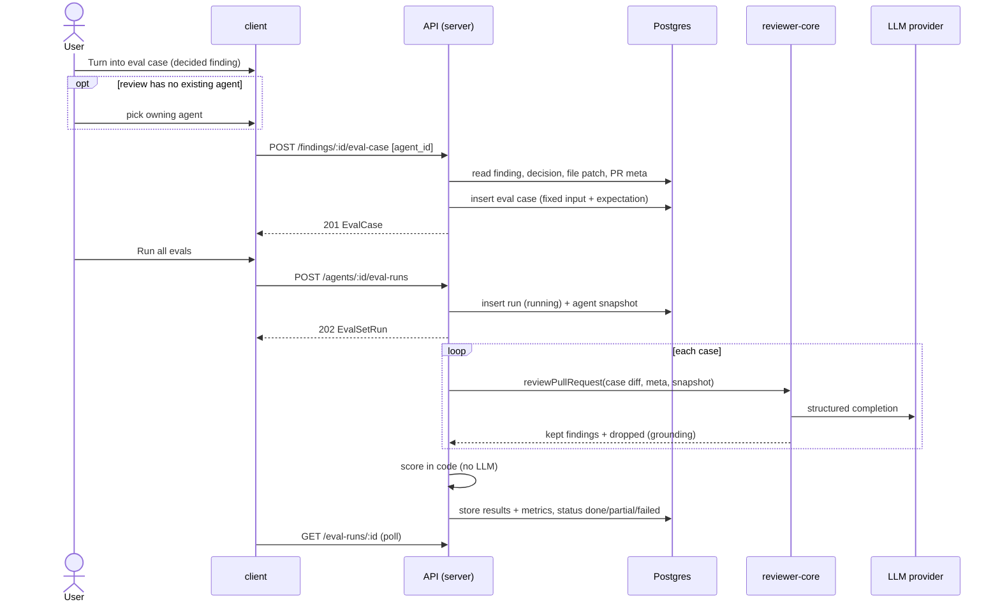

# Spec: Eval Pipeline (eval cases from findings, set runs, scoring, compare)
Spec ID: SPEC-06
Status: implemented
Supersedes: None
Modules: server, client, reviewer-core (relied on, not changed)

## Problem and user
**Who.** The single local dev-digest user who writes and tunes review agents. They change an
agent's system prompt and today cannot tell whether the change made the agent better or worse.

**Today.**
- The user's accept / dismiss decisions on findings are stored but used for nothing else:
  `findings.accepted_at` / `findings.dismissed_at` (`server/src/db/schema/reviews.ts:45-46`), set
  by `POST /findings/:id/accept|dismiss` (`server/src/modules/reviews/routes.ts:143-150`). The
  module comment calls them "the dataset later lessons build on"
  (`server/src/modules/reviews/findings.ts:7-9`).
- Tables `eval_cases` and `eval_runs` exist (`server/src/db/schema/eval.ts:7-35`) but nothing
  reads or writes them: no eval module is registered (`server/src/modules/index.ts:30,33-51`)
  and the seed writes no eval rows (`server/src/db/seed.ts:31`). A case has no expectation type
  and no link to a source finding; `eval_runs` holds one row per case, with no grouping into a
  set run and no record of the agent version or prompt used.
- The finding card offers only Accept and Dismiss
  (`client/src/app/repos/[repoId]/pulls/[number]/_components/FindingCard/FindingCard.tsx:91-112`).
  The agent editor has four tabs, without Evals
  (`client/src/app/agents/[id]/_components/AgentEditor/constants.ts:11-16`); the label
  `editor.tabs.evals` already exists (`client/messages/en/agents.json:53`).
- The review engine can already run on fixed inputs: `reviewPullRequest` takes a parsed diff,
  the system prompt, the model, an injected LLM provider and optional slots
  (`reviewer-core/src/review/run.ts:45-97`), and returns the grounded findings plus the
  findings the grounding gate dropped with reasons (`reviewer-core/src/review/run.ts:99-117,
  201-236`).

**Why it matters.** Without a fixed regression set a prompt edit is judged by feel. With cases
built from the user's own decisions, every prompt version is scored on the same inputs, so a
change that loses a real bug (recall) or adds noise the user already rejected (precision) shows
up as a number.

**Related spec.** The sidebar "Eval Dashboard" page and the per-agent dashboard with the trend
chart are SPEC-07 (`specs/2026-10-22-eval-dashboard.md`). SPEC-07 reuses this spec's run data,
metric definitions and compare view; it does not redefine them.

**Design sources** (user screenshots, guidance only):
1. PR detail, Review runs: a finding card with Accept · Dismiss · Learn · **Turn into eval case** ·
   Reply to author.
2. Agents page, Evals tab: metric cards RECALL / PRECISION / CITATION ACCURACY / TRACES PASSED
   with deltas ("82% ▲4pt"); "View full dashboard →"; "Eval cases 3 / 5 passing"; buttons
   "Run all evals" and "New eval case"; case rows with a status icon, name, "expected 1 finding,
   got 1" / "never run", a severity · category chip or "empty []", and run / edit / delete icons.
3. Eval case editor modal (Name, Input tabs Diff / Files / PR meta, Expected output JSON,
   "Finding skeleton", "Run on save", "Run case", Save).
4. Per-agent dashboard with a Recent runs table (checkboxes, version, recall, precision,
   citation, pass, cost) and a **Compare** button.
5. Compare runs modal "v6 → v7": four cards (recall, precision, citation, cost) "old → new" with
   delta, a SYSTEM PROMPT DIFF with "v6 (old)" / "v7 (new)", buttons Close and "Promote v7".

Deviations from the design, decided with the user: Learn, Reply and the CI tab are not built
(NG4); the manual "New eval case" editor, "Run on save" and "Promote" are not built (NG2, NG5), and
"Run case" exists only in the finding's warm-up modal (AC20, AC21); the design word "traces" is shown as "cases"; Compare lives in the Evals tab here and is
reused by SPEC-07.

## Goals / Non-goals
### Goals
- G1 Turn a decided finding into an eval case in one click: accepted → `must_find`, dismissed →
  `must_not_flag`.
- G2 Show and manage (list, delete) an agent's eval case set in the agent editor's Evals tab.
- G3 Run an agent over its whole case set on fixed, stored inputs, so runs of different agent
  versions are comparable.
- G4 Score every run in code with no model call: recall, precision, citation accuracy and
  passed cases.
- G5 Show run history and compare two runs side by side: metric deltas and the system prompt
  diff.
- G6 Ship a seeded set of at least 8 cases and a `verify:l06` script that proves the pipeline.

### Non-goals
- NG1 Exporting an agent (with or without its eval cases) as a plugin bundle; the
  `productionize.ts` contracts stay unused (user decision, Q2).
- NG2 The manual "New eval case" editor (JSON expected output, "Finding skeleton", "Run on
  save") and editing a case after creation.
- NG3 "Run case" for a saved case from the agent's Evals tab. A set run always covers the whole
  set. _(Revision 2026-10-22: "Run case" exists only inside the warm-up modal, on an unsaved
  draft; see AC20 and AC21.)_
- NG4 Learn, Reply to author and the CI tab shown in the design.
- NG5 "Promote vN" (rolling an agent back or forward to a run's prompt).
- NG6 Eval cases owned by a skill (`owner_kind = skill`); this spec covers agents only.
- NG7 The sidebar Eval Dashboard page, the per-agent dashboard page, the trend chart, "Run all
  agents", the period filter, the agent selector and the alert banner (SPEC-07 or later).
- NG8 Repeating a run N times or averaging runs; runs are single executions (see NFR6).
- NG9 Repo-intel, project context, intent, memory and skills in eval runs (Q5: prompt, model and
  strategy only).
- NG10 The homework's screenshot and screencast deliverables; they are manual and not part of
  any test lane.

## User stories
- US1. As an agent author, I want to turn a finding I accepted or dismissed into an eval case in
  one click, so that my real decisions become the regression set.
- US2. As an agent author, I want to see and prune my agent's eval cases, so that the set stays
  meaningful.
- US3. As an agent author, I want to run my agent over all its cases, so that I get a score for
  the current prompt on fixed inputs.
- US4. As an agent author, I want recall, precision and citation accuracy computed the same way
  every time without a model, so that the numbers are trustworthy and free.
- US5. As an agent author, I want to compare two runs with the prompts side by side, so that I
  can see which prompt edit moved which metric.
- US6. As the course reviewer, I want a seeded case set and one verify command, so that I can
  confirm the pipeline works.

## Acceptance criteria (EARS)
- AC1 (US1). WHEN the user turns an **accepted** finding into an eval case, the API (shall)
  store one eval case owned by the finding's agent with `expected_output.type = must_find` and
  one expectation item equal to the finding's `file`, `start_line`, `end_line`, `title`,
  `severity` and `category`. _(observable: `POST /findings/:id/eval-case` → 201 with the
  `EvalCase` body; one `eval_cases` row with those values and `source_finding_id` = the finding
  id)_
- AC2 (US1). WHEN the user turns a **dismissed** finding into an eval case, the API (shall) store
  one eval case with `expected_output.type = must_not_flag` and one expectation item equal to the
  finding's `file`, `start_line`, `end_line`, `title`, `severity` and `category`. _(observable:
  201; stored `expected_output.type` = `must_not_flag`)_
- AC3 (US1). IF the finding is neither accepted nor dismissed, THEN the API (shall) return 422
  with `error.code = finding_undecided` and (shall) store no eval case. _(observable: 422 body;
  `eval_cases` row count unchanged)_
- AC4 (US1). WHILE a finding is neither accepted nor dismissed, the finding card (shall) render
  "Turn into eval case" disabled, with the reason text linked through `aria-describedby`.
  _(observable: button `disabled`; `aria-describedby` points at an element with the i18n
  key `eval.findingAction.undecidedReason` text)_
- AC5 (US1). IF an eval case already exists for the finding, THEN the API (shall) return 200 with
  the existing case and (shall) not create a second one; the card (shall) then show the
  "Eval case created" state. _(observable: second POST → 200 with the same `id`; one row with
  that `source_finding_id`; card label from `eval.findingAction.created`)_
- AC6 (US1, US3). WHEN an eval case is created from a finding, the API (shall) store as its fixed
  input the full patch of the finding's file in that PR, the list of that one file path, and the
  PR meta (`pr_number`, `title`, `body`). _(observable: stored `input_diff` equals that file's
  patch; `input_files = [file]`; `input_meta` holds the three fields)_
- AC7 (US2). WHEN the user opens the agent editor's Evals tab, the client (shall) list every eval
  case of that agent with its name, expectation type, the status from the latest finished run
  (`pass` / `fail` / `error` / `never_run`) and, when `decision_changed` is true, a "decision
  changed" badge. _(observable: one row per case from `GET /agents/:id/eval-cases`; status and
  badge text by i18n key under `eval.evalsTab`)_
- AC8 (US2). WHEN the user confirms deleting an eval case, the API (shall) remove the case and
  (shall) keep the results of past runs that included it. _(observable: confirm dialog naming the
  case; `DELETE /eval-cases/:id` → 204; the case is gone from the list; `GET /eval-runs/:id` of an
  older run still returns that case's result with its `case_name`)_
- AC9 (US3). WHEN the user starts "Run all evals", the API (shall) create one eval run in status
  `running`, record on it the agent's current `version`, `model`, `strategy` and `system_prompt`,
  and return 202 before any case finishes. _(observable: `POST /agents/:id/eval-runs` → 202 with
  `EvalSetRun`, `status = running`, snapshot fields filled)_
- AC10 (US3). IF a run cannot start, THEN the API (shall) reject it with the status and code in
  the table below and (shall) store no eval run. _(observable: status + `error.code`; `GET
  /agents/:id/eval-runs` count unchanged)_

  | Condition | Status | `error.code` |
  |---|---|---|
  | the agent has a run in status `running` | 409 | `eval_run_active` |
  | the agent has 0 eval cases | 422 | `no_eval_cases` |
  | the agent's provider has no API key | 422 | `provider_not_configured` |
  | the agent does not exist | 404 | `not_found` |
- AC11 (US3). WHILE an eval run of the agent is `running`, the Evals tab (shall) disable "Run all
  evals", show the running state, and show the final status once the run ends without a page
  reload. _(observable: button `disabled` with `aria-busy`; final status text appears after the
  mocked poll returns `done`)_
- AC12 (US4). WHEN every case of a run has a result, the API (shall) compute the run's metrics
  with the rules in "Scoring rules" and (shall) make no LLM provider call to do so. _(observable:
  `recall`, `precision`, `citation_accuracy`, `cases_passed` on `GET /eval-runs/:id` equal the
  values computed by hand for a fixture; a provider stub that throws on any call during scoring
  is never called)_
- AC13 (US3, US4). IF the model call for a case fails or times out, THEN the API (shall) record
  that case as `error` with a reason, leave it out of the metrics, and end the run as `partial`
  (or `failed` when every case errored). _(observable: case result `status = error`, `error`
  non-null; run `status = partial`; `cases_errored` count; the tab shows "n of m cases errored"
  by i18n key)_
- AC14 (US4). WHEN the Evals tab shows metrics, the client (shall) show the latest finished run's
  recall, precision, citation accuracy and passed / total, each with its signed change against
  the previous finished run of the same agent, and "—" for a null value. _(observable: four cards;
  delta text with a "+" or "−" sign in points; "—" for null; no delta on the first run)_
- AC15 (US5). WHEN the user selects exactly two finished runs in the run history and chooses
  Compare, the client (shall) show the older run as "old" and the newer as "new" with the
  recall, precision, citation accuracy and cost deltas and a line diff of the two
  `system_prompt` snapshots. _(observable: Compare disabled unless 2 rows are selected; dialog
  shows "old → new" values and added / removed prompt lines; "Prompts identical" by i18n key when
  the snapshots are equal; a "models differ" note when `model` differs)_
- AC16 (US6). WHEN the database is seeded, the seed (shall) leave at least 8 eval cases owned by
  one seeded agent, covering both `must_find` and `must_not_flag`, also on a database seeded
  before this feature, and without duplicating them on a re-seed. _(observable: after `db:seed`
  on a fresh DB and on an already-seeded DB, run twice, `eval_cases` for that agent has ≥ 8 rows,
  both types present, same count after the second run)_
- AC17 (US6). WHEN `verify:l06` runs in `server/` on a machine with Docker, it (shall) exit 0 only
  if all of these pass: the scoring rules on fixtures with zero provider calls; the eval contract
  parity between the server and client `shared` copies; the eval routes against real Postgres
  with a mock LLM, including AC1-AC3, AC5, AC9, AC10, AC13; the seed count of AC16; and a two-run
  case where a changed system prompt makes the mock return different findings and the second
  run's precision or recall differs from the first. _(observable: exit code 0 / non-zero; with
  pnpm broken, the documented equivalent is `./node_modules/.bin/vitest run <the same files>`)_
- AC18 (US1). IF the finding's review has no agent, or that agent no longer exists, THEN the
  finding card (shall) ask the user to pick the owning agent from the workspace's agents before
  the case is created, and the API (shall) create the case owned by the picked `agent_id`.
  _(observable: activating the button opens an agent picker listing the workspace agents; the
  POST carries `agent_id`; stored `owner_id` = the picked agent; without `agent_id` the API
  returns 422 `agent_required` and stores no case)_
- AC19 (US3). WHEN the server starts, it (shall) set every eval run still in status `running` to
  `failed` with a reason saying the server restarted, so that AC10's 409 no longer applies to
  that agent. _(observable: after a boot with a seeded `running` row, that row has `status =
  failed`, `finished_at` set and a non-null restart reason; a new start for the agent → 202)_
- AC20 (US1). WHEN the user activates "Turn into eval case" on a decided finding, the client
  (shall) open a modal prefilled from the finding (diff, PR meta, case name, expected output
  `must_find` for an accepted finding, `must_not_flag` for a dismissed one) and the system
  (shall) store no case until the user presses Save. _(observable: after the click,
  `POST /findings/:id/eval-case/draft` is sent, no `eval_cases` row exists and the Evals tab
  lists no new case; Cancel leaves it that way; Save sends `POST /findings/:id/eval-case` with
  the edited fields and the case then appears in the Evals tab)_
- AC21 (US1). WHILE the modal is open, WHEN the user presses "Run case", the system (shall) run
  the agent once over the edited, unsaved case and show its pass / fail result and the findings
  it reported, without storing a case or a run. _(observable: `POST
  /agents/:id/eval-cases/run` returns an `EvalCaseResult` with `case_id: null`; `eval_cases` and
  `eval_set_runs` row counts are unchanged; editing a field clears the shown result; invalid
  expected-output JSON disables Run case and Save)_

## Workflow

How an eval run feeds reviewer-core without GitHub: each case's stored `input_diff` is parsed
into the same unified-diff shape a review uses, and `reviewPullRequest` receives that diff, the
case's PR meta (as the PR description and the task line), and the run's snapshot of the agent's
`system_prompt`, `model` and `strategy`. No clone, GitHub call, repo-intel, project context,
intent, memory or skill is read (NG9). The grounding gate `groundFindings()`
(`reviewer-core/src/grounding.ts:75`) runs unchanged inside `reviewPullRequest`
(`reviewer-core/src/review/run.ts:202`); the run observes survival directly from its outcome:
`review.findings` are the findings that survived, `dropped` are those the gate removed, with the
reason. Because no intent is passed, the scope filter does not run
(`reviewer-core/src/review/run.ts:215`), so `review.findings` equals the gate's kept list.

## Scoring rules
All rules run in code over stored results; none calls a model (AC12, NFR1).
- **Match.** A finding matches an expectation item when its `file` equals the item's `file`
  exactly and the inclusive ranges `[start_line, end_line]` overlap. Severity, category and
  title are ignored.
- **Kept / dropped.** Per case, *kept* = the findings that survived the grounding gate; *dropped*
  = the findings the gate removed.
- **Case pass.** A `must_find` case passes when every expectation item is matched by at least one
  kept finding. A `must_not_flag` case passes when no kept finding matches its expectation item.
  An `error` case does not pass.
- **Noise.** A kept finding is noise when it matches no `must_find` item of its own case. In a
  `must_not_flag` case every kept finding is noise.
- **recall** = matched `must_find` items ÷ all `must_find` items, over non-errored cases. An item
  matched by several findings counts once. `null` when there are 0 items.
- **precision** = (kept − noise) ÷ kept, over non-errored cases. `null` when kept = 0.
- **citation_accuracy** = kept ÷ (kept + dropped), over non-errored cases. `null` when
  kept + dropped = 0.
- **Passed / total** = `cases_passed` ÷ `cases_total`, where `cases_total` is every case in the
  run, including errored ones.
- **Delta** (AC14, AC15) = new value − old value, shown in points (×100, signed); no delta when
  either side is `null`.

## Contracts
Wire fields are snake_case. Both `server/src/vendor/shared` and `client/src/vendor/shared` carry
the identical shapes (NFR7). The existing `EvalCase`, `EvalCaseInput`, `EvalRunRecord` and
`EvalRun` (`server/src/vendor/shared/contracts/knowledge.ts:138-172`,
`server/src/vendor/shared/contracts/eval-ci.ts:20-54`) may be changed or replaced; no stored rows
depend on them today.

**`EvalExpectationItem`**: `file` string · `start_line` int ≥ 1 · `end_line` int ≥ `start_line` ·
`title` string · `severity` `CRITICAL | WARNING | SUGGESTION` · `category`
`bug | security | perf | style | test`.

**`EvalCase`** (response)
| Field | Type | Nullability |
|---|---|---|
| `id` | string (uuid) | required |
| `owner_kind` | `agent` | required |
| `owner_id` | string (agent id) | required |
| `name` | string | required |
| `input_diff` | string (unified patch of one file) | required |
| `input_files` | string[] | required |
| `input_meta` | `{ pr_number: int, title: string, body: string }` | required; `body` nullable |
| `expected_output` | `{ type: must_find \| must_not_flag, items: EvalExpectationItem[] }` | required |
| `source_finding_id` | string | nullable (seeded cases; source deleted) |
| `decision_changed` | boolean | required |
| `last_status` | `pass \| fail \| error \| never_run` | required |
| `notes` | string | nullish |

**`EvalSetRun`** (response of `POST /agents/:id/eval-runs`, items of `GET /agents/:id/eval-runs`)
| Field | Type | Nullability |
|---|---|---|
| `id` | string | required |
| `agent_id` | string | required |
| `agent_version` | int | required |
| `model` | string | required |
| `strategy` | string | required |
| `status` | `running \| done \| partial \| failed` | required |
| `started_at` | ISO string | required |
| `finished_at` | ISO string | nullable |
| `cases_total` / `cases_passed` / `cases_errored` | int | required |
| `recall` / `precision` / `citation_accuracy` | number 0..1 | nullable |
| `cost_usd` | number | nullable (unknown price) |
| `duration_ms` | int | nullable while running |

**`EvalSetRunDetail`** (`GET /eval-runs/:id`) = `EvalSetRun` plus `system_prompt` string (required)
and `results[]`:
| Field | Type | Nullability |
|---|---|---|
| `case_id` | string | nullable (case deleted later, AC8) |
| `case_name` | string | required |
| `expectation_type` | `must_find \| must_not_flag` | required |
| `status` | `pass \| fail \| error` | required |
| `error` | string | nullable |
| `kept` | `{ file, start_line, end_line, title, severity, category, is_noise }[]` | required (empty on error) |
| `dropped` | `{ file, start_line, end_line, title, reason }[]` | required (empty on error) |
| `matched_items` | int | required |

Persisted JSON (per-case results) is parsed back by these contracts, so any field added later
must be `nullish` (root INSIGHTS "A contract field added to RunStats must be optional").

**Routes and errors**
| Route | Success | Errors |
|---|---|---|
| `POST /findings/:id/eval-case` (body `{ agent_id }`, `agent_id` optional; used only when the finding's review has no existing agent, AC18) | 201 new · 200 existing (AC5) | 404 `not_found` (finding, or picked agent) · 422 `finding_undecided` · 422 `diff_unavailable` (EC2) · 422 `agent_required` (EC3, AC18) |
| `GET /agents/:id/eval-cases` | 200 `EvalCase[]` | 404 |
| `DELETE /eval-cases/:id` | 204 | 404 |
| `POST /agents/:id/eval-runs` (no body) | 202 `EvalSetRun` | AC10 table · 429 (NFR2) |
| `GET /agents/:id/eval-runs` | 200 `EvalSetRun[]`, newest first | 404 |
| `GET /eval-runs/:id` | 200 `EvalSetRunDetail` | 404 |

## Edge cases
- EC1. Finding undecided → AC3 (API), AC4 (UI).
- EC2. The finding's file has no stored patch in that PR (seeded PR #482 stores a patch only for
  `src/config.ts`, `server/src/db/seed.ts:127-132`) → 422 `diff_unavailable`, no case stored;
  the card shows the reason by i18n key. Covered by AC6 (the input must be the file's patch) and
  the Contracts error table.
- EC3. The finding's review has no agent (the seeded PR #482 review is written with no agent,
  root INSIGHTS "A PR-list rollup…", `server/src/db/seed.ts:143-155`) or the agent was deleted
  → the user picks the owning agent; without a pick the API returns 422 `agent_required` (AC18).
- EC4. Double click or two tabs on "Turn into eval case" → one case (AC5).
- EC5. The decision changes after the case was created → the case keeps its type and shows
  "decision changed" (AC7, P3).
- EC6. The source finding is deleted (its review is deleted) → the case stays runnable with
  `source_finding_id = null` and `decision_changed = false` (Contracts; AC7).
- EC7. A case is deleted after runs used it → old run results keep `case_name` (AC8).
- EC8. A case is deleted while a run is `running` → the run still runs and scores that case from
  the case set captured at run start; the deletion affects later runs only (AC8, AC12).
- EC9. Empty case set → "Run all evals" disabled with an empty state that points to "Turn into
  eval case" on a PR (P7, AC10 for the API).
- EC10. Second start while running, or two tabs → 409 `eval_run_active` (AC10); button disabled
  (AC11).
- EC11. No API key for the agent's provider → 422 `provider_not_configured`, no run (AC10, P5);
  the tab links to Settings → API Keys.
- EC12. One case's model call fails or times out → `error`, run `partial` (AC13). All cases fail →
  `failed` (AC13).
- EC13. The server stops while a run is `running` → on the next boot the run is set to `failed`
  with a restart reason (AC19), so it no longer blocks a new start (AC10).
- EC14. Rate limit: an 11th start in one minute → 429 (NFR2); the tab says it is a limit and when
  to retry.
- EC15. Zero kept findings / zero items / zero findings at all → the metric is `null` and shows
  "—" (Scoring rules, AC14).
- EC16. Cost unknown → "—"; free → "$0.00"; below $0.0001 → "<$0.0001" (P10, client INSIGHTS
  "Formatting a cost at fixed 4dp…"). Covered by AC15 (cost delta) and NFR5.
- EC17. Two compared runs with identical prompts → "Prompts identical"; different models → a
  note (AC15).
- EC18. Long case names, file paths and prompt lines → truncated with the full text available;
  no horizontal overflow (NFR4).
- EC19. Many runs → the run history lists the newest 20 runs of the agent, with no paging
  (AC15).
- EC20. The finding's `file` was renamed in the PR → matching uses the new-side path stored in the
  case (Scoring rules).
- EC21. Seed on a dev DB seeded before this feature → cases still appear (AC16; server INSIGHTS
  "Seed fixture changes reach only a fresh DB").
- EC22. Agent deleted → its eval cases and eval runs are deleted with it (P8). Covered by NFR8.

## Non-functional requirements
- NFR1. Cost and determinism — scoring makes 0 LLM provider calls; a set run makes LLM calls only
  inside `reviewPullRequest`, one review per case — verify: server-unit (provider stub that
  throws during scoring), server-integration (call counter equals cases × chunks).
- NFR2. Rate limits — `POST /agents/:id/eval-runs` allows 10 requests/min, like the review route
  (`server/src/modules/reviews/routes.ts:29`), under the global 120/min (`server/src/app.ts:110`);
  `POST /findings/:id/eval-case` stays under the global limit only — verify: server-integration
  with its own `NODE_ENV=development` app (server INSIGHTS "A per-route rateLimit never fires
  under NODE_ENV=test").
- NFR3. Accessibility (WCAG 2.2 AA) — metric changes are stated as signed text, never by colour
  alone (1.4.1); run-history checkboxes have labels that name the run (1.3.1, 4.1.2); the compare
  dialog traps focus and returns it to Compare on close (2.4.3); the running state and the final
  status are announced through a polite live region (4.1.3); every button is reachable by
  keyboard — verify: client.
- NFR4. Long content — names, paths and prompt lines up to 500 characters render without
  horizontal overflow at 1280 px width and at 200 % zoom (1.4.10) — verify: client (truncation and
  title attribute present), manual for zoom (jsdom has no layout).
- NFR5. i18n — every new string lives in `client/messages/en/eval.json` (existing namespace with
  `evalsTab.*`, `caseEditor.*`, `dashboard.*`, `page.*`) plus new `findingAction.*` and
  `compare.*` groups; none inline in JSX — verify: client.
- NFR6. Reproducibility — runs use the provider's default temperature 0
  (`reviewer-core/src/llm/openrouter.ts:72`) and no seed exists, so a repeat of the same prompt
  may differ; the UI states this nowhere as "identical", and a delta is always shown against a
  named run — verify: manual (model behaviour; reason: real model output).
- NFR7. Compatibility — the eval contracts are identical in both `shared` copies; existing review,
  finding and agent contracts and routes keep their shapes; the grounding gate and
  `wrapUntrusted()` are unchanged — verify: server-unit (contract parity test, like
  `server/test/contracts.test.ts:471-476`), reviewer-core suite unchanged and green.
- NFR8. Data lifecycle — deleting an agent deletes its eval cases and eval runs; no orphan row
  remains (P8) — verify: server-integration.
- NFR9. Observability — each eval run logs start and end at `info` with run id, agent id, agent
  version, case count, status and duration; per case at `info` with case id, status and counts;
  never diff, prompt, finding or PR text — verify: server-unit (log capture).
- NFR10. Schema changes go through drizzle-kit generated migrations only; no applied migration
  is edited (`AGENTS.md` "Do not touch") — verify: review of the generated migration set.

## Inputs and provenance
| Input | Source | Trusted? | Used in |
|---|---|---|---|
| File patch (case `input_diff`) | DB (`pr_files.patch`, originally GitHub / clone) | No | DB, prompt, UI |
| PR title and body (`input_meta`) | DB (originally GitHub) | No | DB, prompt, UI |
| Finding title, file, lines, severity, category | DB (originally model output) | No | DB (expectation), UI |
| Findings returned by an eval run | model output | No | DB (results), UI, scoring |
| Grounding drop reasons | reviewer-core (code) | Yes | DB, UI |
| Agent system prompt, model, strategy | DB (user-authored) | Yes (user's own) | prompt, DB snapshot, UI diff |
| Decision (accepted / dismissed) | DB (user action) | Yes | expectation type |

## Untrusted inputs
- File patch and PR meta — reach the prompt — threat: prompt injection (OWASP Agentic AI, A05) —
  the system (shall) pass them only through `reviewPullRequest`, where the diff and the PR
  description enter inside `wrapUntrusted()` blocks (`reviewer-core/src/prompt.ts:45,227,245`)
  and the gate `groundFindings()` still drops findings outside the diff — covered by: AC9, NFR7.
- File patch, PR meta, finding and result text — reach the UI — threat: stored XSS (A05) — the
  client (shall) render them as text only, never as HTML or markdown with raw HTML — covered by:
  AC7, AC15, NFR5 (client lane asserts text rendering of a `<script>` fixture).
- File patch (can hold secrets, the design shows a `sk_live_` key) — reaches DB and logs — threat:
  secret in log (A09) — the system (shall) never log diff, prompt or finding text, and eval tables
  are treated as sensitive like `run_traces` (server INSIGHTS "Prompt logs are metadata-only…")
  — covered by: NFR9.
- Model output (findings of a run) — reaches scoring and DB — threat: tampered output / injection
  into metrics — the system (shall) validate every returned finding against the Finding contract
  and score only gate-surviving findings — covered by: AC12, AC13.

## Traceability
| AC | Story | Goal | Covers (EC / NFR / untrusted input) | Verify by |
|---|---|---|---|---|
| AC1 | US1 | G1 | EC6, finding text | server-integration |
| AC2 | US1 | G1 | — | server-integration |
| AC3 | US1 | G1 | EC1 | server-integration |
| AC4 | US1 | G1 | EC1, NFR3, NFR5 | client |
| AC5 | US1 | G1 | EC4 | server-integration, client |
| AC6 | US1, US3 | G1, G3 | EC2, EC20, file patch | server-integration |
| AC7 | US2 | G2 | EC5, EC6, EC18, XSS | client |
| AC8 | US2 | G2 | EC7, EC8 | server-integration, client |
| AC9 | US3 | G3 | prompt injection, NFR1 | server-integration |
| AC10 | US3 | G3 | EC9, EC10, EC11, EC13 | server-integration |
| AC11 | US3 | G3 | EC10, NFR3 | client |
| AC12 | US4 | G4 | EC15, EC20, NFR1, model output | server-unit |
| AC13 | US3, US4 | G3, G4 | EC12 | server-integration |
| AC14 | US4 | G4 | EC15, NFR3 | client |
| AC15 | US5 | G5 | EC16, EC17, EC18, EC19, NFR3 | client |
| AC16 | US6 | G6 | EC21 | server-integration |
| AC17 | US6 | G6 | NFR1, NFR7 | server-integration (script exit code) |
| AC18 | US1 | G1 | EC3 | server-integration, client |
| AC19 | US3 | G3 | EC13 | server-integration |
| AC20 | US1 | G1 | — | client-unit, server-unit |
| AC21 | US1 | G1 | — | client-unit, server-unit |

NFR2 → server-integration; NFR8 → server-integration (EC22); NFR9 → server-unit; NFR4, NFR6 →
manual with the reasons given; NFR10 → review.

## Decisions
- Q1 — answered — two specs: this one (SPEC-06) and SPEC-07 Eval Dashboard; case list, delete
  and run-all for one agent here — landed in: G2, G3, NG2, NG3, NG5, NG7.
- Q2 — answered — plugin export is out of scope — landed in: NG1.
- Q3 — answered — noise = any kept finding matching no `must_find` of its case; empty
  denominators → `null` ("—"); case pass, match, recall and citation definitions as proposed —
  landed in: Scoring rules, AC12.
- Q4 — answered — snapshot `system_prompt` and `model` on the run — landed in: AC9, Contracts.
- Q5 — answered — prompt, model and strategy only; the diff fragment is the full patch of the
  finding's file — landed in: AC6, AC9, NG9, Workflow.
- Q6 — answered — async start, poll, 10/min, one active run per agent (409) — landed in: AC9,
  AC10, AC11, NFR2.
- Q7 — answered — `verify:l06` in `server/package.json`; ≥ 8 seeded cases of both types for one
  seeded agent — landed in: AC16, AC17.
- P1 — accepted — button disabled until decided — landed in: AC3, AC4, EC1.
- P2 — accepted — idempotent creation via the stored source finding id — landed in: AC5, EC4.
- P3 — accepted — case keeps its type; "decision changed" badge — landed in: AC7, EC5.
- P4 — accepted — default name = slug of the finding title plus `file:line`, rendered as text;
  renaming is not built (NG2) — landed in: AC1 (stored `name`), Untrusted inputs.
- P5 — accepted — no API key refuses the start up front — landed in: AC10, EC11.
- P6 — accepted — a failing case is `error`, run `partial` — landed in: AC13, EC12.
- P7 — accepted — empty set disables "Run all evals" — landed in: EC9, AC10.
- P8 — accepted — agent deletion removes its cases and runs — landed in: EC22, NFR8.
- P9 — accepted — compare exactly two runs: deltas, prompt diff, identical and model notes —
  landed in: AC15, EC17.
- P10 — accepted — three-way cost format; cost deltas not via the vendored `MetricCard` (client
  INSIGHTS "Vendored Donut and MetricCard misreport…") — landed in: EC16, AC15.
- P11 — accepted — WCAG 2.2 AA items — landed in: NFR3, NFR4.
- P12 — accepted — untrusted-input guards — landed in: Untrusted inputs, NFR9.
- P13 — accepted — grounding untouched; scoring only reads its output — landed in: Workflow,
  NFR7.
- Non-blocking defaults accepted by the user — single runs (NG8, NFR6); the word "cases" in the
  UI; agent-only cases (NG6); the nav edit as a main-session step (SPEC-07).
- OQ1 — answered 2026-10-22 — the user picks the owning agent when the finding's review has no
  existing agent — landed in: AC18, EC3, Contracts routes table.
- OQ3 — answered 2026-10-22 — a run left `running` is marked `failed` on server boot — landed
  in: AC19, EC13.
- OQ2 — answered 2026-10-22 — a case deleted mid-run is still scored from the case set captured
  at run start; deletion affects later runs only — landed in: EC8.
- OQ4 — answered 2026-10-22 — run history shows the newest 20 runs, no paging — landed in: EC19.
- Derived (not a separate proposal) — `diff_unavailable` when the file has no patch (EC2), cases
  surviving source deletion (EC6) and run results keeping `case_name` (EC7) follow from Q5 and
  G3 (cases carry their own fixed input).

## Open questions
- ~~OQ1. When the finding's review has no agent (or the agent was deleted): refuse with 422 and
  which code, or let the user pick the owning agent?~~ closed 2026-10-22 — the user picks the
  agent (AC18).
- ~~OQ2. When a case is deleted during a running run, does the run still score it or skip it?~~
  closed 2026-10-22 — scored from the run-start snapshot; later runs only (EC8).
- ~~OQ3. How does a run left `running` after a server restart end?~~ closed 2026-10-22 — marked
  `failed` on server boot (AC19).
- ~~OQ4. How many runs the history lists, and are older runs paged?~~ closed 2026-10-22 — newest
  20, no paging (EC19).
- OQ5. The per-case model-call timeout: the provider's existing timeout and retry behaviour was
  not verified for eval use (server INSIGHTS "container.llm() cannot promise exactly one HTTP
  request") — C5 — owner: implementation-planner — blocks: none — marker: none.
- OQ6. Which seeded agent owns the seeded cases, and their fixture content (the seeded PR #482
  has only 2 findings and 1 stored patch, `server/src/db/seed.ts:127-182`, so the 8 cases need
  their own fixture diffs) — C3 — owner: implementation-planner — blocks: none — marker: none.
- OQ7. The poll interval while a run is `running` — C2 — owner: implementation-planner — blocks:
  none — marker: none.
- OQ8. Whether seeded agents have `agent_versions` rows (`server/src/db/seed.ts:189-257` inserts
  agents only; not fully verified). Not needed by this spec because runs snapshot the prompt
  (Q4) — C3 — owner: implementation-planner — blocks: none — marker: none.

## Code anchors
- `server/src/db/schema/eval.ts:7-20` — `eval_cases`: id, workspace_id (FK cascade), owner_kind `skill|agent`, owner_id (no FK), name, input_diff, input_files, input_meta, expected_output, notes.
- `server/src/db/schema/eval.ts:22-35` — `eval_runs`: one row per case; ran_at, actual_output, pass, recall, precision, citation_accuracy, duration_ms, cost_usd.
- `server/src/db/migrations/0000_init.sql:116,129` — both tables were created by the init migration.
- `server/src/modules/index.ts:30,33-51` — no eval module registered; comment lists eval as a future module.
- `server/src/db/seed.ts:31` — no eval seed rows.
- `server/src/db/seed.ts:101-185` — PR #482 seed: 4 `pr_files`, a patch only for `src/config.ts` (line 130); one review with no agent and 2 findings (config.ts:12 security, users.ts:45-52 perf); written only inside `if (!pr)` (line 106).
- `server/src/db/seed.ts:189-257` — seeded agents: General, Security, Performance, Test Quality, API Contract Reviewer.
- `server/src/db/schema/reviews.ts:29-47` — finding columns; `accepted_at` / `dismissed_at` at 45-46; no agent_id or run_id on a finding.
- `server/src/db/schema/reviews.ts:10-27` — reviews: pr_id, agent_id (no FK), run_id (no FK).
- `server/src/modules/reviews/repository/review.repo.ts:105-145` — `findingContext` joins finding → review → pull; accept / dismiss set one timestamp and null the other.
- `server/src/modules/reviews/routes.ts:143-150` — `POST /findings/:id/accept|dismiss`.
- `server/src/modules/reviews/routes.ts:27-45` — `POST /pulls/:id/review`, 10/min (line 29), async, returns run ids.
- `server/src/app.ts:110-112` — global rate limit 120/min, registered only when `nodeEnv !== 'test'`.
- `server/src/db/schema/pulls.ts:36,44` — `pr_files.patch` per file.
- `server/src/modules/reviews/diff-loader.ts:12-44` — review diff: clone first, then `pr_files.patch`.
- `server/src/adapters/git/diff-parser.ts` — `parseUnifiedDiff` (used by the diff loader).
- `server/src/modules/reviews/run-executor.ts:263-292` — the review run's `reviewPullRequest` call and its inputs.
- `server/src/modules/reviews/run-executor.ts:198,353` — duration measured by the caller.
- `server/src/db/schema/runs.ts:28` — `agent_runs.grounding` stores only "k/n passed"; drops are not persisted.
- `server/src/platform/container.ts:418-437` — `ConfigError` when the provider key is missing.
- `server/src/db/schema/agents.ts:8-49` — agents (system_prompt, model, strategy, version) and `agent_versions` snapshots.
- `server/src/modules/agents/routes.ts:127-141` — `GET /agents/:id/versions[/:version]`.
- `server/src/vendor/shared/contracts/knowledge.ts:138-172,329-339` — `EvalPerTrace`, `EvalRun`, `EvalOwnerKind`, `EvalCase`, `AgentVersionConfig` (has `system_prompt`).
- `server/src/vendor/shared/contracts/eval-ci.ts:20-89` — `EvalCaseInput`, `EvalRunRecord`, `EvalRunResult`, `EvalTrendPoint`, `EvalDashboard`; identical in the client copy, other parts of the file have drifted (`AgentManifest`, `ConformanceInput.provider`).
- `server/src/vendor/shared/contracts/findings.ts:11,14,47-67,87` — severity, category, Finding, `FindingActionKind`.
- `server/src/vendor/shared/contracts/productionize.ts:48-58` — `PluginEvalCase` (unused; NG1).
- `server/test/contracts.test.ts:471-476` — precedent for a server/client contract parity assertion.
- `reviewer-core/src/review/run.ts:45-117` — `ReviewInput` / `ReviewOutcome` (no title field, no duration).
- `reviewer-core/src/review/run.ts:201-236` — grounding then scope filter (only with intent); `review.findings` = kept.
- `reviewer-core/src/grounding.ts:29-34,75,64-69` — `GroundingResult {kept, dropped}`, `groundFindings`, private `rangeIntersects`.
- `reviewer-core/src/prompt.ts:45,227,245` — `wrapUntrusted`; PR description (capped 4000 chars, line 52) and diff wrapped.
- `reviewer-core/src/llm/openrouter.ts:72` — temperature defaults to 0; no seed anywhere.
- `client/src/app/repos/[repoId]/pulls/[number]/_components/FindingCard/FindingCard.tsx:91-112` — Accept and Dismiss only.
- `client/src/lib/hooks/reviews.ts:149-171` — `useFindingAction` posts to `/findings/:id/:action`, invalidates `["reviews", prId]`.
- `client/src/app/agents/[id]/_components/AgentEditor/constants.ts:11-16` — four tabs.
- `client/src/app/agents/[id]/page.tsx:17,50` — `?tab=` accepts only keys derived from the tab list.
- `client/messages/en/agents.json:53` — `editor.tabs.evals` label exists.
- `client/messages/en/eval.json:2,33,60,76` — `dashboard`, `caseEditor`, `evalsTab`, `page` groups exist.
- `client/src/app/skills/[id]/_components/SkillEditor/_components/VersionsTab/helpers.ts:23` — precedent for a text diff rendered through `DiffViewer` (client INSIGHTS "`diff`'s `createTwoFilesPatch` output must be stripped…").
- `server/package.json:6-15` — no `verify:*` script; no root `package.json`.

## Changelog
- 2026-10-22 — draft created from the user's answers to Q1-Q7 and P1-P13.
- 2026-10-22 — OQ1 answered (user picks the owning agent): added AC18, optional `agent_id` on
  `POST /findings/:id/eval-case`, error `agent_required`; EC3 marker removed. OQ3 answered
  (stale `running` runs set to `failed` on boot): added AC19; EC13 marker removed. No IDs
  renumbered.
- 2026-10-22 — OQ2 answered (mid-run deletion scored from the run-start snapshot, EC8) and OQ4
  answered (history = newest 20, no paging, EC19); last markers removed. Status unchanged.
- 2026-10-22 — revision after mentor feedback: "Turn into eval case" opens a warm-up modal and
  saves only on Save (AC20); "Run case" runs one unsaved draft (AC21); NG3 narrowed. Added
  `POST /findings/:id/eval-case/draft` and `POST /agents/:id/eval-cases/run`.
