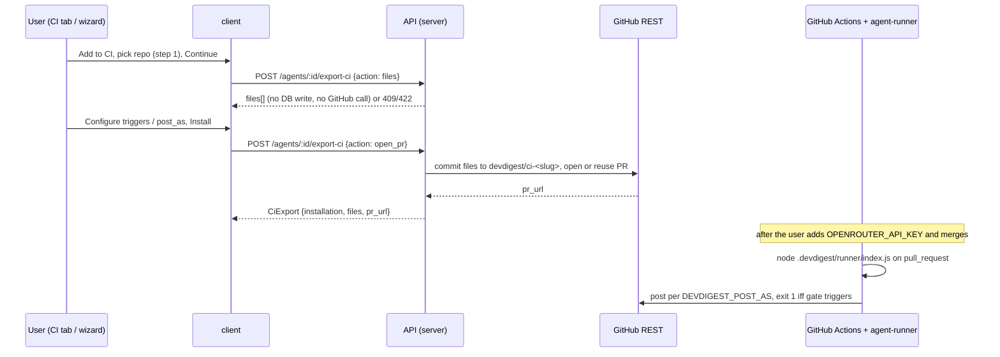

# Spec: Export to CI
Spec ID: SPEC-09
Status: approved
Supersedes: None
Modules: server, client (agent-runner is consumed as a pre-built bundle and is not changed)

## Problem and user
A DevDigest user who has tuned a review agent in the studio can run it only locally, PR by PR. There is no way to run it on every pull request in GitHub, or to block merges on its findings.

The groundwork exists on this branch (L07-lab-hw), but nothing connects it:
- The tables `ci_installations` and `ci_runs` exist (`server/src/db/schema/ci.ts:4`, `server/src/db/schema/ci.ts:14`). No module writes to them.
- There is no `server/src/modules/ci/`, so `POST /agents/:id/export-ci` is not served. The runner's comments refer to `server/src/modules/ci/manifest.ts` and `workflow.ts` (`agent-runner/src/manifest.ts:10`, `agent-runner/src/index.ts:5`), but neither file exists.
- Contracts for export, installation and result artifact are in the server copy (`server/src/vendor/shared/contracts/eval-ci.ts:133-239`). The client copy has the same CI shapes but no `AgentManifest` (`client/src/vendor/shared/contracts/eval-ci.ts:133-210`); the two copies have drifted.
- The agent editor tabs are Config, Skills, Context, Evals and Stats (`client/src/app/agents/[id]/_components/AgentEditor/constants.ts:12-16`). There is no CI tab.
- The UI scaffolds `ExportWizardSteps`, `LiveLogStream` and `AutoTriggerStatus` exist in `client/src/vendor/ui/`, but no route uses them.
- The sidebar has a `ci-runs` key (`client/src/components/app-shell/helpers.ts:38`, `client/messages/en/shell.json:28`) with no `/ci-runs` page behind it.
- The agent already has `ci_fail_on`, edited in the Config tab (`client/src/app/agents/[id]/_components/AgentEditor/_components/ConfigTab/ConfigTab.tsx:24`). `reviewer-core` turns it into a deterministic gate (`reviewer-core/src/output/to-review.ts:37`).
- `agent-runner/` is a finished CLI (`agent-runner/README.md:1-30`):
  - It is ncc-bundled to `dist/index.js`, which is git-ignored and built with `pnpm build` (`agent-runner/README.md:77-81`).
  - It runs as `node .devdigest/runner/index.js` with no CLI arguments (`agent-runner/src/index.ts:30-33`).
  - It loads exactly one `.devdigest/agents/*.yaml`, validated as `AgentManifest` (`agent-runner/src/manifest.ts:36-44`), plus `.devdigest/skills/<slug>.md` per manifest skill (`agent-runner/src/skills.ts:17-18`).
  - Its configuration comes only from env (`agent-runner/README.md:89-98`).
  - It reviews through `reviewer-core` behind `groundFindings()` and `wrapUntrusted()`, and writes `devdigest-result.json` (`CiResultArtifact`).
  - It posts per `DEVDIGEST_POST_AS` and exits 1 when the gate triggers or on a hard failure (`agent-runner/README.md:105-112`).
  - It uses OpenRouter only (`agent-runner/src/index.ts:39`).

This spec covers the **minimal first iteration**: deploy one agent to one repository's GitHub Actions through a pull request. Results do not flow back into DevDigest yet.

**Two-feature lab context.** This spec is paired with multi-agent-review (SPEC-08), which **merges first** and adds finding attribution. There is no ingest in this iteration, so this spec does **not** read attribution. See "Ownership, merge order and verification".

## Goals / Non-goals
### Goals
- G1. From the agent editor, a user can see where the agent is deployed to CI and set when CI fails.
- G2. A user can generate and preview the exact files that deploy the agent to GitHub Actions.
- G3. A user can install those files into a repository through a pull request that DevDigest opens, with no GitHub App.
- G4. Re-installing the same agent into the same repository updates the existing branch and PR instead of piling up new ones.

### Non-goals
- NG1. CircleCI, Jenkins and Generic CLI targets. They are shown disabled as "Coming soon" and are not generated.
- NG2. Ingest of CI results (`devdigest-result.json` → `ci_runs`), the CI Runs page, run status chips such as "succeeded", `LiveLogStream` and `AutoTriggerStatus`: later. The CI Runs nav entry stays as it is.
- NG3. Download as zip. It is replaced by a per-file Copy button.
- NG4. Editing generated files in Preview. Preview is read-only; the user changes the agent instead.
- NG5. Writing repository secrets or branch protection automatically. The wizard shows text instructions only.
- NG6. `.devdigest/memory.jsonl`. It is not generated, because the runner does not read it (`agent-runner/README.md:13-15`).
- NG7. Reading finding attribution from SPEC-08, because there is no ingest (NG2).
- NG8. GitHub App, webhooks and polling.
- NG9. Exposing `ci_fail_on = any` in the CI tab. It stays in the contract and in the Config tab.
- NG10. Uninstall, or removing a repository from CI.
- NG11. The header button "Update CI config". Running "Add to CI" again for an installed repo updates it (AC13).
- NG12. More than one agent per repository. The runner accepts exactly one manifest (`agent-runner/src/manifest.ts:40-44`); see AC16.
- NG13. Non-OpenRouter providers in CI. The runner always uses `OpenRouterProvider` (`agent-runner/src/index.ts:39`); see AC17.

## User stories
- US1. As an agent author, I want a CI tab on my agent that shows the repositories it is deployed to, so that I know where it runs.
- US2. As an agent author, I want to choose the severity at which CI fails, so that I can block merges on serious findings.
- US3. As an agent author, I want a wizard that shows the exact files for GitHub Actions before anything is written, so that I trust what lands in my repo.
- US4. As an agent author, I want DevDigest to open a PR with those files in my repo, so that I install the agent with one review-and-merge.

## Acceptance criteria (EARS)
- AC1 (US1). WHILE the agent has no CI installation, the CI tab (shall) show an empty state with an "Add to CI" action. _(observable: CI tab renders the `ci.tab.empty.*` text and an enabled "Add to CI" button; no repo rows)_
- AC2 (US1). WHILE the agent has one or more CI installations, the CI tab (shall) render one row per installation showing the repo `owner/name`, a "GitHub Actions" chip, a "PR opened" status linking to the stored `pr_url`, and the relative `installed_at` time, plus a header badge "Active in N repos" where N is the number of rows. _(observable: row count equals `GET /agents/:id/ci-installations` length; badge text holds N; link `href` equals `pr_url`)_
- AC3 (US2). WHEN the user picks Critical, Warning+ or Never in the CI tab's "Fail CI on" control, the client (shall) save the agent's existing `ci_fail_on` as `critical`, `warning` or `never` through the existing agent update; WHILE the stored value is `any`, no segment (shall) be selected. _(observable: `PUT /agents/:id` body carries the mapped `ci_fail_on`; with `any`, all segments have `aria-checked="false"`)_
- AC4 (US3). WHEN the user opens the wizard, it (shall) start at step 1 "Target" with GitHub Actions selected, and show CircleCI, Jenkins and Generic CLI as disabled "Coming soon" cards that cannot be selected. _(observable: 3 cards have `aria-disabled="true"` and the "Coming soon" label; clicking one leaves GitHub Actions selected)_
- AC5 (US3). WHILE no repository is selected in step 1 "Target", the wizard (shall) keep Continue disabled; the step 1 repository picker (shall) offer only repositories imported into DevDigest. _(observable: Continue `disabled` until a repo is chosen; options equal the imported repo list)_
- AC6 (US3). WHEN the wizard reaches step 2 "Preview", the API (shall) answer `POST /agents/:id/export-ci` with `action: "files"` with the files `.devdigest/agents/<slug>.yaml`, one `.devdigest/skills/<skill-slug>.md` per skill attached to the agent, `.devdigest/runner/index.js` and `.github/workflows/devdigest-review.yml`, and (shall) create no installation row and make no GitHub call. In Preview, the runner bundle (shall) show only its path and size, and step 2 (shall) warn that the prompt and skills become visible to anyone who can read the repo. _(observable: 200 with the listed `files[].path`; `ci_installations` row count unchanged; GitHub adapter not called; bundle pane shows a size, not the contents)_
- AC7 (US3). The generated `.devdigest/agents/<slug>.yaml` (shall) parse back into an `AgentManifest` whose `name`, `provider`, `model`, `system_prompt`, `skills`, `strategy` and `ci_fail_on` equal the agent's values at export time, and every slug in `skills` (shall) have its `.devdigest/skills/<slug>.md` in the file list. _(observable: round-trip parse equals the source agent fields, including a prompt with quotes, colons, `#`, `---` and multi-line text)_
- AC8 (US3). The generated workflow (shall) run on `pull_request` with exactly the trigger types selected in step 3 (default `opened`, `synchronize`, `reopened`), use Node 20, grant `contents: read` and `pull-requests: write`, set `OPENROUTER_API_KEY` from the repo secret `OPENROUTER_API_KEY`, `GITHUB_TOKEN` from the Actions token and `PR_NUMBER` from the event, and run `node .devdigest/runner/index.js` with no arguments. _(observable: parsed workflow `on.pull_request.types` equals the selection; `permissions`, `env` keys and the `run` line as stated)_
- AC9 (US3). WHEN the user chooses "Post results as" GitHub review, PR comment or None, the generated workflow (shall) set env `DEVDIGEST_POST_AS` to `github_review`, `pr_comment` or `none`. _(observable: workflow `env.DEVDIGEST_POST_AS` equals the chosen `post_as`)_
- AC10 (US3). IF no trigger type is selected in step 3, THEN the wizard (shall) keep Continue disabled and make no API call. _(observable: Continue `disabled`; no request)_
- AC11 (US3). WHEN the user clicks Copy on a file in Preview, the client (shall) copy that file's full contents to the clipboard and announce "Copied" in a polite live region. _(observable: clipboard write called with `contents`; `role="status"` text)_
- AC12 (US4). WHEN the user clicks Install with "Open a PR with these files", the API (shall) commit the files to branch `devdigest/ci-<agent-slug>` off the `base` branch, open a PR titled "Add DevDigest CI review", and return the PR URL in `pr_url` with the upserted installation. Step 4 (shall) state that the user must add the repo secret `OPENROUTER_API_KEY` before merging. _(observable: 200 `CiExport` with non-null `pr_url`; exactly one `ci_installations` row for (agent, repo) with that `pr_url`; step 4 shows the PR link and the `ci.wizard.install.secretHint` text naming `OPENROUTER_API_KEY`)_
- AC13 (US4). WHEN Install runs for an (agent, repo) that already has the branch `devdigest/ci-<agent-slug>`, the API (shall) update that branch. It (shall) return the URL of the branch's open PR when one exists, and open a new PR when the previous one is closed or merged. It (shall) never leave two open PRs for the same branch or two installation rows for the same (agent, repo). _(observable: second Install returns the same `pr_url` while the PR is open; row count stays 1)_
- AC14 (US4). IF Install fails (no `GITHUB_TOKEN`, GitHub 403/404, timeout, rate limit), THEN the API (shall) return the error envelope (`config_error` 500, `external_service_error` 502, or 429) and (shall) store no installation, and the wizard (shall) show the message inline in step 4 with the inputs kept. _(observable: error status and `error.code`; `ci_installations` unchanged; step 4 shows `ci.wizard.install.error.*` and stays open)_
- AC15 (US4). WHILE an Install request is in flight, the wizard (shall) disable Install and Back and show a busy state, so that a double click sends one request. _(observable: button `disabled` + `aria-busy="true"`; one network call on double click)_
- AC16 (US3, US4). IF the selected repository already has a CI installation for a different agent, THEN the API (shall) reject `POST /agents/:id/export-ci` (both `files` and `open_pr`) with 409 `ci_repo_has_other_agent` naming that agent, and (shall) make no GitHub call; the wizard (shall) show the message in step 1 and keep Continue disabled for that repo. _(observable: 409 + `error.code`; no new row; step 1 shows `ci.wizard.target.repoTaken` with the other agent's name)_
- AC17 (US3). IF the agent's `provider` is not `openrouter`, THEN the API (shall) reject `POST /agents/:id/export-ci` with 422 `ci_provider_unsupported`, and the wizard (shall) show in step 1 that CI supports OpenRouter agents only. _(observable: 422 + `error.code`; step 1 shows `ci.wizard.target.providerUnsupported`)_
- AC18 (US3). The generated workflow (shall) skip the review job WHEN the pull request's head repository is a fork. _(observable: job `if:` condition compares the head repo with the base repo; a fork-event fixture yields a skipped job)_

## Workflow

## Contracts
The existing `eval-ci.ts` shapes are reused. The only change is additive and **must land in both copies** (`server/src/vendor/shared/contracts/eval-ci.ts`, `client/src/vendor/shared/contracts/eval-ci.ts`).

- **`POST /agents/:id/export-ci`** — request `CiExportInput` (existing; server `eval-ci.ts:174`, client `eval-ci.ts:145`).
  - Request fields:
    - `repo`: string, required, `owner/name` of an imported repo.
    - `target`: optional, default `gha`. Any other value → 422 `validation_error` in this iteration.
    - `action`: optional, `open_pr` | `files`, default `open_pr`. `files` is the preview: no DB write and no GitHub call.
    - `post_as`: optional, `github_review` | `pr_comment` | `none`, default `github_review`. Written to the workflow as `DEVDIGEST_POST_AS`.
    - `triggers`: optional array, a subset of `opened` | `synchronize` | `reopened`, min 1, default all three.
    - `base`: optional, default `main`.
  - Response `CiExport` (existing; server `eval-ci.ts:198`, client `eval-ci.ts:169`):
    - `installation`: `CiInstallation`. For `action: files` it is a transient object (not stored), with `id` set to an empty string and `pr_url` null. No contract change.
    - `files`: array of `CiFile` (`path` string, `contents` string, `editable` boolean, always `false` here). For the runner bundle, `contents` holds the bundle, and Preview shows only `path` and its size.
    - `pr_url`: string, nullable. Null for `action: files`.
  - Errors:
    - 404 `not_found`: agent or repo unknown.
    - 409 `ci_repo_has_other_agent`: AC16.
    - 422 `validation_error`: bad input, or an unsafe slug (NFR3).
    - 422 `ci_provider_unsupported`: AC17.
    - 500 `config_error`: no `GITHUB_TOKEN`, or the runner bundle `agent-runner/dist/index.js` is missing, with a message naming the bundle path.
    - 502 `external_service_error`: GitHub failure or timeout.
    - 429: rate limit.
- **`GET /agents/:id/ci-installations`** (new) → array of `CiInstallation`, newest first. Returns an empty array when there are none, and 404 when the agent is unknown.
- **`CiInstallation`** (existing; server `eval-ci.ts:188`, client `eval-ci.ts:159`) gains `pr_url`: string, **nullish** (additive; older rows have none). Nothing else changes in shared.
- **`ci_fail_on`**: no contract change. CI tab mapping: Critical → `critical`, Warning+ → `warning`, Never → `never`; `any` → no segment selected.
- **Runner bundle source**: the server reads the locally pre-built `agent-runner/dist/index.js` (`cd agent-runner && pnpm build`, `agent-runner/README.md:77`).

## Ownership, merge order and verification
- **Merge order:** SPEC-08 multi-agent-review merges first. This branch then rebases on it and re-runs the verification below.
- **Owned by this feature:**
  - the new server module for CI export and installations;
  - the CI tab and the Export wizard under `client/src/app/agents/[id]/`;
  - the `ci` i18n namespace (`client/messages/en/ci.json`) and the new `agents.editor.tabs.ci` key;
  - the CI section of `eval-ci.ts` in both `shared` copies;
  - the migration that persists `pr_url` and enforces one installation per repo (AC13, AC16).
- **Not changed by this feature:**
  - `findings.ts` and any attribution fields (owned by SPEC-08);
  - `reviewer-core`: the invariants `groundFindings()` (`reviewer-core/src/grounding.ts:75`) and `wrapUntrusted()` (`reviewer-core/src/prompt.ts:45`) are relied on inside the runner and never changed;
  - the `agent-runner/` source;
  - the sidebar `NAV` and `nav.test.tsx`. Export-to-ci makes **no nav change**. If SPEC-08 changes nav, this branch only rebases.
- **Shared contracts:** any `shared` change is made in both copies in the same commit, and only the `pr_url` field above is permitted. SPEC-08 must not edit the CI section; this feature must not edit findings attribution.
- **Verification** (pnpm is broken here; use local binaries, see root `AGENTS.md`):
  - server: `./node_modules/.bin/tsc --noEmit`, `./node_modules/.bin/vitest run --exclude '**/*.it.test.ts'`, `./node_modules/.bin/vitest run .it.test` (needs Docker).
  - client: `./node_modules/.bin/tsc --noEmit`, `./node_modules/.bin/vitest run`.
  - agent-runner (unchanged; it is the consumer of the generated files): `./node_modules/.bin/tsc --noEmit -p tsconfig.json`, `./node_modules/.bin/vitest run`, `./node_modules/.bin/ncc build src/index.ts -o dist`. This needs `reviewer-core/node_modules` installed (`agent-runner/insights/INSIGHTS.md:14`).
  - reviewer-core (unchanged, sanity check): `npm run typecheck`.

## Edge cases
- EC1. First-time use, no installations → AC1.
- EC2. Agent has no skills → no `.devdigest/skills/*` files and `skills: []` in the manifest → AC6, AC7.
- EC3. Agent or skill name with spaces, Unicode, `/`, `..`, quotes or shell metacharacters → each slug used in paths, the branch or the manifest contains only `[a-z0-9-]` and is non-empty → NFR3. The runner joins skill slugs into a path unchecked (`agent-runner/src/skills.ts:18`).
- EC4. System prompt with YAML-significant text (`:`, `#`, `---`, multi-line, quotes) → AC7.
- EC5. No `GITHUB_TOKEN` configured → AC14 (`config_error`).
- EC6. Token lacks write access (403), or the base branch does not exist (404) → AC14.
- EC7. GitHub slow or down → AC14 (`external_service_error`, nothing stored).
- EC8. Double click on Install, or two tabs installing the same (agent, repo) → AC15, AC13 (one row, one open PR).
- EC9. Re-install while the PR is open, or after it was closed or merged → AC13.
- EC10. The agent's `ci_fail_on` is `any` → no segment selected (AC3).
- EC11. `ci_fail_on`, the prompt or the skills change after install → the repo keeps the old manifest until the user re-installs (AC13). Drift is not detected (NG2).
- EC12. Long repo names or many installations → the row truncates the repo name and shows the full name in `title`; no pagination (one agent per repo keeps the count small).
- EC13. Rate limit reached → AC14 (429).
- EC14. Runner bundle missing on the server → `config_error` naming `agent-runner/dist/index.js`; nothing stored or committed (Contracts).
- EC15. The runner bundle is large → Preview shows only its path and size (AC6).
- EC16. Repo not imported into DevDigest → not offered in the picker (AC5); a direct API call gets 404.
- EC17. Exporting a second, different agent to a repo that already has one → AC16. The runner would otherwise fail with "Expected exactly one agent manifest" (`agent-runner/src/manifest.ts:40-44`).
- EC18. Two attached skills whose names produce the same slug → the API rejects with 422 `validation_error` naming both skills, so no file is overwritten → NFR3.
- EC19. Agent provider is `openai` or `anthropic` → AC17.
- EC20. PR from a fork (repo secrets are unavailable, and the runner expects the workflow to skip these, `agent-runner/src/context.ts:30-31`) → AC18.
- EC21. The user merges the PR without adding `OPENROUTER_API_KEY` → the runner's first model call fails and it exits 1 with nothing posted (`agent-runner/README.md:108-112`). Step 4 warns about this up front (AC12).

## Non-functional requirements
- NFR1. Limits — `POST /agents/:id/export-ci` (shall) be rate-limited to 10 requests/min, as the review endpoints are (`server/src/modules/reviews/routes.ts:29`), inside the global 120/min (`server/src/app.ts:119`). Verify: server-integration on a dev app; per-route limits do not fire under `NODE_ENV=test` (`server/INSIGHTS.md:288`).
- NFR2. Security — `GITHUB_TOKEN` and the provider key (shall) never appear in a generated file, a response body, a log line or the UI. The workflow refers to secrets only by name (`${{ secrets.OPENROUTER_API_KEY }}`, `${{ secrets.GITHUB_TOKEN }}`). Verify: server-unit asserting no secret value appears in `files[].contents` or the response.
- NFR3. Security — the agent slug and every skill slug (shall) match `^[a-z0-9]+(-[a-z0-9]+)*$` before use in a file path, branch name or manifest. An empty slug or a slug collision gets 422. Verify: server-unit with the names from EC3 and EC18. The slug transform has no path-splitting step (`client/INSIGHTS.md:167`).
- NFR4. Security — every generated path (shall) stay under `.devdigest/` or `.github/workflows/`, and no path contains `..` or starts with `/`. Verify: server-unit.
- NFR5. Reliability — each GitHub call (shall) be bounded by the adapter's existing timeout and retry (`server/src/adapters/github/octokit.ts:247`, `:266`). A failure after the commit but before the PR opens (shall) leave no installation row. Verify: server-unit with a failing fake (`server/src/adapters/mocks.ts:218-228`).
- NFR6. Accessibility (WCAG 2.2 AA) — the wizard is a modal dialog with a focus trap and an accessible name. The current step uses `aria-current="step"`. The segmented controls and trigger chips are keyboard-operable with visible focus. Disabled cards use `aria-disabled`. Copy, Install and error feedback use live regions. Verify: client.
- NFR7. i18n — every new string lives in `client/messages/en/ci.json` (namespace `ci`) or, for the tab label, under `agents.editor.tabs.ci`; none inline in JSX. Verify: client.
- NFR8. Observability — the API (shall) log one info line per export with `agent_id`, `repo`, `action` and the outcome code, and never file contents or tokens. Verify: server-unit log assertion.
- NFR9. Compatibility — existing `CiExportInput`, `CiExport` and `AgentManifest` consumers keep working, including `agent-runner`, which validates `AgentManifest` (`agent-runner/src/manifest.ts:69`). The `pr_url` addition is `nullish` and identical in the server and client copies. Verify: typecheck of server, client and agent-runner, plus a diff of the CI section in both `eval-ci.ts` copies.

## Inputs and provenance
| Input | Source | Trusted? | Used in |
|---|---|---|---|
| Agent name, system prompt, model, provider, `ci_fail_on` | user (DB `agents`) | semi (user-authored) | slug, manifest YAML, workflow |
| Attached skill names and bodies | user / imported skills (DB) | semi | skill slugs, `.devdigest/skills/*.md` |
| Selected repo `owner/name` | user, limited to imported repos | semi | GitHub API path, `ci_installations.repo` |
| Triggers, `post_as`, `base` | user (wizard) | no | workflow YAML, GitHub API |
| GitHub responses (PR URL, error messages) | GitHub | no | DB `pr_url`, UI link, UI error text |
| `GITHUB_TOKEN` | `SecretsProvider` (`server/src/adapters/secrets/local.ts:40`) | secret | server GitHub calls only |
| Runner bundle `dist/index.js` | local build of `agent-runner/` | trusted build artifact | `.devdigest/runner/index.js` |

## Untrusted inputs
- Agent and skill names → file paths, branch name, manifest. Threat: path traversal (A01/A05), including in the runner, which joins skill slugs into paths (`agent-runner/src/skills.ts:18`). The system (shall) reduce each name to a safe slug or reject it. Covered by: NFR3, NFR4.
- System prompt and skill text → YAML/Markdown files in the repo. Threat: YAML injection that changes manifest fields (for example a forged `ci_fail_on: never`). The system (shall) serialize them so that parsing returns exactly the source values. Covered by: AC7.
- System prompt and skill text → a possibly public repository. Threat: information disclosure (A06, insecure design). The wizard (shall) warn in step 2. Covered by: AC6.
- Triggers, `post_as`, `base` → workflow YAML and GitHub API. Threat: workflow injection (A05). The API (shall) accept only the enumerated values and a branch-name-safe `base`. Covered by: Contracts (422), AC8, AC9.
- Repo `owner/name` → GitHub API path. Threat: a request to an unintended repository. The API (shall) accept only an imported repo. Covered by: AC5, EC16.
- GitHub error messages and `pr_url` → UI. Threat: XSS. The client (shall) render them as text, and `pr_url` only as an `https://github.com/` link. Covered by: AC2, AC14.
- Fork PR content → the CI job with repo secrets. Threat: secret exfiltration through untrusted PR code (A06). The workflow (shall) skip fork PRs. Covered by: AC18.
- PR title, body and diff in CI → model prompt (inside the runner). Threat: prompt injection. This relies on the unchanged `reviewer-core` invariants `wrapUntrusted()` (`reviewer-core/src/prompt.ts:45`) and `groundFindings()` (`reviewer-core/src/grounding.ts:75`). Covered by: NFR9 (runner unchanged).
- Tokens → logs or files. Threat: secret in log or repo (A09). Covered by: NFR2, NFR8.

## Traceability
| AC | Story | Goal | Covers (EC / NFR / untrusted input) | Verify by |
|---|---|---|---|---|
| AC1 | US1 | G1 | EC1, NFR7 | client |
| AC2 | US1 | G1 | EC12, `pr_url` XSS | client + server-integration (list endpoint) |
| AC3 | US2 | G1 | EC10, EC11 | client |
| AC4 | US3 | G2 | NG1, NFR6 | client |
| AC5 | US3 | G2 | EC16, repo input | client |
| AC6 | US3 | G2 | EC2, EC14, EC15, NFR4, disclosure warning | server-unit + client |
| AC7 | US3 | G2 | EC2, EC4, YAML injection | server-unit |
| AC8 | US3 | G2 | NFR2, workflow injection | server-unit |
| AC9 | US3 | G2 | enum inputs | server-unit |
| AC10 | US3 | G2 | — | client |
| AC11 | US3 | G2 | NFR6 | client |
| AC12 | US4 | G3 | EC21, NFR2, NFR5, NFR8 | server-integration (fake GitHub adapter) + client |
| AC13 | US4 | G4 | EC8, EC9 | server-integration |
| AC14 | US4 | G3 | EC5, EC6, EC7, EC13, NFR1 | server-unit + client |
| AC15 | US4 | G3 | EC8, NFR6 | client |
| AC16 | US3, US4 | G3 | EC17, NG12 | server-integration + client |
| AC17 | US3 | G2 | EC19, NG13 | server-unit + client |
| AC18 | US3 | G2 | EC20, fork secret exfiltration | server-unit |

## Decisions
- Q1 — accepted (a) — GitHub Actions only; other targets disabled "Coming soon"; 4-step wizard; Install = open a PR only; per-file Copy instead of zip — landed in: AC4, AC11, AC12, NG1, NG3.
- Q2 — accepted (a) — no ingest; status "PR opened" + link; ingest later — landed in: AC2, NG2, NG7.
- Q3 — accepted (a) — Critical / Warning+ / Never → `critical` / `warning` / `never`; one source of truth (the agent's `ci_fail_on`); Config tab unchanged — landed in: AC3, NG9.
- Q4 — accepted (a) — read-only Preview — landed in: NG4.
- Q5 — accepted — secret setup is text only; same branch `devdigest/ci-<agent-slug>`; new PR when the old one is closed — landed in: AC12, AC13, NG5.
- Q6 — accepted (a) — `specs/2026-10-23-export-to-ci.md`, SPEC-09 (SPEC-08 = multi-agent-review).
- P1 — accepted — empty, no-token and not-imported states — landed in: AC1, AC5, AC14.
- P2 — accepted — Install disabled while in flight; GitHub errors inline in step 4 — landed in: AC14, AC15.
- P3 — accepted — Preview warns that the prompt and skills become visible in the repo — landed in: AC6.
- P4 — accepted — new strings in the `ci` namespace — landed in: NFR7.
- Rate limit 10/min — accepted — landed in: NFR1.
- OQ1 → repo picker in step 1 — AC5. OQ2 → no CLI args — AC8. OQ3 → `DEVDIGEST_POST_AS`, repo secret `OPENROUTER_API_KEY`, OpenRouter only — AC8, AC9, AC12, AC17. OQ4 → local pre-built bundle, `config_error` when missing — Contracts, EC14. OQ5 → `any` shows no segment — AC3. OQ6 → bundle shown as path and size — AC6. OQ7 → transient installation, no contract change — Contracts. OQ8 → "Update CI config" cut — NG11.
- Runner constraint (exactly one manifest per repo) — one agent per repo, 409 for a second agent — landed in: AC16, EC17, NG12.
- Derived from the runner contract — fork PRs skipped (`agent-runner/src/context.ts:30-31`) — landed in: AC18. Non-OpenRouter agents rejected (`agent-runner/src/index.ts:39`) — landed in: AC17, NG13.
- Derived — `CiInstallation.pr_url` (nullish, both copies) shows "PR opened + link" after a reload — landed in: Contracts, AC2.

## Open questions
None. OQ1–OQ9 were resolved on 2026-10-23 (see Decisions and Changelog).

## Code anchors
- `server/src/db/schema/ci.ts:4` — `ci_installations` (id, agent_id FK cascade, repo text, target_type enum gha|circle|jenkins|cli, installed_at). No `pr_url`; no unique key on repo.
- `server/src/db/schema/ci.ts:14` — `ci_runs`, all columns nullable; unused in this iteration.
- `server/src/db/schema/runs.ts:26` — `agent_runs.source` `local|ci`, default `local`; unused in this iteration.
- `server/src/db/schema/agents.ts:15` — agent `provider` enum openai|anthropic|openrouter.
- `server/src/db/schema/skills.ts:10` — skills have a `name` and no slug column.
- `server/src/vendor/shared/contracts/eval-ci.ts:152` — `AgentManifest` (name, provider, model, system_prompt, skills nullish→[], strategy, ci_fail_on default critical). The client copy has no `AgentManifest`.
- `server/src/vendor/shared/contracts/eval-ci.ts:174` / `client/.../eval-ci.ts:145` — `CiExportInput`.
- `server/src/vendor/shared/contracts/eval-ci.ts:188,198` / `client/.../eval-ci.ts:159,169` — `CiInstallation`, `CiExport` (installation required, pr_url nullable).
- `server/src/vendor/shared/contracts/eval-ci.ts:228` / `client/.../eval-ci.ts:199` — `CiResultArtifact`; not read in this iteration.
- `server/src/vendor/shared/contracts/knowledge.ts:283` / `client/.../knowledge.ts:277` — `CiFailOn` = never|critical|warning|any.
- `reviewer-core/src/output/to-review.ts:26-40` — `FAIL_ON_MIN_RANK`, `gateTriggered()`.
- `reviewer-core/src/grounding.ts:75` — `groundFindings()`; `reviewer-core/src/prompt.ts:45` — `wrapUntrusted()`.
- `server/src/adapters/github/octokit.ts:247` — `openPullRequest`. `:266` — `commitFiles` (reuses an existing branch and force-updates its ref). `:334` — `findOpenPr(repo, branch)`. Fakes are at `server/src/adapters/mocks.ts:218-228`.
- `server/src/platform/container.ts:420` — the GitHub client requires `GITHUB_TOKEN`, otherwise it throws `ConfigError`.
- `server/src/platform/errors.ts:21,27,33,39` — `not_found` 404, `validation_error` 422, `external_service_error` 502, `config_error` 500. Module-specific 409 codes follow `server/src/modules/eval/domain.ts:41`.
- `server/src/app.ts:119` — global rate limit 120/min. `server/src/modules/reviews/routes.ts:29` — the 10/min per-route pattern.
- `server/src/modules/agents/routes.ts:109-110` — `PUT /agents/:id` (accepts `ci_fail_on`, `:41`/`:54`). `:145` — `GET /agents/:id/skills`.
- `client/src/app/agents/[id]/_components/AgentEditor/constants.ts:12-16` — editor tabs Config, Skills, Context, Evals, Stats.
- `client/src/app/agents/[id]/_components/AgentEditor/_components/ConfigTab/ConfigTab.tsx:24` — Config tab holds `ci_fail_on`.
- `client/src/vendor/ui/ExportWizardSteps.tsx` — vendored wizard step indicator, unused.
- `client/messages/en/ci.json:5` — the existing `ci` namespace ("CI Runs").
- `client/src/components/app-shell/helpers.ts:38`, `client/src/components/app-shell/nav.test.tsx:46` — the `ci-runs` nav key; the test asserts it is not in GLOBAL. Not touched here.
- `agent-runner/src/index.ts:30-39` — no CLI args; env `DEVDIGEST_DIR`, `DEVDIGEST_RESULT_PATH`, `DEVDIGEST_POST_AS` (default `github_review`); always `OpenRouterProvider(OPENROUTER_API_KEY)`.
- `agent-runner/src/manifest.ts:36-44` — exactly one `*.yaml`/`*.yml` in `.devdigest/agents/`, otherwise `RunnerError`.
- `agent-runner/src/skills.ts:17-18` — skill bodies read from `.devdigest/skills/<slug>.md`.
- `agent-runner/src/context.ts:30-31,78` — fork flag is informational, and the workflow must skip fork PRs. `PR_NUMBER` falls back to the event.
- `agent-runner/src/diff.ts:21` — the runner ignores `.devdigest/` and `.github/workflows/` in the diff.
- `agent-runner/README.md:77-81,89-98,105-112` — build command, env table, exit codes.
- `agent-runner/insights/INSIGHTS.md:38` — the `post_as` wiring gap, closed by AC9.
- `INSIGHTS.md:50` — the implementer may edit only the paired `shared` contracts under `vendor`. `pr_url` is allowed; `client/src/vendor/ui/*` is not.

## Changelog
- 2026-10-23 — draft created (minimal first iteration; answers to Q1–Q6 and P1–P4 applied).
- 2026-10-23 — revised on the L07-lab-hw tree:
  - Re-verified all code anchors and line numbers. Fixed the Evals tab (it exists), `app.ts:119`, `container.ts:420`, `prompt.ts:45`, `nav.test.tsx:46`, and the client `eval-ci.ts` lines (no `AgentManifest` in the client copy).
  - Read `agent-runner/` and closed OQ1–OQ9.
  - Added AC16 (one agent per repo, from the runner's single-manifest rule), AC17 (OpenRouter only), AC18 (skip fork PRs), EC17–EC21, NG11–NG13.
  - AC8 now runs the runner with no arguments. Removed all `[NEEDS CLARIFICATION]` markers.
