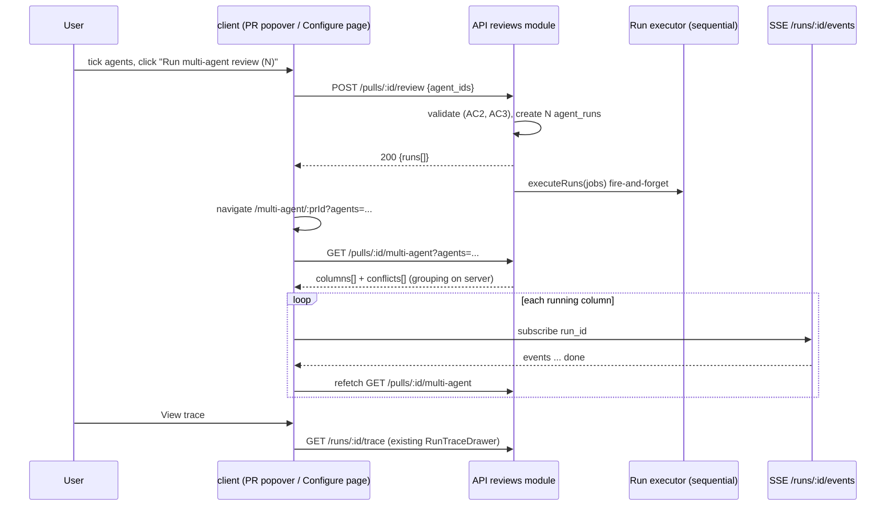

# Spec: Multi-Agent Review
Spec ID: SPEC-08
Status: implemented
Supersedes: None
Modules: server, client (plus the vendored `@devdigest/shared` contracts in both copies)

## Problem and user
A reviewer on a PR wants several review agents (for example Security Reviewer and Performance Reviewer) to look at the same PR, see each agent's verdict side by side, and see where the agents agree or disagree. Today:

- The review trigger accepts exactly one agent or "all enabled agents", never a chosen subset: `RunRequest` is `{ agentId?, all? }` (`server/src/vendor/shared/contracts/platform.ts:335-339`), resolved by `resolveTargets` (`server/src/modules/reviews/service.ts:47-58`).
- The PR header's `RunReviewDropdown` runs one agent per click or "Run all" (`client/src/app/repos/[repoId]/pulls/[number]/_components/RunReviewDropdown/RunReviewDropdown.tsx:41-82`); it cannot pick a subset.
- There is no page that compares agents: the multi-agent contracts exist (`server/src/vendor/shared/contracts/observability.ts:22-86`) and their i18n strings exist (`client/messages/en/runs.json:2-15,124-148`), but no route or screen uses them, and no finding-grouping rule exists in code.
- A finding carries no attribution of its own (`server/src/vendor/shared/contracts/review-api.ts:21-25`); the agent is known only through its parent review (`review-api.ts:29-34`). The parallel feature "Export to CI" (worktree B, `specs/export-to-ci.md`) needs a finding's producing agent and agreeing agents when it ingests CI results.

This lab feature is deliberately simple: it wires the ready run executor, SSE stream, run trace drawer and contracts into one new flow, and adds no table, no service and no execution mode.

## Goals / Non-goals
### Goals
- G1 Start one review of a PR with a user-chosen set of enabled agents, from the PR page and from a dedicated Configure page.
- G2 Show the latest run of every selected agent side by side (Columns or Tabs), live while running, with each agent's trace reachable through the existing run trace drawer.
- G3 Show where agents agree and disagree, using one deterministic grouping rule computed on the server.
- G4 Expose finding attribution (producing agent, group, agreeing agents) in the API contract, so worktree B can read it and reuse the same grouping rule.
- G5 Add the "Multi-Agent Review" sidebar item, with a defined merge order against worktree B.

### Non-goals
- NG1 Parallel execution. Agents keep running one after another in the existing executor (`server/src/modules/reviews/run-executor.ts:154-181`). The UI says "sequential"; "fan-out via worktrees" in the mock is illustrative only and is out of scope.
- NG2 A persisted multi-agent session or history. No new table, no new column, no migration; the `multi_agent_runs` stub (`server/src/db/schema/runs.ts:43-52`) stays unused.
- NG3 A new trace or log sidebar. "View trace" reuses the existing `RunTraceDrawer`, relocated to a shared folder (see Ownership) with no behaviour change; no second drawer is built.
- NG4 New finding actions. "Learn" and "Reply to author" from the mock are not built; only the actions `FindingCard` already has are shown.
- NG5 Any change to the CI flow, `ci_*` tables, `contracts/eval-ci.ts`, `agent-runner/`, or the CI UI scaffolds (`ExportWizardSteps`, `LiveLogStream` as a CI view, `AutoTriggerStatus`). Those belong to worktree B.
- NG6 Model-written reasons for "did not flag". An agent that did not flag a location shows "did not flag" with no invented reason.
- NG7 Any change to `groundFindings()` (`reviewer-core/src/grounding.ts:75`) or `wrapUntrusted()` (`reviewer-core/src/prompt.ts:32`). Every agent run keeps both invariants exactly as today.
- NG8 Running disabled agents from the multi-agent surfaces. Only enabled agents are listed.

## User stories
- US1. As a reviewer, I want to trigger one review with a chosen set of agents through the API, so that I pay only for the agents I need.
- US2. As a reviewer on a PR page, I want to tick agents in the "Run Review" popover and run them, so that I can start a multi-agent review without leaving the PR.
- US3. As a reviewer, I want a Configure page where I pick a PR and agents and see an estimate, so that I know the expected time and cost before I run.
- US4. As a reviewer, I want a results page with one column (or tab) per selected agent, so that I can compare verdicts, scores and findings.
- US5. As a reviewer, I want to open the trace and live log of any agent from the results page, so that I can see why it produced what it did.
- US6. As a reviewer, I want a "Where agents disagree" section, so that I can focus on locations only some agents flagged.
- US7. As the Export-to-CI feature (worktree B), I want every finding to carry its producing agent and its agreeing agents under one shared rule, so that CI results are attributed the same way as local ones.
- US8. As a user, I want a "Multi-Agent Review" item in the sidebar, so that I can reach the feature from anywhere.

## Acceptance criteria (EARS)
- AC1 (US1). WHEN `POST /pulls/:id/review` receives `agent_ids` holding 1 to 6 unique ids of enabled agents of the workspace, the API (shall) create one agent run per id and return `runs` in the same order as `agent_ids`. _(observable: HTTP 200; `runs.length === agent_ids.length`; `runs[i].agent_id === agent_ids[i]`; one new `agent_runs` row per id)_
- AC2 (US1). IF `agent_ids` is empty, holds a duplicate, holds more than 6 ids, or is sent together with `agentId` or `all`, THEN the API (shall) return 400 with `error.code` `invalid_run_request` and (shall) create no agent run. _(observable: HTTP 400; `error.code`; `agent_runs` row count unchanged)_
- AC3 (US1). IF an id in `agent_ids` does not name an enabled agent of the workspace, THEN the API (shall) return 404 and (shall) create no agent run for any id of that request. _(observable: HTTP 404; `agent_runs` row count unchanged)_
- AC4 (US2). WHEN the user opens the "Run Review" popover on the PR page, the popover (shall) list every enabled agent, and only enabled agents, as a checkbox, with the primary button labelled "Run multi-agent review (N)" where N is the number of checked boxes and the button disabled while N = 0. _(observable: one checkbox per enabled agent from `GET /agents`; disabled agents absent; button text updates with N; `disabled` when N = 0; "Clear" unchecks all)_
- AC5 (US2, US3). WHEN the user submits a selection of N agents from the PR popover or from the Configure page, the client (shall) send one `POST /pulls/:id/review` with `agent_ids` in selection order and, on success, navigate to `/multi-agent/<prId>?agents=<id1>,<id2>,…` in the same order. _(observable: exactly one request with the body `{ agent_ids }`; router location after the 200 response)_
- AC6 (US3). WHEN the user opens `/multi-agent` with at least one enabled agent, the Configure page (shall) show a PR selector listing the open PRs of the active repo, and one selectable card per enabled agent with its name, the summary of that agent's latest review on the selected PR (from `GET /pulls/:id/reviews` narrowed by `latestReviewPerAgent`; empty when the agent has no review on that PR), and an estimate from `GET /agents/:id/stats` over the last 30 days (`avg_latency_ms`, `avg_cost_usd`), shown as "no estimate yet" when `runs` is 0 or the value is null. _(observable: PR options equal the open PRs from `usePulls`; one card per enabled agent; the card summary equals the newest review summary of that agent on the selected PR; the estimate text or the "no estimate yet" key; the stats request carries a 30-day period)_
- AC7 (US3). WHILE at least one agent card is selected on the Configure page, the footer (shall) show "≈ <sum of estimated durations> · <sum of estimated costs> · sequential", counting only agents that have an estimate. _(observable: the footer text equals the sums of the selected cards' estimates; the word "sequential" from i18n)_
- AC8 (US3). IF the workspace has no enabled agent, THEN the Configure page (shall) show the empty state "Enable agents to run reviews" with a "Go to Agents" button that links to `/agents`, and (shall) show no PR selector and no run button. _(observable: the `runs.page.noAgents.*` strings; link `href="/agents"`; selector and run button absent)_
- AC9 (US4). WHEN the user opens `/multi-agent/<prId>?agents=<ids>`, the results page (shall) show one column per listed agent, in URL order, each holding the latest run of that agent on that PR: agent name, duration, cost, score, and findings count. _(observable: column count and order equal the `agents` param; values equal `GET /pulls/:id/multi-agent` → `columns[]`; score "—" when `score` is null)_
- AC10 (US4). The results page header (shall) show "<N> agents · sequential · <total> total · <cost>", where total is the sum of the columns' durations and cost is the sum of the columns' known costs. _(observable: the header text equals the sums of `columns[].duration_ms` and `columns[].cost_usd`; no "parallel" or "worktrees" text)_
- AC11 (US4). WHILE a column's run has status `running`, the results page (shall) show that column as in progress and (shall) replace it with the finished column within 5 s of the run's SSE `done` event, without a page reload. _(observable: the column's in-progress state; the findings list visible after the stream completes; no navigation)_
- AC12 (US4). IF a column's run has status `failed` or `cancelled`, or the agent has no run on that PR, THEN its column (shall) show that state with the stored error text when there is one, and the other columns (shall) render normally. _(observable: status label per column; `columns[].error` text; neighbouring columns unchanged)_
- AC13 (US5). WHEN the user clicks "View trace" on a column or on a Tabs-view summary card, the results page (shall) open the existing `RunTraceDrawer` for that column's `run_id`, on the Live log tab while the run is running and on the Trace tab otherwise. _(observable: the drawer titled from `runs.drawer.title` with that agent's name; the active tab; the same tabs and "Copy raw output" footer as on the PR page)_
- AC14 (US4). WHEN the user switches the view toggle to Tabs, the results page (shall) show one tab per column with the agent name and score, and for the selected tab a summary card (score, review summary, "View trace", duration, cost) and its findings rendered with the existing `FindingCard`, whose only actions are Accept, Dismiss and Turn into eval case. _(observable: toggle `aria-checked`/`aria-selected` state; tab count; no "Learn" or "Reply to author" control)_
- AC15 (US6). The "Where agents disagree" section (shall) list one row per finding group from `conflicts[]`, with one cell per column: the severity pill and title for each agent that flagged the location, "did not flag" for each other agent with a `done` run; WHEN "Show only conflicts" is on, the section (shall) hide rows whose `is_conflict` is false. _(observable: row count with the toggle off = `conflicts.length`; with it on = the count of `is_conflict === true`; cell texts; the `runs.conflicts.empty` text when no row remains)_
- AC16 (US7). The API (shall) put two findings from different agents into the same group if and only if they cite the same `file` and their inclusive ranges `[start_line, end_line]` overlap, closing the relation transitively, and (shall) give each group a `group_key` that does not depend on the order of the input findings. _(observable: unit test on the grouping rule — same input in any order gives the same groups and keys; touching ranges `[1,3]`/`[3,5]` group; `[1,3]`/`[4,5]` do not; different files never group)_
- AC17 (US7). WHEN `GET /pulls/:id/reviews` or `GET /pulls/:id/multi-agent` returns findings, every finding (shall) carry `agent_id`, `agent_name`, `group_key` and `agreed_by`, where `agreed_by` lists the findings of other agents in the same group. _(observable: response JSON fields per the Contracts section; `agreed_by` never contains a finding from the finding's own agent)_
- AC18 (US8). The sidebar's GLOBAL section (shall) hold "Multi-Agent Review" (`/multi-agent`, key `multi-agent`) directly before "Agent Performance", marked current on every `/multi-agent` route. _(observable: `NAV` GLOBAL keys `["multi-agent", "agent-performance"]` before worktree B merges; `aria-current="page"` on `/multi-agent` and `/multi-agent/<prId>`)_
- AC19 (US8). WHEN worktree A has merged into `L07-lab-hw` and before worktree B merges, the navigation (shall) be verified on its own: the sidebar test and a manual check of the GLOBAL section pass with A's item only, and B's later `ci-runs` item is appended after `agent-performance` without moving A's item. _(observable: `client/src/components/app-shell/nav.test.tsx` green after A's merge; after B's merge, GLOBAL keys `["multi-agent", "agent-performance", "ci-runs"]`)_

## Workflow

## Contracts
All wire fields are snake_case. Every shape below changes in **both** `server/src/vendor/shared/contracts/` and `client/src/vendor/shared/contracts/`, identically.

### `RunRequest` (request body of `POST /pulls/:id/review`) — `contracts/platform.ts`
| Field | Type | Nullability | Notes |
|---|---|---|---|
| `agentId` | string | optional | Unchanged (camelCase kept for compatibility with MCP `run_agent_on_pr`, `mcp/src/tools/run-agent-on-pr.ts:71-72`) |
| `all` | boolean | optional | Unchanged |
| `agent_ids` | string[] | optional | New. 1-6 unique enabled agent ids; exclusive with `agentId` and `all` |

Validation of `agent_ids` (exclusivity with `agentId`/`all`, 1-6 ids, no duplicates, every id an enabled agent of the workspace) happens in the service's target resolution (`resolveTargets`, `server/src/modules/reviews/service.ts:47-58`), The format checks (exclusivity, count, duplicates) return 400 `invalid_run_request`, as that code does today (`service.ts:57`). An id that is not an enabled agent of the workspace returns 404, as AC3 states, in the way the single-agent path does today (`service.ts:54`). It is not a schema refinement, because a schema failure answers 422 `validation_error` instead (server INSIGHTS "`body: Schema.optional()` rejects an empty POST with 422").

Errors: 400 `invalid_run_request` (AC2), 404 (AC3), 429 from the existing per-route limit (10/min, `server/src/modules/reviews/routes.ts:29`). The response shape `{ pr_id, runs[], reviews[] }` is unchanged (`routes.ts:44`).

### Finding attribution — added to `FindingRecord` (`contracts/review-api.ts`) and to the multi-agent column finding
| Field | Type | Nullability | Notes |
|---|---|---|---|
| `agent_id` | string | nullable | The producing agent; null when the parent review has no agent (`review-api.ts:32`) |
| `agent_name` | string | nullable | Display name of the producing agent |
| `group_key` | string | nullable | Group id under the AC16 rule; null for findings outside the grouping scope (below) |
| `agreed_by` | `AgreedBy[]` | always present, may be empty | Findings of other agents in the same group |

`AgreedBy`: `{ agent_id: string (always present), agent_name: string (nullable), finding_id: string (always present) }`.

Grouping scope: the newest review of each agent on the PR (the same "latest review per agent" rule as `client/src/lib/latest-reviews.ts:27` and `mcp/src/format.ts:57`). Findings of older reviews carry `group_key: null` and `agreed_by: []`. A review with a null `agent_id` is its own bucket and never agrees with another.

### `GET /pulls/:id/multi-agent?agents=<id>,<id>,…` → `MultiAgentRun` (`contracts/observability.ts`)
Changes to the existing shape (`observability.ts:23-86`):
| Shape.field | Change | Nullability |
|---|---|---|
| `MultiAgentRun.id` | No persisted session (NG2) | nullable, always null in this spec |
| `MultiAgentRun.ran_at` | Newest `ran_at` among columns | nullable (null when no column has a run) |
| `MultiAgentRun.total_duration_ms` | Sum of column durations (sequential) | unchanged, always present |
| `AgentColumn.run_id` | — | nullable (null when status is `none`) |
| `AgentColumn.status` | Enum becomes `done`, `failed`, `cancelled`, `running`, `none` | always present |
| `AgentColumn.error` | New: stored failure text | nullable |
| `AgentColumn.findings[]` | Becomes the full `FindingRecord` including attribution (needed by `FindingCard` in Tabs view) | always present, may be empty |
| `Conflict.group_key` | New | always present |
| `Conflict.end_line` | New | always present |
| `Conflict.is_conflict` | New: true when at least one column with a `done` run did not flag the group, or the flagging agents gave different severities (`observability.ts:61-64`) | always present |
| `ConflictTake.persona` | The agent name | unchanged |
| `ConflictTake.note` | The finding title for a flagging agent; empty string for `ignored` (NG6) | unchanged |

`conflicts[]` holds every group that at least one listed agent flagged, ordered by `file`, then `line`. Errors: 404 when the PR is unknown; 400 when `agents` is empty, holds a duplicate or more than 6 ids. An id that names a disabled agent of the workspace, or an agent with no run on the PR, returns a column with status `none` (`run_id: null`) and the agent's `agent_name`. A disabled agent that has a run on the PR still shows that latest run. An id that names no agent of the workspace (deleted, or belonging to another workspace) returns 404.

## Ownership, shared contracts and merge order
### Owned by worktree A (this spec)
- `server/src/modules/reviews/**`: subset trigger, the multi-agent read endpoint, and the grouping rule as a pure server function with no DB or I/O, exported so other server modules (worktree B's `ci/` ingest) can call it.
- `server/test/` files named for this feature (`multi-agent-*.test.ts`, `multi-agent-*.it.test.ts`).
- `client/src/app/multi-agent/**` (the new Configure and Results routes).
- `client/src/app/repos/[repoId]/pulls/[number]/_components/RunReviewDropdown/**`.
- `RunTraceDrawer` (today `client/src/app/repos/[repoId]/pulls/[number]/_components/RunTraceDrawer/`) and `FindingCard` with its `EvalCaseAction` (today `client/src/app/repos/[repoId]/pulls/[number]/_components/FindingCard/`). Both move, with no behaviour change, to `client/src/components/run-trace-drawer/` and `client/src/components/finding-card/` (kebab-case folder, PascalCase file inside), so that the PR page and `/multi-agent` share them. Their importers and tests are updated to the new location.
- `client/messages/en/runs.json` (`page.*`, `conflicts.*`) and `client/messages/en/prReview.json` (`runReview.*`).
- Sanctioned vendor edit: the GLOBAL group in `client/src/vendor/ui/nav.ts:39-44`, plus `client/src/components/app-shell/nav.test.tsx`.

### Shared contracts and who may change them
| Contract | Owner | Worktree B |
|---|---|---|
| Multi-agent section of `contracts/observability.ts` (both copies) | A | reads only |
| `RunRequest` in `contracts/platform.ts` (both copies) | A | reads only |
| Attribution fields on `FindingRecord` in `contracts/review-api.ts` (both copies) | A | reads only |
| The grouping rule (AC16) | A | calls it; never re-implements or changes it |
| `contracts/eval-ci.ts`, `ci_*` tables, `agent_runs.source` | B | A does not touch |

Any change B needs to an A-owned contract goes back to this spec as a revision, not into B's branch.

### Merge order
1. Worktree A (`feat/multi-agent-review`) merges into `L07-lab-hw` first.
2. Navigation check right after A's merge (AC19).
3. Worktree B (`feat/export-to-ci`) rebases on the result, reads the attribution and the grouping rule, appends `ci-runs` to GLOBAL after `agent-performance`, and merges second.

## Verification commands
`pnpm` is broken in this environment; use the local binaries (root `AGENTS.md` "Commands"). Install reviewer-core deps first: `cd reviewer-core && npm ci`.

| Package | Command |
|---|---|
| server typecheck | `cd server && ./node_modules/.bin/tsc --noEmit` |
| server hermetic | `cd server && ./node_modules/.bin/vitest run --exclude '**/*.it.test.ts'` |
| server integration (Docker) | `cd server && ./node_modules/.bin/vitest run .it.test` |
| client typecheck | `cd client && ./node_modules/.bin/tsc --noEmit` |
| client tests | `cd client && ./node_modules/.bin/vitest run` |
| client build | `cd client && ./node_modules/.bin/next build` |
| mcp (compatibility) | `cd mcp && npm test` |
| contract copies | `diff server/src/vendor/shared/contracts/<file> client/src/vendor/shared/contracts/<file>` for `observability.ts`, `platform.ts`, `review-api.ts`. The touched sections must be identical. |

## Edge cases
- EC1. Double submit: the submit button is disabled while the request is pending, so one click sends one request — covered by AC5.
- EC2. Rate limit: the review endpoint allows 10 requests/min (`server/src/modules/reviews/routes.ts:29`). One multi-agent submit is one request whatever N is. On a 429 the popover or Configure page shows a rate-limited message and does not navigate — covered by AC5 (navigation only on success) and NFR2.
- EC3. One agent fails (provider key missing, model error): its run is persisted as failed with its trace (`run-executor.ts:424-448`) and the others continue (`run-executor.ts:172-180`) — covered by AC12.
- EC4. The diff fails to load: every queued run fails (`run-executor.ts:99-129`) — every column shows failed, covered by AC12.
- EC5. An agent in the URL has no run on the PR (a hand-edited or old link): status `none` — covered by AC12.
- EC6. An agent in the URL was disabled after the run: the column still shows its latest run on the PR, or status `none` when it has none. An agent that was deleted, or belongs to another workspace, makes `GET /pulls/:id/multi-agent` return 404 (Contracts).
- EC7. The server restarted mid-run: stale `running` rows are reaped on boot (`service.ts:93-96`) and the column then shows failed — covered by AC12.
- EC8. A user cancels a run from the drawer or the PR page: the column shows cancelled — covered by AC12.
- EC9. The user re-runs the same agents: the page shows each agent's newest run (Contracts, grouping scope), not a union — covered by AC9.
- EC10. Two tabs: both tabs read the same server state; a run started in one shows in the other on refetch — covered by AC9 and AC11.
- EC11. Many agents: the selection cap is 6 (AC2). Columns scroll horizontally without clipping (NFR4).
- EC12. Long finding titles and summaries wrap or truncate with the full text available; no layout overflow (NFR4).
- EC13. No findings at all: columns show `runs.column.noFindings`; the conflicts section shows `runs.conflicts.empty` — covered by AC15.
- EC14. A PR with no head-moved check: a stale run (head moved since) still shows; staleness is not part of this spec — NG2.
- EC15. No open PRs in the active repo: the PR selector is empty and the run button disabled — covered by AC6 and AC4's disabled rule. The no-repo case shows the selector's `runs.page.noRun.bodySelect` text.
- EC16. Cost unknown for a model (`cost_usd` null): it is excluded from sums, and a column shows "—" — covered by AC10.
- EC17. Worktree B ingests CI findings from a CI artifact: B applies the AC16 rule to them, and the attribution is read from A's contract — covered by AC16, AC17 and the ownership table.

## Non-functional requirements
- NFR1. Performance — `GET /pulls/:id/multi-agent` with 6 agents and 300 findings in total responds in under 500 ms at p95 on the dev stack; grouping is computed per request and never calls a model — verify: server-integration (timed request) and server-unit (grouping has no I/O).
- NFR2. Limits and rate limits — The existing limits stay: review trigger 10 requests/min (`routes.ts:29`), global 120 requests/min (`server/src/app.ts:119`), SSE unlimited (`routes.ts:51`). The selection cap is 6 agents — verify: server-integration for the 400 above 6. A 429 needs its own dev app, because per-route limits never fire under NODE_ENV=test (server INSIGHTS).
- NFR3. Reliability — One agent's failure never changes another column's status or findings (existing isolation, `run-executor.ts:172-180`) — verify: server-integration with one agent whose provider key is missing.
- NFR4. Accessibility (WCAG 2.2 AA) —
  - checkboxes, agent cards, the view toggle and "Show only conflicts" are reachable and operable by keyboard with a visible focus ring;
  - the view toggle exposes its selected state (`aria-checked` or `aria-selected`);
  - the score ring has a text equivalent ("Score 64 of 100");
  - severity is never shown by colour alone (icon or text too);
  - a column's change from running to done is announced through a polite live region;
  - the columns view scrolls horizontally at 320 CSS px without clipping text.

  Verify: client.
- NFR5. i18n — every new string lives in `client/messages/en/runs.json` (results, Configure, conflicts) or `client/messages/en/prReview.json` (popover), none inline in JSX. The existing `runs.page.meta` "fan-out via p-queue" (`runs.json:135`) is replaced with the sequential wording, and `runs.page.subtitle` (`runs.json:126`) no longer says "in parallel" — verify: client.
- NFR6. Security — Finding titles, summaries, rationales and suggestions are model output and render only as text or through the existing finding renderer, never as raw HTML. No new text enters any prompt — verify: client (a title holding `` renders as text).
- NFR7. Compatibility —
  - `agentId` and `all` keep working unchanged, so MCP `run_agent_on_pr` (`mcp/src/tools/run-agent-on-pr.ts:71-72`) is unaffected;
  - the attribution fields are additive, so existing clients of `GET /pulls/:id/reviews`, including MCP `get_findings` (`mcp/src/api/schemas.ts:76`), still parse;
  - the server and client contract copies carry identical shapes for every changed section.

  Verify: `cd mcp && npm test`, plus the contract `diff` in Verification commands.
- NFR8. Observability — The trigger logs one info line per run with `correlation_id`, `runId`, agent and `prId`, as today (`run-executor.ts:156-159`). No prompt text, diff or finding text is logged (server INSIGHTS "Prompt logs are metadata-only") — verify: server-unit on the log fields.

## Inputs and provenance
| Input | Source | Trusted? | Used in |
|---|---|---|---|
| `agent_ids`, `agents` URL param | user | no | validation, DB lookups |
| Agent name, summary of last review | DB (agent authored; summary is model output) | name yes; summary no | UI |
| Finding title, rationale, suggestion, file, lines | model output (grounded) | no | UI, grouping |
| PR title in selector | GitHub | no | UI |
| Run trace, raw output, live log | DB / SSE (model output and PR text) | no | existing drawer |
| Estimates | DB aggregates (agent stats) | yes | UI |

## Untrusted inputs
- `agent_ids` / `agents` param — reaches DB lookups — threat: broken access control (another workspace's agent), injection — the API (shall) accept only ids of agents in the caller's workspace and reject anything else with 400/404 — covered by: AC2, AC3.
- Finding text and review summary (model output, possibly echoing a prompt-injected PR) — reaches the UI — threat: stored XSS — the client (shall) render it as text only — covered by: NFR6.
- PR title — reaches the PR selector — threat: stored XSS — rendered as text — covered by: NFR6.
- Finding file and lines — reach grouping and display — threat: none beyond display. Findings are already grounded to the diff by `groundFindings()` (`reviewer-core/src/grounding.ts:75`), which this feature relies on and does not change — covered by: AC16, NG7.
- PR body, diff, repo files in the agents' prompts — reach prompts only through the unchanged executor, inside `wrapUntrusted()` (`reviewer-core/src/prompt.ts:32`) — threat: prompt injection — no new prompt input is added — covered by: NG7, NFR6.

## Traceability
| AC | Story | Goal | Covers (EC / NFR / untrusted input) | Verify by |
|---|---|---|---|---|
| AC1 | US1 | G1 | NFR7 | server-integration |
| AC2 | US1 | G1 | EC11, NFR2, `agent_ids` | server-integration |
| AC3 | US1 | G1 | `agent_ids` | server-integration |
| AC4 | US2 | G1 | EC15 | client |
| AC5 | US2, US3 | G1 | EC1, EC2 | client |
| AC6 | US3 | G1 | EC15 | client |
| AC7 | US3 | G1 | EC16 | client |
| AC8 | US3 | G1 | — | client |
| AC9 | US4 | G2 | EC6, EC9, EC10 | client + server-integration |
| AC10 | US4 | G2 | EC16, NFR5 | client |
| AC11 | US4 | G2 | EC10, NFR4 | client |
| AC12 | US4 | G2 | EC3, EC4, EC5, EC7, EC8, NFR3 | client + server-integration |
| AC13 | US5 | G2 | — | client |
| AC14 | US4 | G2 | NFR4, NFR6 | client |
| AC15 | US6 | G3 | EC13 | client + server-unit |
| AC16 | US7 | G3, G4 | EC17, NFR1, finding file/lines | server-unit |
| AC17 | US7 | G4 | EC17, NFR7 | server-integration |
| AC18 | US8 | G5 | — | client |
| AC19 | US8 | G5 | — | client + manual (post-merge check across two branches; no single lane sees both merges) |

## Decisions
- Q1 — accepted (a) — keep sequential execution; the UI says "sequential"; total = sum — landed in: NG1, AC7, AC10, NFR5.
- Q2 — accepted (a) — no new table; latest run per selected agent; agent set in URL — landed in: NG2, AC5, AC9, Contracts.
- Q3 — accepted (b) — server-side pure grouping rule: same file + overlapping inclusive line ranges; worktree B reuses it — landed in: AC16, ownership table.
- Q4 — accepted — `agent_id`, `agent_name`, `group_key`, `agreed_by[]` on the multi-agent response and on `FindingRecord` from `GET /pulls/:id/reviews`; A owns the contracts, B reads them — landed in: AC17, Contracts, ownership table.
- Q5 — accepted (a) — A adds `multi-agent` to GLOBAL before `agent-performance` and updates `nav.test.tsx`; B appends `ci-runs` — landed in: AC18, AC19, merge order.
- Q6 — accepted (a) — the checkbox popover replaces the dropdown menu, and lists enabled agents only — landed in: AC4, AC5, NG8.
- Q7 — accepted — non-goals as proposed; only the existing `FindingCard` actions are shown — landed in: NG1-NG7, AC14.
- Selection cap — user delegated the value; set to 6 as a simple default — landed in: AC2, NFR2, OQ1.
- Grouping scope = newest review per agent (follows from Q2a; mirrors `latest-reviews.ts:27`) — landed in: Contracts, OQ2.
- P1 — accepted — `agent_ids` on `RunRequest`, exclusive with `agentId`/`all` — landed in: AC1-AC3, Contracts.
- P2 — accepted — estimates from run history; "no estimate yet" with none — landed in: AC6, AC7.
- P3 — accepted — the card description is the latest review summary, else empty — landed in: AC6.
- P4 — accepted — live, failed, cancelled and none column states; score "—" when null — landed in: AC9, AC11, AC12.
- P5 — accepted — "View trace" reuses `RunTraceDrawer` — landed in: AC13, NG3.
- P6 — accepted — no invented "did not flag" reason — landed in: AC15, NG6, Contracts.
- P7 — accepted — accurate sequential wording — landed in: AC10, NFR5.
- P8 — accepted — the existing empty-state strings — landed in: AC8.
- P9 — accepted — one request per submit; double-submit guard; 429 message — landed in: AC5, EC1, EC2.
- P10 — accepted — accessibility requirements — landed in: NFR4.
- P11 — accepted — model output rendered as text; no new prompt input — landed in: NFR6, NG7.
- Revision 2026-10-23 — accepted — the AC6 summary and estimate sources; the `none` vs 404 rule for the multi-agent read; `RunTraceDrawer` and `FindingCard` relocated to `client/src/components/`; `agent_ids` validated in the service, not the schema — landed in: AC6, Contracts, EC6, NG3, Ownership.
- Non-blocking — accepted — routes `/multi-agent` and `/multi-agent/[prId]?agents=…`, open PRs of the active repo, this file name, SPEC-08 — landed in: AC5, AC6, AC9.

## Open questions
- OQ1. Is 6 the right cap on selected agents? With sequential runs of about 6-8 s each, 6 agents take roughly 40-50 s. — category: C5 — owner: user — blocks: none (6 is in force until changed) — marker: none.
- OQ2. Should findings of older reviews (not the newest per agent) also be grouped, or stay `group_key: null`? — category: C3 — owner: user — blocks: none — marker: none.
- OQ3. Where exactly does worktree B call the grouping rule: in the server's `ci/` ingest (assumed here) or in `agent-runner/`? If `agent-runner/`, the rule would need to live in `reviewer-core`, which changes the ownership table. — category: C4 — owner: user with worktree B — blocks: none for A — marker: none.
- ~~OQ4~~ closed 2026-10-23 — the estimates come from `GET /agents/:id/stats` (`server/src/modules/agent-performance/routes.ts:48`) over the last 30 days; "no estimate yet" when `runs` is 0 or the value is null. The card summary is the agent's latest review on the selected PR. Landed in AC6.
- OQ5. The file name `specs/multi-agent-review.md` departs from the `YYYY-MM-DD-<slug>.md` convention (`.claude/skills/spec-writing/references/template.md:4`); it is kept by user request. — category: C6 — owner: user — blocks: none — marker: none.
- OQ6. The spec has 19 ACs, above the ~15 guideline. Split it into "API + attribution" (AC1-AC3, AC16, AC17) and "UI" (the rest)? It is kept as one spec because the lab pairs one spec with one worktree. — category: C1 — owner: user — blocks: none — marker: none.

## Code anchors
- `server/src/modules/reviews/routes.ts:27-45` — `POST /pulls/:id/review`, rate limit 10/min (`:29`), body parsed with `RunRequest`, returns `{ pr_id, runs, reviews }`.
- `server/src/modules/reviews/routes.ts:49-93` — SSE `GET /runs/:id/events`, replay-first, `rateLimit: false`.
- `server/src/modules/reviews/routes.ts:96-133` — `GET /pulls/:id/runs/active`, `GET /pulls/:id/runs`, `DELETE /runs/:id`, `POST /runs/:id/cancel`, `GET /runs/:id/trace`, `GET /pulls/:id/reviews`.
- `server/src/modules/reviews/service.ts:47-58` — `resolveTargets`: `all` → enabled agents, `agentId` → one agent, else 400 `invalid_run_request`.
- `server/src/modules/reviews/service.ts:104-140` — `runReview` creates one `agent_runs` row per target up front, then fires `executeRuns` without awaiting.
- `server/src/modules/reviews/service.ts:93-96` — `reapStaleRuns` on boot.
- `server/src/modules/reviews/run-executor.ts:120-152` — the diff and intent are loaded once for all jobs.
- `server/src/modules/reviews/run-executor.ts:154-181` — agents run sequentially (`for … await`), with per-agent failure isolation.
- `server/src/modules/reviews/run-executor.ts:99-118` — a pre-work failure fails every queued run.
- `server/src/modules/reviews/run-executor.ts:335-371` — a review is persisted with `agentId`, `runId`, `score`; `completeAgentRun` stores duration, cost, score.
- `server/src/modules/reviews/run-executor.ts:424-448` — failure or cancel persists status, error text and the buffered trace.
- `server/src/db/schema/runs.ts:8-33` — `agent_runs` (status, error, source `local|ci`, score, cost_usd, duration_ms).
- `server/src/db/schema/runs.ts:36-41` — `run_traces` single jsonb document per run.
- `server/src/db/schema/runs.ts:43-52` — `multi_agent_runs` stub: id, workspace_id, pr_id, ran_at only.
- `server/src/vendor/shared/contracts/platform.ts:335-339` — `RunRequest { agentId?, all? }`.
- `server/src/vendor/shared/contracts/review-api.ts:21-44` — `FindingRecord` (no agent field); `ReviewRecord.agent_id`/`agent_name`.
- `server/src/vendor/shared/contracts/findings.ts:47-67` — `Finding` with `file`, `start_line`, `end_line`, `confidence`, `suggestion`.
- `server/src/vendor/shared/contracts/observability.ts:22-86` — `AgentColumnFinding`, `AgentColumn`, `ConflictTake`, `Conflict`, `MultiAgentRun`; the comment names `GET /pulls/:id/multi-agent` (`:74`).
- `server/src/vendor/shared/contracts/observability.ts:179-180` — `AgentStats.avg_cost_usd`, `avg_latency_ms`.
- `server/src/vendor/shared/contracts/eval-ci.ts:228-238` — `CiResultArtifact` holds counts only (worktree B's).
- `server/src/modules/eval/domain.ts:133` — existing matcher: exact file and inclusive range overlap.
- `reviewer-core/src/review/merge-conventions.ts:82,136-147` — convention clustering (Jaccard 0.6 or overlap); not used for findings.
- `server/src/app.ts:119` — global rate limit 120/min.
- `client/src/app/repos/[repoId]/pulls/[number]/_components/RunReviewDropdown/RunReviewDropdown.tsx:41-82` — current menu: Run all + one agent per click, lists disabled agents too.
- `client/src/app/repos/[repoId]/pulls/[number]/_components/RunTraceDrawer/RunTraceDrawer.tsx:19-49` — props `runId, agentName, prNumber, findings, running, onClose`; tabs Trace/Live log; uses `useRunTrace`, `useRunEvents`.
- `client/src/app/repos/[repoId]/pulls/[number]/_components/FindingCard/FindingCard.tsx:101-116` — actions Accept, Dismiss, `EvalCaseAction`.
- `client/src/lib/hooks/reviews.ts:134,178` — `useRunReview`, `useRunEvents(runIds)`.
- `client/src/lib/hooks/core.ts:100` — `usePulls(repoId)`.
- `client/src/lib/latest-reviews.ts:27` — `latestReviewPerAgent`; mirrored by `server/src/modules/pulls/helpers.ts` `countedReviewIds` and `mcp/src/format.ts:57`.
- `client/src/vendor/ui/nav.ts:39-44` — GLOBAL holds only `agent-performance`; no Memory item exists.
- `client/src/components/app-shell/nav.test.tsx:35-49` — pins GLOBAL to `["agent-performance"]` and asserts `multi-agent`/`ci-runs` absent (SPEC-04 AC1).
- `client/src/components/app-shell/helpers.ts:28` — `/multi-agent` pathname → nav key `multi-agent`.
- `client/messages/en/shell.json:26` — `nav.multi-agent` "Multi-Agent Review".
- `client/messages/en/runs.json:2-15,124-148` — viewTrace, column, conflicts, page strings (incl. `noAgents`, `meta` "fan-out via p-queue").
- `mcp/src/tools/run-agent-on-pr.ts:71-72` — MCP sends `{ agentId }` or `{ all: true }`.
- `mcp/src/api/schemas.ts:76` — MCP parses `agent_id` on reviews.

## Changelog
- 2026-10-23 — draft created
- 2026-10-23 — approved by the user. The approval came with five changes:
  - AC6 now names the card summary source (the latest review on the selected PR) and the estimate source (`GET /agents/:id/stats`, last 30 days); OQ4 is closed.
  - The `GET /pulls/:id/multi-agent` rule is aligned with EC6: a disabled agent or one with no run gives a `none` column; an unknown or foreign id gives 404.
  - Ownership: `RunTraceDrawer` and `FindingCard` are relocated to `client/src/components/`; the NG3 wording is updated.
  - The `agent_ids` validation is placed in the service's target resolution (400, not 422).
